# Строгий учебный курс по reverse engineering и EH/Unwind Analyzer

## Назначение издания

Это последовательный технический курс для читателя без исходной подготовки. Он вводит понятия в порядке зависимостей, выводит связи между C, машинным исполнением, Windows x64 ABI, PE/COFF, обработкой исключений и reverse engineering, а затем разбирает фактический исходный код EH/Unwind Analyzer по модулям, данным, ошибкам, тестам и отчётам.

Материал не заявляет, что чтение одной книги автоматически заменяет практику профессионального reverse engineer. Он формирует строгий фундамент именно для понимания проекта, его защиты и дальнейшей практической подготовки.

Версия проекта: `1.0.0`. Версия report schema: `1.1.0`.

# EH/Unwind Analyzer с абсолютного нуля: строгий учебный курс

## Назначение курса

Этот курс предназначен для читателя, который не изучал системное программирование, архитектуру процессоров, устройство операционных систем, форматы исполняемых файлов и обратную разработку. Отсутствие предварительной подготовки учитывается порядком изложения, но не снижением технической точности.

Термины не заменяются приблизительными бытовыми аналогиями. Каждое понятие вводится через:

1. набор уже определённых предпосылок;
2. точное техническое определение;
3. внутреннюю структуру;
4. свойства и инварианты;
5. отношения с соседними понятиями;
6. фактическое представление в памяти, файле или исходном коде;
7. место в архитектуре EH/Unwind Analyzer;
8. способ независимой проверки.

Цель курса — сформировать связную техническую модель, а не набор формулировок для запоминания.

## Принцип зависимости понятий

Сложное системное понятие обычно зависит от нескольких более простых. Например, невозможно строго определить `RUNTIME_FUNCTION`, если ранее не определены:

- байт и целое число фиксированной разрядности;
- файл и файловое смещение;
- машинная инструкция и функция;
- виртуальная память и виртуальный адрес;
- исполняемый образ Windows;
- RVA;
- секция PE;
- соглашение о вызовах Windows x64;
- стековый кадр;
- исключение;
- раскрутка стека.

Поэтому материал организован как ориентированный граф зависимостей. Новый термин используется только после определения его непосредственных предпосылок.

Основная последовательность:

```text
данные и числа
-> машинное представление
-> исходный код и трансляция
-> процессор и набор инструкций
-> память и адреса
-> функции и соглашение о вызовах
-> операционная система, процесс и поток
-> формат PE и загрузка образа
-> исключения Windows
-> x64 unwind metadata
-> статический и динамический анализ
-> архитектура и исходный код проекта
-> эвристическая интерпретация
-> отчёты, тестирование и интеграция
```

## Стандарт введения английского термина

Английские обозначения сохраняются, потому что они используются:

- в документации Microsoft и Intel;
- в исходном коде;
- в именах структур Windows;
- в интерфейсах Ghidra и debugger;
- в научной и инженерной литературе;
- в отчётах проекта.

При первом использовании термин оформляется следующим образом:

> **`File offset` — файловое смещение.** Неотрицательное целое число, равное количеству байтов от начала файла до рассматриваемого байта или поля.

После определения раскрываются:

- область применимости;
- единицы измерения;
- допустимый диапазон;
- способ вычисления;
- отличие от близких терминов;
- типичные ошибки использования.

Перевод не заменяет английское название. Например, слова `image`, `module`, `file` и `process` могут в обычном языке переводиться неоднозначно, но в системном контексте имеют разные технические значения.

## Уровни технического утверждения

В курсе различаются четыре класса утверждений.

### Нормативное утверждение

Следует из официальной спецификации или документации интерфейса. Пример: `RUNTIME_FUNCTION` для AMD64 содержит три 32-битных image-relative поля.

### Утверждение о реализации

Следует из фактического исходного кода EH/Unwind Analyzer. Пример: проект ограничивает глубину следования по chained unwind records значением из диапазона `1..16`.

### Наблюдение

Получено при исследовании конкретного бинарного файла или выполнения процесса. Пример: у `benign_richer.exe` каталог исключений имеет RVA `0x3000` и размер `0x24`.

### Аналитический вывод

Получен путём интерпретации фактов. Пример: размещение unwind metadata в секции с разрешением записи повышает приоритет ручной проверки.

Эти классы не взаимозаменяемы. Эвристический вывод проекта не является правилом PE/COFF. Нормативно допустимая структура не обязательно безопасна. Наблюдение одного динамического запуска не доказывает поведение всех возможных путей.

## Требование полноты объяснения

Термин считается раскрытым, если читатель может ответить на следующие вопросы.

1. Каково его точное определение?
2. В какой системе координат или модели он существует?
3. Какими единицами и типами представляется?
4. Кто создаёт соответствующий объект?
5. Кто его использует?
6. Каков его жизненный цикл?
7. Какие инварианты должны выполняться?
8. Как он связан с предыдущими и последующими объектами?
9. Как он представлен в исследуемом файле или процессе?
10. Какая функция проекта его читает, проверяет или сериализует?
11. Какие ошибки возникают при неверной интерпретации?
12. Как проверить утверждение вручную?

Краткого перевода английского слова для этого недостаточно.

## Сквозной объект исследования

Теоретические определения связываются с фактическим файлом:

```text
tests/samples/bin/benign_richer.exe
```

Для него известны воспроизводимые свойства:

```text
архитектура: AMD64
формат optional header: PE32+
ImageBase: 0x140000000
SizeOfImage: 0x7000
RVA каталога исключений: 0x3000
размер каталога исключений: 0x24
количество RUNTIME_FUNCTION: 3
```

Эти значения не вводятся как готовый список для запоминания. В соответствующих разделах будет показано:

- из каких файловых смещений они считываются;
- почему байты интерпретируются именно так;
- как RVA связывается с секцией;
- как проект проверяет границы;
- как из 36 байтов получаются три записи по 12 байт;
- как каждая запись приводит к `UNWIND_INFO`;
- как результат попадает в JSON.

## Сквозной маршрут по исходному коду

При выполнении команды:

```text
eh_unwind_analyzer benign_richer.exe --heuristics --json report.json
```

данные проходят следующую последовательность:

```text
argv
-> parse_args
-> buf_init_from_file
-> Buf
-> pe_parse
-> PeImage
-> unwind_read_runtime_functions
-> RuntimeFunction[]
-> unwind_parse
-> UnwindSummary[]
-> heuristics_analyze
-> HeuristicReport
-> report_write_json_ex
-> report.json
```

Каждая стрелка означает конкретное преобразование данных. В проектной части курса будут разобраны:

- входной контракт функции;
- выходной контракт;
- владение памятью;
- проверки ошибок;
- сохранённые инварианты;
- соответствующий тест;
- поле итогового отчёта.

## Формат самостоятельного технического объяснения

После изучения темы читатель должен уметь строить объяснение в следующем порядке:

```text
Определение
Структура
Механизм
Инварианты
Представление
Связи
Реализация проекта
Проверка
Ограничения
```

Например, ответ о RVA не должен ограничиваться фразой «это относительный виртуальный адрес». Полный ответ должен определить базу относительности, разрядность поля в PE, отличие от VA и file offset, алгоритм преобразования, требования к секции, обработку zero-filled tail и использование в `pe_rva_to_fileoff`.

## Ожидаемый результат

После полного курса и практической работы читатель должен:

- читать исходный код ядра на C;
- прослеживать жизненный цикл данных;
- понимать PE32+ AMD64 на уровне используемых проектом структур;
- понимать Windows x64 calling convention и unwind model;
- вручную декодировать базовый `UNWIND_INFO`;
- объяснять статические findings и их ограничения;
- понимать устройство Windows dynamic collector;
- проверять отчёты по исходным байтам и коду;
- аргументированно обсуждать архитектуру, тестирование и интеграцию;
- продолжать изучение reverse engineering на технической основе.

Курс не заявляет достижение экспертного уровня только за счёт чтения. Экспертность требует самостоятельного анализа большого числа реальных объектов. Здесь формируется системная начальная подготовка и полное понимание конкретного проекта.

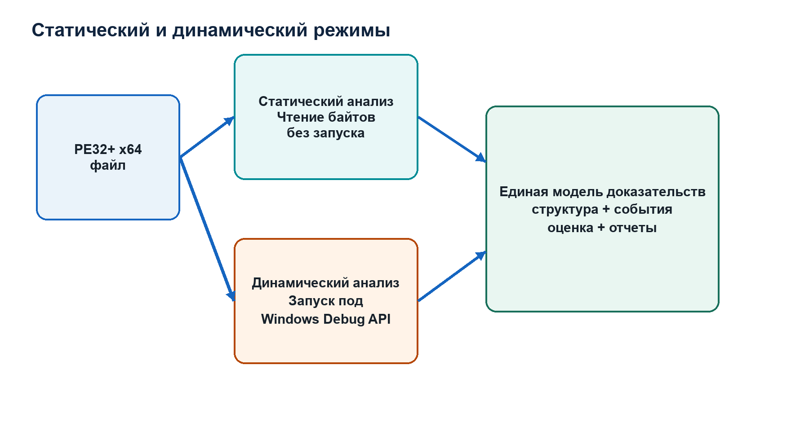

# Часть I. От исходного текста до выполняющегося процесса

## Исходная точка

Работу проекта удобно начать рассматривать с конкретной команды:

```text
eh_unwind_analyzer benign_richer.exe --heuristics --json report.json
```

В этой строке участвуют три файла разного назначения. `eh_unwind_analyzer` является собранным исполняемым модулем анализатора. `benign_richer.exe` является входным исполняемым модулем Windows, который анализатор должен исследовать. `report.json` является ещё не существующим выходным файлом, который должен быть создан после анализа.

Одинаковое слово «файл» скрывает принципиально различную роль каждого объекта. Первый файл операционная система загружает и выполняет. Второй в статическом режиме открывается как последовательность данных и не выполняется. Третий создаётся как сериализованное представление результата.

Чтобы понять эту разницу строго, нужно проследить весь путь от исходного текста проекта до процесса анализатора.

## Программа как описание вычисления

Программа задаёт вычислительный процесс: допустимые входные данные, последовательность преобразований, условия выбора ветвей, операции с памятью и формирование результата. На языке C этот процесс описан исходным кодом.

Рассмотрим начало функции из `src/main.c`:

```c
int main(int argc, char** argv) {
    Args a;
    ParseResult pres = parse_args(argc, argv, &a);
```

Здесь исходный текст содержит синтаксические конструкции языка C. Конструкция:

```c
int main(int argc, char** argv)
```

объявляет функцию с именем `main`. Функция получает два параметра и возвращает значение типа `int`.

Термин **function**, или функция, в программировании обозначает именованную часть программы с определённым интерфейсом входных параметров и результата. На уровне C функция является языковой конструкцией. После компиляции она обычно соответствует одному или нескольким диапазонам машинных инструкций, но такое соответствие не обязано быть взаимно однозначным: компилятор может встроить функцию, разделить её на участки, создать вспомогательные блоки или удалить неиспользуемый код.

Параметр `argc` имеет тип `int` и содержит количество элементов командной строки, переданных процессу. Параметр `argv` имеет тип `char**`, то есть является указателем на указатели на `char`. На практическом уровне `argv` предоставляет доступ к массиву C-строк. `argv[0]` обычно содержит путь или имя запущенной программы, `argv[1]` в рассматриваемой команде содержит `benign_richer.exe`.

Сейчас важно не запоминать синтаксис указателей, а зафиксировать связь уровней: строка, введённая пользователем в оболочке, превращается операционной системой и C runtime в данные, доступные функции `main`.

Исходный код сам по себе не является последовательностью инструкций AMD64. Он является текстом в формальном языке C. Чтобы процессор мог выполнять описанное вычисление, исходный текст должен пройти трансляцию.

## Translation unit и preprocessing

Компилятор C обрабатывает не изолированный файл в его исходном виде, а единицу трансляции — `translation unit`. Она получается после работы препроцессора.

В `main.c` присутствуют строки:

```c
#include "util.h"
#include "pe.h"
#include "unwind.h"
```

Директива `#include` сообщает препроцессору, что содержимое указанного заголовочного файла должно участвовать в формировании единицы трансляции. Заголовок содержит объявления типов и функций, которыми пользуется `main.c`.

Например, в `include/pe.h` объявлена функция:

```c
bool pe_parse(PeImage* out, const Buf* b, StrBuf* err);
```

Это объявление сообщает компилятору тип возвращаемого значения и типы параметров. Тело функции находится в `src/pe.c`. На стадии компиляции `main.c` достаточно знать интерфейс. Фактическая связь с реализацией будет установлена линкером.

Разделение на заголовок и исходный файл позволяет нескольким единицам трансляции согласованно использовать один интерфейс. Если объявление и определение расходятся, программа нарушает контракт языка или ABI и может не собраться либо работать неверно.

Препроцессор также обрабатывает условную компиляцию. В `src/dynamic_win.c` используется:

```c
#ifdef _WIN32
```

Если макрос `_WIN32` определён, в сборку входит реализация через Windows Debug API. Если нет, компилируется заглушка, сообщающая о недоступности динамического режима. Поэтому один набор исходников создаёт разные машинные варианты в зависимости от целевой платформы.

Здесь возникает первое важное различие: переносимость исходного кода не означает идентичность возможностей всех собранных файлов. Статическая часть не зависит от Windows API и работает на нескольких ОС. Динамическая часть включается только в Windows-сборку.

## Compilation

После preprocessing компилятор анализирует C.

Синтаксический анализ устанавливает структуру выражений и операторов. Проверка типов определяет допустимость операций. Затем компилятор строит промежуточное представление, выполняет оптимизации, выбирает инструкции целевой архитектуры и формирует объектный файл.

Целевая архитектура проекта для исследуемого формата — AMD64, также обозначаемая x86-64. Архитектура набора команд определяет регистры, инструкции, правила адресации и модель выполнения, наблюдаемую машинным кодом.

Фрагмент:

```c
if (!buf_init_from_file(&b, a.input, &owned)) {
    fprintf(stderr, "Failed to read file: %s\n", a.input);
    return 1;
}
```

не переводится механически «одна строка — одна инструкция». Компилятор должен:

- подготовить аргументы вызова по соглашению о вызовах;
- выполнить вызов `buf_init_from_file`;
- проверить возвращённое булево значение;
- выбрать адрес следующей инструкции;
- при ошибке подготовить аргументы `fprintf`;
- вернуть целочисленный код из `main`.

В оптимизированной сборке часть операций может быть преобразована. Однако наблюдаемое поведение должно соответствовать требованиям языка C для корректной программы.

## Object file

Результатом отдельной компиляции обычно является объектный файл. Он уже содержит машинный код, но ещё не является полностью готовым процессом или окончательным исполняемым image.

Допустим, машинный код `main.c` вызывает `pe_parse`. Адрес `pe_parse` на стадии отдельной компиляции может быть неизвестен, потому что функция определена в другом объектном файле. Компилятор сохраняет символическую ссылку и relocation information.

Символом называется именованная сущность toolchain, с которой связывается функция, объект данных или другое адресуемое значение. Relocation record описывает место, которое необходимо скорректировать после определения окончательного размещения.

Объектный файл, таким образом, содержит не только инструкции, но и информацию, необходимую следующей стадии.

## Linking

Линкер получает объектные файлы:

```text
main.obj
util.obj
pe.obj
unwind.obj
heuristics.obj
report.obj
dynamic_win.obj
app_info.obj
```

и используемые библиотеки. Он разрешает ссылки между символами и создаёт итоговый модуль.

В `CMakeLists.txt` ядро объявлено:

```cmake
add_library(ehua_core STATIC ${EHUA_CORE_SOURCES})
```

Это означает, что перечисленные объектные компоненты объединяются в статическую библиотеку `ehua_core`. Далее:

```cmake
add_executable(eh_unwind_analyzer src/main.c)
target_link_libraries(eh_unwind_analyzer PRIVATE ehua_core)
```

Линкер связывает CLI с ядром и создаёт исполняемый файл.

На этом этапе определяется размещение секций, адреса функций внутри image, import information и служебные таблицы. Для Windows x64 toolchain также формирует сведения, необходимые для раскрутки стека. Эти сведения впоследствии станут объектом анализа самого проекта.

Это важная причинная связь. `UNWIND_INFO` не является произвольной дополнительной базой, которую вручную создаёт пользователь. Обычно её генерирует toolchain, потому что операционной системе необходимо восстанавливать состояние функций при исключениях и stack walking.

## Исполняемый файл как структурированный результат

Итоговый файл Windows имеет формат PE — Portable Executable. Термин `portable` исторически указывает на единый формат для нескольких поддерживаемых архитектур Windows, но не означает, что один и тот же машинный код выполняется на любой архитектуре или ОС.

PE является не только контейнером машинных инструкций. Он содержит:

- заголовки, описывающие image;
- таблицу секций;
- код;
- данные;
- описание импортируемых DLL и функций;
- relocation information;
- exception directory;
- другие служебные каталоги.

Операционная система должна знать, какие байты являются кодом, где их разместить и какие зависимости подключить. Без такой структуры конечная последовательность байтов не определяет полноценный алгоритм загрузки.

EH/Unwind Analyzer использует тот же формат как источник аналитических данных. Но его задача отличается от задачи loader. Loader работает с целью создания выполняемого image. Анализатор работает с недоверенным вводом и должен обнаруживать несогласованности, не выходя за границы файла.

## Файл как последовательность байтов

На уровне файловой системы исполняемый модуль хранится как конечная последовательность байтов. Если размер равен `N`, отдельные байты имеют индексы от `0` до `N - 1`.

Файловое смещение, `file offset`, — количество байтов от начала файла до рассматриваемой позиции. Это определение задаёт систему координат файла.

Когда `buf_init_from_file` открывает `benign_richer.exe`, выполняются:

```c
FILE* f = fopen(path, "rb");
```

Режим `rb` означает binary read. Затем:

```c
fseek(f, 0, SEEK_END);
long sz = ftell(f);
fseek(f, 0, SEEK_SET);
```

Функция определяет длину и возвращает позицию в начало. После выделения памяти:

```c
uint8_t* mem = (uint8_t*)malloc(alloc_size);
```

байты читаются:

```c
size_t rd = fread(mem, 1, (size_t)sz, f);
```

В результате образуются два связанных объекта:

```c
out->data = mem;
out->size = (size_t)sz;
*owned_mem = mem;
```

`mem` является адресом выделенной области памяти процесса анализатора. `Buf` содержит невладеющее представление этой области: адрес начала и размер. `owned_mem` сохраняет указатель, который позднее должен быть передан `free`.

Здесь термин «владение» не относится к правам доступа ОС. В C-коде ownership означает ответственность за освобождение динамически выделенного ресурса. Если несколько указателей указывают на одну область, необходимо однозначно знать, какая часть программы должна её освободить и когда.

`Buf` не освобождает память самостоятельно. В конце `main` вызывается:

```c
buf_free_owned(owned);
```

Эта модель предотвращает неопределённость жизненного цикла.

## Безопасное чтение диапазона

После загрузки parser многократно читает поля по известным смещениям. Функция:

```c
bool buf_read(const Buf* b, size_t off, void* out, size_t len)
```

получает:

- `b` — описание входной последовательности;
- `off` — начальный индекс;
- `out` — адрес области назначения;
- `len` — число требуемых байтов.

Проверки:

```c
if (off > b->size) return false;
if (len > b->size - off) return false;
```

доказывают существование диапазона.

Пусть размер файла равен 100. Запрос четырёх байтов по смещению 96 допустим: требуются индексы 96, 97, 98 и 99. Запрос по смещению 97 недопустим: четвёртый байт имел бы индекс 100, которого нет.

Это не бытовая аналогия, а непосредственная проверка полуоткрытого диапазона:

```text
[off, off + len)
```

Диапазон допустим, если его конец не превышает размер буфера.

Почему код не записан как:

```c
if (off + len > b->size) return false;
```

Тип `size_t` беззнаковый. При достаточно больших значениях сумма может переполниться по модулю и стать малой. Вычитание `b->size - off` безопасно только после доказательства `off <= b->size`, поэтому проверки расположены именно в таком порядке.

Эта последовательность является одним из центральных инженерных свойств ядра: все внешние смещения считаются недоверенными.

## Порядок байтов

Файл содержит отдельные байты, но поля PE часто являются 16-, 32- или 64-битными числами. Для объединения байтов требуется правило порядка.

AMD64 и формат PE используют little-endian representation для рассматриваемых целых полей. Младший байт числа располагается по меньшему адресу или file offset.

Четыре байта:

```text
50 45 00 00
```

при little-endian чтении образуют:

```text
0x00004550
```

Проект не приводит произвольный адрес внутри файла к указателю на C-структуру. Он читает байты и собирает значение явно:

```c
static inline uint32_t le32(const uint8_t* p) {
    return (uint32_t)(
        p[0] |
        ((uint32_t)p[1] << 8) |
        ((uint32_t)p[2] << 16) |
        ((uint32_t)p[3] << 24)
    );
}
```

Каждый байт переводится в `uint32_t` и сдвигается на число бит, соответствующее его позиции. Это устраняет зависимость parser от alignment и layout C-структур.

## От файла к процессу

До запуска `eh_unwind_analyzer` является файлом. Чтобы выполнить его инструкции, операционная система создаёт процесс.

Процесс — управляемый ОС объект, включающий:

- виртуальное адресное пространство;
- один или несколько потоков;
- таблицу handles;
- security context;
- отображённые executable modules;
- выделенные области памяти;
- состояние runtime.

Loader читает PE анализатора, резервирует виртуальные диапазоны и отображает sections. Он разрешает imports, применяет relocations при необходимости и передаёт управление entry point.

Entry point — RVA, указанное в PE header, которое после загрузки преобразуется в виртуальный адрес. Оно обычно ведёт в startup code, а не непосредственно в исходную `main`. Runtime подготавливает параметры и вызывает `main(argc, argv)`.

Таким образом, до первой строки `main` уже произошли:

```text
чтение PE анализатора
-> создание процесса
-> создание начального потока
-> отображение image
-> разрешение imports
-> инициализация runtime
-> формирование argc/argv
-> вызов main
```

Эта последовательность необходима для понимания динамического режима. Когда анализатор запускает target под debugger, Windows выполняет аналогичный процесс создания, но посылает debug events управляющему процессу.

## Почему входной EXE не запускается в статическом режиме

В команде присутствуют два исполняемых файла, но выполняется только анализатор. Путь `benign_richer.exe` передаётся как текстовый аргумент. `buf_init_from_file` использует его для `fopen`, а не для `CreateProcess`.

После чтения байты target находятся в обычной heap memory процесса анализатора. Процессор не выбирает оттуда инструкции для выполнения. Функции `pe_parse` и `unwind_parse` интерпретируют байты как данные.

Это точный смысл static analysis проекта: свойства target извлекаются из его файлового представления без передачи управления его entry point.

При `--dynamic` вызывается другая ветвь:

```c
dynamic_collect_windows(...)
```

Windows-реализация использует API создания процесса с флагами отладки. Теперь target становится отдельным процессом и его инструкции выполняются. Поэтому динамический режим имеет другой trust boundary и требует изолированной Windows-среды.

## Три состояния одной программы

Для системного анализа необходимо различать как минимум три представления.

Первое — исходный код. Он содержит типы, имена и структуры языка C.

Второе — PE-файл. Он содержит машинный код и служебные бинарные структуры, сформированные compiler/linker toolchain.

Третье — загруженный процесс. Его память содержит отображённый image, разрешённые imports, применённые relocations, stack, heap и runtime allocations.

Некоторые свойства существуют только на одном уровне.

Имя локальной переменной может существовать только в исходнике или debug symbols.

File offset существует в системе координат файла, но не является адресом памяти процесса.

Фактический virtual address зависит от размещения image и существует в процессе.

Heap object создаётся во время выполнения и отсутствует в исходном PE как готовый объект.

Реверс-инженер должен постоянно указывать, к какому представлению относится адрес или структура.

## Место reverse engineering

Обычный engineering process движется от требований и исходного кода к executable implementation. Reverse engineering начинает с реализации и строит модель её структуры и поведения.

EH/Unwind Analyzer автоматизирует конкретный участок этой работы. Он не восстанавливает исходный C и не анализирует всю семантику машинного кода. Он:

- проверяет PE layout;
- находит exception directory;
- читает runtime-function entries;
- декодирует x64 unwind descriptions;
- агрегирует аномалии;
- при необходимости наблюдает Windows exception-related runtime events.

Для полноценной работы реверс-инженер дополняет результат disassembler, decompiler и debugger.

## Вывод первой части

Теперь можно точно описать начальный участок работы.

Исходные файлы C компилируются в объектный код. Линкер связывает модули и создаёт исполняемый файл анализатора. Loader операционной системы создаёт процесс и передаёт управление через startup code в `main`. Командная строка становится `argc/argv`. Путь к target используется для открытия файла. Файл целиком читается в динамически выделенную память процесса анализатора. `Buf` представляет байты и размер, а безопасные функции чтения гарантируют, что parser не обращается за пределы входа.

Следующая часть должна определить, как процессор адресует память, что такое virtual address и почему файловое смещение target нельзя напрямую использовать как адрес загруженного image. Без этого невозможно корректно перейти к PE sections и RVA.

## Проверка связности понимания

Ответьте развёрнуто, без однословных определений.

1. Почему `src/pe.c`, собранный analyzer и процесс analyzer являются тремя разными объектами?
2. На какой стадии ссылка из `main.c` на `pe_parse` получает окончательное разрешение?
3. Почему object file может содержать машинный код, но не быть готовым executable image?
4. Как loader использует PE иначе, чем EH/Unwind Analyzer?
5. Почему `benign_richer.exe` не выполняется без `--dynamic`?
6. Как связаны `owned_mem`, `Buf.data` и освобождение памяти?
7. Почему порядок двух bounds-check в `buf_read` имеет значение?
8. Какие свойства target относятся к файлу, а какие появляются только в процессе?

# Часть II. Двоичные данные, память и системы адресов

## Почему следующий этап посвящён представлению данных

После `buf_init_from_file` анализатор располагает двумя значениями: адресом первого байта target в своей памяти и размером последовательности. Однако поля PE не представлены как готовые C-объекты. Проект должен извлечь из байтов числа, а затем интерпретировать эти числа как размеры, смещения и адреса.

Чтобы понимать этот процесс, необходимо последовательно различить:

- математическое значение;
- двоичное представление;
- тип C;
- физический набор байтов;
- адрес области памяти;
- file offset;
- virtual address;
- RVA.

Ошибочное смешение этих категорий является одной из основных причин ошибок бинарных parsers.

## Разрядность и множество представимых значений

Последовательность из `N` битов имеет `2^N` возможных конфигураций. Если конфигурации интерпретируются как беззнаковые целые, диапазон равен:

```text
0 <= x <= 2^N - 1
```

Для 8 бит верхняя граница равна 255, для 16 — 65 535, для 32 — 4 294 967 295.

Типы `uint8_t`, `uint16_t`, `uint32_t` и `uint64_t` в C предназначены для беззнаковых целых точной ширины. Префикс `u` означает `unsigned`, число указывает ширину, суффикс `_t` является частью имени typedef.

В PE многие поля имеют фиксированную ширину независимо от платформы, на которой работает parser. Поэтому проект использует `uint32_t`, а не `unsigned long`, размер которого зависит от data model компилятора.

Например:

```c
uint32_t exception_rva;
uint32_t exception_size;
```

Оба поля PE имеют размер 4 байта даже тогда, когда анализатор собран как 64-битная программа.

## Знаковая интерпретация

Те же `N` битов могут интерпретироваться как знаковое число в two's complement representation. Диапазон:

```text
-2^(N-1) <= x <= 2^(N-1) - 1
```

Байты не содержат отдельного признака «это signed». Интерпретацию задаёт тип или инструкция.

Конфигурация из 32 единичных битов:

```text
FF FF FF FF
```

как `uint32_t` равна `4 294 967 295`, а как `int32_t` равна `-1`.

В parser полей размера и RVA используется беззнаковая интерпретация, потому что отрицательные адресные смещения не входят в модель этих полей.

## Шестнадцатеричная запись

Двоичная запись неудобна для длинных значений. Одна шестнадцатеричная цифра представляет четыре бита:

```text
0 = 0000
1 = 0001
...
9 = 1001
A = 1010
B = 1011
C = 1100
D = 1101
E = 1110
F = 1111
```

Две hex-цифры представляют один байт. Поэтому последовательность:

```text
4D 5A
```

однозначно показывает два байта.

Префикс `0x` в C и технической документации обозначает шестнадцатеричную систему:

```text
0x10 = 16
0x100 = 256
0x1000 = 4096
```

Hex удобен не только краткостью. Границы степеней двойки визуально выражены нулями. В PE типичные alignments `0x200` и `0x1000` непосредственно связаны с двоичным выравниванием.

## Побитовые поля

Несколько логических значений могут храниться в одном целом. Каждый бит или группа битов имеет отдельную семантику.

Первый байт `UNWIND_INFO` содержит:

```text
bits 0..2: Version
bits 3..7: Flags
```

Чтобы извлечь младшие три бита, проект применяет mask:

```c
version = vflags & 0x07u;
```

`0x07` в двоичном виде:

```text
00000111
```

Операция bitwise AND оставляет только младшие три позиции.

Чтобы получить старшие пять битов:

```c
flags = vflags >> 3;
```

Логический сдвиг вправо перемещает их в младшие позиции.

Здесь понятие `flags` обозначает набор независимых или комбинируемых признаков, закодированных битами. В проекте flags unwind определяют наличие exception handler, termination handler или chained info.

## Переполнение

Операция над целым фиксированной ширины может дать математический результат, не представимый этим типом.

Для беззнакового 32-битного значения арифметика выполняется по модулю `2^32`:

```text
0xFFFFFFFF + 1 = 0x00000000
```

В `src/pe.c` сложение двух `uint32_t` проверяется через расширение:

```c
static bool safe_add_u32(uint32_t a, uint32_t b, uint32_t* out) {
    uint64_t t = (uint64_t)a + (uint64_t)b;
    if (t > 0xffffffffu) return false;
    *out = (uint32_t)t;
    return true;
}
```

Операнды сначала переводятся в 64-битный тип. Сумма всех возможных двух `uint32_t` помещается в `uint64_t`, поэтому переполнение на промежуточной стадии исключено. Затем проверяется возможность вернуть результат в 32 бита.

Функция используется при вычислении file offset:

```c
off = section.raw_ptr + delta
```

Если сумма не помещается в поле, mapping отклоняется.

## Порядок байтов

Целое число шире одного байта должно быть разложено по последовательным адресам.

**Endianness** определяет порядок расположения байтов многобайтного значения.

В little-endian representation младший по значимости байт расположен по меньшему адресу.

Число:

```text
0x12345678
```

представлено:

```text
offset +0: 78
offset +1: 56
offset +2: 34
offset +3: 12
```

Это не означает, что число «записано наоборот» на всех уровнях. Hex viewer показывает байты по возрастающим смещениям. Register view показывает уже собранное числовое значение.

Функция `le32` проекта определяет интерпретацию явно, поэтому результат одинаков на поддерживаемых host-платформах.

## Объект памяти процесса

Когда `malloc` возвращает указатель, процесс получает область своего виртуального адресного пространства.

**Address — адрес.** Числовой идентификатор позиции в определённом адресном пространстве.

Определение требует указания пространства. Число `0x1000` само по себе не сообщает, является ли оно:

- file offset;
- RVA;
- virtual address;
- физическим адресом;
- смещением внутри структуры.

**Virtual address, VA — виртуальный адрес.** Адрес в виртуальном адресном пространстве процесса.

Указатель `mem` из `buf_init_from_file` содержит VA первого байта копии target внутри процесса анализатора. Этот адрес не обязан совпадать ни с ImageBase target, ни с адресом, по которому target был бы загружен.

Выражение:

```c
b->data + off
```

выполняет pointer arithmetic. Для указателя на `uint8_t` прибавление `off` перемещает адрес на `off` байтов. Поэтому file offset после чтения файла может использоваться как индекс внутри копии:

```text
host VA байта = Buf.data + file_offset
```

Это адрес байта в процессе анализатора, а не runtime VA target.

## Физическая и виртуальная память

Процессор выполняет инструкции с виртуальными адресами. Операционная система совместно с аппаратным механизмом трансляции отображает виртуальные страницы на физические frames либо фиксирует отсутствие mapping.

Для user-mode анализа важны свойства виртуальной памяти:

- каждый процесс имеет собственное адресное пространство;
- один virtual address в разных процессах может указывать на разные данные;
- region может быть reserved, committed или unmapped;
- страницы имеют permissions;
- mapping может связывать память с файлом;
- адрес не гарантирует допустимость чтения или выполнения.

**Page — страница памяти.** Блок фиксированного размера, являющийся базовой единицей управления virtual memory. На x64 Windows обычный размер страницы составляет 4096 байт, то есть `0x1000`, хотя существуют large pages.

**Memory protection — защита памяти.** Атрибуты страницы, определяющие разрешённость чтения, записи и выполнения.

PE section characteristics используются loader для выбора начальных protections. Поэтому проект рассматривает writable или executable placement unwind metadata как аналитический признак.

## Image

В Windows PE-контексте **image** — модуль, подготовленный форматом для отображения в virtual memory с определённой структурой sections и адресов.

Следует различать:

- file representation — байты на диске;
- image layout — логическое размещение согласно PE;
- mapped image — фактическое отображение в процессе.

Размер файла не равен `SizeOfImage`. В памяти sections выравниваются иначе, чем на диске. Некоторые виртуальные области заполняются нулями и не имеют соответствующих raw bytes.

## ImageBase

**ImageBase — базовый виртуальный адрес image.** Предпочтительный адрес начала image, указанный в optional header PE.

Для `benign_richer.exe`:

```text
ImageBase = 0x140000000
```

Это preferred base. Из-за ASLR loader может выбрать другой actual base. Адреса PE, представленные как RVA, сохраняют относительную позицию и могут быть прибавлены к фактической базе.

## RVA

**Relative Virtual Address, RVA — относительный виртуальный адрес.** Неотрицательное смещение от начала image в его виртуальной системе координат.

Связь:

```text
VA = actual_image_base + RVA
```

Если:

```text
actual_image_base = 0x140000000
RVA = 0x3000
```

то:

```text
VA = 0x140003000
```

RVA не является file offset. В памяти sections могут начинаться на границах `0x1000`, а в файле raw data — на границах `0x200`. Поэтому одна и та же логическая позиция имеет разные координаты.

## Section и две системы координат

PE section header связывает virtual layout и file layout.

Поля:

```text
VirtualAddress
VirtualSize
PointerToRawData
SizeOfRawData
```

задают два диапазона.

Виртуальный диапазон начинается с `VirtualAddress`, являющегося RVA.

Файловый диапазон начинается с `PointerToRawData`, являющегося file offset.

Если требуемый RVA принадлежит section:

```text
delta = RVA - section.VirtualAddress
```

Тот же относительный сдвиг внутри raw data:

```text
file_offset = section.PointerToRawData + delta
```

Но преобразование допустимо только при:

```text
delta < section.SizeOfRawData
```

Если `VirtualSize` больше `SizeOfRawData`, часть section существует в mapped image как zero-filled memory, но не имеет исходных байтов в файле.

Именно поэтому `pe_rva_to_fileoff` сначала ищет section, затем проверяет `delta`:

```c
uint32_t delta = rva - s->virtual_address;
if (delta >= s->raw_size) {
    return false;
}
```

## File offset, RVA и VA как разные типы

Хотя все три значения представлены целыми числами, логически они являются разными типами.

File offset отвечает на вопрос: где байт находится в файле?

RVA отвечает на вопрос: где объект находится относительно начала image?

VA отвечает на вопрос: где объект находится в virtual address space конкретного процесса?

Формулы перехода требуют контекста:

```text
RVA -> VA:
actual base + RVA

RVA -> file offset:
найти section, вычислить delta, проверить raw backing
```

Переход:

```text
file offset -> VA
```

невозможен без знания section и actual image base.

## ASLR

**Address Space Layout Randomization, ASLR — рандомизация размещения адресного пространства.** Механизм, при котором loader изменяет фактические базы modules и другие placements, чтобы абсолютные адреса были менее предсказуемыми.

ASLR объясняет, почему статический отчёт преимущественно использует RVA. RVA устойчиво относительно image, тогда как VA конкретного запуска зависит от base.

Dynamic collector после события создания процесса получает loaded image base и вычисляет:

```text
handler VA = loaded base + handler RVA
```

Если бы он использовал preferred `ImageBase` без учёта фактической базы, breakpoint мог бы быть установлен по неверному адресу.

## Адреса модулей в разных процессах

Системная DLL загружена и в analyzer, и в target, но из-за ASLR bases могут различаться. Поэтому адрес `RtlAddFunctionTable` в analyzer process нельзя напрямую считать адресом функции в target.

Collector определяет offset функции внутри локального module:

```text
symbol_offset = local_symbol_va - local_module_base
```

Затем:

```text
remote_symbol_va = remote_module_base + symbol_offset
```

Эта операция является ещё одним применением относительной адресации.

## Размер и диапазон

В бинарном анализе почти каждый объект задаётся началом и размером либо началом и концом.

Проект использует полуоткрытые диапазоны:

```text
[begin, end)
```

Начало включено, конец исключён. Размер:

```text
size = end - begin
```

Соседние диапазоны:

```text
[0x1000, 0x1010)
[0x1010, 0x1020)
```

не пересекаются. Адрес `0x1010` принадлежит только второму.

`RUNTIME_FUNCTION` использует `BeginAddress` и `EndAddress` именно как границы диапазона кода.

## Что проект проверяет на уровне адресов

`pe_parse` проверяет:

- raw section range относительно file size;
- virtual section range относительно `SizeOfImage`;
- raw overlaps;
- virtual overlaps;
- alignment;
- exception directory относительно image.

`unwind_read_runtime_functions` преобразует RVA каталога в file offset.

`heuristics_analyze` проверяет begin/end/unwind RVA отдельных записей.

`dynamic_collect_windows` преобразует статические RVA в runtime VA.

`report.c` сериализует оба вида в соответствующих полях, не смешивая их.

## Итоговая связная модель

Входной PE существует как файл с file offsets. После чтения его байты существуют также в heap анализатора по host virtual addresses, но семантика полей остаётся файловой. PE section table связывает file offsets с RVA image. Loader в отдельном target process связывает RVA с фактическими VA. ASLR может изменить base, но не относительную структуру image.

Следовательно, любое адресное значение в анализе должно сопровождаться указанием системы координат.

## Контрольные задачи

Для section:

```text
VirtualAddress = 0x3000
VirtualSize = 0x180
PointerToRawData = 0x800
SizeOfRawData = 0x200
```

и RVA `0x3050`:

```text
delta = 0x50
file offset = 0x850
```

Для RVA `0x31F0` raw backing существует, потому что `0x1F0 < 0x200`.

Для RVA `0x3200` рассматриваемый полуоткрытый raw диапазон уже завершён.

Ответьте:

1. Чем адрес `Buf.data + 0x850` отличается от target VA соответствующего байта?
2. Почему `SizeOfImage` не должен сравниваться с file size как равное значение?
3. Почему RVA устойчивее VA при сравнении двух запусков?
4. Как virtual overlap делает RVA mapping неоднозначным?
5. Почему zero-filled tail существует в процессе, но отсутствует в файле?
6. Где проект использует `uint64_t` для проверки 32-битных диапазонов?

# Часть III. Процессор, функции, стек и Windows x64 ABI

## Исполнение инструкции

После загрузки процесса поток имеет register context, включающий instruction pointer и другие архитектурные регистры. На AMD64 регистр `RIP` содержит virtual address следующей инструкции.

Упрощённый архитектурный цикл:

```text
получить байты по RIP
-> декодировать инструкцию
-> получить операнды
-> выполнить операцию
-> изменить регистры, flags или память
-> определить следующий RIP
```

Современный процессор реализует этот цикл значительно сложнее: конвейер, out-of-order execution, speculation, caches. Для reverse engineering пользовательского кода сначала изучается архитектурно наблюдаемое поведение ISA, а не микроархитектурная реализация.

## Регистры

**Register — регистр.** Архитектурно видимое хранилище фиксированной ширины внутри модели процессора.

Основные 64-битные general-purpose registers AMD64:

```text
RAX RBX RCX RDX
RSI RDI RBP RSP
R8  R9  R10 R11
R12 R13 R14 R15
```

`RIP` содержит instruction pointer. `RFLAGS` содержит condition and control flags.

Названия частей одного регистра отражают ширину:

```text
RAX: 64 бита
EAX: младшие 32 бита
AX:  младшие 16 бит
AL:  младшие 8 бит
```

Запись в `EAX` обнуляет старшие 32 бита `RAX`. Это свойство часто используется компилятором.

## Операнды и память

Инструкция работает с операндами. Операнд может находиться:

- в регистре;
- в памяти;
- непосредственно в кодировке инструкции;
- быть неявно задан ISA.

Пример Intel syntax:

```asm
mov eax, dword ptr [rcx]
```

Инструкция читает 4 байта памяти по адресу из `RCX` и помещает значение в `EAX`.

Квадратные скобки означают обращение к памяти. Без скобок `RCX` обозначал бы само числовое содержимое регистра.

## Арифметика адреса

AMD64 поддерживает эффективный адрес:

```text
base + index * scale + displacement
```

где scale принимает `1`, `2`, `4` или `8`.

Пример:

```asm
mov eax, dword ptr [rcx + rdx*4 + 8]
```

может соответствовать чтению 32-битного элемента массива, если `RCX` является base, `RDX` — индексом, а `8` — смещением поля.

Инструкция `lea` вычисляет адресное выражение, но не читает память:

```asm
lea rax, [rcx + rdx*4]
```

Компилятор использует `lea` и для обычной арифметики.

## Управление потоком

По умолчанию `RIP` переходит к следующей инструкции. Instructions branch изменяют эту последовательность.

`jmp` выполняет безусловный переход.

Условные переходы `je`, `jne`, `ja`, `jb`, `jg`, `jl` используют flags, установленные предыдущими арифметическими или сравнительными операциями.

Различие signed и unsigned comparison существенно. Например:

- `ja` рассматривает operands как unsigned;
- `jg` рассматривает их как signed.

Decompiler восстанавливает `if`, `while` и другие конструкции на основе control-flow graph, но реальный machine code состоит из сравнений и переходов.

## Function на машинном уровне

На машинном уровне функция не является встроенным объектом ISA с полным описанием типов. Обычно это диапазон кода с соглашением:

- где находятся входные аргументы;
- где вернуть результат;
- какие регистры можно изменять;
- какие регистры нужно восстановить;
- как организован stack;
- как передаётся управление.

Такое соглашение называется ABI.

**Application Binary Interface, ABI — двоичный интерфейс приложений.** Набор правил совместимости скомпилированных компонентов на уровне машинного кода и бинарных объектов.

ABI включает calling convention, layout некоторых объектов, правила stack alignment, symbol naming и другие аспекты.

Если caller и callee используют разные правила, они неверно интерпретируют аргументы или повреждают состояние.

## Caller и callee

**Caller — вызывающая функция.**

**Callee — вызываемая функция.**

При вызове caller подготавливает аргументы и передаёт управление. Callee выполняет работу и возвращает результат.

В `main.c`:

```c
bool ok = unwind_parse(&b, &img, rf[i].unwind_rva,
                       &uopts, &us[i], NULL, &perr);
```

`main` является caller, `unwind_parse` — callee.

На Windows x64 первые четыре integer/pointer arguments передаются:

```text
RCX, RDX, R8, R9
```

Оставшиеся передаются через stack.

Для вызова `unwind_parse`:

```text
RCX = &b
RDX = &img
R8  = unwind_rva
R9  = &uopts
остальные параметры = stack
```

Компилятор может использовать промежуточные инструкции, но состояние в точке вызова должно соответствовать convention.

## Return value

Integer and pointer return value обычно помещается в `RAX`. Для `bool` значим младший участок.

После `unwind_parse` caller проверяет результат и записывает его в `us_ok[i]`.

## Volatile и nonvolatile registers

Windows x64 делит registers на volatile и nonvolatile.

Volatile register callee может изменить без восстановления. Caller должен сохранить значение самостоятельно, если оно требуется после вызова.

Nonvolatile register callee обязан восстановить перед возвратом, если использовал.

К nonvolatile general-purpose относятся:

```text
RBX RBP RDI RSI RSP R12 R13 R14 R15
```

RCX, RDX, R8, R9 и часть других являются volatile.

Это правило напрямую связано с unwind. Если функция сохранила nonvolatile register на stack, Windows должна знать, где находится сохранённое значение, чтобы восстановить context при исключении.

## Stack

**Stack — стек.** Область virtual memory потока, используемая calling convention и программой для хранения адресов возврата, сохранённых регистров, локальных объектов и временных данных.

На AMD64 stack обычно растёт в сторону меньших адресов. Регистр `RSP` содержит текущий stack pointer.

Инструкция:

```asm
sub rsp, 40
```

уменьшает `RSP` на 40 и резервирует диапазон stack memory.

Инструкция:

```asm
add rsp, 40
```

освобождает тот же фиксированный диапазон перед возвратом.

Слово «освобождает» здесь означает изменение границы текущего stack frame. Память не обязательно немедленно удаляется или очищается.

## `call` и адрес возврата

Инструкция `call target` выполняет два архитектурных действия:

1. помещает адрес следующей инструкции на stack;
2. устанавливает `RIP` в адрес target.

Сохранённый адрес называется return address.

Инструкция `ret` извлекает адрес со stack и передаёт ему управление.

Следовательно, корректность `RSP` критична. Если stack pointer не восстановлен, `ret` прочитает неверное значение.

## Stack frame

**Stack frame — стековый кадр функции.** Часть stack и связанное register state, относящиеся к конкретному активному вызову функции.

Frame может включать:

- return address;
- caller-provided home space;
- сохранённые nonvolatile registers;
- локальные переменные;
- временные значения;
- stack arguments для других вызовов.

Границы frame не хранятся в одном универсальном hardware field. Они следуют из ABI, выполняемых инструкций и unwind metadata.

## Shadow space

Windows x64 требует, чтобы caller перед вызовом резервировал 32 байта home space для первых четырёх register parameters.

Этот диапазон также называют `shadow space`. Callee может использовать соответствующие slots для сохранения register arguments.

Даже если callee их не использует, caller обязан обеспечить пространство согласно ABI.

Это объясняет распространённый размер:

```asm
sub rsp, 40
```

32 байта составляют shadow space, ещё 8 участвуют в поддержании требуемого alignment с учётом return address и текущей структуры функции.

Нельзя автоматически утверждать, что любое выделение 40 имеет только эту причину, но для вызывающей функции это типичный pattern.

## Alignment stack

Вне специально разрешённых участков prolog/epilog stack должен быть выровнен на 16 байт. Это необходимо для ABI и некоторых инструкций.

Caller учитывает, что `call` помещает 8-байтовый return address. Компилятор выбирает размер frame так, чтобы в точках вызовов соблюдалось правило.

## Prolog

**Prolog — пролог функции.** Начальная последовательность инструкций, создающая frame и сохраняющая необходимое nonvolatile state.

Типичный вариант:

```asm
push rbx
sub rsp, 32
```

Семантика:

- `push rbx` уменьшает `RSP` на 8 и записывает прежний `RBX`;
- `sub rsp, 32` резервирует дополнительный stack space.

После этого fixed stack change относительно состояния при входе составляет 40 байт.

## Epilog

**Epilog — эпилог функции.** Допустимая заключительная последовательность, восстанавливающая frame и возвращающая управление caller.

Для примера:

```asm
add rsp, 32
pop rbx
ret
```

Эпилог должен быть распознаваемым Windows unwind mechanism. Microsoft ограничивает допустимые формы, потому что система должна уметь определить, находится ли `RIP` внутри epilog, и корректно восстановить context.

## Frame pointer

Некоторые функции используют отдельный nonvolatile register как frame pointer. На x64 это часто `RBP`, но ABI допускает и другие разрешённые registers в metadata.

Frame pointer предоставляет устойчивую базу для доступа к frame, если `RSP` временно изменяется или используется dynamic allocation.

Оптимизированный код часто обходится без отдельного frame pointer. Отсутствие `RBP` как frame pointer не является аномалией.

## Leaf и nonleaf function

В контексте Windows x64 unwind leaf function обычно не изменяет nonvolatile state и не требует сложной раскрутки. Она может не иметь записи в exception table.

Nonleaf function выполняет действия, требующие описания восстановления: изменяет `RSP`, сохраняет nonvolatile registers, вызывает другие функции или имеет handler.

Поэтому отсутствие `.pdata` нельзя автоматически считать повреждением для небольшого leaf-only image. Проект учитывает это и выдаёт умеренный, а не максимальный сигнал при executable code без runtime functions.

## Машинное исключение и обычный возврат

При нормальном выполнении функция достигает epilog и `ret`. При исключении управление может быть передано системе из произвольной точки функции. Обычный epilog ещё не выполнен, поэтому `RSP` и nonvolatile registers находятся в состоянии текущей точки.

Чтобы перейти к предыдущему frame, Windows должна определить:

- какие изменения prolog уже были выполнены;
- сколько stack space выделено;
- где сохранены registers;
- есть ли frame pointer;
- связан ли с функцией handler.

На Windows x64 эти данные кодируются в unwind metadata.

## Почему metadata отделена от машинного кода

Теоретически система могла бы дизассемблировать пролог во время каждого исключения. Однако variable-length x86-64 encoding, необходимость точного и эффективного восстановления, оптимизации и ограничения безопасного распознавания делают table-driven model предпочтительной.

Compiler генерирует описание prolog operations. Linker размещает runtime function table и unwind structures в PE. OS runtime использует их для stack walking и exception dispatch.

EH/Unwind Analyzer читает ту же metadata статически и проверяет её структуру.

## Пример связи с `benign_richer.exe`

Одна runtime function sample имеет:

```text
Begin RVA: 0x1010
End RVA: 0x1029
Unwind RVA: 0x4004
SizeOfProlog: 4
fixed_stack_bytes: 40
```

Декодированный `UWOP_ALLOC_SMALL` сообщает о фиксированном выделении 40 байт.

Чтобы проверить metadata, реверс-инженер должен:

1. перейти к VA `ImageBase + 0x1010`;
2. дизассемблировать первые инструкции;
3. определить байтовую длину prolog;
4. найти изменение `RSP`;
5. сравнить размер с 40;
6. проверить отсутствие необъяснённых сохранений.

Текущая версия анализатора выполняет пункты разбора metadata, но не автоматизирует сопоставление с disassembly.

## Context потока

**Thread context — контекст потока.** Набор register values и другого архитектурного состояния, необходимого для продолжения выполнения.

Windows structure `CONTEXT` хранит, среди прочего, `RIP`, `RSP` и general-purpose registers.

При debug event collector получает или изменяет context для обработки software breakpoint. При unwind Windows вычисляет context caller.

## Почему проект сохраняет register masks

`UnwindSummary` содержит:

```c
uint16_t saved_nonvol_mask;
uint16_t saved_xmm_mask;
uint32_t pushed_nonvol_count;
uint32_t fixed_stack_bytes;
```

Mask позволяет обозначить множество registers битами. Если установлен бит с номером регистра, metadata сообщает о его сохранении.

Эти поля являются сводной моделью. Они не заменяют полный порядок операций, но позволяют отчёту показать, какое state заявлено как сохранённое.

## Итоговая причинная цепочка

ABI требует, чтобы caller и callee согласованно передавали arguments и сохраняли nonvolatile state. Callee создаёт stack frame в prolog и удаляет его в epilog. Исключение может произойти до epilog. Поэтому Windows требуется формальное описание уже выполненных изменений. Toolchain создаёт unwind metadata. Проект декодирует это описание и оценивает его целостность.

## Контрольные вопросы

1. Почему функция на уровне C и диапазон machine code не всегда взаимно однозначны?
2. Что определяет ABI?
3. Почему caller резервирует shadow space?
4. Чем volatile register отличается от nonvolatile?
5. Почему `RSP` должен быть восстановлен перед `ret`?
6. Как исключение нарушает обычную последовательность prolog-body-epilog?
7. Почему Windows использует metadata, а не только disassembly?
8. Что означает fixed stack size и чего он не учитывает?
9. Как вручную проверить `UWOP_ALLOC_SMALL`?
10. Где register context используется dynamic collector?

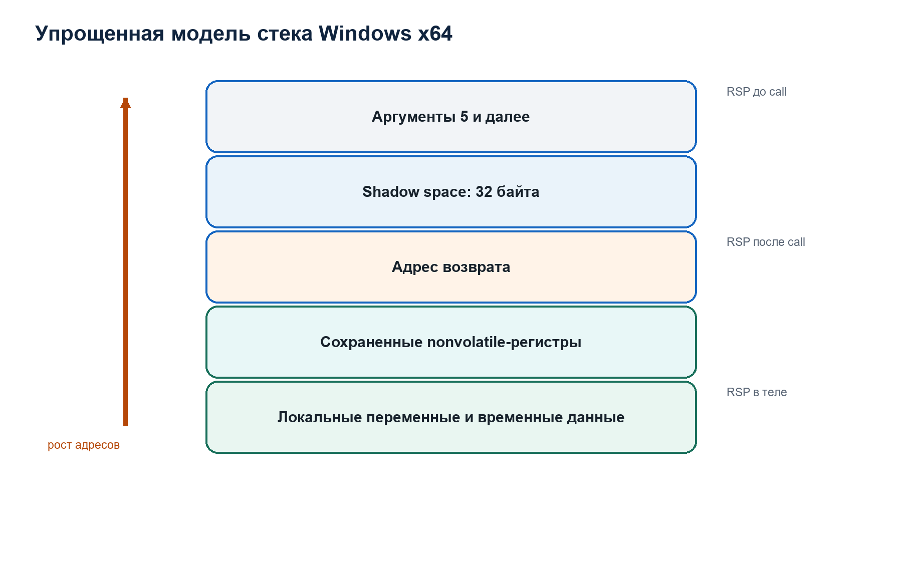

# Лекция 4. Процесс, поток, контекст и исключение в Windows

## Зачем эта лекция нужна до изучения проекта

Статическая часть EH/Unwind Analyzer читает сведения, которые Windows использует во время исполнения программы. Динамическая часть запускает исследуемый файл как отдельный процесс, получает от операционной системы события отладки, читает и изменяет контекст его потоков, временно заменяет байты инструкций и наблюдает прохождение исключений. Поэтому слова «процесс», «поток», «контекст», «исключение», «обработчик» и «отладочное событие» нельзя понимать приблизительно. Это разные системные сущности с разными областями состояния и разными правилами времени жизни.

Ни статический файл на диске, ни загруженный образ, ни исполняющийся процесс не являются одним и тем же объектом. PE-файл хранит байты и описания будущего образа. Загрузчик формирует из него отображение в виртуальном адресном пространстве. Процесс предоставляет адресное пространство и набор системных ресурсов. Потоки внутри процесса исполняют инструкции. Исключение возникает в контексте конкретного потока, однако его обработка может обращаться к данным уровня всего процесса: таблицам функций, зарегистрированным векторным обработчикам, загруженным модулям и глобальному фильтру необработанных исключений.

## Процесс как объект операционной системы

**Process**, далее процесс, — объект Windows, представляющий выполняемый экземпляр программы. Процесс обладает собственным виртуальным адресным пространством, таблицей дескрипторов, параметрами безопасности, набором загруженных модулей и как минимум одним потоком после успешного создания.

Формулировка «процесс выполняет инструкции» допустима только как сокращение. Непосредственное архитектурное состояние исполнения принадлежит потоку. Процесс задаёт среду, в которой потоки видят память и системные ресурсы.

Виртуальное адресное пространство процесса содержит диапазоны страниц. Каждая страница имеет состояние и защиту. Она может быть зарезервирована, зафиксирована, доступна для чтения, записи или исполнения. PE-загрузчик отображает заголовки и секции образа в это пространство, применяет перемещения, разрешает импорты и передаёт управление стартовому коду. Один и тот же PE-файл при разных запусках может получить разные фактические виртуальные адреса из-за Address Space Layout Randomization, сокращённо ASLR. Поэтому проект постоянно различает относительный виртуальный адрес RVA и фактический виртуальный адрес VA.

В динамическом анализаторе дескриптор процесса хранится в `pi.hProcess`. Через него вызываются `ReadProcessMemory`, `WriteProcessMemory`, `VirtualProtectEx`, `FlushInstructionCache` и `TerminateProcess`. Дескриптор не является адресом процесса и не содержит его память. Это значение в таблице дескрипторов анализатора, через которое ядро Windows проверяет права и находит целевой объект.

## Модуль и загруженный образ

**Module**, далее модуль, — загруженный в процесс исполняемый образ: основной EXE или DLL. У модуля есть фактический базовый адрес и размер отображённого образа. В проекте эта информация хранится в `ModInfo`:

```c
typedef struct ModInfo {
    char name[MAX_PATH];
    uint64_t base;
    uint64_t size;
} ModInfo;
```

Поле `base` — фактический VA начала образа в исследуемом процессе. Поле `size` задаёт диапазон адресов модуля. Имя приводится к нижнему регистру, чтобы сопоставление не зависело от регистра символов.

Функция `mods_find_by_addr` проверяет принадлежность адреса полуинтервалу:

```text
[base, base + size)
```

Полуинтервал включает начало и исключает конец. Такое представление совпадает с тем, как проект описывает функции `[BeginRVA, EndRVA)` и предотвращает двойную принадлежность адреса соседним диапазонам.

Список модулей обновляется через Tool Help API. Анализатор создаёт snapshot, перечисляет модули и записывает их фактические базы. Это необходимо потому, что адрес функции API в процессе анализатора нельзя механически использовать в исследуемом процессе. ASLR может выбрать другую базу. Проект сначала вычисляет смещение функции внутри локального модуля, затем прибавляет то же смещение к базе соответствующего модуля в target process.

## Поток как носитель исполнения

**Thread**, далее поток, — планируемая Windows единица исполнения внутри процесса. Потоки одного процесса разделяют виртуальную память и загруженные модули, но имеют собственные:

- архитектурные регистры;
- instruction pointer;
- stack pointer;
- стек;
- thread-local storage;
- состояние планирования;
- системный идентификатор thread ID.

Поскольку каждый поток имеет собственный `RIP`, `RSP` и flags register, программная точка останова должна обрабатываться применительно к потоку, который её достиг. Именно поэтому исправленная версия динамического коллектора хранит pending re-arm не в одной глобальной переменной, а в таблице, индексируемой `tid`.

Если поток A остановился на `INT3`, анализатор временно снял breakpoint и включил single-step, а затем поток B достиг другой точки останова, единый глобальный указатель потерял бы связь между событием single-step и конкретной точкой, которую надо восстановить. `PendingRearmList` устраняет эту ошибку модели.

## Контекст потока

**Thread context**, далее контекст потока, — структура, содержащая выбранную часть архитектурного состояния потока. На x64 к нему относятся регистры общего назначения, `RIP`, `RSP`, `EFlags`, SIMD-состояние и другие поля. Windows API не всегда читает все части контекста. Поле `ContextFlags` указывает, какие группы состояния требуются.

Проект запрашивает:

```c
ctx.ContextFlags = CONTEXT_CONTROL | CONTEXT_INTEGER;
```

`CONTEXT_CONTROL` включает управляющее состояние, необходимое для `RIP`, `RSP` и flags. `CONTEXT_INTEGER` включает целочисленные регистры, в том числе `RCX`, `RDX`, `R8` и `R9`, где Windows x64 ABI передаёт первые четыре целочисленных или указательных аргумента функции.

Контекст читается через `GetThreadContext` и изменяется через `SetThreadContext`. Эти операции выполняются над остановленным потоком. В debug event loop Windows приостанавливает потоки отлаживаемого процесса на время обработки события, поэтому анализатор получает согласованную точку для чтения и модификации.

Контекст не является копией всей памяти потока. Он не включает содержимое стека. Если нужны данные по адресу `RSP`, их надо отдельно читать через `ReadProcessMemory`.

## Нормальное управление и исключительное управление

При нормальном исполнении следующая инструкция определяется текущим `RIP`, длиной выполненной инструкции и явными инструкциями передачи управления: `call`, `ret`, условными и безусловными переходами.

**Exception**, далее исключение, — архитектурное или программно инициированное событие, которое прерывает обычную последовательность исполнения и передаёт управление механизму диспетчеризации Windows. Причинами могут быть:

- доступ к недопустимой памяти;
- деление на ноль;
- выполнение `INT3`;
- включённый trap flag после одной инструкции;
- явный вызов `RaiseException`;
- другие аппаратные или программные условия.

Исключение описывается кодом, адресом возникновения и дополнительными параметрами. Для анализа принципиально различать причину исключения и способ его обработки. Один код исключения может быть намеренно создан программой, возникнуть из-за ошибки или использоваться защитным механизмом управления потоком.

## Structured Exception Handling

**Structured Exception Handling**, сокращённо SEH, — системный механизм Windows для обработки исключений. Слово structured указывает, что обработка следует определённой модели поиска и раскрутки, а не произвольному переходу на неизвестный адрес.

Для x64 Windows использует table-based exception handling. Сведения о функциях и действиях, необходимых для восстановления состояния вызывающей функции, находятся в таблицах `RUNTIME_FUNCTION` и структурах `UNWIND_INFO`. Это ключевая причина существования проекта.

Обработка исключения имеет две логически разные задачи.

Первая задача — **dispatch**, то есть поиск обработчика, который согласится обработать исключение. Система рассматривает текущую функцию, затем вызывающую, затем следующую по стеку. Чтобы перейти от текущего контекста к контексту вызывающей функции, она выполняет виртуальную раскрутку на основе unwind metadata.

Вторая задача — **unwind**, то есть фактическое сворачивание кадров до выбранной точки обработки с вызовом необходимых termination handlers и восстановлением состояния.

Поиск и раскрутка используют сходные метаданные, но не являются одним действием. Поиск может исследовать несколько кадров, не разрушая реальное состояние исполнения. Фактическая раскрутка применяется после выбора пути обработки.

## Frame-based handlers, VEH, VCH и UEF

В проекте наблюдаются несколько классов обработчиков, которые нельзя смешивать.

**Frame-based handler** связан с конкретной функцией через её `UNWIND_INFO`. Флаги `UNW_FLAG_EHANDLER` и `UNW_FLAG_UHANDLER` указывают наличие соответствующего хвоста с `HandlerRVA`. Такой обработчик рассматривается в связи с кадром стека и языковой моделью функции.

**Vectored Exception Handler**, сокращённо VEH, регистрируется функцией `AddVectoredExceptionHandler`. Он принадлежит процессу, а не одному стековому кадру. Параметр `First` влияет на место в цепочке векторных обработчиков. Параметр `Handler` является адресом функции.

**Vectored Continue Handler**, сокращённо VCH, регистрируется `AddVectoredContinueHandler` и относится к фазе продолжения после обработки исключения. В проекте регистрация VEH и VCH учитывается раздельно, потому что их семантические роли различны.

**Unhandled Exception Filter**, сокращённо UEF, задаётся через `SetUnhandledExceptionFilter`. Это top-level filter процесса, которому управление может быть передано, когда исключение не было обработано ранее. Его наличие не доказывает вредоносность: crash reporter, runtime и диагностическая подсистема также могут устанавливать такой фильтр.

Эти механизмы образуют разные слои наблюдения. Динамический collector ставит breakpoint на API регистрации, извлекает адрес переданного обработчика из аргументного регистра, затем ставит дополнительный breakpoint уже на сам пользовательский handler. Регистрация и фактическое срабатывание поэтому являются разными событиями и разными по силе свидетельствами.

## First chance и second chance

Когда отлаживаемый процесс создаёт исключение, Windows сначала уведомляет debugger до обычной окончательной обработки. Это уведомление называют **first-chance exception notification**. Оно не означает, что процесс завершится, и не означает, что исключение является ошибкой.

Если debugger не объявил исключение обработанным, система продолжает стандартный поиск обработчиков. Если ни приложение, ни системный механизм не обработали исключение, debugger может получить **second-chance notification**. Второй шанс указывает, что нормальный поиск не дал обработчика; продолжение как необработанного обычно ведёт к завершению процесса.

В `dynamic_win.c` для исключений, не являющихся внутренними breakpoint или single-step анализатора, устанавливается:

```c
cont = DBG_EXCEPTION_NOT_HANDLED;
```

Так collector не поглощает исключение и сохраняет обычный путь его диспетчеризации. Если бы он возвращал `DBG_CONTINUE` для каждого исключения, он мог бы искусственно изменить поведение target и скрыть реальные handlers.

Счётчики `first_chance_seen` и `second_chance_seen` отражают число наблюдений, а не число уникальных причин и не число аварий. Один запуск может породить несколько исключений.

## Debug object и поток событий

При создании процесса с флагом `DEBUG_ONLY_THIS_PROCESS` Windows связывает target с debugger. Операционная система посылает debugger события:

- создание процесса;
- создание и завершение потоков;
- загрузка и выгрузка DLL;
- исключения;
- завершение процесса.

Событие представлено структурой `DEBUG_EVENT`. Поле `dwDebugEventCode` выбирает активный вариант объединения `u`. Для исключения используется `u.Exception`; для создания процесса — `u.CreateProcessInfo`; для загрузки DLL — `u.LoadDll`.

Главный цикл имеет обязательную дисциплину:

```text
WaitForDebugEvent
-> разобрать ровно одно событие
-> выбрать continuation status
-> ContinueDebugEvent
```

Пока событие не продолжено, target остаётся остановленным. Поэтому потерянный вызов `ContinueDebugEvent` создаёт зависание, а ошибочный status меняет семантику исключения.

`CREATE_PROCESS_DEBUG_EVENT` возникает до начала обычного user-mode исполнения target. Проект использует этот момент для получения `lpBaseOfImage`, обновления module map и установки начальных breakpoints.

`LOAD_DLL_DEBUG_EVENT` важен потому, что функции API могут находиться в DLL, которая ещё не была загружена при предыдущей попытке. Collector обновляет список модулей и повторяет `add_api_bps_if_ready`.

`EXIT_PROCESS_DEBUG_EVENT` содержит код завершения. После `ContinueDebugEvent` отладочная связь завершается; поэтому проект сначала сохраняет `target_exit_code`, добавляет event и только затем продолжает событие.

## Software breakpoint как исключение

На x86-64 программная точка останова обычно реализуется однобайтовой инструкцией `INT3` с кодом `0xCC`. Анализатор:

1. читает исходный байт по адресу;
2. сохраняет его в `Breakpoint.orig`;
3. записывает `0xCC`;
4. очищает instruction cache;
5. ждёт `EXCEPTION_BREAKPOINT`.

Когда CPU исполняет `INT3`, Windows сообщает исключение. К этому моменту сохранённый `RIP` указывает после байта `0xCC`. Чтобы исполнить заменённую исходную инструкцию, debugger должен:

1. восстановить исходный байт;
2. установить `RIP` на адрес breakpoint;
3. включить trap flag в `EFlags`;
4. продолжить поток;
5. получить `EXCEPTION_SINGLE_STEP` после одной инструкции;
6. снова записать `0xCC`;
7. снять trap flag, если дальнейшая трассировка не нужна.

Эта последовательность реализована в проекте. Она объясняет поля `armed`, `rearm_pending`, `PendingRearmList`, обработку `EXCEPTION_SINGLE_STEP` и вызов `FlushInstructionCache`.

## Trap flag и single-step

Bit 8 регистра flags, называемый **Trap Flag**, сокращённо TF, включает аппаратный режим пошагового выполнения. После завершения следующей инструкции процессор создаёт debug exception. Windows передаёт его debugger как `EXCEPTION_SINGLE_STEP`.

Проект использует TF в двух целях:

- исполнить исходную инструкцию после временного снятия `INT3`;
- собрать ограниченную последовательность `RIP` после попадания в handler.

`trace_steps` ограничивается значением 256, потому что `DynamicReport.trace` имеет фиксированную ёмкость 256. Это не полная instruction trace. Это bounded sample последовательных instruction pointers одного выбранного потока.

## Динамические таблицы функций

Обычная `.pdata` находится в загруженном PE. Однако JIT compiler или другой runtime может создавать исполняемый код после загрузки. Для корректной раскрутки такого кода процесс регистрирует dynamic function table через `RtlAddFunctionTable`, `RtlInstallFunctionTableCallback` или связанные API.

Вызов `RtlAddFunctionTable` принимает:

```text
RCX = FunctionTable
RDX = EntryCount
R8  = BaseAddress
```

Collector фиксирует эти аргументы на входе функции. Он не копирует и не валидирует всю переданную таблицу. Поэтому событие доказывает факт вызова API с наблюдавшимися аргументами, но ещё не доказывает корректность таблицы и не определяет назначение сгенерированного кода.

`RtlInstallFunctionTableCallback` принимает четыре первых аргумента через `RCX`, `RDX`, `R8`, `R9`; проект записывает table identifier, base, length и callback address. Это важное наблюдение для runtime-generated code, но оно также требует ручного исследования памяти и callback.

## Что динамический collector устанавливает, а чего не устанавливает

Collector способен установить наблюдаемые факты:

- target был создан под Windows Debug API;
- конкретный API регистрации был достигнут;
- в аргументных регистрах находились конкретные значения;
- зарегистрированный handler был достигнут;
- исключение было first chance или second chance;
- handler, указанный статической `UNWIND_INFO`, был достигнут;
- процесс завершился или превысил timeout.

Он не устанавливает автоматически:

- что handler является вредоносным;
- что исключение намеренно маскирует control flow;
- что dynamic function table содержит поддельные записи;
- что отсутствие события означает отсутствие соответствующего механизма во всех путях программы;
- что исследованный запуск покрыл полный набор поведения.

Динамический анализ всегда зависит от входных аргументов, окружения, времени ожидания и реально достигнутого execution path. Поэтому отчёт хранит параметры запуска, timeout, число шагов, события и состояние завершения сессии.

## Связь с последующими лекциями

Теперь определены системные сущности, которыми оперирует проект. Следующая лекция объясняет, как файл на диске задаёт будущий модуль: какие поля PE являются контрактом загрузки, как RVA превращается в адрес и почему exception directory связывает статический формат с описанным здесь runtime exception dispatch.

## Нормативные источники

- Microsoft, [Debugging Events](https://learn.microsoft.com/en-us/windows/win32/debug/debugging-events).
- Microsoft, [Writing the Debugger's Main Loop](https://learn.microsoft.com/en-us/windows/win32/debug/writing-the-debugger-s-main-loop).
- Microsoft, [x64 exception handling](https://learn.microsoft.com/en-us/cpp/build/exception-handling-x64?view=msvc-170).
- Microsoft, [AddVectoredExceptionHandler](https://learn.microsoft.com/en-us/windows/win32/api/errhandlingapi/nf-errhandlingapi-addvectoredexceptionhandler).
- Microsoft, [SetUnhandledExceptionFilter](https://learn.microsoft.com/en-us/windows/win32/api/errhandlingapi/nf-errhandlingapi-setunhandledexceptionfilter).
- Microsoft, [RtlAddFunctionTable](https://learn.microsoft.com/en-us/windows/win32/api/winnt/nf-winnt-rtladdfunctiontable).

# Лекция 5. PE/COFF как контракт компоновщика, загрузчика и анализатора

## Формат файла и смысл структуры

Portable Executable, сокращённо PE, — формат образов Windows. Common Object File Format, сокращённо COFF, — связанная система структур для объектных файлов и частей PE. Название portable не означает, что конкретный EXE запускается на любой операционной системе или процессорной архитектуре. Оно означает, что общий формат способен описывать разные machine types и виды Windows images.

PE — не просто контейнер произвольных байтов. Его заголовки задают проверяемые отношения:

- где находится основной PE header;
- для какой архитектуры создан образ;
- сколько секций описано;
- как секции расположены в файле;
- по каким виртуальным адресам они должны отображаться;
- каков предпочтительный ImageBase;
- каков итоговый SizeOfImage;
- где находятся системные таблицы, включая exception directory.

Эти отношения являются контрактом между генератором файла, загрузчиком Windows и инструментами анализа. EH/Unwind Analyzer реализует ограниченного consumer этого контракта. Он не загружает образ и не исполняет его, но проверяет достаточную часть структуры, чтобы безопасно найти x64 exception metadata.

## Object file, image file и этап link

Compiler обычно создаёт object files. В них уже есть machine code, data, symbols и relocation records, но окончательные адреса ещё не назначены. **Linker**, далее компоновщик, объединяет object files и libraries, разрешает ссылки, располагает код и данные, строит import information, relocation information и другие таблицы, после чего создаёт image file.

EXE и DLL являются image files. Они предназначены для отображения загрузчиком в виртуальную память. Различие EXE и DLL выражается флагами и entry semantics, но обе категории используют PE image structure.

В проекте входной файл обязан быть PE32+ AMD64 image. PE32+ — вариант optional header для 64-разрядного адресного пространства. `Machine` должен быть `IMAGE_FILE_MACHINE_AMD64`, значение `0x8664`; optional header magic должен быть `0x20B`.

Проект намеренно не пытается применять x64 unwind decoder к PE32, ARM64 или произвольному COFF object file. Это не недостаток проверки, а граница поддерживаемого формата.

## File offset, RVA и VA как три координатные системы

**File offset** — позиция байта внутри файла на диске, отсчитываемая от нуля. Функции `buf_read`, `buf_u16le`, `buf_u32le` работают с file offsets.

**Relative Virtual Address**, сокращённо RVA, — виртуальный адрес после загрузки за вычетом base address образа. Поля `VirtualAddress` в data directories и section headers, а также адреса в `RUNTIME_FUNCTION` являются RVA.

**Virtual Address**, сокращённо VA, — адрес в виртуальном пространстве процесса. Для адреса внутри модуля:

```text
VA = ActualModuleBase + RVA
```

На диске такой же объект находится по формуле секции:

```text
delta = RVA - Section.VirtualAddress
file_offset = Section.PointerToRawData + delta
```

Формула применима только при выполнении условий принадлежности и наличия raw bytes. Нельзя вычесть `VirtualAddress` произвольной секции и считать результат правильным.

Проект проверяет, что:

```text
RVA >= section.VirtualAddress
delta < max(VirtualSize, SizeOfRawData)
delta < SizeOfRawData
PointerToRawData + delta < file_size
```

Первое условие исключает отрицательное смещение. Второе проверяет принадлежность виртуальному диапазону. Третье различает существование виртуального места и наличие соответствующего байта в файле. Четвёрто защищает от выхода за фактический входной buffer.

Секция может иметь `VirtualSize > SizeOfRawData`. Дополнительная область формируется загрузчиком, обычно с нулевым содержимым, и не имеет bytes в файле. Статический parser не должен читать её как будто она записана на диске.

## DOS header и поле e_lfanew

PE начинается с DOS-compatible header. Первые два байта содержат signature `MZ`, то есть значения `0x4D 0x5A`.

По file offset `0x3C` находится 32-разрядное поле `e_lfanew`. Оно содержит file offset PE signature. Это значение нельзя считать доверенным. Parser должен проверить, что:

- поле `e_lfanew` целиком присутствует во входе;
- вычисленный offset не выходит за размер файла;
- по этому offset доступны signature и следующие headers.

Проект использует bounded reads и safe addition, чтобы повреждённое `e_lfanew` не создавало integer overflow или out-of-bounds access.

DOS stub между DOS header и PE header для задачи проекта не имеет семантического значения. Parser не исполняет и не дизассемблирует его.

## PE signature

По offset `e_lfanew` должны лежать четыре байта:

```text
50 45 00 00
 P  E \0 \0
```

Signature отделяет DOS-compatible prefix от COFF file header. Совпадение только `MZ` недостаточно, потому что старые DOS executables и повреждённые файлы также могут начинаться с этих байтов.

## COFF file header

Сразу после PE signature находится COFF file header длиной 20 bytes. Для проекта важны:

- `Machine`;
- `NumberOfSections`;
- `SizeOfOptionalHeader`;
- `Characteristics`.

`Machine` определяет target architecture. `NumberOfSections` определяет число последующих section headers. `SizeOfOptionalHeader` задаёт фактический размер optional header и используется как граница доступа. Нельзя предполагать, что все возможные поля optional header существуют только потому, что файл имеет PE signature.

Число секций участвует в вычислении размера section table:

```text
section_table_size = NumberOfSections * 40
```

Умножение и сложение должны быть проверены до чтения. В `pe.c` все probes выполняются через безопасные функции и проверки размера `Buf`.

## Почему optional header называется optional

Название историческое. Для COFF object file этот header действительно может отсутствовать. Для PE image он обязателен. Поэтому анализатор требует его присутствия.

PE32+ optional header содержит standard fields, Windows-specific fields и data directories. Проект читает только необходимые поля:

- magic;
- `ImageBase`;
- `SectionAlignment`;
- `FileAlignment`;
- `SizeOfImage`;
- `SizeOfHeaders`;
- `NumberOfRvaAndSizes`;
- exception directory RVA и size.

Неиспользуемые поля всё равно остаются частью формата, но отсутствие их разбора означает лишь, что они не входят в аналитическую задачу инструмента.

## ImageBase

`ImageBase` — предпочтительный VA начала образа. Для PE32+ это 64-разрядное поле. Если образ загружен по этому адресу, статическая связь имеет вид:

```text
VA = ImageBase + RVA
```

При ASLR фактическая база может отличаться. Статический report сохраняет declared ImageBase, потому что анализирует file model. Dynamic collector получает actual base из `CREATE_PROCESS_DEBUG_EVENT`. Смешивать эти значения нельзя.

В `benign_richer.exe` declared ImageBase равен:

```text
0x0000000140000000
```

Например, `RVA 0x3000` соответствует preferred VA `0x140003000`, но в конкретном процессе реальный VA может быть `base_main + 0x3000`.

## SectionAlignment и FileAlignment

`SectionAlignment` задаёт выравнивание секций в памяти. `FileAlignment` задаёт выравнивание raw data в файле. Это разные пространства, поэтому значения могут различаться.

Для `benign_richer.exe`:

```text
SectionAlignment = 0x1000
FileAlignment    = 0x0200
```

Следовательно, section RVA обычно кратен 4096 bytes, а `PointerToRawData` — 512 bytes.

Проект считает section misaligned, если:

```text
VirtualAddress % SectionAlignment != 0
```

или для секции с raw content:

```text
PointerToRawData % FileAlignment != 0
```

Это structural signal. Само нарушение ещё не классифицирует назначение файла, но указывает несогласованность declared layout.

## SizeOfImage

`SizeOfImage` — размер загруженного image с учётом headers и секций, округлённый по правилам alignment. Он задаёт верхнюю границу допустимых image-relative ranges для поддерживаемой модели.

Для RVA внутри образа требуется:

```text
RVA < SizeOfImage
```

Для полуинтервала функции:

```text
BeginRVA < EndRVA
EndRVA <= SizeOfImage
```

Важно, что `EndRVA == SizeOfImage` допустим для полуинтервала: последний включённый byte находится по адресу `SizeOfImage - 1`.

Проект не использует размер файла как замену `SizeOfImage`. File layout и virtual layout различаются.

## SizeOfHeaders

`SizeOfHeaders` задаёт размер заголовочной области image. RVA, попадающий в headers и имеющий file-backed byte, может отображаться непосредственно:

```text
file_offset = RVA
```

при условии:

```text
RVA < SizeOfHeaders
RVA < file_size
```

Это отдельная ветвь `pe_rva_to_fileoff`. Не все RVA обязаны принадлежать section data.

## Data directories

В optional header находится массив `IMAGE_DATA_DIRECTORY`. Каждая запись содержит:

```c
DWORD VirtualAddress;
DWORD Size;
```

Несмотря на имя поля `VirtualAddress`, для обычных image data directories это RVA. Exception directory является записью с индексом 3.

Перед чтением directory parser обязан проверить:

- `NumberOfRvaAndSizes` достаточно велико;
- `SizeOfOptionalHeader` включает нужную запись;
- сама запись лежит внутри файла.

Microsoft отдельно указывает, что directory RVA не обязан совпадать с началом секции и что инструменты не должны полагаться только на section name. Поэтому проект находит directory по RVA, а не ищет обязательную секцию с именем `.pdata`.

## Section header

Каждый section header имеет размер 40 bytes и описывает одну секцию. Проект сохраняет:

```c
typedef struct PeSection {
    char name[9];
    uint32_t virtual_size;
    uint32_t virtual_address;
    uint32_t raw_size;
    uint32_t raw_ptr;
    uint32_t characteristics;
} PeSection;
```

Имя в PE занимает максимум восемь bytes и не обязано иметь завершающий zero. Parser копирует восемь bytes в массив длиной девять и добавляет terminator, чтобы получить безопасную C string.

`VirtualAddress` — RVA начала секции. `VirtualSize` — значимый размер в memory model. `SizeOfRawData` и `PointerToRawData` описывают file-backed bytes. `Characteristics` содержат flags назначения и permissions.

Для эвристик особенно важны:

```text
IMAGE_SCN_MEM_EXECUTE = 0x20000000
IMAGE_SCN_MEM_READ    = 0x40000000
IMAGE_SCN_MEM_WRITE   = 0x80000000
```

Проект не превращает section name в разрешение. Разрешение берётся из `Characteristics`. Имя используется только как дополнительный layout context.

## Почему parser использует max(VirtualSize, RawSize)

Разные toolchains и linker layouts могут описывать границу секции неидентично. Для определения того, к какой секции относится RVA, проект использует:

```text
span = max(VirtualSize, SizeOfRawData)
```

Это policy parser. Она позволяет распознать RVA в raw tail, если raw size больше declared virtual size. Но для фактического чтения всё равно требуется `delta < RawSize`.

Таким образом разделяются два вопроса:

1. к какой секции относится адрес в принятой модели;
2. существует ли соответствующий byte в файле.

Это разделение необходимо для корректной диагностики virtual-only и malformed ranges.

## Structural validation секций

`pe_parse` не прекращает анализ при каждой подозрительной секции. Он собирает counters:

- `section_raw_oob`;
- `section_virtual_oob`;
- `section_raw_overlaps`;
- `section_virtual_overlaps`;
- `section_misaligned`;
- `exception_directory_oob`.

**Raw out of bounds** означает:

```text
PointerToRawData + SizeOfRawData > file_size
```

**Virtual out of bounds** означает:

```text
VirtualAddress + max(VirtualSize, RawSize) > SizeOfImage
```

**Raw overlap** означает пересечение двух file ranges. **Virtual overlap** означает пересечение двух RVA ranges. Пересечение проверяется симметричной формулой полуинтервалов:

```text
a_begin < b_end && b_begin < a_end
```

Parser сохраняет counters в `PeImage`, а `heuristics_analyze` превращает их в structured findings. Это хороший пример разделения уровней: parser устанавливает факт структуры, heuristic engine оценивает его аналитическую значимость.

## Exception directory

Для AMD64 exception directory содержит массив `RUNTIME_FUNCTION`. Размер каждой записи равен 12 bytes:

```text
BeginAddress  : 4 bytes
EndAddress    : 4 bytes
UnwindData    : 4 bytes
```

Все три значения image-relative. Directory size должен быть совместим с записью фиксированной длины. Проект использует строгую policy: неполный хвост directory считается ошибкой целостности, а не молча игнорируется.

Для `benign_richer.exe`:

```text
Exception RVA  = 0x3000
Exception Size = 0x24
```

`0x24 = 36`, следовательно:

```text
36 / 12 = 3 RUNTIME_FUNCTION entries
```

Directory RVA `0x3000` попадает в `.pdata`. Если `.pdata` имеет:

```text
VirtualAddress  = 0x3000
PointerToRawData = 0x0800
```

то:

```text
delta = 0x3000 - 0x3000 = 0
file_offset = 0x0800 + 0 = 0x0800
```

Именно с file offset `0x800` parser начинает читать три записи.

## Связь `.pdata` и `.xdata`

`RUNTIME_FUNCTION.UnwindData` указывает RVA `UNWIND_INFO`. В типичном MSVC layout table entries находятся в `.pdata`, а unwind records — в `.xdata`. Однако section names не являются нормативным условием поиска.

В исследуемом sample одна запись указывает:

```text
UnwindData RVA = 0x4004
```

Если `.xdata` имеет:

```text
VirtualAddress   = 0x4000
PointerToRawData = 0x0A00
```

то:

```text
delta = 0x4004 - 0x4000 = 0x4
file_offset = 0x0A00 + 0x4 = 0x0A04
```

По `0xA04` начинается header соответствующего `UNWIND_INFO`. Следующая лекция объясняет его семантику как программу обратного преобразования prolog.

## Loader contract и parser contract

Windows loader и EH/Unwind Analyzer имеют разные задачи. Loader должен создать исполнимый image или отклонить его. Analyzer должен безопасно извлечь сведения даже из повреждённого или подозрительного файла и предоставить локализованные diagnostics.

Поэтому parser contract строже в одних местах и уже в других:

- он поддерживает только PE32+ AMD64;
- он не разрешает imports и relocations;
- он не исполняет TLS callbacks;
- он проверяет все reads по file bounds;
- он сохраняет structural anomalies вместо безусловленного продолжения;
- он не считает section name источником истины;
- он не заменяет static file model поведением реального loader.

Успешный `pe_parse` означает, что минимальная поддерживаемая модель PE извлечена безопасно. Это не означает, что Windows обязательно загрузит файл, что все directories корректны или что файл безопасен.

## Что должен уметь доказать студент

После этой лекции необходимо уметь без механического заучивания вывести:

1. почему `RVA` нельзя использовать как file offset;
2. почему actual module base отличается от declared ImageBase;
3. почему принадлежность секции не гарантирует наличие raw byte;
4. почему directory ищется по RVA, а не по имени `.pdata`;
5. почему parser counters являются фактами, а score появляется только на следующем уровне;
6. как из exception directory size получить число `RUNTIME_FUNCTION`;
7. как вручную преобразовать `UnwindData RVA` в file offset.

## Нормативный источник

Microsoft, [PE Format](https://learn.microsoft.com/en-us/windows/win32/debug/pe-format). Документ описывает DOS header, PE signature, COFF header, optional header, data directories, section table, RVA, VA, file pointer и exception table. При работе с проектом следует учитывать оговорку Microsoft: спецификация предназначена для разработки инструментов, но не гарантируется как исчерпывающая во всех деталях.

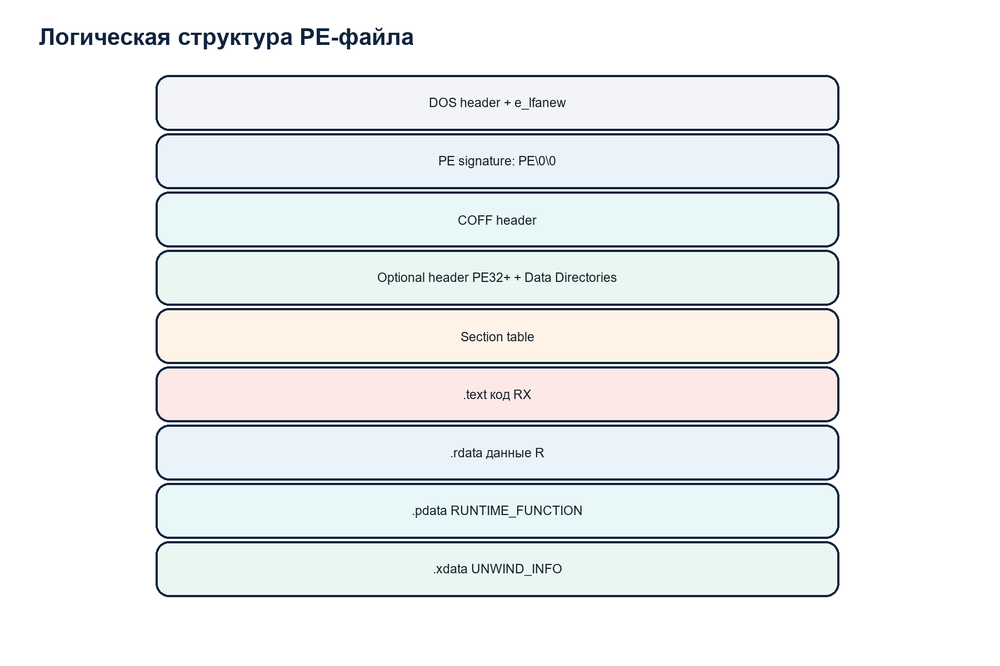

# Лекция 6. Диспетчеризация исключений и теория раскрутки Windows x64

## Центральная проблема

В момент исключения Windows получает состояние текущего потока: `RIP`, `RSP`, регистры и описание исключения. Чтобы искать обработчик выше по цепочке вызовов, системе необходимо последовательно восстановить состояния вызывающих функций.

На x86-64 это нельзя надёжно сделать только по машинному коду и нельзя считать, что каждая функция использует постоянный frame pointer. Compiler может изменять `RSP`, сохранять nonvolatile registers в разных местах и выполнять оптимизации. Поэтому Windows x64 ABI вводит ограничения на prolog и epilog и требует unwind metadata для nonleaf functions.

**Unwind**, далее раскрутка, — вычисление состояния caller из состояния callee. Оно включает восстановление stack pointer, instruction pointer и сохранённых nonvolatile registers. Слово «раскрутка» описывает движение от более глубокого stack frame к более раннему.

## Leaf и nonleaf function

**Leaf function** в данном контексте — функция, которая не изменяет nonvolatile state таким способом, который требует unwind description, и не вызывает другие функции. Если для текущего `RIP` отсутствует `RUNTIME_FUNCTION`, Windows может рассматривать frame как leaf: return address находится по `[RSP]`, после чего виртуальный `RSP` увеличивается на восемь.

**Nonleaf function** может выделять stack space, сохранять nonvolatile registers, устанавливать frame register и вызывать другие функции. Для неё требуется table entry.

Отсутствие `.pdata` не всегда является ошибкой. Image, состоящий только из leaf code, теоретически может не иметь записей. Поэтому эвристика `no_runtime_functions` имеет medium severity и прямо требует проверки сложности code. Если executable sections отсутствуют, проект даже не начисляет score и фиксирует информационное объяснение resource-only или forwarding image.

## RUNTIME_FUNCTION как индекс диапазона кода

На AMD64 запись имеет три 32-разрядных RVA:

```c
typedef struct RuntimeFunction {
    uint32_t begin_rva;
    uint32_t end_rva;
    uint32_t unwind_rva;
} RuntimeFunction;
```

Она описывает:

```text
[BeginAddress, EndAddress) -> UnwindInfoAddress
```

Диапазон является полуинтервалом. Запись применима, если:

```text
BeginAddress <= ControlPcRVA < EndAddress
```

Таблица должна быть отсортирована по `BeginAddress`. Сортировка позволяет системе эффективно искать запись по текущему control PC. Overlap и duplicate begin нарушают однозначность отображения code address в metadata.

Все адреса image-relative. Это делает table независимой от actual base при ASLR. Для получения VA:

```text
FunctionVA = ModuleBase + BeginRVA
UnwindVA   = ModuleBase + UnwindRVA
```

## UNWIND_INFO как описание обратного действия

Prolog изменяет входной context функции. Он может уменьшить `RSP`, сохранить `RBX`, `RBP`, `RSI`, `RDI`, `R12`–`R15`, сохранить nonvolatile XMM registers и установить frame pointer.

`UNWIND_INFO` кодирует действия, необходимые для отмены этих изменений. Это не копия инструкций и не общий bytecode CPU. Это компактная domain-specific encoding Windows ABI.

Header версии 1 занимает четыре bytes:

```text
byte 0: Version, 3 bits; Flags, 5 bits
byte 1: SizeOfProlog
byte 2: CountOfCodes
byte 3: FrameRegister, 4 bits; FrameOffset, 4 bits
```

После header расположен массив `UNWIND_CODE`. Каждая базовая slot занимает два bytes:

```text
CodeOffset : 1 byte
UnwindOp   : 4 bits
OpInfo     : 4 bits
```

Некоторые operations потребляют дополнительные slots как operands. Поэтому `CountOfCodes` — число двухбайтовых slots, а не число логических операций.

## Version и Flags

Три младших bits первого byte образуют `Version`. Нормативная Microsoft documentation для классической структуры описывает version 1. Проект также поддерживает version 2 epilog descriptors в ограниченной decoder policy, потому что такие данные встречаются в современных toolchains.

Пять старших bits образуют `Flags`. Для version 1 существенны:

```text
UNW_FLAG_EHANDLER = 1
UNW_FLAG_UHANDLER = 2
UNW_FLAG_CHAININFO = 4
```

`EHANDLER` означает наличие exception handler, используемого в search phase. `UHANDLER` означает termination handler, используемый в unwind phase. Оба формата хвоста содержат handler RVA после выровненного массива codes.

`CHAININFO` означает, что хвост содержит не handler RVA, а связанную `RUNTIME_FUNCTION`. Chained record переиспользует primary unwind information для фрагмента функции.

Сочетание `CHAININFO` с handler flags противоречит формату. Decoder должен фиксировать invalid chain, а не выбирать произвольную интерпретацию хвоста.

## SizeOfProlog и CodeOffset

`SizeOfProlog` — длина prolog в bytes. `CodeOffset` указывает offset после инструкции prolog, эффект которой описывает operation. Codes хранятся в descending order по `CodeOffset`, потому что раскрутка отменяет prolog в обратной последовательности.

Если exception произошёл внутри prolog, нельзя отменять instructions, которые ещё не были выполнены. Windows учитывает control PC относительно prolog. Статический проект не выполняет полный `RtlVirtualUnwind` для конкретного `ControlPc`; он проверяет structural order и агрегирует effects всей записи.

`CodeOffset > SizeOfProlog` является anomaly, потому что operation заявляет эффект за пределами declared prolog. Нарушение descending order также фиксируется.

## FrameRegister и FrameOffset

Четыре младших bits четвёртого header byte кодируют frame register. Значение zero означает отсутствие frame register. Остальные значения используют register numbering unwind format.

Четыре старших bits задают scaled offset. Реальный offset:

```text
FrameOffsetBytes = FrameOffset * 16
```

Если frame register отсутствует, ненулевой offset не имеет корректного смысла. Если указан volatile register, decoder отмечает operand anomaly, потому что frame register должен соответствовать ABI constraints.

Frame pointer не равен автоматически `RBP`. Encoding может указать другой допустимый nonvolatile register. Поэтому reverse engineer должен читать поле, а не переносить привычку из неиспользуемой compilation model.

## UWOP_PUSH_NONVOL

`UWOP_PUSH_NONVOL` описывает сохранение nonvolatile general-purpose register инструкцией push. `OpInfo` кодирует register.

Push уменьшает `RSP` на восемь и записывает register. При unwind операция читает сохранённое значение и увеличивает `RSP`. Для summary проекта фиксированный stack effect увеличивается на 8 bytes, а bit register добавляется в `saved_nonvol_mask`.

Если `OpInfo` указывает volatile register или `RSP`, metadata сомнительна. Decoder отмечает bad operand или operand sanity anomaly.

## UWOP_ALLOC_SMALL

`UWOP_ALLOC_SMALL` кодирует небольшое выделение stack:

```text
AllocationSize = OpInfo * 8 + 8
```

Operation не требует дополнительного slot. Возможный диапазон при четырёхбитовом `OpInfo`:

```text
8, 16, ..., 128 bytes
```

Для sample `benign_richer.exe` `OpInfo = 4`, поэтому:

```text
4 * 8 + 8 = 40 bytes
```

Это значение появляется в `fixed_stack_bytes` JSON report.

## UWOP_ALLOC_LARGE

`UWOP_ALLOC_LARGE` имеет два encoding modes.

При `OpInfo = 0` следующий slot хранит 16-разрядное значение, масштабированное на восемь:

```text
AllocationSize = operand16 * 8
```

При `OpInfo = 1` следующие два slots образуют полное 32-разрядное allocation size без scaling.

Другие `OpInfo` недопустимы. Недостаток operand slots означает truncated record.

Проект вычисляет fixed stack size с saturating behavior. Если сумма выходит за `uint32_t`, она ограничивается максимальным значением и помечается anomaly. Это предпочтительнее wraparound, при котором огромный stack effect ошибочно превратился бы в малое число.

## UWOP_SET_FPREG

`UWOP_SET_FPREG` сообщает, что prolog установил declared frame register. Дополнительных operands нет. Смысл операции зависит от header fields `FrameRegister` и `FrameOffset`.

Если header не задаёт frame register, наличие `SET_FPREG` противоречиво. Если declared frame register не является допустимым nonvolatile register, decoder отмечает anomaly.

При анализе disassembly нужно найти instruction, которая формирует relation:

```text
FrameRegister = RSP + FrameOffsetBytes
```

или эквивалентную разрешённую форму prolog.

## UWOP_SAVE_NONVOL и UWOP_SAVE_NONVOL_FAR

Эти operations описывают сохранение nonvolatile general-purpose register через memory store, а не push.

`UWOP_SAVE_NONVOL` использует один дополнительный slot:

```text
StackOffset = operand16 * 8
```

`UWOP_SAVE_NONVOL_FAR` использует два slots:

```text
StackOffset = operand32
```

Operation сообщает место сохранения register относительно stack frame. Она не означает дополнительное выделение stack: allocation обычно описывается отдельным `ALLOC_SMALL` или `ALLOC_LARGE`. Поэтому summary добавляет register в mask, но не должен дважды прибавлять offset к `fixed_stack_bytes`.

## XMM operations

`UWOP_SAVE_XMM128` и `UWOP_SAVE_XMM128_FAR` описывают сохранение nonvolatile SIMD register.

Обычная форма использует:

```text
StackOffset = operand16 * 16
```

Far form использует полный 32-разрядный offset. Масштаб 16 соответствует размеру 128-bit XMM value и alignment constraints.

Проект хранит `saved_xmm_mask`, где bit N означает XMMN. На Windows x64 ABI nonvolatile являются XMM6–XMM15. Сохранение volatile XMM register в unwind metadata вызывает sanity signal.

## UWOP_PUSH_MACHFRAME

`UWOP_PUSH_MACHFRAME` описывает machine frame, созданный при переходе через interrupt или exception mechanism. `OpInfo` различает frame с error code и без него.

Эта operation не эквивалентна обычному `push`. Она моделирует системный набор полей, включающий control state. Stack effect зависит от variant. Неподдерживаемое `OpInfo` является bad operand.

В обычном прикладном code такая operation редка, но decoder обязан корректно распознавать её, иначе valid system-oriented metadata будет ошибочно объявлена повреждённой.

## Padding и выравнивание хвоста

Поскольку каждый code slot имеет два bytes, конец массива может оказаться не выровнен на четыре bytes. Handler RVA или chained `RUNTIME_FUNCTION` должен начинаться на DWORD boundary.

Если `CountOfCodes` нечётно, после последнего значимого slot присутствует padding slot:

```text
tail_offset = 4 + 2 * align_up(CountOfCodes, 2)
```

или эквивалентно количество slots округляется до чётного.

Ошибка здесь смещает чтение handler RVA на два bytes и полностью разрушает последующую интерпретацию. Поэтому alignment является самостоятельным проверяемым invariant.

## Handler tail

При `EHANDLER` или `UHANDLER` после aligned code array находится 32-разрядный `HandlerRVA`. За ним может следовать language-specific data, формат которых зависит от конкретного handler.

EH/Unwind Analyzer читает только handler RVA. Он не декодирует C scope tables, C++ exception structures или конкретные compiler runtime records. Поэтому `has_handler = true` означает наличие frame handler pointer по общему формату, но не раскрывает семантику языка.

Heuristic engine проверяет section, в которую попадает handler RVA:

- отсутствующая или non-executable section;
- writable section;
- dominance одного handler среди множества records.

Эти свойства не подменяют disassembly handler.

## Chained unwind info

При `CHAININFO` хвост содержит полную тройку:

```text
BeginAddress
EndAddress
UnwindInfoAddress
```

Она связывает текущий fragment с другой unwind record. Chaining позволяет описывать discontiguous или разделённые prolog regions без полного дублирования.

Decoder проверяет:

- правильность flag combination;
- валидность range;
- нахождение адресов внутри image;
- отсутствие очевидного self-loop;
- ограничение глубины follow;
- отсутствие цикла по уже посещённым unwind RVA.

Ограничение глубины является защитой parser, а не свойством Windows semantics. Без него специально созданная длинная цепочка могла бы вызвать чрезмерную работу или recursion.

## Virtual unwind

**Virtual unwind** означает вычисление caller context без фактического исполнения epilog. В логической форме система:

1. находит table entry для текущего `RIP`;
2. определяет положение внутри prolog, body или epilog;
3. применяет relevant unwind operations;
4. восстанавливает nonvolatile registers;
5. получает return address;
6. формирует caller `RIP` и `RSP`;
7. повторяет поиск для caller.

Если текущий адрес находится в epilog, Windows может распознать разрешённую форму epilog и симулировать оставшиеся действия. Именно поэтому x64 ABI ограничивает структуру epilog.

EH/Unwind Analyzer не является stack walker. Он декодирует metadata вне конкретного runtime context. Поэтому он способен сказать, что record описывает 40-byte allocation и сохранение register, но не вычисляет caller context для заданных `RIP/RSP`.

## Search phase и unwind phase

Во время search phase dispatcher проверяет frame handlers, чтобы определить, может ли какой-либо из них обработать exception. Контекст виртуально перемещается вверх, но реальное выполнение функции ещё не сворачивается.

После выбора handler начинается unwind phase. Система возвращается по frames до target, вызывает termination handlers и восстанавливает состояние согласно правилам.

Различие объясняет флаги `EHANDLER` и `UHANDLER`. Один handler может участвовать в поиске, другой — в cleanup при раскрутке.

## Почему metadata интересна reverse engineer

Unwind metadata создана прежде всего для runtime correctness, но содержит структурные сведения:

- границы функций;
- наличие prolog и его размер;
- fixed stack allocation;
- nonvolatile registers;
- frame register;
- handler address;
- chain relations.

Даже если symbols удалены, `.pdata` сохраняет function ranges для многих nonleaf functions. Это делает её источником восстановления function map.

Одновременно защитные системы, packers, virtual machines и JIT runtimes могут:

- централизовать handlers;
- регистрировать dynamic tables;
- размещать metadata необычно;
- использовать exception-driven control flow;
- создавать records, затрудняющие автоматический анализ.

Но необычность не равна вредоносности. Compiler runtime, managed runtime и JIT также законно используют сложные handlers и dynamic tables. Поэтому проект строит evidence, а не бинарный детектор.

## Инварианты, которые проверяет проект

Инварианты `RUNTIME_FUNCTION`:

```text
EndRVA > BeginRVA
BeginRVA < SizeOfImage
EndRVA <= SizeOfImage
UnwindRVA != 0
UnwindRVA < SizeOfImage
table sorted by BeginRVA
ranges do not overlap
```

Инварианты `UNWIND_INFO`:

```text
supported version
header and all operand slots are file-backed
CodeOffset <= SizeOfProlog
CodeOffset order is descending
opcode and OpInfo combination is valid
tail is correctly aligned
handler and chain addresses are plausible
chain traversal is bounded and acyclic
```

Нарушение отдельного invariant локализуется в `UnwindSummary.anomalies` или `parse_error`. Затем heuristic layer агрегирует число нарушений и их распространённость.

## Разбор фактической записи sample

Для одной функции `benign_richer.exe`:

```text
RUNTIME_FUNCTION:
BeginRVA  = 0x1010
EndRVA    = 0x1029
UnwindRVA = 0x4004
```

Функция занимает:

```text
0x1029 - 0x1010 = 0x19 = 25 bytes
```

По `UnwindRVA 0x4004` decoder читает header версии 1. `SizeOfProlog = 4`. Массив codes содержит `UWOP_ALLOC_SMALL` с `OpInfo = 4`.

Следовательно:

```text
FixedStackBytes = 4 * 8 + 8 = 40
```

Handler flags отсутствуют, chain отсутствует, anomalies равны zero. Итог summary говорит не «функция безопасна», а:

- record структурно прочитан;
- declared prolog length равен 4;
- metadata описывает fixed allocation 40 bytes;
- дополнительных сохранённых registers и handlers нет;
- поддерживаемые invariants не нарушены.

## Граница доказательства

Parser может подтвердить внутреннюю согласованность metadata, но не полное соответствие реальному machine code. Для этого нужно сопоставить каждую unwind operation с prolog instructions в disassembler. Например, `ALLOC_SMALL 40` должен соответствовать изменению `RSP` на 40 bytes разрешённой prolog instruction.

Таким образом имеются три уровня:

```text
syntactic validity
-> semantic validity внутри формата
-> correspondence с фактическим кодом
```

Проект автоматизирует первые два уровня частично. Третий остаётся manual reverse-engineering task и должен быть явно назван на защите.

## Нормативные источники

- Microsoft, [x64 exception handling](https://learn.microsoft.com/en-us/cpp/build/exception-handling-x64?view=msvc-170).
- Microsoft, [x64 prolog and epilog](https://learn.microsoft.com/en-us/cpp/build/prolog-and-epilog?view=msvc-170).
- Microsoft, [x64 calling convention](https://learn.microsoft.com/en-us/cpp/build/x64-calling-convention?view=msvc-170).
- Microsoft, [PE Format, `.pdata` section](https://learn.microsoft.com/en-us/windows/win32/debug/pe-format).

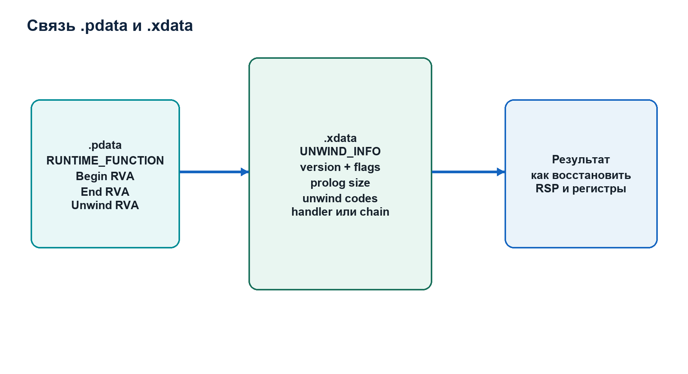

# Лекция 7. Метод reverse engineering: от наблюдения к проверяемому выводу

## Reverse engineering как дисциплина вывода

**Reverse engineering**, далее обратный анализ или реверс-инжиниринг, — восстановление структуры, поведения и назначения программной системы по доступным артефактам без опоры на её исходную design documentation. Для бинарного анализа артефактами служат bytes файла, machine code, metadata, imports, runtime memory, execution events и результаты контролируемых экспериментов.

Обратный анализ не сводится к чтению disassembly. Disassembly является одним представлением. Надёжный вывод строится как цепочка:

```text
наблюдаемый факт
-> интерпретация по формату или ABI
-> гипотеза о поведении
-> независимая проверка
-> ограниченный вывод
```

Если аналитик перепрыгивает от одного необычного byte к заключению о назначении программы, он совершает логическую ошибку. EH/Unwind Analyzer специально разделяет raw facts, findings, score, confidence и manual validation steps, чтобы сделать эту дисциплину явной.

## Статический и динамический анализ

**Static analysis** исследует файл и производные представления без исполнения target. Он воспроизводим для одного и того же файла и не зависит от достигнутого runtime path. Статический анализ способен охватить недостигаемые в одном запуске sections и records, но не доказывает, что code был выполнен.

**Dynamic analysis** наблюдает конкретное исполнение. Он подтверждает достигнутые события и значения состояния, но охватывает только path, определённый аргументами, environment, timing и внешними данными.

Эти методы не конкурируют. Они отвечают на разные вопросы.

Статика может установить:

```text
UNWIND_INFO указывает HandlerRVA 0x5120
```

Динамика может установить:

```text
VA base+0x5120 был достигнут потоком 1480 после exception
```

Только совместно они подтверждают, что handler, заявленный конкретной metadata, реально участвовал в исследованном execution path. Даже этот вывод не объясняет назначение handler; для этого требуется code analysis.

## Нормативный факт, implementation fact и аналитический вывод

Рабочие записи должны маркировать происхождение утверждений.

**Нормативный факт** следует из specification или ABI. Например: `RUNTIME_FUNCTION` AMD64 содержит три image-relative 32-bit fields.

**Implementation fact** следует из исходного кода инструмента. Например: проект начисляет 25 score points за exception directory out of bounds.

**Observation** следует из конкретного sample или run. Например: в `benign_richer.exe` exception directory имеет RVA `0x3000` и size `0x24`.

**Analytical conclusion** связывает факты и наблюдения. Например: directory содержит три полных entries и не имеет incomplete tail.

Вес heuristic не является нормативным фактом Microsoft. Отсутствие такого различия делает объяснение проекта научно некорректным.

## Chain of custody для бинарного артефакта

До анализа следует зафиксировать identity input:

- исходный путь;
- размер;
- SHA-256;
- время получения;
- источник;
- условия хранения;
- копию для работы.

**SHA-256** — cryptographic hash function, формирующая 256-bit digest. В проекте digest кодируется 64 lowercase hexadecimal symbols. Hash позволяет проверить, что два отчёта относятся к одним bytes. Он не подтверждает добросовестность источника и не является digital signature.

Проект записывает `input_sha256` и `input_size` в report metadata. Это связывает analytical output с exact input.

При динамическом анализе неизвестного binary следует использовать изолированную Windows environment, snapshot и контролируемую сеть. Тот факт, что collector не предназначен для обхода защит, не делает запуск неизвестного файла безопасным.

## Первый проход: определить класс объекта

До изучения functions нужно ответить:

- является ли input PE image;
- какая архитектура указана;
- EXE это или DLL;
- каковы section layout и permissions;
- присутствует ли exception directory;
- не повреждены ли ranges;
- совпадает ли hash с ожидаемым sample.

EH/Unwind Analyzer автоматизирует часть этого прохода только для PE32+ AMD64. Он не заменяет универсальный PE viewer, signature verification, import analysis или malware sandbox.

## Ghidra как статическая платформа

Ghidra — framework для software reverse engineering. Для проекта важны:

- import PE;
- memory map;
- disassembler;
- function manager;
- decompiler;
- symbol and reference navigation;
- scripting.

После import Ghidra строит собственную program database. Она не равна исходному PE-файлу. В ней хранятся разобранные memory blocks, functions, labels, references, types и пользовательские annotations.

**Disassembler** переводит machine-code bytes в assembly instructions согласно выбранной architecture и address context.

**Decompiler** строит high-level intermediate representation и затем C-like text. Его output не является исходным C-кодом. Имена, types и control structures являются реконструкцией, подверженной ошибкам.

## Адресная синхронизация

EH/Unwind Analyzer выводит RVA. Ghidra обычно показывает image-based addresses. Для declared base:

```text
GhidraAddress = ImageBase + RVA
```

Если Ghidra imported image с base `0x140000000`, то function begin RVA `0x1010` находится по:

```text
0x140000000 + 0x1010 = 0x140001010
```

В debugger:

```text
RuntimeVA = ActualModuleBase + RVA
```

RVA служит стабильным идентификатором позиции внутри image между static и dynamic representations.

Нужно всегда записывать, какой тип адреса используется. Строка `0x140001010` без обозначения VA или preferred VA недостаточна.

## Импорт CSV из проекта

Проект способен сформировать Ghidra-oriented CSV:

```text
begin_rva,end_rva,name,comment
```

Импортирующий script может:

- создать или уточнить function boundaries;
- присвоить synthetic names вида `sub_00001010`;
- добавить comment с decoded unwind summary.

Это enrichment, а не доказательство правильности decompilation. Если metadata повреждена или намеренно искажена, автоматически созданные function boundaries также могут быть неверны. Поэтому findings table должна проверяться до массового доверия imported map.

## Анализ функции по слоям

Для каждой подозрительной function рекомендуется одна и та же последовательность.

Сначала установить boundary source: определена ли функция по `.pdata`, symbol, call target, prolog pattern или manual creation.

Затем исследовать raw instructions:

- какие bytes образуют prolog;
- как изменяется `RSP`;
- какие nonvolatile registers сохраняются;
- выполняются ли calls;
- где находятся epilogs;
- имеются ли indirect branches.

После этого сравнить metadata:

- совпадает ли `SizeOfProlog`;
- соответствует ли `ALLOC_*` изменению `RSP`;
- совпадают ли `PUSH_NONVOL` и `SAVE_NONVOL`;
- соответствует ли frame register;
- указывает ли handler на executable code.

Лишь затем исследовать decompiler output и data flow.

## Сопоставление prolog и UNWIND_INFO

Пусть disassembly начинается:

```asm
sub rsp, 28h
```

Immediate `0x28` равен 40 decimal bytes. Metadata `UWOP_ALLOC_SMALL` с `OpInfo = 4` также описывает:

```text
4 * 8 + 8 = 40
```

Совпадение подтверждает semantic correspondence для allocation.

Если metadata заявляет сохранение `RBX`, нужно найти соответствующий `push rbx` или store в stack slot в пределах prolog. Если instruction находится после declared `SizeOfProlog`, metadata и code расходятся.

Такой анализ выполняется instruction-by-instruction. Недостаточно увидеть, что общий stack size похож.

## Control flow graph

**Control Flow Graph**, сокращённо CFG, — ориентированный граф, vertices которого являются basic blocks, а edges — возможные передачи управления.

**Basic block** — последовательность instructions с одним входом и завершением на branch, return, call с особой моделью или другом boundary.

Exception-based flow может отсутствовать в обычных explicit branch edges. Handler address приходит из metadata или runtime registration. Поэтому EH/Unwind analysis добавляет к CFG неявные связи:

```text
protected function/frame -> frame handler
registration call -> registered VEH/VCH/UEF
exception event -> reached handler
```

Эти связи нужно хранить отдельно от прямых machine-code jumps, потому что их semantics и условия активации различаются.

## Data flow

**Data flow analysis** исследует происхождение и использование values. Для API registration:

```text
RCX/RDX/R8/R9 at function entry
```

являются ABI locations аргументов. Однако регистровое значение само по себе может быть pointer, integer, handle или bit field в зависимости от prototype.

Для `AddVectoredExceptionHandler`:

```text
RCX = First
RDX = Handler
```

Для `RtlAddFunctionTable`:

```text
RCX = FunctionTable
RDX = EntryCount
R8  = BaseAddress
```

После capture нужно проверить pointer ranges, memory protection, module ownership и pointed data. Collector пока записывает arguments, но не выполняет полный remote table parser.

## Cross-reference analysis

**Cross-reference**, сокращённо xref, — связь между местом использования и target address, symbol или data object.

Для dominant handler следует определить:

- сколько `UNWIND_INFO` records на него ссылаются;
- какие functions покрываются этими records;
- принадлежит ли handler compiler runtime;
- кто вызывает или регистрирует related code;
- есть ли indirect references;
- какие exception codes он проверяет;
- куда передаёт control.

Высокий reuse может быть нормален для language runtime. Решение требует context, а не только ratio.

## Debugger breakpoint strategy

Каждый breakpoint должен отвечать на сформулированный вопрос.

Breakpoint на registration API отвечает: была ли регистрация, и какие arguments переданы?

Breakpoint на handler entry отвечает: был ли handler фактически достигнут?

Breakpoint на `RtlAddFunctionTable` отвечает: регистрировалась ли dynamic table?

Breakpoint на конкретный instruction после handler отвечает: какой branch выбран после проверки exception?

Избыточные breakpoints создают data volume, но не обязательно увеличивают evidence.

## Software breakpoint limitations

Запись `0xCC` изменяет target memory. Это вмешательство может быть обнаружено anti-debug logic, конфликтовать с self-modifying code или racing threads.

Если другой поток исполняет address между снятием и re-arm breakpoint, hit может быть пропущен. Per-thread pending list исправляет логическую потерю re-arm, но не устраняет все concurrency races inherent software breakpoints.

Hardware breakpoints не изменяют code bytes, но ограничены register resources и имеют собственные semantics. Текущий проект их не использует.

Следовательно, отсутствие hit не доказывает, что code никогда не исполнялся при всех условиях.

## First-chance workflow

При first-chance exception аналитик фиксирует:

- exception code;
- exception address;
- thread;
- module and RVA;
- register context;
- stack;
- наличие ожидаемого handler;
- дальнейший continuation status.

Затем debugger должен передать исключение системе как unhandled, если цель — наблюдать обычную application dispatch. Именно так поступает collector.

Если debugger объявит исключение handled, application handlers могут не получить управление. Это пример того, как метод наблюдения способен изменить объект наблюдения.

## Handler investigation

При попадании в handler необходимо определить:

- класс handler: frame-based, VEH, VCH или UEF;
- prototype и arguments;
- exception record fields;
- context record usage;
- return disposition;
- writes to context;
- transfers to dispatcher or original path;
- повторное создание exception.

VEH получает `PEXCEPTION_POINTERS`, включающий pointers на exception record и context record. Изменение context может перенаправить выполнение. Но факт записи в context ещё нужно связать с последующим `RIP`.

Текущий collector фиксирует handler hit и ограниченную RIP trace, но не сериализует полный context diff. Это одна из честных границ продукта.

## Static-dynamic correlation

Correlation должна иметь явный join key. В проекте им может быть:

- handler RVA;
- module + offset;
- event type;
- function range;
- section property;
- dynamic table base.

Например:

```text
static:
HandlerRVA 0x5120 находится в writable section

dynamic:
handler VA ActualBase+0x5120 был достигнут

correlated conclusion:
статически заявленный handler из writable section участвовал в данном run
```

Project-level `has_static_dynamic_correlation` использует более агрегированные rules: suspicious static handler context плюс handler hits, либо placement anomalies плюс runtime function table registration. Это useful summary, но manual investigation должна сохранять exact address relation.

## Evidence strength и falsifiability

Хорошая гипотеза допускает проверку, способную её опровергнуть.

Гипотеза:

```text
dominant handler является normal compiler runtime helper
```

Проверки:

- symbol or signature identification;
- comparison с binaries того же compiler;
- code semantics;
- exception codes;
- references from normal try/catch functions.

Гипотеза:

```text
handler реализует exception-driven dispatcher
```

Проверки:

- изменяет `ContextRecord.Rip`;
- выбирает destinations по state;
- вызывается для множества protected functions;
- dynamic trace уходит в dispatcher loop;
- control-flow pattern воспроизводится при разных inputs.

Вывод должен сохранять альтернативные объяснения, пока они не исключены.

## Отчёт reverse engineer

Полноценный analytical report включает:

- input identity;
- environment and tool versions;
- scope;
- observations;
- адреса с указанием coordinate system;
- screenshots или disassembly excerpts;
- static findings;
- runtime events;
- correlations;
- excluded hypotheses;
- remaining uncertainty;
- reproducible commands.

JSON проекта является machine-readable evidence package. HTML является human-review projection той же модели. Ни один из них автоматически не заменяет narrative analyst report о semantics code.

## Практический протокол для EH/Unwind Analyzer

1. Вычислить SHA-256 и сохранить sample.
2. Запустить static mode с JSON, HTML и Ghidra CSV.
3. Проверить PE structural counters.
4. Отсортировать findings по severity и family.
5. Для каждого representative RVA выполнить RVA-to-VA и RVA-to-file-offset conversion.
6. Открыть соответствующий record и function в Ghidra.
7. Сопоставить prolog и unwind codes.
8. Исследовать handler xrefs и code semantics.
9. На Windows запустить dynamic mode с контролируемыми arguments.
10. Сопоставить events с static addresses.
11. Проверить manual validation steps из report.
12. Сформулировать conclusion с границами evidence.

Эта последовательность превращает output инструмента в метод исследования, а не в замену профессионального анализа.

## Что означает компетентность после лекции

Студент должен уметь:

- отделять disassembly от decompilation;
- объяснять, почему static и dynamic evidence не взаимозаменяемы;
- преобразовывать RVA между Ghidra и runtime debugger;
- проверить `UNWIND_INFO` по prolog instructions;
- исследовать handler не только по адресу, но по data flow и return semantics;
- назвать вмешательство software breakpoint;
- сформулировать вывод так, чтобы было видно, что доказано, а что остаётся гипотезой.

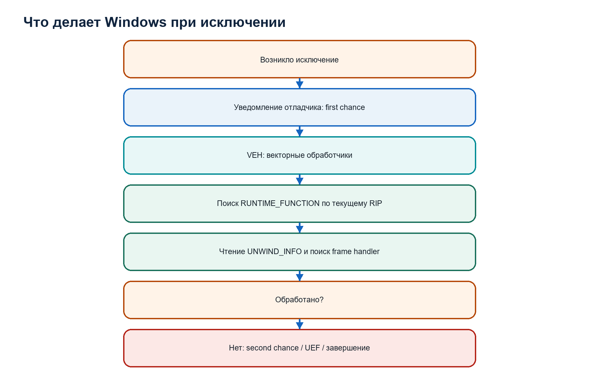

# Том II. EH/Unwind Analyzer: полная инженерная модель проекта

## Что именно должно быть понято во втором томе

Исходный код проекта нельзя полноценно объяснить как независимый список файлов. Функции образуют последовательность преобразований, а структуры данных являются промежуточными состояниями одного анализа.

Полное понимание проекта требует уметь проследить две взаимосвязанные цепочки.

Первая цепочка — цепочка данных:

```text
путь к файлу
-> байты файла
-> модель PE image
-> таблица runtime functions
-> summaries unwind metadata
-> статические findings
-> динамические события
-> JSON, HTML и CSV
```

Вторая цепочка — цепочка доверия:

```text
недоверенный внешний ввод
-> доказанная доступность диапазона
-> доказанная структурная интерпретация
-> проверенная внутренняя модель
-> эвристическая интерпретация
-> ручная верификация
```

Если читатель понимает только первую цепочку, он знает, куда передаются структуры, но может не понимать надёжность вывода. Если понимает только вторую, но не знает фактический код, он не способен объяснить реализацию. Поэтому каждый модуль будет рассмотрен одновременно как преобразователь данных и как граница доверия.

## Предметная область проекта

Проект называется `EH/Unwind Analyzer`.

`EH` — сокращение от `Exception Handling`, обработка исключений.

`Unwind` — процесс восстановления состояния предыдущих вызовов функции, в частности значения stack pointer и сохранённых nonvolatile registers.

`Analyzer` — программный инструмент, который извлекает свойства исследуемого объекта и формирует аналитическое представление.

Полное назначение проекта:

> Проект статически разбирает Windows PE32+ AMD64 images, извлекает таблицу функций и x64 unwind metadata, проверяет структурную согласованность, формирует объяснимые эвристические признаки и отчёты, а в Windows-сборке может дополнительно наблюдать exception-related runtime events при запуске target под debugger.

Каждая часть формулировки ограничивает область продукта.

`PE32+` означает 64-битную разновидность PE optional header. Это не означает поддержку любого 64-битного формата.

`AMD64` означает конкретную архитектуру и её модель unwind. ARM64 использует другой формат.

`Статически разбирает` означает, что основное ядро читает файл как данные и не выполняет target.

`Эвристические признаки` означает, что проект не выдаёт математическое доказательство вредоносности.

`Windows-сборка` ограничивает настоящий dynamic collector, потому что он использует Windows Debug API.

## Граница продукта

Проект не выполняет следующие задачи:

- полное дизассемблирование `.text`;
- декомпиляцию программы;
- восстановление исходного C/C++;
- универсальную классификацию malware;
- эмуляцию всех возможных путей;
- kernel-mode tracing;
- поддержку PE32 x86;
- поддержку ARM64 unwind;
- поддержку ELF или Mach-O;
- автоматическое доказательство соответствия каждого `UNWIND_INFO` машинному прологу;
- полное декодирование всех language-specific exception tables.

Это не список недостатков, а определение архитектурной границы. Завершённость продукта оценивается относительно заявленного scope.

## Архитектурный тип

Основные алгоритмы собираются в статическую библиотеку:

```cmake
add_library(ehua_core STATIC ...)
```

CLI собирается отдельным executable и связывается с ядром:

```cmake
add_executable(eh_unwind_analyzer src/main.c)
target_link_libraries(eh_unwind_analyzer PRIVATE ehua_core)
```

Такую систему корректно называть модульным монолитом с библиотечным ядром.

`Монолит` означает, что штатный анализ выполняется одним процессом и компоненты взаимодействуют через вызовы функций и C-структуры, а не через сеть.

`Модульный` означает, что ответственность разделена между исходными модулями с явными интерфейсами.

`Библиотечное ядро` означает, что основная логика не находится исключительно внутри `main`, а собрана в переиспользуемый target `ehua_core`.

Это решение соответствует характеру задачи. Между чтением PE header и декодированием unwind передаются маленькие структуры и массивы. Выделение этих стадий в отдельные сетевые сервисы не повысило бы точность, но добавило бы сериализацию и failure modes.

Над модульным монолитом существует отдельный слой поставки. Он не участвует в
алгоритме анализа и не превращает ядро в микросервисную систему:

```text
аналитическое ядро и CLI
-> CMake/CTest/CPack
-> release manifest и quality passport
-> Windows, macOS, source и evidence packages
```

`scripts/create_release_bundles.py` собирает воспроизводимые архивы для разных
получателей. Это release orchestration, а не новый analytical module. Поэтому
архитектурный тип самого анализатора остаётся прежним: один CLI process,
статическая библиотека `ehua_core` и модульные границы внутри процесса.

## Модули и их строгие контракты

### `util.c`

Предоставляет примитивы, на которых основана безопасность остальных модулей:

- загрузку файла;
- bounds-safe чтение;
- little-endian decoding;
- динамический строковый буфер;
- атомарную запись;
- SHA-256.

`util.c` не знает формат PE. Это уровень общих операций над байтами и выходными файлами.

### `pe.c`

Преобразует `Buf` в `PeImage`.

Вход: неизменяемая последовательность байтов.

Выход: проверенные ключевые поля PE и массив секций, а также счётчики структурных нарушений.

`pe.c` определяет систему координат, необходимую всем последующим модулям.

### `unwind.c`

Использует `PeImage`, чтобы:

- найти exception directory;
- прочитать массив `RUNTIME_FUNCTION`;
- преобразовать `UnwindInfoAddress` в file offset;
- декодировать `UNWIND_INFO`;
- вычислить сводные свойства;
- зафиксировать аномалии и parse failures.

### `heuristics.c`

Не читает исходный файл самостоятельно. Он получает уже построенные модели и агрегирует наблюдения.

Это принципиальная граница: heuristic rule не должна обходить parser и заново интерпретировать недоверенные байты по своим правилам.

### `dynamic_win.c`

В Windows-сборке создаёт target process под debugger и собирает bounded runtime evidence. Он использует статические handler RVA для установки breakpoints после определения loaded image base.

В не-Windows сборке экспортирует тот же интерфейс, но возвращает контролируемое сообщение о недоступности режима.

### `report.c`

Сериализует внутренние модели. Он не должен менять score, повторно анализировать PE или владеть переданными массивами.

### `app_info.c`

Создаёт provenance:

- tool version;
- schema version;
- compiler;
- platform;
- build mode;
- timestamp.

### `main.c`

Является orchestration layer:

- разбирает CLI;
- определяет требуемые режимы;
- вызывает модули в правильном порядке;
- управляет временем жизни объектов;
- агрегирует ошибки в exit code;
- инициирует запись outputs.

## Почему CLI и ядро разделены

CLI является одним способом использования ядра. Он решает вопросы пользовательского интерфейса:

- как записываются options;
- какие defaults применяются;
- что печатается в терминал;
- какие файлы создавать;
- какой вернуть exit code.

Ядро решает предметную задачу:

- как разобрать PE;
- как декодировать unwind;
- как вычислить findings;
- как сформировать report model.

Такое разделение позволяет backend запускать CLI как worker. Сетевой API между backend и ядром необязателен. Backend может передать путь процессу и получить JSON.

Если в будущем потребуется прямой library API, `ehua_core` уже отделён, но публичный стабильный ABI потребует дополнительного проектирования opaque handles и versioning structures.

## Главные структуры как состояния анализа

### `Buf`

```c
typedef struct Buf {
    const uint8_t* data;
    size_t size;
} Buf;
```

Состояние: файл загружен, но его формат ещё не доказан.

### `PeImage`

Состояние: обязательные PE32+ AMD64 headers разобраны, sections известны, RVA mapping возможен.

### `RuntimeFunction[]`

Состояние: exception directory интерпретирован как последовательность троек begin/end/unwind RVA.

### `UnwindSummary[]` и `us_ok[]`

Состояние: для каждой runtime function выполнена попытка декодирования. `us_ok[i]` отделяет успешную структурную интерпретацию от failure. `UnwindSummary` сохраняет и результат, и причину ошибки.

### `HeuristicReport`

Состояние: низкоуровневые наблюдения агрегированы в findings, score, confidence, verdict и mitigations.

### `DynamicReport`

Состояние: один ограниченный runtime experiment завершён либо не выполнен. Содержит counters, events, trace и status.

### `ReportMetadata`

Состояние: результат связан с конкретной версией инструмента, временем и SHA-256 входа.

## Почему используются параллельные массивы

Для `N` runtime functions проект выделяет:

```c
UnwindSummary* us;
bool* us_ok;
```

Индекс связывает:

```text
rf[i] <-> us[i] <-> us_ok[i]
```

`rf[i]` описывает диапазон функции и RVA metadata.

`us[i]` содержит декодированную сводку либо заполненную ошибку.

`us_ok[i]` сообщает, допустимо ли использовать основные decoded fields.

Почему success не определяется только `us[i].valid`? Внутренняя структура действительно содержит `valid`, но внешний массив success обеспечивает простой единообразный контракт для heuristics и reports. Нулевая структура после `calloc` не должна ошибочно считаться успешным результатом.

Недостаток модели — необходимость поддерживать одинаковую длину и порядок массивов. `main` создаёт их одновременно на основании `rf_count`, а report validation проверяет наличие pointers при ненулевом количестве.

## Ownership graph

Память в C не освобождается автоматически по выходу из всей программы, если она выделена в heap. Для краткоживущего CLI ОС освободила бы адресное пространство после exit, но корректное явное освобождение необходимо для:

- unit tests;
- sanitizer checks;
- библиотечного использования;
- ранних ошибок;
- предотвращения накопления ресурсов.

Граф владения:

```text
main
├── owned input bytes
├── PeImage.sections
├── RuntimeFunction[]
├── UnwindSummary[]
├── us_ok[]
├── HeuristicReport.details
├── DynamicReport.details
└── локальные StrBuf
```

Конкретные release functions:

```text
buf_free_owned
pe_free
free
heuristics_free
dynamic_report_free
sb_free
```

Report writers получают borrowed pointers. Они не освобождают модели и не хранят их после возврата.

## Error model

Проект различает несколько уровней ошибки.

### CLI error

Неверная option или значение. Exit code `2`.

### Input or structural fatal error

Файл не читается, не является поддерживаемым PE или exception directory невозможно прочитать. Exit code `1`.

### Per-record parse failure

Одна `UNWIND_INFO` не декодируется, но анализ остальных records продолжается. Ошибка становится частью отчёта и heuristics.

### Analytical finding

Наблюдение подозрительно, но анализ технически успешен. Exit code не обязан становиться ненулевым.

### Output error

Не удалось сформировать metadata или записать requested report. Exit code `1`.

### Dynamic session failure

Collector не запустился или не завершил требуемую операцию. Exit code `1`, но при возможности status отражается в `DynamicReport`.

Критически важно: score выше нуля не является технической ошибкой выполнения инструмента.

## Почему analysis продолжается при локальной ошибке

Если одна unwind structure повреждена, прекращение всего анализа уничтожило бы информацию о тысячах остальных функций. Проект использует устойчивую модель:

```text
ошибка конкретной записи
-> us_ok[i] = false
-> parse_error сохраняется
-> цикл продолжается
-> heuristic counter увеличивается
-> отчёт содержит failure
```

Такой подход называется fault containment на уровне записи: локальная ошибка не должна разрушать весь результат, если верхнеуровневая структура всё ещё позволяет безопасное продолжение.

## Доказательная модель

Проект не переходит непосредственно от байтов к verdict. Между ними существуют уровни.

```text
байты
-> parsed fields
-> validation counters
-> findings
-> evidence families
-> score/confidence
-> static/dynamic assessment
-> manual validation
```

`Parsed field` — значение, извлечённое по формату.

`Validation counter` — число нарушений конкретного условия.

`Finding` — структурированное аналитическое сообщение с code, family, severity и location.

`Score` — сумма инженерных weights.

`Confidence` — оценка силы и разнообразия evidence с weakening rules.

`Assessment` — объединение static и dynamic levels.

`Manual validation` — действия, которые должен выполнить человек.

Чем выше уровень, тем больше интерпретации и тем меньше допустимо выдавать результат за нормативный факт.

## Сквозной инвариант неизменности входа

Static core объявляет байты:

```c
const uint8_t* data;
```

Functions принимают:

```c
const Buf* b;
```

`const` выражает контракт: parser не модифицирует вход. Это позволяет:

- вычислить SHA-256 тех же байтов;
- сравнивать результаты разных стадий;
- безопасно повторять parsing;
- исключить случайное patching target;
- использовать вход как immutable evidence artifact.

Динамический target является отдельным process и может изменять собственную memory. Это не меняет сохранённый input buffer анализатора.

## Связь модулей с теоретическим фундаментом

| Теоретическое понятие | Реализация проекта |
|---|---|
| конечная последовательность байтов | `Buf` |
| файловое смещение | параметр `off`, section raw pointers |
| little-endian integer | `le16`, `le32`, `le64` |
| виртуальный образ | `PeImage` |
| RVA | поля sections/runtime functions |
| ABI и stack frame | decoded unwind operations |
| exception dispatch | handlers и dynamic events |
| множество и частота | hash maps heuristics |
| сериализация | `report.c` |
| процесс и поток | `dynamic_win.c` |
| жизненный цикл ресурса | ownership и cleanup |
| контракт | headers в `include/` |
| доказательство корректности | unit/regression/schema tests |
| воспроизводимая поставка | `scripts/create_release_bundles.py`, `release/` |

## Как читать последующие главы

Каждый модуль будет разобран в одинаковом порядке:

1. зачем он нужен в общей цепочке;
2. какие предпосылки уже доказаны;
3. публичные структуры и функции;
4. внутренний алгоритм;
5. обработка каждого класса ошибки;
6. ownership;
7. передача результата следующему модулю;
8. соответствующие tests;
9. отражение в report;
10. ограничения и возможные улучшения.

Следующая глава начинает с `main.c`, потому что именно там все модули соединяются в реально выполняемый сценарий.

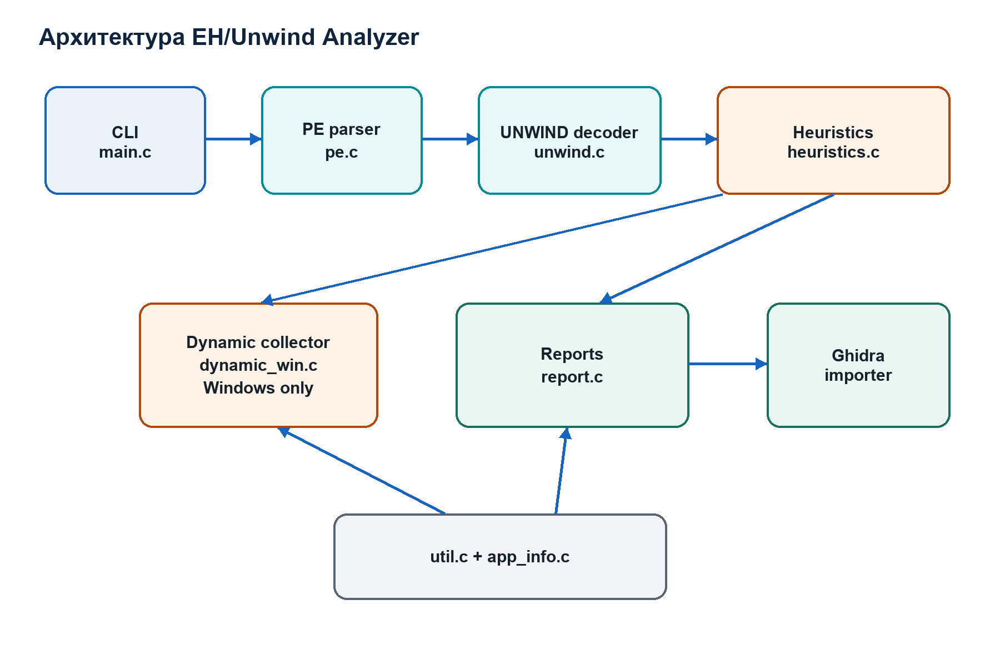

# Том II. `main.c`: полный жизненный цикл одного анализа

## Роль `main.c`

`main.c` не реализует формат PE или unwind encoding. Его задача — orchestration: создать правильную последовательность вызовов, сохранить результаты, сформировать requested outputs и освободить ресурсы.

Эта роль часто недооценивается. Даже корректные отдельные модули образуют некорректный продукт, если orchestration:

- вызывает их в неверном порядке;
- игнорирует failure;
- передаёт несогласованные pointers;
- создаёт отчёт до вычисления metadata;
- освобождает объект слишком рано;
- возвращает неверный exit code.

Поэтому `main.c` является формальным описанием полного user workflow.

## Входной интерфейс процесса

Сигнатура:

```c
int main(int argc, char** argv)
```

`argc` содержит число аргументов.

`argv` указывает на массив pointers на null-terminated byte strings.

Для команды:

```text
eh_unwind_analyzer benign_richer.exe --heuristics --json report.json
```

логическая модель:

```text
argc = 5
argv[0] = "eh_unwind_analyzer"
argv[1] = "benign_richer.exe"
argv[2] = "--heuristics"
argv[3] = "--json"
argv[4] = "report.json"
```

Операционная система и C runtime формируют эти значения до вызова `main`.

## Внутренняя структура `Args`

```c
typedef struct Args {
    const char* input;
    bool dump;
    bool show_ops;
    bool heuristics;
    const char* csv_path;
    const char* ghidra_csv_path;
    const char* json_path;
    const char* html_path;
    int dump_limit;
    bool follow_chain;
    int max_chain_depth;
    bool dynamic;
    uint32_t timeout_ms;
    uint32_t trace_steps;
    const char** child_argv;
    int child_argc;
} Args;
```

Эта структура является нормализованным представлением command line.

Поля `const char*` не владеют строками. Они указывают на memory, предоставленную через `argv`, и действительны в течение `main`.

Boolean fields определяют включённые режимы.

Числовые fields уже должны быть проверены по диапазонам.

`child_argv` и `child_argc` описывают arguments target после разделителя `--`.

## Почему parsing arguments отделён

Функция:

```c
static ParseResult parse_args(int argc, char** argv, Args* a)
```

обнуляет output:

```c
memset(a, 0, sizeof(*a));
```

а затем задаёт nonzero defaults:

```c
a->dump_limit = -1;
a->follow_chain = true;
a->max_chain_depth = 8;
a->timeout_ms = 15000;
a->trace_steps = 64;
```

Обнуление создаёт доказуемое начальное состояние всех optional pointers и flags. Defaults задаются явно после него.

Возвращаемый `ParseResult` различает:

```text
PARSE_OK
PARSE_HELP
PARSE_VERSION
PARSE_ERR
```

Boolean результата было бы недостаточно: help и version являются успешным завершением пользовательского запроса, а malformed CLI — ошибкой.

## Позиционный input

Если первый аргумент равен `--help` или `--version`, input file не требуется.

Иначе:

```c
a->input = argv[1];
```

Проект использует первый позиционный аргумент как путь target. Остальные аргументы до `--` должны быть известными options.

Это означает, что текущий CLI не поддерживает произвольное расположение input после options. Backend должен следовать документированному contract.

## Разделитель `--`

Option:

```text
--
```

завершает options анализатора. Все последующие strings передаются target в dynamic mode.

Пример:

```text
eh_unwind_analyzer target.exe --dynamic -- --input sample.dat
```

До separator:

```text
--dynamic
```

принадлежит анализатору.

После separator:

```text
--input sample.dat
```

принадлежит target.

Без separator невозможно однозначно определить, чья option `--input`.

## Проверка чисел

`parse_long_range` использует `strtol`.

Она проверяет:

- null/empty input;
- `ERANGE`;
- отсутствие цифр;
- наличие trailing characters;
- minimum и maximum.

Условие:

```c
end == text
```

означает, что не была распознана ни одна цифра.

Условие:

```c
*end != '\0'
```

означает, что после числа остался непотреблённый текст, например `10abc`.

Для unsigned values `parse_u32_range` дополнительно отклоняет начальный `-`, потому что `strtoul` имеет поведение, которое могло бы преобразовать отрицательную запись в большое unsigned value.

## Диапазоны options

`--max-chain-depth` допускает `1..16`.

Нижняя граница исключает бессмысленную нулевую глубину при включённом follow chain.

Верхняя граница ограничивает рекурсивную или итеративную работу на malicious chain.

`--trace-steps` допускает `0..256`. Ноль отключает trace. Верхняя граница соответствует фиксированному массиву:

```c
uint64_t trace[256];
```

CLI validation и размер модели согласованы.

`--timeout-ms` требует значение больше нуля и допускает диапазон `uint32_t`.

## Exit code CLI parsing

После:

```c
ParseResult pres = parse_args(argc, argv, &a);
```

`main` обрабатывает результат:

```c
if (pres != PARSE_OK) {
    if (pres == PARSE_VERSION) {
        print_version();
        return 0;
    }
    usage(argv[0]);
    return (pres == PARSE_HELP) ? 0 : 2;
}
```

Help и version возвращают 0. Invalid command line возвращает 2.

Различие важно для automated caller:

```text
0: запрос выполнен
1: runtime/input/output failure
2: неправильный способ вызова
```

## Чтение input

Объявляются:

```c
uint8_t* owned = NULL;
Buf b;
```

После успешного `buf_init_from_file`:

```text
owned == b.data
b.size == file size
```

но roles различаются. `owned` используется для освобождения, `b` — для чтения.

Если чтение не удалось, другие объекты ещё не созданы, поэтому cleanup минимален.

## Error buffers

Проект использует `StrBuf` для накопления подробных diagnostics:

```c
StrBuf err;
sb_init(&err, 1024);
```

В текущем `main` return value `sb_init` в некоторых местах не проверяется немедленно. `StrBuf` сохраняет `failed`, а последующие append возвращают false. Для критических output metadata проверки выполняются составным условием.

Инженерное улучшение могло бы унифицировать проверку каждого `sb_init`, но test/sanitizer coverage снижает риск незамеченного поведения.

## PE parsing

```c
PeImage img;
if (!pe_parse(&img, &b, &err)) {
    ...
    return 1;
}
```

До вызова `img` не инициализирован вызывающим кодом. Контракт `pe_parse` начинается с:

```c
memset(out, 0, sizeof(*out));
```

При failure `main` не вызывает `pe_free`, потому что parser сам освобождает локально выделенные sections на соответствующих failure paths и не возвращает успешное owned state.

При success ownership `img.sections` переходит вызывающему, и позднее требуется `pe_free`.

## Runtime function table

```c
RuntimeFunction* rf = NULL;
size_t rf_count = 0;
```

Использование null и zero перед вызовом обеспечивает определённое состояние даже при failure.

`unwind_read_runtime_functions` выделяет массив. После success:

```text
rf[0..rf_count-1]
```

доступен caller. Освобождение выполняется `free(rf)`.

Если exception directory корректно отсутствует, допустим success с `rf_count == 0`. Код последующих allocations учитывает ноль.

## Allocations для per-function state

```c
UnwindSummary* us =
    (UnwindSummary*)calloc(rf_count ? rf_count : 1,
                           sizeof(UnwindSummary));
bool* us_ok =
    (bool*)calloc(rf_count ? rf_count : 1,
                  sizeof(bool));
```

Почему при `rf_count == 0` выделяется один элемент?

Стандарт C допускает implementation-defined поведение `malloc(0)`/`calloc(0, ...)`, включая null. Проект хочет различать реальный out-of-memory и пустую таблицу, поэтому запрашивает минимум один элемент.

Логическая длина всё равно равна `rf_count`; фиктивный элемент не обрабатывается.

`calloc` обнуляет память:

- `us_ok[i]` изначально false;
- все fields `UnwindSummary` изначально zero;
- `parse_error` содержит empty string.

## Options unwind parser

```c
UnwindParseOpts uopts = {
    .max_chain_depth = a.max_chain_depth,
    .follow_chain = a.follow_chain
};
```

Designated initializers явно связывают значения с именами fields.

Эта структура отделяет policy пользователя от обязательных параметров parser. В будущем в неё можно добавить controlled options, но изменение public structure потребует проверки ABI/library use.

## Основной цикл unwind

```c
for (size_t i = 0; i < rf_count; i++) {
    StrBuf perr;
    sb_init(&perr, 256);
    bool ok = unwind_parse(
        &b,
        &img,
        rf[i].unwind_rva,
        &uopts,
        &us[i],
        a.show_ops ? &ops : NULL,
        &perr
    );
    us_ok[i] = ok;
    sb_free(&perr);
}
```

На каждой итерации:

1. выбирается `rf[i].unwind_rva`;
2. parser использует общие immutable `b` и `img`;
3. результат записывается точно в `us[i]`;
4. success записывается в `us_ok[i]`;
5. локальная diagnostic освобождается;
6. цикл продолжается независимо от failure одной записи.

`perr` не печатается в этом цикле, потому что `unwind_parse` копирует конкретную причину в `us[i].parse_error`. Локальный buffer используется для внутреннего diagnostic contract.

## Почему операции могут разбираться повторно

В первом цикле текст operations строится только при `a.show_ops`, но общий `ops` не хранит отдельный текст для всех functions.

В dump loop при необходимости `unwind_parse` вызывается повторно для конкретной записи и строит `ops2`.

Преимущество:

- не хранится большой массив текстов для всех функций;
- detailed output создаётся только для отображаемых entries.

Недостаток:

- выбранные structures разбираются второй раз.

Для CLI dump это разумный обмен memory на computation. Parser детерминирован относительно immutable input и options.

## Heuristic stage

`HeuristicReport` объявляется на stack:

```c
HeuristicReport hr;
HeuristicReport* hr_ptr = NULL;
```

Pointer остаётся null, пока анализ не завершится успешно.

После success:

```c
hr_ptr = &hr;
```

Reports получают null, если heuristics не запрошены или failed. Это позволяет сериализатору различать отсутствие этапа и заполненную модель.

Если `heuristics_analyze` failed, `exit_code` становится 1, но код может продолжить формировать другие requested outputs. Такая стратегия позволяет пользователю получить частичный результат, не скрывая failure через process status.

## Dynamic stage

`DynamicReport dr` предварительно обнуляется:

```c
memset(&dr, 0, sizeof(dr));
```

Флаг:

```c
bool dr_initialized = false;
```

нужен для корректного вызова `dynamic_report_free`. После вызова collector считается, что report прошёл init path, даже если session не ran успешно.

`dr_ptr` передаётся reports, если dynamic mode был запрошен. Тогда JSON способен показать failure/status, а не просто отсутствие блока.

## Outputs CSV

CSV writers вызываются независимо:

```c
report_write_csv(..., false, ...)
report_write_csv(..., true, ...)
```

Последний boolean выбирает full CSV или Ghidra-oriented variant.

Каждый output имеет собственный error buffer и собственную обработку. Failure одного файла устанавливает `exit_code = 1`, но не запрещает попытку создать остальные.

## Подготовка provenance

JSON и HTML требуют metadata. `main` строит:

```c
StrBuf invocation;
char timestamp[32];
char input_sha256[65];
ReportMetadata metadata;
```

Составное условие требует success всех операций:

```c
sb_init
build_invocation
app_utc_timestamp
sha256_hex
```

Только после этого:

```c
metadata_ptr = &metadata;
```

Если metadata неполна, JSON/HTML не записываются как будто полноценные. Это сохраняет report invariant: каждый полный report должен быть привязан к tool build и input hash.

## Redaction arguments target

`build_invocation` проходит исходный `argv`. При достижении `--` он не копирует последующие значения, а записывает:

```text
-- [N target arguments redacted]
```

Причина не связана с синтаксисом JSON. Target arguments могут содержать:

- credentials;
- tokens;
- персональные данные;
- внутренние пути;
- содержимое запроса.

Для воспроизводимости сохраняется факт и количество, но не значения.

## SHA-256

`sha256_hex(b.data, b.size, input_sha256)` вычисляет digest всех входных байтов.

Если файл изменится хотя бы в одном бите, ожидается другое digest. SHA-256 связывает отчёт с конкретным содержимым, но не доказывает происхождение или безопасность файла.

## JSON и HTML

Writers получают одинаковый analytical model:

```text
path
PeImage
RuntimeFunction[]
UnwindSummary[]
us_ok[]
HeuristicReport optional
DynamicReport optional
ReportMetadata
```

Различается presentation:

- JSON предназначен для machine integration;
- HTML предназначен для interactive human review.

Логические значения должны согласовываться между форматами. Unit tests проверяют оба serializers.

## Финальный cleanup

Порядок:

```c
heuristics_free
dynamic_report_free
sb_free(&ops)
free(us_ok)
free(us)
free(rf)
pe_free(&img)
sb_free(&err)
sb_free(&err2)
buf_free_owned(owned)
```

Порядок следует зависимостям. Reports уже записаны, поэтому borrowed pointers больше не используются.

`PeImage.sections` освобождается до input bytes, но мог бы освобождаться и после: sections является отдельной allocation и не указывает внутрь input. Главное — не использовать models после release.

## Полный автомат состояний `main`

```text
START
-> CLI_PARSED
-> INPUT_LOADED
-> PE_PARSED
-> RF_TABLE_READ
-> UNWIND_ATTEMPTED_FOR_ALL
-> OPTIONAL_HEURISTICS
-> OPTIONAL_DYNAMIC
-> OPTIONAL_OUTPUTS
-> CLEANUP
-> EXIT
```

Fatal transitions до построения основной модели немедленно ведут в cleanup соответствующего уровня и exit 1.

Локальные analytical failures могут позволять продолжение, но изменяют final exit code.

## Tests, относящиеся к `main`

`test_cli_contract.py` проверяет:

- help/version;
- invalid options;
- numeric ranges;
- exit codes;
- output combinations.

`run_regression_samples.py` проверяет end-to-end pipeline на шести PE.

`test_report_semantics.py` запускает CLI и проверяет отношения полей.

`test_release_metadata.py` проверяет согласованность version/schema declarations.

Mutation test многократно вызывает CLI на изменённых входах и требует controlled result вместо crash.

## Что можно улучшить

Текущий `main` является последовательным orchestration layer. Возможные улучшения:

- единый cleanup block для уменьшения повторения ранних failure paths;
- structured machine-readable error output;
- более детальные exit subcodes;
- `--quiet`;
- `--output-dir`;
- сохранение duration каждого этапа;
- явное различие `not_requested`, `failed`, `completed` для каждого stage;
- streaming или batching для очень больших reports.

Эти изменения не требуют менять предметные алгоритмы PE/unwind.

## Проверка полного понимания `main`

Читатель должен суметь для любой строки основного pipeline ответить:

1. какие объекты уже существуют;
2. кто ими владеет;
3. какие инварианты доказаны;
4. что произойдёт при failure;
5. продолжится ли анализ;
6. какой exit code сформируется;
7. какие outputs ещё могут быть созданы;
8. где объект освобождается.

# Том II. `util.c`: основание безопасного parser и генерации отчётов

## Почему `util.c` является частью доказательства корректности

`pe.c` и `unwind.c` содержат предметные знания о формате. Но все их проверки бессмысленны, если базовая операция чтения способна выйти за границу или неверно собрать integer.

`util.c` формирует минимальный trusted computing base проекта на уровне пользовательского кода. Ошибка здесь распространялась бы на все последующие conclusions.

## `Buf` как read-only view

```c
typedef struct Buf {
    const uint8_t* data;
    size_t size;
} Buf;
```

`Buf` не содержит capacity, mutable pointer или ownership flag. Он описывает только доступное для чтения содержимое.

`const uint8_t*` запрещает изменение байтов через этот pointer на уровне type system C. Это shallow const: сама структура `Buf` может быть присвоена, но pointed bytes через неё не модифицируются.

`size` задаёт единственную допустимую границу. Parser не использует null terminator, потому что binary input может содержать нулевые байты в любой позиции.

## `buf_init_from_file`

Контракт:

```c
bool buf_init_from_file(
    Buf* out,
    const char* path,
    uint8_t** owned_mem
);
```

Preconditions:

- все три pointers ненулевые;
- `path` указывает на корректную C string.

Postcondition success:

```text
out->data == *owned_mem
out->size == фактическое число прочитанных байтов
*owned_mem != NULL
```

Postcondition failure:

```text
*owned_mem == NULL
нет открытого FILE
нет неосвобождённой allocation, созданной функцией
```

Функция сначала выполняет:

```c
*owned_mem = NULL;
```

Это важно для failure paths caller. Даже если открытие не удалось, caller не получает неопределённый pointer.

## Определение размера

Используются `fseek` и `ftell`. `ftell` возвращает `long`, поэтому текущая реализация имеет практическое ограничение для файлов, размер которых не представим `long` на host.

На современных 64-битных POSIX и Windows toolchains это обычно достаточно для анализируемых PE, но строгая поддержка очень больших файлов потребовала бы platform-specific 64-bit file APIs.

Отрицательный результат `ftell` считается failure:

```c
if (sz < 0) ...
```

## Пустой файл

Для размера zero:

```c
size_t alloc_size = sz > 0 ? (size_t)sz : 1u;
```

Выделяется один байт, хотя логический `Buf.size` равен нулю.

Причина: `malloc(0)` может вернуть null или уникальный pointer в зависимости от реализации. Проект хочет, чтобы failure allocation не смешивался с пустым input.

Ни один байт фиктивной allocation не считается частью input, потому что bounds определяет `size`.

## Полнота `fread`

```c
size_t rd = fread(mem, 1, (size_t)sz, f);
```

Функция требует:

```c
rd == sz
```

Частичное чтение не принимается. Если файл изменился, возник I/O error или чтение прервано, allocation освобождается.

Это сохраняет invariant: SHA-256 и parser работают с полной последовательностью заявленного размера.

## `buf_free_owned`

```c
void buf_free_owned(uint8_t* owned_mem) {
    free(owned_mem);
}
```

Отдельная wrapper function документирует ownership pair:

```text
buf_init_from_file -> buf_free_owned
```

`free(NULL)` допустим стандартом C, поэтому функция безопасна для null.

## `buf_read`

Контракт:

```c
bool buf_read(
    const Buf* b,
    size_t off,
    void* out,
    size_t len
);
```

`void* out` означает, что destination type не фиксирован интерфейсом. Функция копирует raw bytes.

Проверка:

```c
if (!b || !out) return false;
```

Даже при `len == 0` проект требует non-null `out`. Это упрощает contract.

Далее:

```c
if (off > b->size) return false;
```

`off == size` допустим только для zero-length read.

Затем:

```c
if (len > b->size - off) return false;
```

После доказательства диапазона вызывается:

```c
memcpy(out, b->data + off, len);
```

`memcpy` требует, чтобы source и destination ranges были валидны и не перекрывались. Destination предоставляется caller. Source доказан `Buf`.

## Typed read functions

`buf_read_u16` не записывает прямо в `uint16_t` из arbitrary file address:

```c
uint8_t tmp[2];
if (!buf_read(b, off, tmp, 2)) return false;
*out = le16(tmp);
```

Причины:

- file offset может быть невыровнен;
- host endianness не должен влиять;
- чтение C-object через cast может нарушать aliasing/alignment rules;
- bounds должны быть проверены до interpretation.

Такой подход немного многословнее direct cast, но создаёт переносимый parser.

## `le16`, `le32`, `le64`

`le64` строится из двух `le32`:

```c
return (uint64_t)le32(p) |
       ((uint64_t)le32(p + 4) << 32);
```

Cast к `uint64_t` выполняется до сдвига на 32. Если сдвигать 32-битное значение на 32 без расширения, операция была бы недопустимой.

Эти helpers являются pure functions: результат зависит только от входных байтов, state не изменяется.

## `StrBuf`

```c
typedef struct StrBuf {
    char* s;
    size_t len;
    size_t cap;
    bool failed;
} StrBuf;
```

`s` указывает на allocation.

`len` — число содержательных bytes без завершающего null.

`cap` — вместимость allocation в bytes.

`failed` — sticky error state.

Invariant успешного initialized buffer:

```text
s != NULL
len < cap
s[len] == '\0'
failed == false
```

Наличие null terminator позволяет передавать `s` функциям C strings, а `len` позволяет не вычислять `strlen` после каждого append.

## Почему error state sticky

Если одна операция append не смогла выделить память, дальнейшее продолжение могло бы сформировать усечённый JSON. Поэтому:

```c
if (!sb || sb->failed) return false;
```

После failure buffer остаётся failed до `sb_free`/новой initialization.

Caller может проверить итог:

```c
sb_ok(&buffer)
```

Это transactional-like property на уровне построения текста: нельзя принять partial output как complete.

## Рост capacity

`sb_reserve` увеличивает capacity:

```c
increment = newcap / 2 + 64
newcap += increment
```

Рост больше линейного снижает число `realloc` при последовательных append.

Перед сложением:

```c
if (increment > SIZE_MAX - newcap)
```

проверяется overflow.

Если geometric growth не может быть вычислен, функция использует точно `need_cap`. Затем `realloc` либо возвращает новую allocation, либо оставляет старую действительной и возвращает null. При null устанавливается `failed`.

## `sb_appendn`

Проверка required capacity:

```c
if (sb->len == SIZE_MAX ||
    n > SIZE_MAX - sb->len - 1u)
```

`+1` нужен для null terminator.

После reserve:

```c
memcpy(sb->s + sb->len, s, n);
sb->len += n;
sb->s[sb->len] = 0;
```

Invariant восстанавливается после каждой успешной операции.

## `sb_appendf`

Variadic function принимает printf format.

Первый `vsnprintf(NULL, 0, ...)` вычисляет необходимую длину. Для повторного использования аргументов создаётся `va_copy`, потому что проход `vsnprintf` изменяет состояние `va_list`.

После reserve второй `vsnprintf` пишет строку. Проверяется:

```c
wrote == need
```

Compiler attribute `format(printf, ...)` для GCC/Clang позволяет статически проверять соответствие format и аргументов.

## Атомарная запись

`file_write_atomic` создаёт temporary sibling path:

```text
<path>.tmp.<pid>
```

Пишет полное содержимое, выполняет `fflush`, закрывает stream, затем заменяет destination.

До replace существующий report остаётся неизменным. Если write failed, temp удаляется.

На Windows:

```c
MoveFileExA(
    temp_path,
    path,
    MOVEFILE_REPLACE_EXISTING |
    MOVEFILE_WRITE_THROUGH
)
```

На POSIX:

```c
rename(temp_path, path)
```

Соседнее расположение важно для атомарности rename в пределах файловой системы.

Ограничение: текущая реализация не выполняет POSIX `fsync` для file descriptor и parent directory. `fflush` переносит данные из user-space stdio buffer, но не является полной гарантией durability при system crash. Для CLI report это разумный уровень, но high-assurance storage мог бы усилить protocol.

## SHA-256

SHA-256 преобразует сообщение произвольной конечной длины в 256-bit digest.

Проект хранит результат как 64 lowercase hex characters:

```text
256 bits / 4 bits per hex digit = 64 digits
```

Плюс null terminator:

```c
char out_hex[65];
```

Digest используется для identity input bytes. Он не:

- шифрует файл;
- подтверждает автора;
- является digital signature;
- определяет maliciousness.

## Связь `util.c` с отчётом и tests

`Buf` используется всеми parsers.

`StrBuf` используется diagnostics и serializers.

Atomic writer используется CSV/JSON/HTML.

SHA-256 попадает в report metadata.

`unit_core_edges` проверяет boundary conditions.

Mutation fuzz проходит через `Buf` operations на изменённых inputs.

JSON/HTML tests косвенно проверяют `StrBuf` и atomic output.

Sanitizers проверяют memory safety на runtime test paths.

## Полная роль модуля

`util.c` обеспечивает четыре свойства всего продукта:

1. input bytes имеют явную длину;
2. каждое чтение доказывает границы;
3. многобайтные значения декодируются независимо от host layout;
4. output либо формируется полностью, либо отмечается failure.

Следующий модуль `pe.c` опирается на эти свойства и добавляет семантику формата.

# Том II. `pe.c`: построение модели PE из недоверенных байтов

## Почему PE parser выполняется раньше unwind decoder

`UNWIND_INFO` адресуется через RVA. Пока проект не прочитал section table, он не способен установить, какой file offset соответствует RVA. Поэтому `pe_parse` создаёт систему координат для всей последующей работы.

На входе функции известны только:

```text
Buf.data
Buf.size
```

На выходе должны быть известны:

```text
архитектура image
ImageBase
SizeOfImage
SizeOfHeaders
alignments
exception directory
sections
структурные counters
```

`PeImage` не является полной моделью всего PE. Проект намеренно извлекает только поля, необходимые для своего scope.

## Почему parser не использует Windows headers

`pe.h` объявляет собственные минимальные constants и структуры:

```c
#define PE_DOS_MAGIC 0x5A4D
#define PE_NT_MAGIC  0x00004550
#define IMAGE_FILE_MACHINE_AMD64 0x8664
#define IMAGE_NT_OPTIONAL_HDR64_MAGIC 0x20b
```

Преимущества:

- static core компилируется на Linux и macOS;
- parser не зависит от packing C-структур Windows SDK;
- каждое поле читается с явным bounds-check;
- поддерживаемый subset виден в коде;
- анализируется файл, а не host representation.

Недостаток — offsets и constants нужно поддерживать в соответствии со спецификацией. Tests и официальная документация являются обязательной частью такого решения.

## `PeSection`

```c
typedef struct PeSection {
    char name[9];
    uint32_t virtual_address;
    uint32_t virtual_size;
    uint32_t raw_ptr;
    uint32_t raw_size;
    uint32_t characteristics;
} PeSection;
```

Это нормализованная модель section header, а не byte-for-byte копия 40-байтового PE structure.

В PE имя занимает ровно 8 байт и не обязано завершаться null. В модели выделено 9:

```c
memcpy(secs[i].name, name8, 8);
secs[i].name[8] = 0;
```

Так report code безопасно использует имя как C string.

Поля relocation/line number из section header не сохраняются, потому что не используются scope проекта.

## `PeImage`

`PeImage` объединяет три класса данных.

Первый класс — identity/layout:

```text
machine
image_base
size_of_image
size_of_headers
section_alignment
file_alignment
```

Второй — предметный каталог:

```text
exception_rva
exception_size
```

Третий — результаты валидации:

```text
section_raw_oob
section_virtual_oob
section_raw_overlaps
section_virtual_overlaps
section_misaligned
exception_directory_oob
```

Parser не только извлекает поля, но и сохраняет факты о нарушениях для heuristics.

## Инициализация результата

```c
if (!out || !b || !err) return false;
memset(out, 0, sizeof(*out));
```

После `memset`:

- `out->sections == NULL`;
- counters равны нулю;
- flags false.

Поле `ok` устанавливается только в конце success path. Caller не должен использовать модель после false return.

## DOS header

PE сохраняет исторически совместимый DOS header. Первые два байта содержат `e_magic`.

При little-endian чтении байты:

```text
4D 5A
```

дают:

```text
0x5A4D
```

ASCII-представление байтов читается как `MZ`.

Функция:

```c
read_dos_lfanew
```

читает magic и 32-битное поле по file offset `0x3C`.

`e_lfanew` — file offset новой PE signature.

Почему offset PE header не зафиксирован? Между DOS header и PE header может находиться DOS stub и padding различной длины. Поэтому parser использует поле, а не предполагает значение `0x80`.

## Проверка минимального PE header range

```c
if ((size_t)lfanew + 4 + 20 > b->size)
```

`4` — размер PE signature.

`20` — размер COFF file header.

Parser доказывает, что обязательная фиксированная часть помещается в файл до чтения полей.

Теоретически сумма может переполнить `size_t`, если `size_t` 32-битный и `lfanew` близок к максимуму. Поддерживаемые современные 64-битные builds исключают это для `uint32_t lfanew`. Для абсолютно общего parser предпочтительна subtractive range check, аналогичная `buf_read`.

Фактические typed reads всё равно проходят через `buf_read`, поэтому out-of-bounds copy не происходит. Предварительная проверка формирует более точную diagnostic.

## PE signature

По `lfanew` читается:

```c
uint32_t sig;
buf_read_u32(...);
```

Ожидаемое значение:

```text
0x00004550
```

Байты:

```text
50 45 00 00
```

первые два соответствуют ASCII `PE`, следующие два равны zero.

Наличие `MZ` без корректной PE signature не делает файл поддерживаемым PE.

## COFF file header

Сразу после signature находится 20-byte COFF header.

Проект читает:

```text
offset +0: Machine
offset +2: NumberOfSections
offset +16: SizeOfOptionalHeader
```

Почему не читается timestamp? Он не нужен для PE/unwind pipeline. Минимальный parser не обязан копировать каждое поле формата.

`Machine` определяет архитектуру machine code и architecture-specific directories. Проект принимает только:

```text
0x8664 = IMAGE_FILE_MACHINE_AMD64
```

Это ранняя проверка предотвращает попытку применить AMD64 unwind decoder к ARM64 или x86.

## Optional header

Название `Optional Header` историческое. Для PE image эта структура необходима.

Её начало:

```c
size_t opthdr = filehdr + 20;
```

`SizeOfOptionalHeader` берётся из COFF header. Parser сначала доказывает:

```c
opthdr + opt_size <= file_size
```

и минимальный размер:

```c
opt_size >= 0x70
```

Смещение `0x70` является началом data directories в PE32+.

## Magic PE32+

Первые 2 байта optional header:

```text
0x10B = PE32
0x20B = PE32+
```

`PE32+` используется для 64-битных images и имеет другое layout некоторых fields. Поэтому проверка magic обязательна даже после AMD64 Machine.

Проект отклоняет PE32, а не пытается читать его по PE32+ offsets.

## Ключевые поля optional header

Offsets относительно начала PE32+ optional header:

```text
0x18 ImageBase, 8 bytes
0x20 SectionAlignment, 4
0x24 FileAlignment, 4
0x38 SizeOfImage, 4
0x3C SizeOfHeaders, 4
0x6C NumberOfRvaAndSizes, 4
```

Offsets определены PE32+ layout.

### `ImageBase`

Preferred base image. Используется для presentation и преобразования RVA в preferred VA. Static structural checks в основном работают с RVA.

### `SectionAlignment`

Выравнивание sections в virtual image.

### `FileAlignment`

Выравнивание raw section data в файле.

### `SizeOfImage`

Размер virtual image с учётом section alignment. Используется как верхняя структурная граница RVA.

### `SizeOfHeaders`

Размер области headers, отображаемой в image. Для RVA внутри этой области проект допускает прямое соответствие file offset.

### `NumberOfRvaAndSizes`

Число реально объявленных data directory entries. Нельзя обращаться к index 3, если число меньше 4.

## Фатальные проверки полей

`SizeOfImage == 0` не позволяет сформировать meaningful RVA boundary.

`SizeOfHeaders == 0` или превышение file size отклоняется. Проект требует физическое наличие всех declared headers.

Нулевой alignment недопустим, потому что modulo operation и модель размещения потеряли бы смысл.

Недостаточное число directories делает exception directory недоступным.

Эти conditions являются fatal, потому что последующий mapping не может быть надёжно выполнен.

## Data directory

Каждая standard data directory entry состоит из:

```text
VirtualAddress: 4 bytes
Size: 4 bytes
```

Exception directory имеет index 3.

Относительный offset:

```c
0x70 + 3 * 8 = 0x88
```

Parser отдельно проверяет, что вся entry помещается в фактический `opt_size`, а не только в теоретический standard layout.

Результат:

```c
exc_rva
exc_sz
```

Оба могут быть zero, что означает отсутствие directory.

Если одно zero, а второе nonzero, `pe_parse` не завершается fatal failure, но выставляет `exception_directory_oob`. Позднее strict reader отклоняет malformed pair. Такое двухуровневое поведение сохраняет `PeImage` и validation counters для отчёта, когда это возможно.

## Section table

Section headers следуют непосредственно после optional header:

```c
secthdr = opthdr + opt_size;
```

Каждый header занимает 40 байт.

Общий конец:

```c
needed = secthdr + nsects * 40;
```

должен находиться внутри файла.

Массив:

```c
calloc(nsects ? nsects : 1, sizeof(PeSection))
```

при zero sections всё равно возвращает обычную allocation. Логическое `num_sections` остаётся zero.

## Чтение section fields

Для каждой section:

```text
+0  Name[8]
+8  VirtualSize
+12 VirtualAddress
+16 SizeOfRawData
+20 PointerToRawData
+36 Characteristics
```

Все integer fields little-endian.

Если любое чтение не удалось, весь массив освобождается до return false. Ownership не передаётся caller частично.

## Virtual span policy

Проект использует:

```c
max(VirtualSize, SizeOfRawData)
```

для поиска candidate section и проверки virtual range.

Причина: реальные PE могут иметь одно из fields меньше другого из-за alignment и producer behavior. Использование maximum позволяет классифицировать RVA в расширенном logical span.

Но raw availability проверяется отдельно:

```c
delta < raw_size
```

Следовательно, membership section и наличие bytes в файле не смешиваются.

Это осознанная parser policy. Другой parser может выбирать иной span для некоторых malformed images, поэтому overlaps фиксируются как ambiguity.

## Raw OOB

Для section:

```c
raw_end = raw_ptr + raw_size
```

вычисляется в `uint64_t`.

Если `raw_size > 0` и:

```text
raw_end > file_size
```

section заявляет bytes за EOF.

Parser не прекращает работу автоматически. Он увеличивает `section_raw_oob`. Это позволяет heuristics создать finding и сохранить остальные fields.

Однако конкретное чтение через `buf_read` всё равно будет отклонено.

## Virtual OOB

```c
virtual_end = virtual_address + virtual_span
```

Если:

```text
virtual_end > SizeOfImage
```

section не помещается в declared image.

Это структурное противоречие между section table и optional header.

## Alignment

Проверяется:

```c
virtual_address % section_alignment == 0
```

и для section с raw data:

```c
raw_ptr % file_alignment == 0
```

Нарушение увеличивает `section_misaligned`.

Project rule не реализует все специальные тонкости PE для очень малых alignments как отдельную сложную policy. Поэтому finding является аналитическим сигналом и требует сверки со спецификацией/loader behavior.

## Overlap

Два полуоткрытых диапазона пересекаются, если:

```text
a_begin < b_end
и
b_begin < a_end
```

Zero-sized ranges не считаются пересекающимися.

Проект проверяет каждую новую section со всеми предыдущими. При небольшом числе sections сложность `O(s²)` приемлема и сохраняет простой проверяемый код.

Raw overlap означает, что section headers претендуют на общие file bytes.

Virtual overlap означает, что один RVA может соответствовать нескольким sections согласно выбранной span policy.

Virtual overlap особенно опасен для mapping: `pe_find_section_for_rva` возвращает первую подходящую section, а другой parser или loader может интерпретировать ambiguous image иначе.

## Exception directory boundary

Если directory не пуст:

```c
exc_end = exc_rva + exc_sz
```

вычисляется в `uint64_t`.

Anomaly выставляется, если:

- RVA zero;
- size zero;
- конец выходит за `SizeOfImage`.

На этом этапе ещё не доказывается наличие raw bytes. Это выполняет `unwind_read_runtime_functions` через `pe_rva_to_fileoff`.

## Завершение модели

Только после полного чтения sections и validation:

```c
out->ok = true;
out->sections = secs;
...
return true;
```

Ownership `secs` переходит `PeImage`.

## `pe_free`

```c
free(img->sections);
memset(img, 0, sizeof(*img));
```

Обнуление после free:

- удаляет dangling pointer из структуры;
- предотвращает случайное повторное использование старых fields;
- делает повторный `pe_free` безопасным относительно `sections == NULL`.

## `pe_find_section_for_rva`

Функция перебирает sections и проверяет:

```text
start <= RVA < end
```

`start` и `end` расширены до `uint64_t`, поэтому section у верхней границы `uint32_t` не оборачивается при сложении.

Test `test_section_range_wrap` использует:

```text
VirtualAddress = 0xFFFFFF00
VirtualSize = 0x300
```

и подтверждает корректную работу widened arithmetic.

## `pe_rva_to_fileoff`

Алгоритм:

```text
найти section
-> delta = RVA - VirtualAddress
-> доказать delta < RawSize
-> safely add RawPtr + delta
-> доказать offset < file_size
-> вернуть offset
```

Если section не найдена, проверяется headers:

```text
RVA < SizeOfHeaders
RVA < file_size
```

и используется прямое mapping.

Почему headers проверяются после sections? В корректном image их virtual ranges не должны конфликтовать. При malformed overlap chosen policy должна быть документирована. Текущий код отдаёт приоритет section membership.

## Сквозной пример `benign_richer.exe`

Report показывает:

```text
file size = 5641
ImageBase = 0x140000000
SizeOfImage = 0x7000
SizeOfHeaders = 0x400
SectionAlignment = 0x1000
FileAlignment = 0x200
Exception RVA = 0x3000
Exception Size = 0x24
```

Section `.pdata`:

```text
VirtualAddress = 0x3000
VirtualSize = 0x24
RawPtr = 0x800
RawSize = 0x200
```

Для exception RVA:

```text
delta = 0x3000 - 0x3000 = 0
file offset = 0x800 + 0 = 0x800
```

Размер `0x24` равен 36 decimal. Конец directory в файле:

```text
0x800 + 0x24 = 0x824
```

он находится внутри raw section и файла.

Section `.xdata`:

```text
VirtualAddress = 0x4000
RawPtr = 0xA00
```

Unwind RVA `0x4004`:

```text
delta = 4
file offset = 0xA04
```

Именно оттуда `unwind_parse` читает 4-byte header второй структуры.

## Переход от parser counter к finding

`pe_parse` не назначает score.

Он сохраняет:

```text
section_raw_oob = N
```

`heuristics_analyze` позднее создаёт:

```text
code = pe_section_raw_oob
family = table_integrity
severity = high
weight = 25
```

Так format layer остаётся отделён от analytical policy.

## Tests

`unit_core_edges` проверяет:

- widened section range;
- header mapping по declared size;
- empty exception directory;
- PE counters, передаваемые heuristics.

Regression sample `suspicious_section_raw_oob.exe` проверяет end-to-end:

- raw OOB;
- raw overlap;
- virtual overlap;
- score 60;
- report fields.

Mutation fuzz изменяет headers и требует controlled rejection или valid report.

## Ограничения `pe.c`

Модуль не:

- проверяет цифровую подпись;
- разбирает imports/exports;
- анализирует relocations;
- разбирает TLS;
- проверяет checksum;
- эмулирует точное loader behavior для всех malformed cases;
- поддерживает другие architectures.

Это минимальный parser, сфокусированный на exception/unwind analysis.

## Что должно быть понятно перед `unwind.c`

`pe_parse` не находит функции по machine code. Он находит exception directory по index 3 и создаёт mapping RVA-to-file-offset. Только после этого следующий модуль может прочитать массив 12-byte `RUNTIME_FUNCTION`.

# Том II. `unwind.c`: от таблицы функций к модели восстановления стека

## Почему Windows x64 хранит таблицу функций

Исключение может возникнуть в произвольной инструкции функции. В этот момент обычный epilog не выполнен. Значения `RSP` и nonvolatile registers отражают частично или полностью созданный stack frame.

Windows должна:

- определить, какой function range содержит текущий `RIP`;
- найти описание изменений prolog;
- восстановить caller context;
- определить наличие language-specific handler;
- продолжить поиск обработчика или stack walk.

Для nonleaf functions AMD64 image содержит function table. PE exception directory указывает на массив `RUNTIME_FUNCTION`.

## `RuntimeFunction`

```c
typedef struct RuntimeFunction {
    uint32_t begin_rva;
    uint32_t end_rva;
    uint32_t unwind_rva;
} RuntimeFunction;
```

Каждое поле 4 bytes. Размер записи 12.

Диапазон code:

```text
[BeginAddress, EndAddress)
```

`UnwindInfoAddress` указывает на `UNWIND_INFO` либо связанную encoding.

Fields являются image-relative, поэтому хранятся как RVA.

## Чтение exception directory

`unwind_read_runtime_functions` сначала обнуляет outputs:

```c
*out_rf = NULL;
*out_count = 0;
```

Если RVA и size оба zero, отсутствие таблицы считается корректным:

```c
return true;
```

Если zero только одно field, directory malformed.

Далее exception RVA преобразуется через `pe_rva_to_fileoff`.

Проверяется полный файловый диапазон:

```c
off + exception_size <= b->size
```

и structural size:

```text
size >= 12
size % 12 == 0
```

Текущая policy strict: неполный хвост отклоняет всю таблицу. Альтернативный forensic parser мог бы прочитать complete entries и сохранить remainder anomaly, но проект предпочитает однозначный contract directory.

Количество:

```c
n = exception_size / 12;
```

Для sample:

```text
0x24 / 0x0C = 3
```

## Почему reader не проверяет begin/end сразу

Функция безопасно извлекает все triples. Semantics ranges проверяются в `heuristics.c`.

Разделение позволяет сохранить malformed values в report model и агрегировать counts. Reader отвечает на вопрос «можно ли физически прочитать таблицу», heuristics — «насколько согласованы значения».

## `UnwindSummary`

Структура является нормализованным результатом декодирования:

```text
valid
version
flags
prolog_size
count_codes
frame_reg
frame_off
handler
chain
fixed_stack_bytes
pushed_nonvol_count
saved register masks
anomalies
parse_error
```

Она не сохраняет все raw slots. Подробный текст может строиться отдельно через `ops_text`.

Это design choice: массовый analysis хранит компактную summary, а `--ops` повторно декодирует выбранные entries для presentation.

## Register encoding

Unwind format кодирует general-purpose register числом `0..15`.

`unwind_reg_name` отображает:

```text
0 RAX
1 RCX
2 RDX
3 RBX
4 RSP
5 RBP
6 RSI
7 RDI
8 R8
...
15 R15
```

Unknown value возвращает `REG?`, хотя 4-bit field физически ограничен 0..15.

## Flags

Поддерживаемые:

```text
UNW_FLAG_EHANDLER  = 0x01
UNW_FLAG_UHANDLER  = 0x02
UNW_FLAG_CHAININFO = 0x04
```

`EHANDLER` указывает exception handler.

`UHANDLER` указывает termination/unwind handler.

`CHAININFO` означает, что tail содержит chained `RUNTIME_FUNCTION`.

CHAININFO не должен одновременно сочетаться с handler flags в той же record. Проект отмечает такое состояние `UA_BAD_OPERAND`.

## Вход `unwind_parse`

```c
bool unwind_parse(
    const Buf* b,
    const PeImage* img,
    uint32_t unwind_rva,
    const UnwindParseOpts* opts,
    UnwindSummary* out,
    StrBuf* ops_text,
    StrBuf* err
);
```

`b` предоставляет bytes.

`img` предоставляет mapping и `SizeOfImage`.

`unwind_rva` выбирает structure.

`opts` задаёт chain policy.

`out` получает summary.

`ops_text` optional.

`err` получает diagnostic.

## Инициализация и локализация ошибки

```c
memset(out, 0, sizeof(*out));
size_t err_start = err->len;
```

`err` может уже содержать старый текст. `err_start` позволяет `unwind_parse_fail` скопировать только diagnostic текущего вызова в `out->parse_error`.

Trailing newline удаляется, потому что JSON field должен содержать compact string.

## Options

Defaults:

```text
max_depth = 8
follow_chain = true
```

Caller может передать options. Значение depth выше 16 clamp-ится, потому что local array:

```c
uint32_t seen[16];
```

не способен хранить больше уникальных chain RVA.

## Alignment `UNWIND_INFO`

RVA должен быть 4-byte aligned:

```c
if ((unwind_rva & 3u) != 0)
    UA_ALIGNMENT
```

Нарушение не делает header физически нечитаемым, поэтому parser продолжает и сохраняет anomaly.

Это пример distinction:

```text
structurally suspicious, but decodable
```

## Mapping header

`parse_unwindinfo_header`:

1. преобразует RVA в file offset;
2. проверяет четыре bytes;
3. читает header.

Failure добавляет `UA_TRUNCATED` и возвращает false.

Термин `TRUNCATED` используется расширенно: structure физически недоступна или не помещается в file-backed range.

## Header layout

Четыре байта:

```text
byte 0: Version:3 | Flags:5
byte 1: SizeOfProlog
byte 2: CountOfCodes
byte 3: FrameRegister:4 | FrameOffset:4
```

Extraction:

```c
ver   = hdr[0] & 0x7;
flags = hdr[0] >> 3;
fr    = hdr[3] & 0x0F;
foff  = hdr[3] >> 4;
```

`FrameOffset` измеряется units of 16 bytes. Actual offset:

```text
foff * 16
```

## Version policy

Поддерживаются V1 и V2.

V3 для Intel APX имеет другую структуру и не должен интерпретироваться как V1/V2. Проект:

```c
UA_VERSION_UNKNOWN
return false
```

Test `test_unsupported_version_is_fatal` закрепляет это поведение.

Отказ лучше ложного успешного decode: неправильная версия сместила бы slots и tail, создав фиктивные handlers.

## Frame register checks

Если `frame_reg == 0`, `frame_off` должен быть zero.

Если frame register nonzero, он должен быть допустимым GPR.

После parsing codes проект также требует наличие `UWOP_SET_FPREG`, если frame register задан и record не является chained.

Несогласованность помечается `UA_BAD_OPERAND`, но structure может оставаться valid.

## CountOfCodes

`CountOfCodes` — количество двухбайтовых slots, а не логических operations.

Одна operation может занимать:

```text
1, 2 или 3 slots
```

Array физически padded до чётного числа slots, чтобы tail был 4-byte aligned:

```c
slots_even = (count + 1) & ~1
codes_bytes = slots_even * 2
```

Если `count = 1`, stored slots = 2, bytes = 4.

Второй slot является padding и не входит в semantic operation count.

## Structure slot

Первый slot operation:

```text
byte 0: CodeOffset
byte 1 low nibble: UnwindOp
byte 1 high nibble: OpInfo
```

`CodeOffset` указывает position в prolog после выполнения соответствующей operation.

Codes хранятся в порядке убывания offsets, потому что unwind применяет действия в обратном направлении.

Если очередной `CodeOffset` больше предыдущего, проект ставит:

```text
UA_CODEOFFSET_ORDER
```

Если offset больше `SizeOfProlog`:

```text
UA_CODEOFFSET_OUTSIDE
```

V2 epilog descriptors имеют другую семантику, поэтому исключаются из обычной проверки prolog offset.

## Определение длины operation

`slots_for_code` получает:

```text
version
op
opinfo
v2_seen_epilog
```

и возвращает физическое число slots.

Эта функция должна быть выполнена до чтения operands. Затем проверяется:

```c
i + slots <= count
```

Неизвестный opcode получает `UA_BAD_OPCODE`, но parser безопасно продвигается на один slot. Это позволяет собрать остальные anomalies без чтения за границей.

Если известная operation заявляет operands за CountOfCodes, parsing становится fatal.

## `UWOP_PUSH_NONVOL`

Семантика prolog:

```asm
push register
```

Stack pointer уменьшается на 8, значение register сохраняется.

Summary:

```text
fixed_stack += 8
pushed_nonvol_count += 1
register bit added to saved_nonvol_mask
```

Проект допускает некоторые volatile register operands из-за наблюдаемого real-world toolchain behavior, исключая `RSP`. Это implementation compatibility policy, а не простое повторение имени opcode.

## `UWOP_ALLOC_SMALL`

Размер:

```text
OpInfo * 8 + 8
```

Диапазон:

```text
8..128 bytes
```

Для sample slot:

```text
CodeOffset = 4
Op = 2
OpInfo = 4
```

размер:

```text
4 * 8 + 8 = 40
```

Поэтому report показывает:

```text
prolog_size = 4
fixed_stack_bytes = 40
```

## `UWOP_ALLOC_LARGE`

Имеет два modes.

Mode 0, `OpInfo == 0`:

- следующий slot содержит size / 8;
- actual size = operand * 8;
- total 2 slots.

Mode 1, `OpInfo == 1`:

- следующие два slots содержат полный 32-bit size;
- total 3 slots.

Другой `OpInfo` недопустим.

Project sanity rules отмечают использование large form для размеров, которые выглядят несогласованно с ожидаемым encoding choice. Это anomaly, не parse failure.

## `UWOP_SET_FPREG`

Указывает установку frame pointer register, заданного header.

Operation сама не добавляет fixed stack bytes. Она изменяет способ вычисления frame base.

Повторная operation или отсутствие header frame register создаёт `UA_BAD_OPERAND`.

## `UWOP_SAVE_NONVOL`

Описывает сохранение register в ранее выделенной области stack без `push`.

Следующий slot кодирует scaled offset.

Проект:

- проверяет наличие operand;
- отмечает register в mask;
- не добавляет fixed stack, потому что allocation описывается отдельной operation.

Это различие критично. `SAVE_NONVOL` сообщает расположение сохранённого значения внутри frame, но не означает дополнительное изменение `RSP`.

## `UWOP_SAVE_NONVOL_FAR`

Использует два operand slots для 32-bit offset.

Far form предназначена для больших offsets. Малое или неверно выровненное значение получает `UA_OPERAND_SANITY`.

Parser всё равно сохраняет register mask, если field декодируемо.

## XMM saves

`UWOP_SAVE_XMM128` и FAR variant описывают сохранение 128-bit XMM register.

Offsets масштабируются согласно specification, хотя compact summary проекта в основном сохраняет register mask и sanity.

Отдельный `saved_xmm_mask` не смешивает vector state с GPR.

## V1 opcodes 6 и 7

Для V1 код поддерживает observed undocumented/common encodings `SAVE_XMM` и `SAVE_XMM_FAR`. Это compatibility behavior, которое должно явно отличаться от официальных V2 meanings.

## V2 epilog descriptors

В V2 opcode 6 используется для epilog descriptors, opcode 7 — spare.

Первый descriptor может иметь short или long form; последующие описывают offsets from end.

Parser:

- определяет slot count с учётом first descriptor;
- строит readable `ops_text`;
- не применяет обычную CodeOffset check;
- продолжает декодировать последующие prolog operations.

Unit test содержит short и long records и проверяет `offset_from_end`.

## `UWOP_PUSH_MACHFRAME`

Описывает machine frame, сформированный hardware/exception mechanism.

`OpInfo` определяет наличие error code.

Summary добавляет:

```text
40 bytes без error code
48 bytes с error code
```

Другой `OpInfo` помечается `UA_BAD_OPERAND`.

## Защита суммы fixed stack

`add_fixed_stack` проверяет:

```c
UINT32_MAX - total < amount
```

При overflow:

```text
total = UINT32_MAX
UA_OPERAND_SANITY
```

Saturation сохраняет upper-bound signal и не позволяет wrap к малому размеру.

## Tail после slots

Tail начинается:

```c
after_codes = codes_off + codes_bytes;
```

`codes_bytes` уже включает padding.

Содержимое зависит от flags.

### Handler tail

При EHANDLER/UHANDLER первые 4 bytes tail — handler RVA.

Проект проверяет physical read и:

```text
handler_rva < SizeOfImage
```

Выход за image ставит `UA_HANDLER_OOB`, но read остаётся successful.

Данные после handler RVA являются language-specific. Текущая summary их не декодирует.

### Chain tail

При CHAININFO tail содержит ещё один 12-byte `RUNTIME_FUNCTION`.

Проверяются:

- `end > begin`;
- range в `SizeOfImage`;
- nonzero unwind RVA;
- unwind RVA в image.

Нарушение даёт `UA_CHAIN_INVALID`.

## Следование по chain

Если enabled, проект начинает с:

```c
cur = out->chain.unwind_rva;
```

Массив `seen[16]` хранит уже посещённые RVA. Повтор означает loop.

Внутренний recursive-like вызов:

```c
unwind_parse(... follow_chain = false)
```

декодирует один следующий record без собственного продолжения chain. Внешний цикл контролирует depth и loop detection.

Summary parent объединяется:

```text
fixed stack sum
pushed count sum
OR register masks
inherited handler
frame consistency check
```

Это compact analytical aggregation. Оно не заменяет точную реализацию `RtlVirtualUnwind` для любого instruction offset.

## `valid` и anomalies

В конце:

```c
out->valid = true;
return true;
```

Anomalies могут быть nonzero. `valid` означает, что structure была декодирована достаточно для summary, а не что metadata идеальна.

Fatal conditions:

- header unmappable/truncated;
- unsupported version;
- code array за file;
- operation operands за CountOfCodes;
- truncated handler/chain tail.

Nonfatal anomalies:

- alignment;
- bad flags/operands;
- order;
- code offset outside;
- handler OOB;
- chain invalid;
- suspicious operand form.

## `parse_error`

При failure `unwind_parse_fail`:

- устанавливает `valid = false`;
- выбирает diagnostic текущего invocation;
- удаляет newline;
- ограничивает длину 159 characters;
- null-terminates field.

Report всегда может показать конкретную причину для function.

## Сквозной sample

Runtime table:

```text
[0] 1000..1010 -> 4000
[1] 1010..1029 -> 4004
[2] 1029..1040 -> 400C
```

Для record 1:

```text
Unwind RVA 0x4004
section .xdata VA 0x4000
raw ptr 0xA00
delta 0x4
file offset 0xA04
```

Header и slot приводят к:

```text
Version 1
Flags 0
Prolog 4
Count 1
Frame register 0
ALLOC_SMALL 40
```

JSON function object сохраняет эти значения.

## Связь с heuristics

`unwind_parse` не назначает weight.

Он создаёт:

```text
us_ok[i]
us[i].anomalies
handler_rva
unwind_rva
```

`heuristics.c` считает:

- parse failures;
- anomaly-bearing records;
- placement unwind RVA;
- placement handler RVA;
- reuse.

Так decode semantics отделена от detection policy.

## Tests

`unit_unwind` строит synthetic byte buffers для точной проверки:

- alloc small;
- push nonvol;
- code offset order;
- operand sanity;
- real-world compatible operands;
- V2 epilogs;
- chain inheritance;
- invalid flags/frame;
- preserved parse error;
- unsupported V3;
- truncated handler;
- chain validation/alignment.

Synthetic tests необходимы, потому что позволяют задать отдельные bits без влияния linker.

Regression tests необходимы дополнительно, потому что проверяют полный PE path.

## Ограничения decoder

Текущий decoder:

- не выполняет полный `RtlVirtualUnwind`;
- не вычисляет caller context для заданного instruction offset;
- не декодирует language-specific handler data;
- не поддерживает V3;
- агрегирует chain эвристически;
- не сопоставляет operations с disassembly;
- сохраняет masks, но не полные offsets каждого register save в JSON summary.

Это определяет направления развития, но не нарушает заявленный contract summary analyzer.

# Том II. Глава 6. `heuristics.c`: от структурных фактов к оценке свидетельств

## Место модуля в системе

`pe.c` и `unwind.c` отвечают на вопросы формата: какие поля присутствуют, какие значения прочитаны, нарушены ли локальные invariants. Они не должны решать, насколько совокупность наблюдений подозрительна.

`heuristics.c` получает уже построенные модели:

```c
const PeImage* img
const RuntimeFunction* rf
const UnwindSummary* us
const bool* us_ok
size_t n
```

и формирует `HeuristicReport`.

Это переход от parsing к assessment. Входные данные модуля не являются raw bytes. Они представляют нормализованные факты предыдущих этапов.

Поток данных:

```text
PE bytes
-> PeImage + structural counters
-> RuntimeFunction[]
-> UnwindSummary[] + us_ok[]
-> HeuristicReport
```

Если parser неверно извлёк поле, heuristic engine получит неверный факт. Поэтому качество assessment зависит от correctness всех предыдущих contracts.

## Что означает слово heuristic

**Heuristic**, далее эвристика, — правило практического вывода, которое использует наблюдаемые признаки, но не гарантирует единственно правильную классификацию.

Проект не содержит обученной statistical model, malware classifier или probability calibration. Все weights и thresholds заданы константами в source code. Комментарий в начале `heuristics.c` прямо называет модель conservative engineering model, а не mathematically validated classifier.

Следствия:

- `score = 70` не означает 70% вероятности вредоносности;
- `confidence = 0.8` не является частотой правильных предсказаний на независимой выборке;
- threshold `1%` не выведен из стандарта PE;
- weight `25` не является нормативным уровнем Microsoft;
- одинаковый score может быть получен разными наборами evidence.

`score` — ограниченная инженерная сумма весов. `suspicion` — её линейная нормализация `score / 100`. `confidence` — отдельная rule-based оценка полноты и взаимного подтверждения evidence.

## Выходная модель

`HeuristicReport` содержит четыре класса данных.

Первый класс — summary assessment:

```c
int score;
double suspicion;
double confidence;
bool requires_manual_review;
uint32_t evidence_families_mask;
char verdict[48];
char evidence_level[16];
```

Второй класс — counters наблюдаемых нарушений и ratios.

Третий класс — structured findings:

```c
typedef struct HeuristicFinding {
    char code[40];
    char family[32];
    char severity[16];
    char message[192];
    bool has_location;
    uint32_t representative_rva;
    size_t affected_count;
} HeuristicFinding;
```

Четвёртый класс — weakening rules, названные `mitigations` в C model:

```c
typedef struct HeuristicMitigation {
    char code[40];
    char message[192];
} HeuristicMitigation;
```

В JSON они выводятся как `weakening_rules_applied`, что точнее отражает назначение: правило не устраняет факт, а снижает confidence вывода.

## Валидация arguments и initialization

`heuristics_analyze` требует ненулевые `img`, `out`, `err`. Если `n > 0`, обязаны существовать `rf`, `us` и `us_ok`.

Затем весь output обнуляется:

```c
memset(out, 0, sizeof(*out));
```

После этого инициализируется `out->details`. Если allocation fails, функция возвращает false. Это важно для ownership: после успешного init `HeuristicReport` должен быть освобождён через `heuristics_free`.

`out->total = n`, а PE counters копируются из `PeImage`. Таким образом report сохраняет snapshot входных structural facts.

## Evidence families

Проект группирует findings в пять семейств.

`table_integrity` включает PE section structure и `RUNTIME_FUNCTION` ranges.

`unwind_integrity` включает parse failures, opcode/operand/chain anomalies и комбинации placement с metadata corruption.

`metadata_placement` включает section context unwind records и handlers.

`unwind_reuse` включает concentration одного `UnwindInfoRVA`.

`handler_dominance` включает concentration одного handler target.

Семейство представлено одним bit в `evidence_families_mask`. `heuristics_evidence_family_count` считает установленные bits.

Family count влияет на confidence, потому что независимые классы evidence считаются более убедительными, чем несколько variants одного pattern. Это engineering assumption. Реальная независимость признаков не доказана статистически.

## Frequency map

Для подсчёта повторов используется собственная небольшая hash map с open addressing и linear probing.

`HEntry` хранит:

```c
uint32_t key;
uint32_t val;
bool used;
```

Для `unwind_counts` key равен `UnwindInfoRVA`, value — числу records с этим RVA.

Для `handler_counts` key равен `HandlerRVA`, value — числу unwind records с этим handler.

Initial capacity выбирается не меньше 64. При load factor около 70% map растёт:

```text
(len + 1) * 10 >= cap * 7
```

`hmap_grow` выделяет новый array и повторно вставляет entries. Это необходимо, потому что index зависит от capacity.

Если map insertion fails после init, loop игнорирует return value:

```c
(void)hmap_inc(...)
```

Практически failure возможен главным образом при grow allocation. В таком случае frequency results могут быть неполны, но функция не сигнализирует failure. Это остаточная техническая слабость: для production-grade evidence engine следовало бы propagate OOM и не формировать potentially incomplete reuse ratios. В учебной защите это нужно назвать честно.

## Первый проход по `RUNTIME_FUNCTION`

Для каждой записи извлекаются:

```text
b = BeginRVA
e = EndRVA
u = UnwindRVA
```

### Invalid range

Если:

```text
e <= b
```

увеличивается `rf_invalid_ranges`. Первый RVA сохраняется как representative location.

`End == Begin` описывает пустой range. `End < Begin` описывает обратный range. Оба нарушают ожидаемый полуинтервал.

### Function range out of image

Если:

```text
b >= SizeOfImage || e > SizeOfImage
```

увеличивается `rf_oob`.

Для `begin` используется `>=`, потому что RVA ровно `SizeOfImage` уже находится за последним byte. Для `end` используется `>`, потому что exclusive end может быть равен верхней границе.

### Unwind RVA out of image

Если:

```text
u >= SizeOfImage || u == 0
```

увеличивается `rf_unwind_oob`.

Zero рассматривается как missing. Даже если header bytes существуют по file offset zero, `UnwindData = 0` не является поддерживаемой valid link на `UNWIND_INFO`.

### Unsorted input table

Модуль сравнивает текущий `BeginRVA` с предыдущим:

```text
current_begin < previous_begin
```

Каждое такое место считается inversion. Это не полное число инверсий математического массива; это число локальных нарушений nondecreasing order между соседними entries. Поле `rf_unsorted` и сообщение «inversions» поэтому следует понимать в реализации проекта, а не как полный inversion count `O(n²)`.

### Reuse counts

Каждый `UnwindRVA`, включая malformed values, добавляется в `unwind_counts`. Это означает, что множество zero или одинаковых OOB values может увеличить reuse ratio. Одновременно они создадут integrity findings. Combination отражает реальную концентрацию указателей, но analyst должен учитывать, что dominant key может быть invalid.

Handler добавляется только если:

```text
us_ok[i] && us[i].has_handler
```

Parse-failed record не участвует в handler dominance, потому что handler field не считается надёжно извлечённым.

## Placement unwind metadata

Для успешно decoded record проект находит section по `UnwindRVA`.

Если section отсутствует, увеличивается `unwind_unusual_section`.

Если section существует, имя оценивается двумя policy.

Строгий allowlist:

```text
.xdata
.rdata
.pdata
.gnu_xdata
.mrdata
xdata
rdata
pdata
```

Дополнительная plausible check принимает имя, содержащее case-insensitive `xdata`, `pdata` или `rdata`.

Это снижает false positives для toolchain-specific names. Но section names не являются гарантией semantics. Специально созданная executable+writable section с именем `.xdata` всё равно будет обнаружена по permissions.

Независимо от имени проверяются flags:

```text
IMAGE_SCN_MEM_EXECUTE
IMAGE_SCN_MEM_WRITE
```

Исполняемая section увеличивает `unwind_exec_section`. Writable section увеличивает `unwind_writable_section`.

Metadata обычно является read-only data. Writable или executable placement создаёт повышенный review interest, но JIT/runtime и нестандартный linker layout остаются возможными benign explanations.

## Placement handler

Если record имеет handler, проект находит section по `HandlerRVA`.

Если section отсутствует или не имеет execute flag:

```text
handler_nonexec_section++
```

Если section writable:

```text
handler_writable_section++
```

Handler — адрес code, поэтому non-executable placement противоречит ожидаемому runtime use. Writable+executable memory возможна, но нарушает распространённую W^X discipline и требует объяснения.

Здесь есть важная модельная граница. Section characteristics в файле не всегда полностью совпадают с runtime page protections после loader или защитного runtime. Поэтому static finding должен коррелироваться с dynamic memory map при серьёзном выводе.

## Parse failure и anomaly

Если `us_ok[i] == false`, увеличивается `unwind_parse_fail`.

Если parse succeeded, но `us[i].anomalies != 0`, увеличивается `unwind_anomalies`.

Эти категории различаются.

Parse failure означает, что decoder не смог надёжно завершить поддерживаемую интерпретацию record.

Anomaly означает, что summary построен, но присутствуют нарушения: неизвестная version, bad opcode, code offset order, chain issue, alignment и другие.

Разделение позволяет report сохранять partial data для anomalous-but-decodable records.

## Overlap и duplicate begin

Input table может быть unsorted, поэтому непосредственное сравнение соседей недостаточно для overlap detection. Проект создаёт `RfIdx[]`, копирует begin/end, сортирует через `qsort`, затем проходит sorted array.

`duplicate_begin`:

```text
current.begin == previous.begin
```

`overlap`:

```text
current.begin < max_end всех предыдущих records
```

Использование `max_end`, а не только previous end, корректно обнаруживает nested overlap:

```text
A = [0x1000, 0x2000)
B = [0x1100, 0x1200)
C = [0x1300, 0x1400)
```

Хотя B закончилась до C, C всё ещё пересекает A. `max_end` остаётся `0x2000`.

Sort array содержит только begin/end и не меняет original arrays. Поэтому parallel relation `rf[i] <-> us[i] <-> us_ok[i]` сохраняется.

## Ratios

После counting:

```text
unwind_reuse_ratio = max_count_same_unwind / total_records
unwind_unique_ratio = unique_unwind_rvas / total_records
handler_reuse_ratio = max_count_same_handler / handler_count
```

При denominator zero `safe_ratio` возвращает 0.

`unwind_reuse_ratio` отвечает на вопрос о концентрации наиболее частого unwind RVA. Он не равен доле всех reused records. Например, два разных RVA могут встречаться по 20% каждый; max ratio будет 20%.

`unwind_unique_ratio` отражает diversity. Значение 1.0 означает unique RVA для каждого record. Низкое значение показывает reuse, но само по себе не создаёт finding.

`handler_reuse_ratio` считается среди records, которые имеют handler, а не среди всех runtime functions. Это важное различие denominator.

## Score saturation

`add_score` вычисляет:

```text
score = clamp(score + weight, 0, 100)
```

После достижения 100 дальнейшие findings сохраняются, но числовой score не растёт. Поэтому score 100 не означает одинаковую evidence mass для всех cases. Для анализа насыщенных cases нужно читать findings, affected counts и families.

## PE structural findings и веса

Точные implementation weights:

| Finding | Weight | Severity |
|---|---:|---|
| `pe_section_raw_oob` | 25 | high |
| `pe_section_virtual_oob` | 20 | high |
| `pe_section_raw_overlap` | 15 | medium |
| `pe_section_virtual_overlap` | 20 | high |
| `pe_section_misaligned` | 8 | medium |
| `pe_exception_directory_oob` | 25 | high |

Для каждого finding сохраняется первый representative section RVA и полный affected count.

Representative RVA не означает, что только один объект нарушен. Это адрес первого найденного примера для навигации. Полный count показывает масштаб.

## Empty exception table

Если `n == 0` и image имеет непустую executable section, добавляется:

```text
code: no_runtime_functions
family: table_integrity
severity: medium
weight: 10
```

Message прямо допускает leaf-only image.

Если executable sections нет, score не начисляется. В details появляется info note о resource-only или forwarding image.

Это context-sensitive rule: одинаковое отсутствие `.pdata` оценивается по-разному в зависимости от наличия executable content.

## Процентные integrity thresholds

Для invalid ranges, function OOB, unwind RVA OOB и parse failures threshold high равен строго больше 1%:

```c
THRESHOLD_HIGH_PERCENT = 0.01;
```

Сравнение использует `>`, не `>=`.

Веса:

| Signal | Low/medium prevalence | High prevalence |
|---|---:|---:|
| invalid range | 10 | 20 |
| function OOB | 10 | 25 |
| unwind RVA OOB | 10 | 25 |
| unwind parse fail | 10 | 25 |

При высоком варианте severity становится high; иначе medium.

На малом sample один record почти всегда превышает 1%. Например, 1 из 3 равен 33.3%. Поэтому позже confidence получает small-sample penalty, если strong findings отсутствуют. Однако если finding уже high по prevalence, penalty `small_sample_size` не применяется, поскольку condition требует `strong_count == 0`.

Это демонстрирует, что score и confidence решают разные задачи.

## Unwind anomaly threshold

Для decoded records с anomaly high threshold равен строго больше 5%:

```c
THRESHOLD_UNWIND_ANOM_HIGH = 0.05;
```

Weight:

```text
10 при <= 5%
20 при > 5%
```

Severity medium или high соответственно.

## Table order findings

Точные weights:

```text
rf_unsorted      15, medium
rf_overlaps      25, high
duplicate_begin  10, medium
```

Overlap получает более высокий weight, потому что нарушает однозначность coverage ranges. Unsorted table может быть восстановлена сортировкой для анализа, но runtime contract ожидает sorted entries.

## Strong unwind reuse

Strong reuse finding появляется только если:

```text
unwind_reuse_ratio > 0.30
n > 200
```

Weight 20, severity high.

Ограничение `n > 200` защищает от малых samples, где несколько одинаковых records дали бы высокий ratio. Strict `>` означает, что ровно 200 records недостаточно, а ровно 30% не проходит.

Representative RVA равен dominant `UnwindInfoRVA`; affected count равен max frequency.

Reuse может быть legitimate из-за shared epilog/prolog patterns, chained info или runtime layout. Поэтому даже strong reuse остаётся heuristic.

## Handler dominance с benign-context suppression

Candidate требует:

```text
handler_count > 50
handler_reuse_ratio > 0.80
```

Затем проект определяет `has_static_context`: имеются ли integrity issues, placement issues или moderate reuse candidate.

Также проверяется `dominant_runtime_like`:

- dominant handler находится в section;
- section executable;
- section name code-like: `.text`, `text`, содержит `text`, `code` или `init`;
- нет non-executable handler findings.

Если handler выглядит как обычный code runtime helper и других static signals нет, finding подавляется.

Именно это проверяется unit test, где 60 entries законно используют один handler в executable `.text`: score остаётся zero. При добавлении suspicious context dominance появляется.

Если finding создаётся:

```text
weight: 15
severity: medium
family: handler_dominance
```

Это важная защита от false positive для central language runtime handlers.

## Moderate unwind reuse требует corroboration

Moderate candidate:

```text
unwind_reuse_ratio > 0.10
n > 200
```

Finding не создаётся автоматически. Требуется хотя бы один другой static signal: handler dominance, integrity issue, placement issue или anomaly.

Если strong reuse уже создан, moderate finding не добавляется.

Weight 10, severity medium.

Правило реализует принцип corroboration: умеренный repetition без context не считается самостоятельным evidence.

## Placement weights

`unwind_in_exec_section`:

```text
weight 20
severity high
```

`unwind_unusual_section`:

```text
weight 8, severity medium
weight 15, severity high, если count > n/20
```

`n/20` использует integer division. Для `n < 20`, `n/20 == 0`, поэтому любое positive count проходит high branch. Это implementation nuance. Small-sample confidence penalties могут смягчить case только если strong finding отсутствует; здесь high severity создаёт strong count и penalty не применяется. Это потенциально резкое поведение на малых samples и кандидат для будущей calibration.

`unwind_writable_section`:

```text
weight 10, severity medium
weight 18, severity high, если count > n/20
```

`handler_nonexec_section`:

```text
weight 15
severity high
```

`handler_writable_section`:

```text
weight 10
severity medium
```

## Combination findings

Модуль начисляет дополнительные weights, когда два разных свойства встречаются вместе.

### Executable unwind metadata и non-executable handler

Condition:

```text
unwind_exec_section > 0
handler_nonexec_section > 0
```

Finding:

```text
placement_exec_nonexec_handler_combo
weight 10
severity high
family metadata_placement
```

### Placement и integrity

Condition:

```text
(unwind_exec_section || handler_nonexec_section)
&&
(unwind_parse_fail || unwind_anomalies || rf_unwind_oob)
```

Finding:

```text
placement_integrity_combo
weight 8
severity medium
family unwind_integrity
```

### Reuse и dominance

Condition:

```text
unwind_reuse_ratio > 0.10
handler_dominance finding exists
```

Finding:

```text
reuse_dominance_combo
weight 8
severity medium
```

### Writable metadata и writable handler

Condition:

```text
unwind_writable_section > 0
handler_writable_section > 0
```

Finding:

```text
writable_metadata_handler_combo
weight 10
severity high
```

Combination weights intentionally double-count related raw observations in aggregate score. Это не статистически независимое суммирование; это explicit policy, что сочетание труднее объяснить benignly.

## Finding storage limit

Maximum:

```text
HEURISTICS_MAX_FINDINGS = 32
```

Если findings больше, `add_finding` продолжает добавлять human-readable line в `details` и family bit, но structured array больше не растёт.

Consequences:

- score продолжает учитывать rule;
- `details` может содержать больше findings, чем `finding_count`;
- severity counts вычисляются только по stored structured findings;
- evidence level и confidence могут недоучесть findings за пределом 32.

Текущий набор rules меньше limit в обычном run, но model limitation существует. Production version могла бы использовать dynamic array или explicit truncation flag.

## Severity counts и evidence level

High и critical считаются strong. Medium считается medium. Остальные stored findings относятся к weak.

Evidence level:

```text
strong:
  strong_count >= 2 или score >= 70

medium:
  strong_count >= 1
  или medium_count >= 2
  или score >= 30

weak:
  существует finding или score > 0

none:
  иначе
```

Evidence level не совпадает с verdict thresholds. Например, один high finding при score 15 может дать `evidence_level = medium`, но `verdict = low_suspicion`.

Это не ошибка: поля описывают разные projections. Однако пользователю необходимо объяснять обе шкалы.

## Confidence calculation

Initial:

```text
confidence = 0.15
```

Additions:

```text
+0.11 за evidence family
+0.08 за strong finding
+0.04 за medium finding
+0.08 при hard table issue
+0.08 при parse failure или unwind anomaly
```

Hard table issue:

```text
rf_invalid_ranges
rf_oob
rf_unwind_oob
rf_overlaps
```

Если `score == 0`, confidence заменяется на `0.20`. Это означает умеренную уверенность только в ограниченном выводе «сильных static anomalies не обнаружено», а не уверенность в безопасности файла.

Final confidence ограничивается:

```text
0.05 <= confidence <= 0.90
```

Static model никогда не выдаёт выше 0.90.

## Weakening rules

### `single_signal_only`

Применяется, если:

```text
finding_count == 1
strong_count == 0
```

Penalty `0.12`.

### `small_sample_size`

Применяется, если:

```text
total < 32
strong_count == 0
finding_count > 0
```

Penalty `0.06`.

### `placement_only_signal`

Применяется, если есть unusual section, но отсутствуют executable/writable placement, handler placement, range issues, parse failures и anomalies.

Penalty `0.10`.

Это правило не применится к `unwind_writable_section`, потому что writable placement рассматривается сильнее простого unusual name.

### `single_family_only`

Применяется, если:

```text
strong_finding_count == 0
family_count <= 1
finding_count > 0
```

Penalty `0.08`.

Mitigations добавляются в report после findings и не уменьшают score. Следовательно:

```text
score описывает weighted anomaly mass
confidence описывает уверенность в статическом verdict
```

## Manual review flag

`requires_manual_review` становится true, если:

- score не меньше 20;
- unwind metadata executable;
- unwind metadata writable;
- handler non-executable;
- handler writable;
- есть parse failure;
- применено хотя бы одно weakening rule.

Score 15 с единственным high placement finding также может потребовать review из-за конкретного counter. И наоборот, low score zero не требует review в автоматической модели, хотя общий reverse engineering может быть нужен по внешним причинам.

## Verdict

Thresholds:

```text
score >= 70 -> high_suspicion
score >= 40 -> moderate_suspicion
score >= 15 -> low_suspicion
иначе       -> no_strong_static_anomalies
```

Название последнего verdict выбрано осторожно. Оно не утверждает `benign`, `clean` или `safe`. Оно утверждает только отсутствие сильных anomalies в реализованном наборе static rules.

## Фактический benign sample

Для `benign_richer.exe`:

```text
total = 3
all range counters = 0
unwind_parse_fail = 0
unwind_anomalies = 0
placement counters = 0
reuse conditions не проходят n > 200
score = 0
suspicion = 0.0
confidence = 0.2
verdict = no_strong_static_anomalies
evidence_level = none
requires_manual_review = false
```

Confidence 0.2 не означает, что sample на 20% benign. Это base confidence в узком static conclusion.

## Фактический suspicious sample `suspicious_unwind_oob.exe`

Manifest требует:

```text
rf_unwind_oob = 1
unwind_parse_fail = 1
score >= 40
verdict = moderate_suspicion
case_strength = strong_unconfirmed_case
```

При малом total один OOB pointer превышает 1%, поэтому:

```text
unwind_rva_oob: +25, high
unwind_parse_fail: +25, high
```

Score достигает не менее 50. Два strong findings дают static evidence strong. Dynamic corroboration отсутствует, поэтому report-level case называется strong unconfirmed.

## Фактический suspicious sample `suspicious_unwind_writable.exe`

Manifest требует writable unwind metadata и score не менее 15. На малом sample condition `count > n/20` может выбрать high branch weight 18.

Finding говорит, что metadata находится в section с write permission. Он не доказывает tampering. Manual validation должна проверить:

- section characteristics;
- runtime memory protection;
- toolchain;
- наличие JIT/runtime scenario;
- correspondence metadata и code.

## Тесты модуля

`unit_heuristics` проверяет базовые score, placement, verdict и confidence.

`unit_heuristics_mitigations` покрывает weakening rules.

`unit_heuristics_context` проверяет benign dominance suppression, suspicious context и writable combinations.

`unit_heuristics_combos` проверяет additional weights при corroborating patterns.

`unit_core_edges` проверяет empty input, resource-only case, nested overlaps и PE structural findings.

Regression manifest связывает synthetic PE samples с ожидаемыми JSON paths.

Тесты подтверждают implementation contract. Они не валидируют weights как научно оптимальные для реального world corpus.

## Что следует улучшать в будущей версии

Наиболее значимые направления:

1. Версионировать heuristic policy отдельно от report schema и tool version.
2. Добавить calibration corpus с размеченными compiler/runtime families.
3. Публиковать score contribution каждого finding, а не только total.
4. Добавить truncation flag для fixed finding array.
5. Propagate hash-map allocation failures.
6. Исправить percentage comparison для малых `n`, используя ratio вместо `count > n/20`.
7. Отделить invalid dominant keys от valid reuse statistics.
8. Сохранять all representative locations, а не только первый.
9. Добавить explicit rationale и standard/nonstandard tag каждому finding.
10. Не называть `confidence` вероятностью до empirical calibration.

## Итоговая модель главы

`heuristics.c` не обнаруживает «зло» как бинарное свойство. Он:

```text
получает проверяемые structural observations
-> агрегирует counts и concentration
-> создаёт named findings
-> группирует findings по evidence families
-> начисляет bounded engineering score
-> оценивает rule-based confidence
-> применяет weakening rules
-> формирует осторожный verdict
-> требует manual validation там, где автоматический вывод недостаточен
```

Именно так модуль должен быть представлен заказчику и на защите: как explainable static evidence engine для EH/unwind anomalies, а не как сертифицированный malware detector.

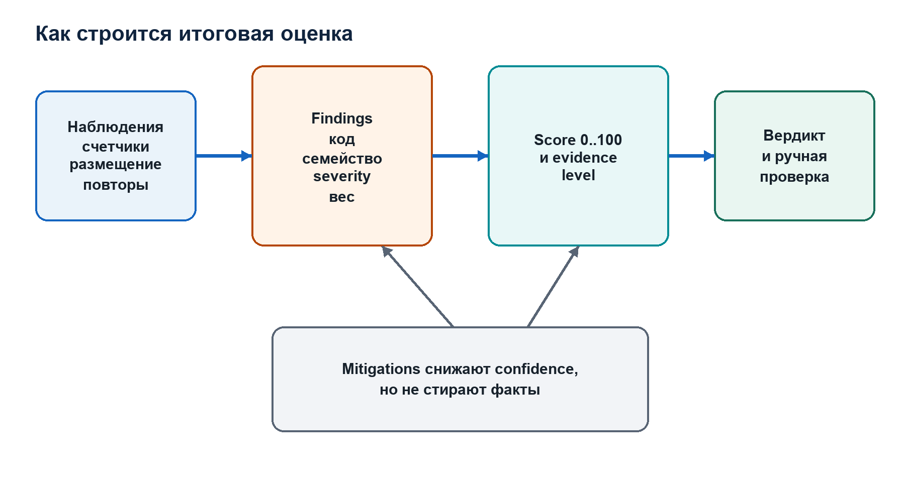

# Том II. Глава 7. `dynamic_win.c`: Windows dynamic evidence collector

## Назначение и граница платформы

Статическая часть проекта компилируется и работает на macOS, Linux и Windows, потому что читает PE как массив bytes. Динамическая часть использует Windows Debug API и должна исполнять Windows x64 target. Поэтому она доступна только в Windows build.

Это различие реализовано compile-time branch:

```c
#ifdef _WIN32
    /* реальный collector */
#else
    /* unsupported-platform stub */
#endif
```

На non-Windows система не пытается эмулировать process execution. `dynamic_collect_windows` инициализирует report, записывает понятную ошибку и возвращает false.

Следовательно:

```text
Linux/macOS host:
  static analysis Windows PE32+ AMD64 = поддерживается
  dynamic Windows exception validation = не поддерживается

Windows x64 host:
  static analysis = поддерживается
  dynamic validation = поддерживается
```

Wine или virtual machine могут быть отдельной средой исследования, но текущий код напрямую не реализует и не тестирует Wine-specific backend.

## Defensive intent

Header `dynamic.h` определяет цель как сбор runtime evidence:

- hits handlers из `UNWIND_INFO`;
- registration и hits VEH/VCH/UEF;
- registration dynamic function tables;
- first-chance и second-chance exception flow.

Collector не заявляет обход защит, извлечение скрытых данных или автоматическую деобфускацию. Он является ограниченным debugger, созданным под конкретные event types.

## Модель результата

`DynamicReport` хранит session state, counters, bounded events, bounded trace и human-readable log.

Состояние:

```c
bool enabled;
bool ran;
bool ok;
bool timed_out;
bool target_exited;
uint32_t target_exit_code;
```

`enabled` означает, что dynamic mode был запрошен и report инициализирован.

`ran` означает, что `CreateProcessA` succeeded и target действительно был создан.

`ok` означает:

```text
CREATE_PROCESS event был получен
&& debug loop не встретил internal failure
&& timeout не наступил
```

`target_exited` отдельно показывает normal observation `EXIT_PROCESS_DEBUG_EVENT`. Session может быть завершена принудительно по timeout, тогда target не считается self-exited.

Events ограничены:

```text
DYNAMIC_MAX_EVENTS = 256
```

После заполнения array новые события не перезаписывают старые; увеличивается `dropped_events`.

Trace также ограничен 256 instruction pointers. Input `trace_steps` clamp до 256.

## Module map

Breakpoints на system APIs нельзя ставить по address, полученному в process анализатора. Из-за ASLR module bases отличаются.

`ModList` содержит максимум 128 modules:

```c
typedef struct ModList {
    ModInfo mods[128];
    size_t count;
} ModList;
```

`mods_refresh_toolhelp`:

1. сбрасывает count;
2. вызывает `CreateToolhelp32Snapshot`;
3. перечисляет `MODULEENTRY32`;
4. сохраняет basename, base и size;
5. приводит name к lowercase.

Module list fixed-size. Если target загрузил более 128 modules, остаток не сохраняется. Truncation flag отсутствует. Это residual limit: API resolution для позднего module может не сработать без явной ошибки.

## Разрешение forwarded API

Windows export может быть forwarded. Например, symbol запрашивается через `kernel32.dll`, но фактический code address принадлежит `kernelbase.dll`.

`local_proc_loc` выполняет:

1. `GetModuleHandleA(preferred_mod)`;
2. `GetProcAddress(symbol)`;
3. `GetModuleHandleExA(...FROM_ADDRESS...)`, чтобы определить real local module;
4. получает basename real module;
5. вычисляет offset:

```text
offset = LocalFunctionVA - LocalRealModuleBase
```

После этого `add_api_bps_if_ready` ищет module с таким basename в target:

```text
TargetFunctionVA = TargetModuleBase + offset
```

Эта схема корректно переносит symbol location между процессами при одинаковой версии загруженного module. Она предполагает, что local и target используют совместимый module binary с тем же internal offset. Для обычного запуска на одной Windows installation это разумно; cross-architecture или module substitution потребовали бы remote export parsing.

## Наблюдаемые API

Collector ставит breakpoints на:

```text
AddVectoredExceptionHandler
AddVectoredContinueHandler
SetUnhandledExceptionFilter
RtlAddFunctionTable
RtlInstallFunctionTableCallback
```

Kinds хранятся как bit mask. Один address может соответствовать нескольким logical kinds, поэтому existing breakpoint получает:

```c
ex->kinds |= kind;
```

Это предотвращает дублирование `INT3` по одному address.

## Breakpoint model

```c
typedef struct Breakpoint {
    uint64_t addr;
    uint8_t orig;
    bool armed;
    bool rearm_pending;
    uint32_t kinds;
} Breakpoint;
```

`addr` — target VA.

`orig` — исходный byte, который был заменён.

`armed` — по address ожидается `0xCC`.

`rearm_pending` — исходная instruction временно восстановлена, breakpoint должен быть поставлен снова после single-step.

`kinds` — logical meanings address.

List имеет capacity 512. При переполнении `bp_add_and_arm` возвращает false, но dedicated overflow counter отсутствует.

## Запись bytes в remote process

`write_one_byte` сначала вызывает `WriteProcessMemory`. Если write failed, code сохраняет error и пробует временно изменить page protection:

```text
VirtualProtectEx(..., PAGE_EXECUTE_READWRITE)
WriteProcessMemory
VirtualProtectEx(..., oldProt)
```

После successful write вызывается `FlushInstructionCache`.

Причина cache flush: processor может иметь ранее полученные instruction bytes. После изменения executable memory debugger должен обеспечить согласованность instruction fetch.

Временный `PAGE_EXECUTE_READWRITE` расширяет permissions целевой страницы. Проект возвращает previous protection, но на короткий период изменяет security state target. Это unavoidable вмешательство выбранной software-breakpoint technique и должно учитываться при anti-debug-sensitive samples.

## Установка breakpoint

`bp_set`:

1. читает один byte по `addr`;
2. сохраняет его в `orig`;
3. пишет `0xCC`;
4. устанавливает `armed = true`;
5. очищает `rearm_pending`.

Здесь имеется subtle risk при повторной постановке: `bp_set` каждый раз заново читает current byte и записывает его в `orig`. Correct flow вызывает re-arm после того, как original instruction уже восстановлена, поэтому сохраняется правильный byte. Если функцию ошибочно вызвать на уже armed breakpoint, `orig` мог бы стать `0xCC`; guard в `bp_add_and_arm` предотвращает этот path.

`bp_clear` восстанавливает `orig` только если `armed`.

## Self-check

`bp_add_and_arm_selfcheck` после первой попытки установки снова читает byte и добавляет deterministic log line:

```text
[SelfCheck] ... OK (byte=0xcc)
```

Если byte не `0xCC`, появляется warning. Self-check также форматирует address как:

```text
module.dll+offset (absolute VA)
```

Это улучшает auditability: report показывает не только желание поставить breakpoint, но и результат remote memory verification.

Self-check log не является structured event. Он находится в `DynamicReport.details`, поэтому backend должен сохранять это поле, если требуется полный audit.

## Per-thread pending re-arm

После hit breakpoint временно снимается. Original instruction должна выполниться в том же потоке, который hit breakpoint. После single-step этот конкретный breakpoint ставится обратно.

`PendingRearmList` имеет 64 slots:

```c
typedef struct PendingRearmEntry {
    DWORD tid;
    Breakpoint* bp;
} PendingRearmEntry;
```

`pending_rearm_set` сначала обновляет existing entry для `tid`, затем ищет free slot. Если 64 threads одновременно находятся между breakpoint hit и single-step, insertion fails и session считается failed.

Один thread может иметь только один pending breakpoint. Это соответствует normal sequence: thread stopped on one breakpoint cannot hit another до выполнения original instruction и single-step.

При `EXIT_THREAD_DEBUG_EVENT` pending breakpoint также re-arm, чтобы завершение потока не оставило shared code без breakpoint.

## Командная строка target

Windows `CreateProcessA` принимает mutable command-line string, а не готовый `argv[]`. Поэтому collector строит строку по Microsoft C runtime quoting rules.

`append_cmd_arg`:

- добавляет quotes для empty string, spaces, tabs или internal quotes;
- удваивает backslashes перед quote;
- удваивает trailing backslashes перед closing quote.

Это существенно. Простое соединение arguments через spaces изменило бы boundaries. Например path с пробелом стал бы несколькими arguments.

CLI отделяет target arguments после `--`:

```text
eh_unwind_analyzer target.exe --dynamic -- --input sample.dat
```

Collector получает `child_argv` и сохраняет boundaries при построении Windows command line.

Report metadata по умолчанию redacts child arguments, потому что они могут содержать secrets. Это относится к `main.c`; actual CreateProcess command line всё равно включает переданные target arguments.

## Создание процесса

Используется:

```c
CreateProcessA(
    NULL,
    cmd.s,
    NULL,
    NULL,
    FALSE,
    DEBUG_ONLY_THIS_PROCESS,
    NULL,
    NULL,
    &si,
    &pi
)
```

`DEBUG_ONLY_THIS_PROCESS` означает, что дочерние процессы target автоматически не становятся debuggees этого collector.

Code намеренно не использует `CREATE_SUSPENDED`. Комментарий фиксирует обнаруженную практическую проблему: на некоторых configurations suspended debuggee не выдавал ожидаемый create event, что создавало deadlock. Debug API сам предоставляет ранний `CREATE_PROCESS_DEBUG_EVENT` до обычного user-mode execution.

После success:

```text
out->ran = true
hProcess = pi.hProcess
pid = pi.dwProcessId
```

## Static handler addresses как input dynamics

До debug loop collector строит unique list `handler_rvas` из успешно parsed records с `has_handler`.

List выделяется размером `rf_count`, минимум один element. Unique check линейный:

```text
для каждого handler
  сравнить со всеми уже сохранёнными
```

Worst-case complexity `O(n²)`. Для типичных handler counts это приемлемо, но большое PE с unique handler для каждого record может замедлить preparation. Hash set был бы масштабируемее.

На `CREATE_PROCESS_DEBUG_EVENT`:

```text
HandlerVA = base_main + HandlerRVA
```

и ставится `BP_UNWIND_HANDLER`.

Если RVA invalid, write may fail; failure считается best effort и не завершает session.

## Debug loop и timeout

Start time:

```c
uint64_t start = GetTickCount64();
```

На каждой iteration:

```text
elapsed = current - start
if elapsed > timeout_ms -> timeout
```

Сравнение строго `>`. Timeout event добавляется в structured events с `arg0 = timeout_ms`.

`WaitForDebugEvent` вызывается с 100 ms. `ERROR_SEM_TIMEOUT` означает отсутствие event в интервале и приводит к следующей iteration. Другой error завершает loop как failure.

Granularity timeout поэтому примерно 100 ms плюс время обработки события.

## Continuation status

Для каждого event initial:

```c
DWORD cont = DBG_CONTINUE;
```

Для ordinary exception, не принадлежащего breakpoint machinery:

```c
cont = DBG_EXCEPTION_NOT_HANDLED;
```

Это передаёт исключение обычному target dispatch.

Для собственных breakpoint и single-step:

```c
cont = DBG_CONTINUE;
```

потому что debugger полностью обработал служебное exception.

Неверный status здесь способен либо поглотить target exception, либо передать приложению `INT3`, вставленный analyzer.

## `CREATE_PROCESS_DEBUG_EVENT`

Collector:

1. устанавливает `got_create = true`;
2. сохраняет `base_main = lpBaseOfImage`;
3. refresh modules;
4. пытается поставить API breakpoints;
5. ставит breakpoints на static handler RVA;
6. закрывает `hFile` из event.

Закрытие file handle обязательно по Windows Debug API contract.

`base_main` — actual base. Он используется для статических handler RVA и address-to-section formatting.

## `LOAD_DLL_DEBUG_EVENT`

При каждой DLL load:

1. refresh module list;
2. повторно вызвать `add_api_bps_if_ready`;
3. закрыть `hFile`.

Повторная попытка нужна, потому что real module API мог отсутствовать раньше. Existing breakpoints deduplicate по address.

`UNLOAD_DLL_DEBUG_EVENT` только refresh list. Breakpoints внутри выгруженного module не удаляются из `BpList`. Их remote pages уже могут быть unmapped. На final cleanup `bp_clear` best-effort игнорирует failure. Если module выгружен и затем другой module загружен по тому же address, stale breakpoint model может стать проблемой. Это limitation текущего collector.

## Ordinary exception event

Для code, отличного от breakpoint и single-step:

```text
exceptions_seen++
first_chance_seen++ или second_chance_seen++
```

В event сохраняются:

- type `exception`;
- thread ID;
- exception address;
- exception code;
- first_chance flag;
- module by address.

После этого `DBG_EXCEPTION_NOT_HANDLED`.

Collector не сериализует `NumberParameters` и `ExceptionInformation[]`. Для access violation поэтому не сохраняются attempted address и operation type. Это направление расширения evidence model.

## Initial system breakpoint

После создания debuggee Windows генерирует initial breakpoint. Он не принадлежит `BpList`.

Code допускает один неизвестный breakpoint как initial:

```text
if !bp && !initial_break_ignored:
    initial_break_ignored = true
    DBG_CONTINUE
```

Следующие unknown breakpoints передаются как not handled.

Это pragmatic rule. Target может выполнить собственный early `INT3` до system breakpoint order, а system behavior может отличаться. Более строгая identification могла бы учитывать module/address и event sequence.

## Hit собственного `INT3`

По exception address выполняется `bps_find`.

Если breakpoint найден:

1. `bp_clear` восстанавливает original byte;
2. `rearm_pending = true`;
3. `pending_rearm_set(tid, bp)`;
4. открывается event thread;
5. читается context;
6. `ctx.Rip = addr`;
7. `ctx.EFlags |= 0x100`;
8. анализируются kinds;
9. записывается context;
10. event продолжается.

Комментарий «RIP points to INT3+1; rewind» реализуется присваиванием address exception. Поскольку `addr` равен адресу breakpoint, это возвращает execution на original instruction.

Если clear, pending storage, thread open, context read или context write fails, debug loop помечается failed и завершается после продолжения текущего event.

## Capture регистрации VEH

На entry `AddVectoredExceptionHandler` Windows x64 ABI:

```text
RCX = First
RDX = Handler
```

Collector:

```text
veh_registrations++
event type = veh_registration
arg0 = First
arg1 = Handler
```

Если Handler nonzero, ставится breakpoint `BP_CUSTOM_VEH_HANDLER`.

Collector не наблюдает return value API, поэтому не знает, была ли регистрация successful. Он фиксирует вызов и arguments. Чтобы подтвердить success, нужен return breakpoint или анализ последующего hit.

## Capture VCH

Аналогично:

```text
RCX = First
RDX = Handler
```

Counters и event types отделены:

```text
vch_registrations
vch_registration
BP_CUSTOM_VCH_HANDLER
vch_hits
```

Это сохраняет различие VEH и VCH phases.

## Capture UEF

На entry `SetUnhandledExceptionFilter`:

```text
RCX = Handler
```

Collector увеличивает `uef_set_calls`, создаёт `uef_registration` и ставит breakpoint на nonzero handler.

Как и для VEH, return value предыдущего filter не записывается.

Microsoft указывает, что top-level filter вызывается, когда exception достигает unhandled filter и process не debugged. Наличие active debugger может менять UEF behavior. Поэтому hit UEF под debugger нельзя считать гарантированным для всех scenarios; bundled smoke target и validation должны учитывать actual Windows semantics.

## Capture `RtlAddFunctionTable`

Arguments:

```text
RCX = FunctionTable
RDX = EntryCount
R8  = BaseAddress
```

Structured event:

```text
type = rtl_add_function_table
arg0 = table pointer
arg1 = count
arg2 = base
```

Collector не читает remote entries. Для полноценного dynamic table analysis нужно:

1. validate count upper bound;
2. compute byte size safely;
3. read remote array;
4. validate `RUNTIME_FUNCTION`;
5. resolve unwind records against supplied base;
6. snapshot page protections;
7. account for table lifetime and `RtlDeleteFunctionTable`.

Текущая реализация подтверждает API call, но не content.

## Capture callback table

`RtlInstallFunctionTableCallback`:

```text
RCX = TableIdentifier
RDX = BaseAddress
R8  = Length
R9  = Callback
```

Event stores all four arguments. Callback table is more dynamic: system may call supplied callback to obtain entries on demand. Full analysis потребовал бы breakpoint on callback и decoding return behavior.

## Handler hits

Kinds:

```text
BP_UNWIND_HANDLER
BP_CUSTOM_VEH_HANDLER
BP_CUSTOM_VCH_HANDLER
BP_CUSTOM_UEF
```

При hit соответствующий counter увеличивается и создаётся event:

```text
unwind_handler_hit
veh_handler_hit
vch_handler_hit
uef_handler_hit
```

Для static unwind handler address formatter показывает absolute VA, RVA и section.

Если `trace_steps > 0` и трасса ещё не собиралась, включается single-step trace:

```text
tracing = true
trace_tid = current tid
add_trace(current RIP)
trace_left = min(trace_steps, 256) - 1
```

После rewind `current RIP` равен handler entry. Поэтому первым trace element является address original handler instruction до её исполнения.

Трасса запускается только при первом handler hit. Последующие попадания продолжают
учитываться отдельными counters и events, но не накапливают новую RIP trace поверх
первой. Благодаря этому `trace_count` никогда не превышает заданный `trace_steps`.

## `EXCEPTION_SINGLE_STEP`

Сначала:

```text
pr_bp = pending_rearm_take(tid)
bp_set(pr_bp)
```

Это возвращает `0xCC` после выполнения original instruction.

Затем читается context.

Если active tracing принадлежит тому же thread:

```text
add_trace(ctx.Rip)
trace_left--
TF remains set
```

Когда `trace_left == 0`, TF снимается.

Если tracing не active для этого thread, TF снимается сразу.

`trace_count` включает initial handler RIP в общий бюджет. При `trace_steps = 32`
сохраняется не более 32 addresses: entry point и до 31 последующего single-step
addresses.

Collector поддерживает только один active trace session global to report.
Повторный handler hit не перезапускает и не перезаписывает трассу, потому что
`start_trace` возвращается при `trace_count != 0`. Counters и events повторных
hits продолжают записываться. Отдельные одновременные per-thread traces не
поддерживаются.

## Thread exit

Если thread завершился с pending re-arm, collector повторно ставит breakpoint. Это важно, потому что code memory принадлежит процессу, а не thread.

Если exiting thread был traced, trace state сбрасывается.

## Process exit

На `EXIT_PROCESS_DEBUG_EVENT`:

```text
process_exited = true
target_exited = true
target_exit_code = event code
```

Добавляется `process_exit` event с exit code в `arg0`. Loop завершится только после `ContinueDebugEvent`, что соответствует Debug API lifecycle.

Exit code zero не означает отсутствие anomalies. Это только status target process.

## Session finalization

После loop:

```text
timed_out = local timed_out
target_exited = process_exited
ok = got_create && debug_loop_ok && !timed_out
```

Затем collector пытается снять все breakpoints.

Если target сам не завершился, вызывается `TerminateProcess`. После этого collector
до одной секунды принимает и продолжает завершающие debug events, включая
`EXIT_PROCESS_DEBUG_EVENT`. Такой drain не добавляет фиксированные пять секунд к
каждому timeout-case и корректно завершает debug lifecycle.

Закрываются initial thread и process handles, освобождается handler list и command-line buffer.

Если `ok == false`, функция добавляет одну из summary errors:

- timeout;
- failure до create event;
- failure внутри event loop.

Даже при false `DynamicReport` остаётся доступным. `main.c` передаёт его в JSON/HTML, чтобы partial events и failure state не терялись.

## Semantics dynamic signal count

Report layer считает не raw events, а категории:

```text
1: any unwind handler hits
1: any VEH registration or hit
1: any VCH registration or hit
1: any UEF set or hit
1: any dynamic function table API call
1: any second-chance exception
```

Maximum category count шесть. Десять VEH hits всё равно дают один dynamic signal category.

Это summary diversity, а не event volume.

## Runtime evidence level

Strong runtime component:

```text
any handler hit
```

Medium components:

```text
dynamic table registration
second chance
```

Weak components:

```text
handler registrations
first chance
```

Result:

```text
strong, если strong>=1 и medium>=1
medium, если strong>=1 или medium>=2
weak, если medium>=1 или weak>=1
none иначе
```

Опять же это engineering taxonomy, не probability.

## Structured event limitations

`DynamicEvent` содержит generic `arg0..arg3`. Их meaning зависит от `type`.

Плюс: model compact и позволяет serializing разные APIs.

Минус: schema не выражает types напрямую. Backend должен знать mapping:

```text
veh_registration:
  arg0 First
  arg1 Handler

rtl_add_function_table:
  arg0 Table
  arg1 EntryCount
  arg2 BaseAddress
```

Для долгосрочной API лучше использовать typed subobjects или event-specific fields, сохранив backward-compatible base.

## Safety and trust boundary

Target является untrusted executable. Dynamic mode действительно запускает его. Он может:

- читать и изменять доступные user files;
- обращаться к сети;
- создавать child processes;
- обнаруживать debugger;
- зависать;
- потреблять ресурсы;
- атаковать parser/debugger through event volume.

`DEBUG_ONLY_THIS_PROCESS` не sandbox. Timeout не sandbox. Поэтому production deployment должен запускать dynamic worker в disposable Windows VM или hardened sandbox с resource limits и restricted network.

Backend нельзя запускать collector от имени privileged service account над arbitrary upload.

## Bundled dynamic smoke targets

Project содержит Windows test programs:

```text
dyn_veh.c
dyn_vch.c
dyn_uef.c
dyn_rtl_ftable.c
```

Они компилируются в:

```text
15_dynamic_veh.exe
16_dynamic_vch.exe
17_dynamic_uef.exe
18_dynamic_rtl_function_table.exe
```

Smoke script запускает analyzer с timeout 8000 ms, trace 32 для handlers и JSON validation.

Targets подтверждают ожидаемые counters:

- VEH registration/hit;
- VCH registration/hit;
- UEF set/hit и exception flow;
- dynamic function table calls.

На macOS эти tests не могут проверить реальный Debug API branch. Нужен Windows CI или физический Windows x64 host.

## Фактическая Windows validation 8 июня 2026 года

Финальная MinGW-w64 сборка dynamic collector была запущена на Windows x64.
Проверенный executable имеет:

```text
SHA-256
489e7571827693cd555c1958f9aec7694d1de717f896d33ecfebe8f13e843624
```

Корпус содержал 18 синтетических и 106 реальных PE-файлов:

```text
124/124 JSON reports прошли schema и semantic validation
86 dynamic sessions были фактически запущены
54 target завершились самостоятельно
32 target корректно остановлены hard timeout
30 DLL/PYD получили ran=false, потому что CreateProcess не запускает library
8 EXE потребовали elevation
4/4 focused VEH/VCH/UEF/runtime-table scenarios прошли
0 dynamic events потеряно
maximum trace_count = 32 при trace_steps = 32
```

Эта проверка подтверждает не только synthetic smoke, но и устойчивость
collector contract на разнообразных реальных EXE: normal exit, nonzero target
exit, GUI/long-running timeout и launch failure. DLL/PYD всё равно не были
исполнены: для них требуется отдельный host process.

Артефакты сохранены в
`reports/dynamic_validation_2026-06-08/`. Скрипт
`tests/validate_dynamic_corpus_evidence.py` повторно проверяет 124
индивидуальных reports, aggregate JSON/CSV, trace budget, dropped events,
source hashes и четыре expected-signal scenarios без повторного запуска
target.

Эмпирическая граница результата: подтверждена MinGW-w64 сборка. MSVC остаётся
отдельным compiler gate и должен проходить в Windows CI на финальной revision.

## Что сделано правильно

Сильные стороны implementation:

- exact separation Windows/non-Windows;
- forwarded API resolution через real module offset;
- bounded event and trace storage;
- command-line quoting;
- instruction cache flush;
- temporary protection restoration;
- per-thread pending re-arm;
- preservation ordinary exception dispatch;
- repeated API breakpoint setup after DLL load;
- partial report retention on failure;
- timeout and cleanup;
- self-check breakpoint bytes.

## Что остаётся улучшить

Наиболее значимые improvements:

1. Remote parse dynamic function tables.
2. Наблюдать removal API и lifetime tables.
3. Typed event schema вместо generic args.
4. Сохранять exception parameters и context snapshots.
5. Поддержать concurrent per-thread traces.
6. Track module unload and invalidate breakpoints.
7. Dynamic capacity или truncation flags для module, breakpoint и pending lists.
8. Return breakpoints для registration API success.
9. Unicode command-line path через `CreateProcessW`.
10. Isolated worker protocol и VM orchestration.
11. Runtime memory protection map.
12. Hardware-breakpoint backend для anti-tamper-sensitive cases.
13. Завершить независимый MSVC gate и расширять Windows version matrix.

## Итоговая state machine

Collector можно представить как finite state machine:

```text
UNINITIALIZED
-> REPORT_INITIALIZED
-> COMMAND_BUILT
-> PROCESS_CREATED
-> WAITING_EVENT
-> HANDLING_EVENT
-> CONTINUING_EVENT
-> WAITING_EVENT
-> EXITED | TIMED_OUT | FAILED
-> BREAKPOINT_CLEANUP
-> HANDLE_CLEANUP
-> REPORT_READY
```

Внутри breakpoint branch существует вложенная state machine:

```text
ARMED
-> HIT
-> ORIGINAL_RESTORED
-> RIP_REWOUND_AND_TF_SET
-> ORIGINAL_INSTRUCTION_EXECUTED
-> SINGLE_STEP
-> REARMED
```

Понимание этих состояний необходимо, чтобы объяснить dynamic part проекта. Она не «просто запускает EXE». Она реализует специализированный user-mode debugger и строит ограниченный, воспроизводимый набор runtime evidence.

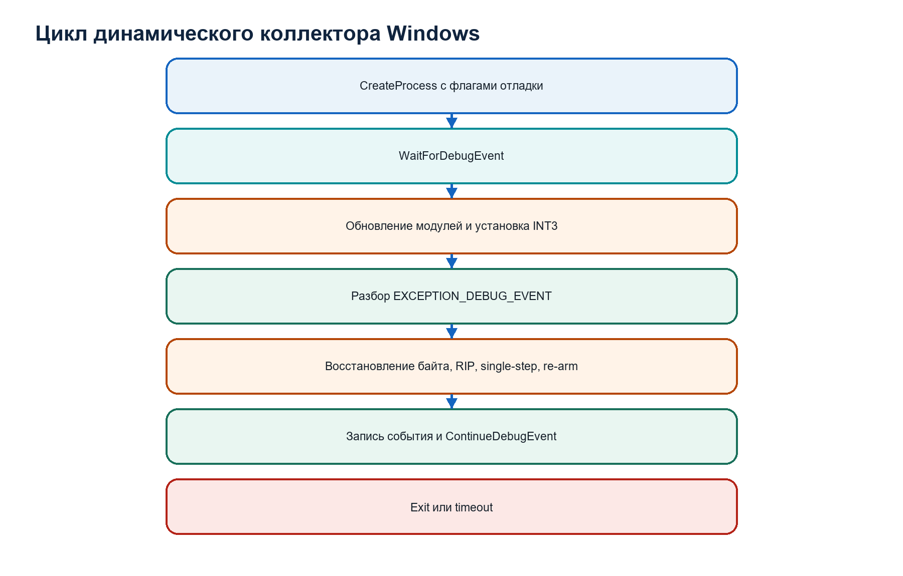

# Том II. Глава 8. `report.c`: отчёты, итоговая assessment и интеграционный контракт

## Отчёт не является форматированным `printf`

После анализа существуют несколько внутренних моделей:

```text
PeImage
RuntimeFunction[]
UnwindSummary[]
us_ok[]
HeuristicReport
DynamicReport
ReportMetadata
```

`report.c` преобразует их в четыре внешних представления:

- brief console output;
- CSV;
- JSON;
- self-contained HTML.

Это serialization boundary. Ошибка здесь может:

- потерять evidence;
- создать invalid JSON;
- внедрить untrusted text в HTML;
- нарушить report schema;
- записать частичный файл как будто он полный;
- исказить числовую semantics.

Поэтому reporting layer проверяет model bounds, metadata, encoding и atomic write.

## Brief console report

`report_print_brief` выводит:

```text
input path
machine
ImageBase
SizeOfImage
SizeOfHeaders
section count
exception directory
RUNTIME_FUNCTION count
```

Это human-readable summary для terminal. Он не содержит все functions и не предназначен как stable machine contract.

Terminal output может меняться без schema migration. Backend не должен parsing console text.

## CSV report

Обычный CSV содержит строку на runtime function:

```text
index
begin_rva
end_rva
size
unwind_rva
unwind_ver
unwind_flags
prolog_size
fixed_stack
frame_reg
frame_off
handler_rva
has_chain
anomalies
parse_error
```

При parse failure поля, которые нельзя считать надёжными, получают `NA`, а error сохраняется.

CSV escaping реализован согласно базовым правилам:

- cell с comma, quote или newline оборачивается quotes;
- internal quote удваивается.

CSV подходит для spreadsheet и простого exchange, но не выражает nested structures, typed events или null semantics так полно, как JSON.

## Ghidra CSV

При `ghidra_mode` columns:

```text
begin_rva,end_rva,name,comment
```

Name строится:

```text
sub_%08X
```

Comment содержит summary:

```text
version
flags
prolog size
stack bytes
frame register
saved GP/XMM
handler
chain
anomalies
```

Этот report создаёт bridge к Ghidra script. Он не меняет source binary и не является отдельной копией core.

## Anomaly text

Bit mask `UnwindSummary.anomalies` преобразуется в compact labels:

```text
ver
trunc
op
arg
off
chain_loop
chain_depth
handler_oob
order
operand_sanity
alignment
chain_invalid
```

Если mask zero, записывается `"0"`.

Compact text удобен в table, а numeric mask сохраняется в JSON. Consumer может использовать stable numeric bits, но для долгосрочной schema лучше также публиковать array full anomaly codes.

## Report metadata

Полный JSON/HTML требует:

```c
typedef struct ReportMetadata {
    const char* tool_version;
    const char* report_schema_version;
    const char* generated_at_utc;
    const char* input_sha256;
    uint64_t input_size;
    const char* command_line;
    const char* build_compiler;
    const char* build_platform;
    const char* build_mode;
} ReportMetadata;
```

Эти поля обеспечивают provenance.

Tool version говорит, какая implementation создала report.

Schema version говорит, как consumer должен интерпретировать JSON structure.

Generated timestamp фиксирует время serialization в UTC.

Input SHA-256 и size идентифицируют bytes.

Command line фиксирует analyzer options, но child arguments могут быть redacted.

Compiler, platform и build mode позволяют различить binaries tool.

## Metadata validation

`report_metadata_valid` требует:

- nonempty tool version;
- exact supported schema version;
- timestamp format длиной 20: `YYYY-MM-DDTHH:MM:SSZ`;
- SHA-256 length 64;
- только lowercase hex;
- nonnull command line;
- nonempty compiler/platform;
- build mode `debug` или `release`.

Проверка timestamp валидацирует syntax positions и digits, но не календарную корректность. Например, month 99 формально прошёл бы. Timestamp генерируется internally, поэтому risk ограничен, но reusable API могла бы выполнять полную date validation.

Schema version comparison strict. Старый или будущий version metadata не записывается этим writer. Это защищает от случайного mislabeled output.

## Model validation

`report_model_valid` проверяет:

- если есть sections, pointer не null;
- finding count не выше capacity;
- mitigation count не выше capacity;
- dynamic event count не выше capacity;
- trace count и requested steps не выше array capacity.

Функция не перепроверяет все semantic relationships. Она является boundary sanity guard.

## JSON escaping

Input path, error text, section names, command line и dynamic details являются untrusted strings. Они должны быть escaped.

`json_escape` обрабатывает:

```text
\  -> \\
"  -> \"
newline -> \n
carriage return -> \r
tab -> \t
control bytes -> \u00xx
```

Для bytes >= 0x80 функция проверяет valid UTF-8 sequence lengths, включая:

- исключение overlong sequences;
- исключение surrogate range;
- ограничение code points до U+10FFFF.

Valid sequence копируется целиком. Invalid byte кодируется как `\u00xx`.

Это гарантирует syntactically valid JSON string, хотя invalid multibyte source преобразуется byte-wise, а не в Unicode replacement character.

## JSON numeric representation

Addresses сериализуются strings с `0x`:

```json
"begin_rva": "0x00001010"
```

Причины:

- сохраняется hexadecimal representation;
- 64-bit VA не теряется в JavaScript number;
- адрес явно отличается от обычного count.

Counts и ratios сериализуются numbers:

```json
"score": 18,
"confidence": 0.43
```

Consumer должен знать type contract. Backend не должен преобразовывать address string в signed 32-bit integer.

## Top-level JSON model

Основные sections:

```text
input
report_metadata
image_base
size_of_image
size_of_headers
section_alignment
file_alignment
exception_directory
pe_validation
sections
heuristic_analysis          если запрошена и успешна
dynamic_validation          если dynamic был запрошен
assessment                  если есть static или dynamic report
functions
```

Optional blocks отражают выполненные stages. Отсутствие `heuristic_analysis` отличается от score zero.

## `pe_validation`

Этот block содержит parser-level structural facts:

```text
section_raw_oob
section_virtual_oob
section_raw_overlaps
section_virtual_overlaps
section_misaligned
exception_directory_oob
```

Они доступны независимо от heuristic score. Это полезно для backend, который хочет собственную policy.

## `sections`

Для каждой section:

```text
name
virtual_address
virtual_size
raw_offset
raw_size
characteristics
readable
writable
executable
```

Permissions как booleans дублируют bit field для удобства consumer. `characteristics` сохраняет original value.

## `heuristic_analysis`

Block включает:

- score, suspicion, confidence;
- manual review flag;
- verdict и evidence level;
- severity counts;
- все raw counters;
- reuse ratios;
- evidence families;
- structured findings;
- weakening rules;
- human-readable details.

Каждый finding содержит:

```text
code
family
severity
message
affected_count
representative_rva или null
representative_section
```

Для database нормализованный key — `code`, а message является display text. Business logic не должна зависеть от точной английской строки message.

## `dynamic_validation`

Block сохраняет не только successful session:

```text
enabled
ran
ok
timed_out
target_exited
target_exit_code
timeout_ms
trace_steps
counters
dynamic_signal_count
dropped_events
details
events
trace
```

Если `ok=false`, partial events всё равно могут быть значимы. Backend должен хранить session status и не отбрасывать block целиком.

Каждый event:

```text
type
module
thread_id
exception_code
first_chance
address
arg0..arg3
```

Meaning args определяется event type. Это нужно документировать в API adapter.

## Functions

Для каждой table entry JSON содержит original range, section context, parse status, decoded record и comment.

Внутренний `unwind` object:

```text
version
flags
prolog_size
count_codes
fixed_stack_bytes
frame_reg
frame_off
has_handler
handler_rva
handler_section
has_chain
anomalies
anomalies_text
chain
```

Даже при `unwind_ok=false` object присутствует с initialized partial/default values, а `unwind_error` объясняет failure.

Это упрощает schema: array shape постоянна.

## Итоговая static/dynamic correlation

`has_static_dynamic_correlation` использует две группы rules.

Первая:

```text
suspicious static handler context
&&
any unwind/VEH/VCH/UEF handler hit
```

Suspicious handler context:

- handler non-executable;
- handler writable;
- handler dominance family.

Вторая:

```text
any placement anomaly
&&
dynamic function table registration
```

Placement anomaly включает unusual/executable/writable unwind metadata или handler placement.

Correlation boolean означает совпадение агрегированных classes evidence. Она не всегда доказывает exact address identity. Поэтому detailed analyst report должен выполнять более строгий address-level join.

## Dynamic signal count

Function считает категории, а не события:

```text
unwind handler
VEH
VCH
UEF
dynamic function table
second chance
```

Registration и hit одной категории не дают два points.

Это снижает влияние repeated events и отражает diversity runtime mechanisms.

## Runtime evidence level

Handler hit относится к strong component, dynamic table call и second chance — medium, registrations и first chance — weak.

Итог `none`, `weak`, `medium`, `strong` строится rule-based. Он не учитывает benign identity handler.

Если dynamic session не завершена успешно, завершилась по timeout или target
не достиг естественного exit, наблюдённые events сохраняются, но runtime
evidence level ограничивается значением `weak`. Такая session не устанавливает
static/dynamic correlation и не повышает final confidence.

## Case strength

`case_strength` комбинирует static и runtime evidence levels:

```text
strong_correlated_case
medium_correlated_case
strong_unconfirmed_case
medium_case
weak_case
no_case
```

Если есть correlation и хотя бы одна сторона strong — strong correlated.

Если нет correlation, но одна сторона strong — strong unconfirmed.

Слово case означает аналитический набор evidence, а не юридически доказанный malicious verdict.

## Final confidence

Начальная final confidence:

```text
hr->confidence, если static report есть
0.10 иначе
```

Добавляется:

```text
+0.10 если есть dynamic signals в успешно завершённой session
+0.10 если есть static/dynamic correlation
```

Maximum `0.98`.

Это не Bayesian update. Runtime signal и correlation могут быть зависимы, а increments не калиброваны. Поле следует трактовать как rule-based report confidence.

## Final verdict

Если static score:

```text
>=70 high_suspicion_correlated/static
>=40 moderate_suspicion_correlated/static
>=15 low_suspicion_correlated/static
```

Если static score ниже 15, но dynamic signals существуют:

```text
runtime_signals_only
```

Иначе:

```text
no_strong_correlated_evidence
```

Dynamic events не повышают static score. Они влияют на final suffix, confidence, case strength и отдельный evidence level.

## Manual validation plan

`collect_manual_validation_steps` строит context-dependent список.

Примеры:

- проверить `.pdata` ranges в PE viewer;
- открыть suspicious `UNWIND_INFO` в hex view;
- сравнить codes с Ghidra prolog;
- проверить section permissions;
- дизассемблировать handler;
- исследовать JIT explanation;
- capture dynamic table arguments;
- single-step registered handlers;
- выполнить dynamic run при наличии только static findings.

Это сильная часть report design: output не заканчивается score, а сообщает следующий проверочный шаг.

Steps являются English display strings, не stable IDs. Для backend localization и workflow automation лучше добавить code каждому step.

## HTML security model

HTML self-contained: CSS и JavaScript встроены, external resources отсутствуют.

Content Security Policy:

```text
default-src 'none'
style-src 'unsafe-inline'
script-src 'unsafe-inline'
img-src 'none'
base-uri 'none'
form-action 'none'
```

Такой CSP запрещает network loads, images, base URL и forms. Inline style/script разрешены, потому что report содержит собственный dashboard и filter.

Все untrusted strings проходят `html_escape`:

```text
& < > " '
```

Invalid UTF-8 bytes превращаются в numeric entities.

Если path содержал `<script>`, он выводится text, а не исполняется.

## HTML sections

Dashboard показывает:

- function count;
- parse failures;
- anomalous entries;
- static score/verdict/confidence;
- dynamic status.

Далее:

- provenance;
- PE image fields;
- structural validation;
- sections;
- final assessment;
- manual plan;
- findings;
- weakening rules;
- dynamic events and log;
- filterable runtime functions.

Client-side filter работает только по уже встроенной table и не отправляет данные наружу.

## HTML status nuance

Dynamic card class green только если:

```text
dr && dr->ran && dr->ok && !dr->timed_out
```

Text различает:

```text
not requested
timed out
not run
completed
failed
```

Это предотвращает превращение «dynamic не запрошен» в «dynamic anomalies не найдены».

## Atomic file write

CSV, JSON и HTML сначала полностью строятся в `StrBuf`, затем передаются `file_write_atomic`.

Atomic strategy:

1. записать temporary file;
2. flush/close;
3. rename в final path.

Consumer либо видит старый complete file, либо новый complete file, а не partial serialization.

Atomic rename не равен полной crash durability: без directory fsync внезапное отключение питания может иметь platform-dependent outcome. Для обычного report generation гарантия достаточна, но archival evidence storage требует отдельной durability policy.

## Memory failure behavior

`StrBuf` имеет sticky `ok` state. Если append failed, дальнейшие operations не превращают truncated buffer в successful report.

Перед write проверяется:

```text
sb_ok(all working buffers)
```

Если false, final file не записывается.

Это важнее частичного convenience output: invalid JSON не должен выдаваться как report.

## JSON schema

`docs/report.schema.json` формализует expected types and required fields. Tests валидируют generated reports.

Schema version находится и в metadata, и в application constants. Изменение field contract требует:

1. обновить schema;
2. изменить schema version;
3. добавить migration/compatibility notes;
4. обновить tests;
5. уведомить backend consumer.

Нельзя silently переименовать `rf_unwind_oob`, если коллега уже сохраняет это поле в database.

## Как backend должен вызывать core

Текущее ядро предоставляет CLI executable и static library. Для другого разработчика самый безопасный initial integration:

```text
backend receives uploaded binary
-> saves immutable job input
-> starts analyzer subprocess with explicit output paths
-> enforces timeout/resource limits
-> checks process exit code
-> parses JSON
-> validates JSON schema
-> stores raw JSON and normalized indexes
```

API между frontend и backend нужен. Между backend и core отдельный network API необязателен: subprocess protocol уже является boundary.

Отдельный core service нужен только если:

- анализ выполняется на другом host;
- нужен Windows-only dynamic worker;
- требуется queue and isolation;
- много concurrent jobs;
- deployment policy запрещает запуск subprocess в backend.

## Рекомендуемая database model

Не следует разбивать каждый JSON field в таблицы до потери original report. Надёжная схема:

`analysis_job`:

```text
id
status
input_sha256
input_size
original_filename
requested_static
requested_dynamic
created_at
started_at
finished_at
tool_version
schema_version
exit_code
failure_reason
```

`analysis_report`:

```text
job_id
raw_json
json_hash
html_object_key
created_at
```

Нормализованные tables для search:

```text
finding
runtime_function
dynamic_event
section
assessment
```

Raw JSON остаётся source of truth для backward compatibility и повторной migration.

## Сравнение analyses

Сравнивать можно:

- один hash в разных tool versions;
- разные versions одного binary;
- static-only и static+dynamic runs;
- runs с разными target arguments.

Join keys:

```text
input_sha256
tool_version
schema_version
function begin_rva
finding code + representative_rva
dynamic event type + module + offset
```

Absolute runtime VA нельзя напрямую сравнивать между runs из-за ASLR. Его нужно нормализовать к module+offset или RVA.

## API adapter не должен менять core

Коллега может написать backend adapter без изменения parser/decoder:

```text
HTTP upload
-> job queue
-> subprocess execution
-> JSON schema validation
-> persistence
-> REST response
```

Core следует менять только при необходимости нового analytical field, stable library API или structured streaming. Web concerns, authentication, database transactions и UI не должны входить в C analyzer.

## Что сделано правильно

- несколько outputs для разных consumers;
- machine-readable JSON;
- provenance and hash;
- schema validation;
- UTF-8-aware escaping;
- HTML escaping and restrictive CSP;
- atomic writes;
- explicit partial dynamic status;
- structured findings and events;
- manual validation plan;
- static/dynamic assessment без изменения raw evidence.

## Что улучшить

1. Добавить explicit policy version heuristics.
2. Typed dynamic event payloads.
3. Stable codes manual steps.
4. Full anomaly code arrays.
5. Score contribution per finding.
6. JSON writer abstraction, уменьшающий риск comma errors.
7. Streaming for extremely large function tables.
8. Optional gzip or JSON Lines for events.
9. Localization layer, не меняющий machine codes.
10. Digital signing of reports для chain of custody.
11. Separate raw observation schema from assessment policy.
12. Compatibility tests against previous schema versions.

## Итог

`report.c` является публичным контрактом продукта. Он соединяет C core с analyst, Ghidra, backend, database и frontend. Полноценность проекта определяется не только тем, может ли parser прочитать `.pdata`, но и тем, может ли downstream system точно понять:

```text
что анализировалось
какой версией
какие этапы реально выполнены
какие факты обнаружены
какие выводы построены
какова их ограниченность
что проверять вручную
```

В текущем проекте этот контракт уже достаточно развит для subprocess integration. Сетевую API-прослойку можно строить вне ядра, не изменяя аналитические modules.

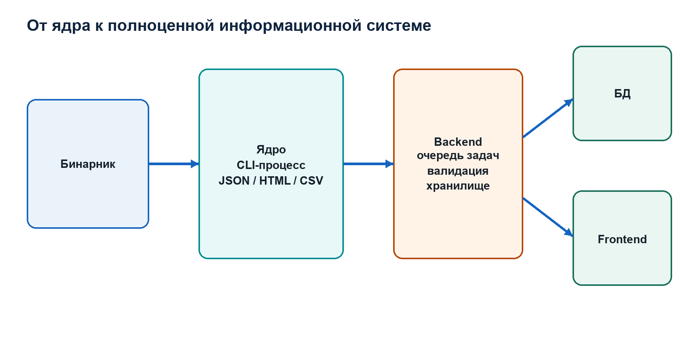

# Том II. Глава 9. Сборка, тестирование, воспроизводимость и степень готовности

## Что значит «проект работает»

Фраза «работает без ошибок» должна быть разложена на проверяемые утверждения:

- source compiles в заявленных toolchains;
- compiler не выдаёт warnings при strict flags;
- unit tests проходят;
- regression samples дают ожидаемые reports;
- malformed inputs не вызывают memory errors;
- JSON соответствует schema;
- HTML escaping сохраняет security;
- CLI exit codes соответствуют contract;
- release package содержит нужные artifacts;
- Windows dynamic branch проверен на Windows x64;
- реальные benign binaries не создают неприемлемый уровень false positives.

Ни один отдельный successful run не доказывает все пункты.

## CMake project model

Top-level project:

```cmake
project(
    eh_unwind_analyzer
    VERSION 1.0.0
    DESCRIPTION "Static and dynamic analyzer for Windows x64 EH/Unwind metadata"
    LANGUAGES C
)
```

Минимальная CMake version 3.23. Language standard:

```cmake
target_compile_features(ehua_core PUBLIC c_std_17)
```

Core собирается как static library:

```cmake
add_library(ehua_core STATIC ...)
```

CLI:

```cmake
add_executable(eh_unwind_analyzer src/main.c)
target_link_libraries(eh_unwind_analyzer PRIVATE ehua_core)
```

Это modular monolith: один deployable CLI, внутри которого modules разделены C interfaces. Static library позволяет будущему native adapter link against core, но public API пока ориентирован на внутренние structs и не обещает ABI stability.

## Core sources

Library включает:

```text
app_info.c
dynamic_win.c
heuristics.c
pe.c
report.c
unwind.c
util.c
```

`main.c` не входит в library. Поэтому CLI orchestration отделена от analysis modules.

## Platform checks

Если build выполняется на Windows, pointer size должен быть 64 bit:

```cmake
if(WIN32 AND NOT CMAKE_SIZEOF_VOID_P EQUAL 8)
    message(FATAL_ERROR ...)
endif()
```

Это не запрещает 64-bit Linux/macOS static build. Проверка относится только к Windows runtime branch.

При MinGW определяется:

```text
__USE_MINGW_ANSI_STDIO=1
```

Это обеспечивает ожидаемое formatting behavior для некоторых specifiers.

## Warning policy

MSVC:

```text
/W4
/permissive-
/WX при warnings-as-errors
```

GCC/Clang:

```text
-Wall
-Wextra
-Wpedantic
-Wconversion
-Wshadow
-Wformat=2
-Werror
```

Warnings as errors включены в base preset. Это предотвращает накопление известных compiler diagnostics.

Warning-free build не доказывает отсутствие bugs, но повышает minimum discipline C code.

## Instrumentation

Sanitizer preset:

```text
AddressSanitizer
UndefinedBehaviorSanitizer
-fno-omit-frame-pointer
```

ASan обнаруживает многие out-of-bounds, use-after-free и related memory errors. UBSan обнаруживает ряд undefined operations.

Они доступны с GCC/Clang, не с текущим MSVC configuration.

Coverage preset использует:

```text
--coverage -O0 -g
```

Sanitizers и coverage запрещены одновременно, чтобы избежать сложной и неподдерживаемой instrumentation combination.

## Presets

Configure presets:

```text
debug
release
sanitize
coverage
```

Все наследуют Ninja generator, tests enabled, compile commands export и warnings-as-errors.

Типичный release cycle:

```sh
cmake --preset release
cmake --build --preset release
ctest --preset release
```

Preset фиксирует повторяемый набор options и уменьшает зависимость от ручной command line.

## Unit test executables

CTest создаёт девять C unit test binaries.

### `unit_unwind`

Проверяет decoder:

- operation decoding;
- code order;
- flags;
- operand length;
- chain errors;
- boundary conditions.

### `unit_heuristics`

Проверяет базовые static score, placement, verdict и confidence.

### `unit_heuristics_mitigations`

Проверяет weakening rules:

- single signal;
- small sample;
- placement only;
- single family.

### `unit_heuristics_context`

Проверяет context-sensitive rules:

- benign handler dominance suppression;
- dominance при corroborating context;
- writable metadata and handler combination.

### `unit_heuristics_combos`

Проверяет additional combination findings и weights.

### `unit_core_edges`

Проверяет:

- empty function table;
- resource-only image;
- overflow/bounds;
- RVA mapping;
- nested overlaps;
- PE structure findings.

### `unit_report_json`

Проверяет:

- complete static/dynamic serialization;
- metadata;
- findings/events;
- UTF-8 safety;
- expected JSON fragments.

### `unit_report_html`

Проверяет:

- HTML escaping;
- dashboard sections;
- filter script;
- отсутствие unescaped hostile strings.

### `unit_matrix_report`

Проверяет combined assessment:

- strong static without dynamic;
- weak static plus weak runtime;
- strong correlated case;
- comma placement around optional blocks;
- final verdict and case strength.

## Assertions в release unit tests

C `assert` обычно отключается macro `NDEBUG` в release builds. CMake принудительно undefines:

```text
/UNDEBUG для MSVC
-UNDEBUG для GCC/Clang
```

Иначе release CTest мог бы «пройти», не выполнив проверки assertions.

## Python integration tests

При наличии Python добавляются ещё семь tests.

### `regression_samples`

Запускает CLI на synthetic PE corpus и проверяет `tests/samples/manifest.json`.

Corpus включает:

```text
benign_minimal.exe
benign_richer.exe
suspicious_unwind_oob.exe
suspicious_unwind_writable.exe
suspicious_section_raw_oob.exe
suspicious_eh_unwind_tamper.exe
```

Manifest проверяет paths внутри generated JSON, minimum score, verdict и case strength.

### `dynamic_validator`

Проверяет validator logic для Windows dynamic reports. На non-Windows это не заменяет реальный Debug API smoke.

### `report_semantics`

Проверяет semantic relationships report, а не только JSON syntax.

### `release_metadata`

Проверяет consistency version, schema и release files.

### `release_hygiene`

Проверяет, что source tree и install rules не пропускают AppleDouble
`._*`, `.DS_Store`, Python cache, `.plist` и неоднозначные старые Windows
executables. Дополнительно закрепляет фильтрацию real-corpus runner и CPack.

### `cli_contract`

Проверяет arguments, exit codes, expected outputs и errors.

### `mutation_fuzz`

Создаёт 120 deterministic mutated inputs и запускает parser через CLI. Цель — обнаружить crashes, hangs и unsafe malformed-input paths.

Это mutation testing, а не exhaustive fuzzing.

## Общее число CTest cases

Девять unit tests плюс семь Python tests дают:

```text
16 CTest tests
```

Именно это число относится к финальной release-candidate configuration.

## Regression corpus semantics

Synthetic samples полезны, потому что каждое изменение контролируется и ожидаемый signal известен.

`benign_minimal` и `benign_richer` ожидают:

```text
score 0
no_strong_static_anomalies
evidence none
manual review false
case no_case
```

`suspicious_unwind_oob` проверяет broken pointer и parse failure.

`suspicious_unwind_writable` проверяет placement.

`suspicious_section_raw_oob` проверяет file layout and overlap.

`suspicious_eh_unwind_tamper` проверяет writable metadata, non-executable/writable handler и combined case.

Synthetic corpus не измеряет false-positive rate на diverse real software.

## Реальный benign corpus

В проектной validation использовался corpus 106 реальных PE files. Его роль:

- проверить parser на разнообразных compiler/linker layouts;
- обнаружить unexpected failures;
- оценить benign false positives;
- проверить performance.

Для научной воспроизводимости нужно сохранять:

- список SHA-256;
- происхождение файлов;
- license/redistribution constraints;
- tool version;
- exact command;
- machine-readable aggregate results.

Если corpus не включён в repository из-за licensing, manifest hashes и acquisition procedure должны быть documented.

Фраза «проверено на 106 файлах» без списка и результатов слабее воспроизводимого benchmark.

На финальной revision повторный прогон дал:

```text
106/106 valid reports
174 795 RUNTIME_FUNCTION records
0 parse failures
0 structural unwind anomalies
0 nonzero heuristic scores
maximum analysis time 765 ms
```

Исходные PE остаются в `real_samples/inbox` для локальной инженерной проверки,
но не включаются в публичные source/customer ZIP из-за размера и необходимости
отдельно учитывать redistribution terms. Их происхождение и download hashes
записаны в `real_samples/SOURCES.md`.

## Fuzzing levels

Проект имеет два уровня.

Deterministic mutation runner изменяет bytes existing samples и запускает full CLI.

Optional libFuzzer target:

```text
ehua_parser_fuzzer
```

Он доступен при `EHUA_BUILD_FUZZER=ON` и Clang с libFuzzer runtime.

LibFuzzer выполняет coverage-guided input generation и может значительно глубже исследовать parser state space. Для release readiness полезно сохранять seed corpus и regression inputs для найденных crashes.

Fuzzing не доказывает отсутствие vulnerabilities. Оно увеличивает explored input space.

На финальной revision выполнены 1000 deterministic mutations:

```text
accepted valid reports: 634
controlled rejected inputs: 366
crashes, hangs, invalid reports: 0
```

LibFuzzer target успешно собирается Homebrew LLVM 21. Полная bounded campaign
остаётся Linux CI gate; локальная macOS campaign с крупными PE seeds оказалась
медленнее установленного wall-clock budget.

## Sanitizer limitations

ASan/UBSan на macOS/Linux проверяют static code paths и non-Windows dynamic stub. Windows-specific branch под `#ifdef _WIN32` при таком run не компилируется и не исполняется.

Для dynamic branch нужны:

- Windows x64 build;
- MSVC warning build;
- MinGW build;
- smoke targets;
- желательно Application Verifier или Windows-compatible sanitizer where supported.

Cross-compilation MinGW подтверждает compile compatibility, но не runtime correctness Debug API.

## Dynamic smoke validation

`tests/run_dynamic_smoke_windows.bat` запускает четыре purpose-built targets.

Parameters:

```text
--timeout-ms 8000
--trace-steps 32 для handler targets
--json report path
```

После runs `validate_dynamic_reports.py` сверяет reports со schema и expected counters.

Это минимальная обязательная проверка перед заявлением, что dynamic mode работает.

На Windows x64 8 июня 2026 года получены следующие результаты:

```text
124/124 schema/semantic-valid reports
86 started dynamic sessions
54 normal completions
32 controlled timeouts
4/4 focused smoke scenarios
0 dropped events
trace budget violations: 0
```

Полный набор можно проверить без выполнения targets:

```sh
python3 tests/validate_dynamic_corpus_evidence.py
```

При наличии исходных corpus roots валидатор дополнительно пересчитывает
размеры и SHA-256 каждого входного PE.

Для более сильной validation нужны:

- Windows 10/11;
- разные patch levels;
- MSVC и MinGW analyzer builds;
- single-thread и multi-thread target;
- module unload/reload;
- high event volume;
- timeout target;
- invalid handler RVA;
- JIT/dynamic table from real runtime;
- anti-debug-aware sample.

## CLI exit codes

Main orchestration различает:

- argument/usage error;
- parse/read failure;
- requested stage failure;
- report write failure.

Даже если heuristic или dynamic stage failed, code может попытаться записать partial report. Process exit code остаётся nonzero, чтобы automation не приняла partial result за complete success.

Backend должен проверять и exit code, и JSON status. Только один из них недостаточен.

## Report schema validation

Generated JSON должен проверяться против `docs/report.schema.json`.

Schema validation отвечает на вопрос:

```text
соответствует ли structure declared contract
```

Она не отвечает:

```text
верны ли вычисленные addresses и score
```

Для второго нужны semantic tests и golden cases.

## Release metadata

Project version CMake `1.0.0`, package version `1.0.0`. Stable final означает, что текущая ревизия объявлена презентационной и проходит финальные release gates.

Report schema `1.1.0`.

Version dimensions:

```text
tool implementation version
package/release version
report schema version
heuristic policy version, пока отсутствует отдельно
```

Их не следует смешивать.

## Installation

CMake installs:

- CLI в `bin`;
- docs;
- Ghidra integration;
- examples;
- README, LICENSE, CHANGELOG, SECURITY, CONTRIBUTING.

Core static library не включена в install targets. Если коллега хочет link directly, потребуется добавить library/header installation и stable API policy. Для subprocess integration это не нужно.

## CPack

CPack generator создаёт ZIP:

```text
eh-unwind-analyzer-1.0.0-System-Processor.zip
```

Archive package является distribution artifact, а не отдельным изменённым проектом. Source workspace остаётся основным местом edits. Архив содержит installed artifacts согласно CMake rules, поэтому он может намеренно не включать source и tests.

Именно это объясняет прежнее недоразумение: Windows project folder и release archive выполняют разные роли.

CPack package является native installed package. Дополнительно
`scripts/create_release_bundles.py` формирует delivery set для разных
получателей. Это четыре архива, но не четыре разные реализации программы.

### Windows x64 package

```text
eh-unwind-analyzer-1.0.0-windows-x64.zip
```

Содержит проверенный MinGW-w64 executable, пользовательскую документацию,
JSON Schema, examples, Ghidra importer и release passport. Это основной пакет
для Windows-заказчика. В нём нет source tree, test corpus и промежуточных
build artifacts.

### macOS arm64 package

```text
eh-unwind-analyzer-1.0.0-Darwin-arm64.zip
```

Это CPack build для Apple Silicon. Он выполняет статический анализ Windows
PE-файлов, формирует reports и поддерживает Ghidra workflow. Windows dynamic
collector в macOS binary недоступен и возвращает controlled unsupported
result.

### Source package

```text
eh-unwind-analyzer-1.0.0-source.zip
```

Содержит C source, headers, CMake, tests, CI, документацию, исходники книги,
release scripts и manifests. Он предназначен разработчику или заказчику,
которому передаётся исходный код. Реальные сторонние PE-файлы и локальные
build directories не включаются.

### Evidence package

```text
eh-unwind-analyzer-1.0.0-evidence.zip
```

Содержит не программу для обычного запуска, а проверяемую доказательную базу:
124 individual JSON reports, logs, aggregate CSV/JSON/Markdown, итоговый DOCX,
schema и validators. Его назначение — аудит утверждений о Windows dynamic
validation.

Все package hashes записываются в `release-output/SHA256SUMS.txt`.
Повторная сборка release bundles дала те же SHA-256, то есть их content
reproducible при неизменном source tree и native CPack input.

Convenience scripts больше не создают неоднозначный executable в корне:

```text
build_mingw.bat -> build\mingw-local\eh_unwind_analyzer.exe
build_msvc.bat  -> build\msvc-local\eh_unwind_analyzer.exe
```

## Readiness dimensions

Готовность нельзя выразить одним абсолютным процентом без шкалы.

### Static core

Сильные стороны:

- bounded parser;
- PE structure validation;
- detailed unwind decoder;
- explainable heuristics;
- JSON/HTML/CSV;
- unit/regression/fuzz tests;
- cross-platform file analysis.

Остаточные задачи:

- broader real corpus calibration;
- full code/metadata correspondence analysis;
- policy versioning;
- expanded formats/architectures.

### Dynamic core

Сильные стороны:

- functional Windows debugger loop;
- handler/API breakpoints;
- per-thread re-arm;
- events and trace;
- smoke targets.
- фактическая MinGW-w64 Windows validation на 124 reports;
- воспроизводимый evidence validator.

Остаточные задачи:

- production sandbox;
- remote dynamic table decoding;
- richer context;
- финальный независимый MSVC gate;
- concurrency/module-lifetime hardening.

### Product platform

CLI core готов к ручному и backend subprocess use.

Для multi-user product отсутствуют в самом core:

- authentication;
- upload API;
- queue;
- database;
- worker isolation;
- frontend;
- observability;
- retention policy.

Это не обязано входить в analytical core; другой человек может построить платформу вокруг JSON contract.

## Можно ли защищать как ВКР

Да, если формулировка соответствует фактическому scope:

```text
разработан инструмент статического анализа PE32+ AMD64 EH/unwind metadata
с explainable heuristic assessment,
Windows-only dynamic evidence collection,
machine-readable and interactive reports,
Ghidra integration,
automated tests and reproducible build
```

Нельзя заявлять:

- универсальный reverse engineering suite;
- гарантированный malware detector;
- полную динамическую песочницу;
- поддержку всех PE architectures;
- доказанную statistical accuracy без benchmark.

Сильная защита показывает не отсутствие границ, а осознанное управление ими.

## Release gate перед передачей

Перед каждым release:

1. Clean configure release.
2. Build with warnings-as-errors.
3. Run 16 CTest tests.
4. Run sanitizer suite.
5. Run mutation fuzz.
6. Validate synthetic corpus.
7. Validate representative real corpus.
8. Build Windows MSVC and MinGW.
9. Run Windows dynamic smoke.
10. Validate JSON schema.
11. Generate HTML and inspect hostile escaping sample.
12. Verify version consistency.
13. Build native CPack package.
14. Build Windows, source and evidence delivery packages.
15. Revalidate extracted source/evidence packages.
16. Compute and verify all package SHA-256.
17. Publish known limitations and compiler gates.

## Фактический паспорт качества final revision

На 8 июня 2026 года зафиксированы:

| Gate | Result |
|---|---:|
| Release CTest | 16/16 |
| ASan/UBSan CTest | 16/16 |
| Coverage CTest | 16/16 |
| Line coverage без Windows-only branch | 86,3% |
| Function coverage | 96,2% |
| Branch coverage | 62,8% |
| Deterministic mutations | 1000 PASS |
| Real benign corpus | 106/106 |
| Windows report validation | 124/124 |
| Focused dynamic smoke | 4/4 |
| Clang Static Analyzer | 0 findings |
| Extracted source package | 16/16 |
| Extracted evidence package | 124/124 |

Эти цифры относятся к конкретной revision и не заменяют future regression
testing. Проверенный Windows binary — MinGW-w64. Поэтому версия остаётся
`1.0.0`, когда independent MSVC job и Windows dynamic corpus пройдены на той же release revision.

## Итог

Проект уже вышел за уровень одноразового prototype: у него есть modular core, strict build, report contract, tests, fuzzing, release metadata и dynamic smoke infrastructure.

Однако «полностью законченный top product» требует operational layer и дальнейшей empirical validation. Наиболее точная характеристика текущего состояния:

```text
зрелое ядро исследовательского инструмента release-candidate уровня,
готовое к ВКР, ручному использованию и backend integration,
но не завершённая multi-user sandbox platform
```

Такое определение не уменьшает ценность работы. Оно правильно отделяет завершённость аналитического ядра от завершённости всей будущей информационной системы.

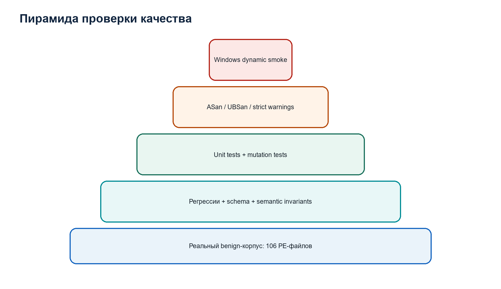

# Том II. Глава 10. Полный разбор `benign_richer.exe`: от bytes до assessment

## Цель сквозного разбора

Предыдущие главы объясняли modules отдельно. Здесь один реальный test binary проходит весь pipeline. Ни одно значение не предполагается: все числа взяты из фактического файла и JSON, созданного текущим release build 8 июня 2026 года.

Input:

```text
tests/samples/bin/benign_richer.exe
```

Размер:

```text
5641 bytes
```

SHA-256:

```text
8b79fe76e06a44637caa1238460b9a83c50c49d80f2f355a614cef021bacc1ec
```

Command:

```sh
build/release/eh_unwind_analyzer \
  tests/samples/bin/benign_richer.exe \
  --heuristics \
  --json /tmp/teacher_benign.json \
  --html /tmp/teacher_benign.html
```

Build platform `macos-arm64`, compiler Clang 21.0.0, mode release. Это допустимо, потому что выполняется static parsing Windows PE, а не Windows dynamic mode.

## Первые bytes

Hex dump:

```text
00000000: 4d 5a 90 00 03 00 00 00 04 00 00 00 ff ff 00 00
00000010: b8 00 00 00 00 00 00 00 40 00 00 00 00 00 00 00
00000020: 00 00 00 00 00 00 00 00 00 00 00 00 00 00 00 00
00000030: 00 00 00 00 00 00 00 00 00 00 00 00 80 00 00 00
```

Bytes `4d 5a` дают little-endian word `0x5A4D`, signature `MZ`.

По offset `0x3C`:

```text
80 00 00 00
```

Little-endian conversion:

```text
e_lfanew = 0x00000080
```

Следовательно, PE signature ожидается по file offset `0x80`. Parser проверяет, что этот offset и следующие headers лежат внутри 5641-byte buffer.

## PE identity

Из COFF и optional header report получает:

```text
Machine      = 0x8664
ImageBase    = 0x140000000
SizeOfImage  = 0x7000
SizeOfHeaders = 0x400
Sections     = 6
```

`0x8664` соответствует AMD64. Optional header имеет PE32+ magic, иначе parser завершил бы analysis unsupported-format error.

`SizeOfImage = 0x7000` задаёт RVA range:

```text
[0x0000, 0x7000)
```

## Alignment

```text
SectionAlignment = 0x1000
FileAlignment    = 0x0200
```

Section RVAs:

```text
0x1000
0x2000
0x3000
0x4000
0x5000
0x6000
```

Все кратны `0x1000`.

Raw offsets ненулевых raw sections:

```text
0x400
0x600
0x800
0xA00
0xC00
```

Все кратны `0x200`.

`section_misaligned = 0`.

## Sections

### `.text`

```text
RVA          0x1000
VirtualSize  0x40
RawOffset    0x400
RawSize      0x200
Flags        0x60000020
Permissions  R-X
```

Code functions находятся в `[0x1000, 0x1040)`. RawSize больше VirtualSize из-за file alignment padding.

### `.rdata`

```text
RVA          0x2000
VirtualSize  0x50
RawOffset    0x600
RawSize      0x200
Permissions  R--
```

### `.pdata`

```text
RVA          0x3000
VirtualSize  0x24
RawOffset    0x800
RawSize      0x200
Permissions  R--
```

Значимые 36 bytes содержат три `RUNTIME_FUNCTION`.

### `.xdata`

```text
RVA          0x4000
VirtualSize  0x14
RawOffset    0xA00
RawSize      0x200
Permissions  R--
```

Значимые 20 bytes содержат три unwind records.

### `.bss`

```text
RVA          0x5000
VirtualSize  0x10
RawOffset    0
RawSize      0
Permissions  RW-
```

`.bss` virtual-only. Отсутствие raw bytes корректно.

### `.idata`

```text
RVA          0x6000
VirtualSize  0x18
RawOffset    0xC00
RawSize      0x200
Permissions  R--
```

## Structural checks

Для каждой raw section:

```text
RawOffset + RawSize <= 5641
```

Для каждой virtual section:

```text
VirtualAddress + max(VirtualSize, RawSize) <= 0x7000
```

Pairwise raw и virtual intervals не пересекаются в запрещённой форме. Result:

```text
section_raw_oob = 0
section_virtual_oob = 0
section_raw_overlaps = 0
section_virtual_overlaps = 0
section_misaligned = 0
```

## Exception directory

```text
RVA  = 0x3000
Size = 0x24
```

RVA находится в `.pdata`.

Conversion:

```text
delta = 0x3000 - 0x3000 = 0
file offset = 0x800 + 0 = 0x800
```

Size `0x24 = 36`. Entry size 12:

```text
36 / 12 = 3
```

Incomplete tail отсутствует.

## Raw `.pdata` bytes

```text
00000800:
00 10 00 00  10 10 00 00  00 40 00 00
10 10 00 00  29 10 00 00  04 40 00 00
29 10 00 00  40 10 00 00  0c 40 00 00
```

Разбивка по 12 bytes.

### Entry 0

```text
00 10 00 00 -> BeginRVA  0x1000
10 10 00 00 -> EndRVA    0x1010
00 40 00 00 -> UnwindRVA 0x4000
```

Function size:

```text
0x1010 - 0x1000 = 0x10 = 16
```

### Entry 1

```text
10 10 00 00 -> 0x1010
29 10 00 00 -> 0x1029
04 40 00 00 -> 0x4004
```

Size:

```text
0x1029 - 0x1010 = 0x19 = 25
```

### Entry 2

```text
29 10 00 00 -> 0x1029
40 10 00 00 -> 0x1040
0c 40 00 00 -> 0x400C
```

Size:

```text
0x1040 - 0x1029 = 0x17 = 23
```

## Table invariants

Ranges:

```text
[0x1000,0x1010)
[0x1010,0x1029)
[0x1029,0x1040)
```

Каждый end больше begin. Все bounds внутри `SizeOfImage`. Entries sorted. Соседние ranges соприкасаются только exclusive/end boundary, overlap отсутствует. Begin values unique.

Unwind RVA:

```text
0x4000
0x4004
0x400C
```

Все nonzero и внутри image.

## Conversion unwind RVA

`.xdata`:

```text
VirtualAddress = 0x4000
RawOffset      = 0xA00
```

Conversions:

```text
0x4000 -> 0xA00 + 0x0 = 0xA00
0x4004 -> 0xA00 + 0x4 = 0xA04
0x400C -> 0xA00 + 0xC = 0xA0C
```

## Raw `.xdata` bytes

```text
00000a00:
01 00 00 00
01 04 01 00 04 42 00 00
01 04 01 00 04 42 00 00
```

### Record 0 at `0xA00`

Header:

```text
byte0 = 0x01
Version = 0x01 & 0x07 = 1
Flags   = 0x01 >> 3 = 0

SizeOfProlog = 0
CountOfCodes = 0
Frame byte   = 0
```

No code array, no handler, no chain.

Summary:

```text
v1
prolog 0
stack 0
frame none
anomalies 0
```

### Record 1 at `0xA04`

Header:

```text
01 04 01 00
```

Interpretation:

```text
Version = 1
Flags = 0
SizeOfProlog = 4
CountOfCodes = 1
FrameRegister = 0
FrameOffset = 0
```

Code slot:

```text
04 42
```

`CodeOffset = 0x04`.

Second byte nibbles:

```text
UnwindOp = low nibble 0x2 = UWOP_ALLOC_SMALL
OpInfo   = high nibble 0x4
```

Allocation:

```text
4 * 8 + 8 = 40 bytes
```

CountOfCodes odd, поэтому aligned tail находится после padding slot `00 00`. Flags zero, tail semantics нет.

### Record 2 at `0xA0C`

Bytes идентичны record 1:

```text
01 04 01 00 04 42 00 00
```

Summary также stack 40 bytes.

## Parallel arrays

Main allocates:

```text
rf[3]
us[3]
us_ok[3]
```

After decoding:

```text
us_ok = [true, true, true]
```

`us[0]` относится к `rf[0]`, и так далее. Sorting heuristic копии не нарушает эту relation.

## Heuristic aggregation

Raw counters:

```text
invalid_ranges = 0
oob = 0
unwind_oob = 0
unsorted = 0
overlaps = 0
duplicate_begins = 0
parse_fail = 0
anomalies = 0
placement = 0
handler placement = 0
```

Unwind frequency map содержит три distinct keys, frequency каждого 1:

```text
max_count = 1
unique = 3
total = 3
```

Ratios:

```text
unwind_reuse_ratio = 1/3 = 0.333333
unwind_unique_ratio = 3/3 = 1.0
```

Хотя max ratio больше 0.30, strong reuse finding требует `n > 200`. Здесь `n = 3`, поэтому finding не создаётся.

Handler count zero.

## Static assessment

Ни одно scoring rule не сработало:

```text
score = 0
suspicion = 0.0
confidence = 0.2
evidence_level = none
verdict = no_strong_static_anomalies
requires_manual_review = false
```

`details` содержит:

```text
- [info] No strong anomalies detected by heuristics.
```

## Final assessment

Dynamic mode не запрошен:

```text
runtime_evidence_level = none
dynamic_signal_count = 0
correlation = false
```

Final:

```text
final_verdict = no_strong_correlated_evidence
final_confidence = 0.2
case_strength = no_case
```

## Что именно доказал этот run

Доказано для SHA-256 указанного input и текущей implementation:

- file соответствует поддерживаемой минимальной PE32+ AMD64 model;
- шесть section headers прочитаны;
- поддерживаемые structural checks не нашли нарушений;
- exception directory содержит три полные entries;
- ranges sorted, non-overlapping и bounded;
- три unwind records decoded;
- два records описывают fixed stack allocation 40 bytes;
- parser anomalies отсутствуют;
- реализованные static heuristics не создали findings.

Не доказано:

- что binary безопасен;
- что machine code полностью соответствует metadata;
- что все PE directories корректны;
- что file будет вести себя benign при запуске;
- что в нём нет иных методов obfuscation;
- что dynamic exception behavior отсутствует.

## Как выполнить ручную correspondence check

Для functions:

```text
preferred VA 0x140001010
preferred VA 0x140001029
```

в Ghidra нужно проверить первые четыре bytes prolog. Metadata ожидает stack allocation 40 bytes. Типичная instruction:

```asm
sub rsp, 28h
```

Если фактическая instruction подтверждает это, достигается третий уровень evidence: correspondence metadata и code.

## Почему этот sample важен

Он показывает, что clean baseline не означает отсутствие metadata. Напротив, report подробно восстанавливает function ranges и stack effects, но не начисляет suspicion.

Это distinction между:

```text
наличием сложной системной структуры
и
нарушением её invariants
```

Проект ценен не только findings. Он формирует normalized map EH/unwind metadata даже для normal binary.

# Том II. Глава 11. Расследование четырёх подозрительных regression samples

## Назначение samples

Regression samples созданы для контролируемой проверки rules. Они не являются коллекцией реального malware и не используются для оценки detection accuracy.

Каждый sample изменяет известное свойство `benign_richer.exe`, поэтому можно связать:

```text
изменённый факт
-> parser observation
-> finding
-> score contribution
-> manual verification
```

## `suspicious_unwind_oob.exe`

### Фактический report

```text
score = 50
confidence = 0.69
verdict = moderate_suspicion
evidence_level = strong
case_strength = strong_unconfirmed_case
```

Findings:

```text
unwind_rva_oob
severity high
affected 1
representative RVA 0x9000

unwind_parse_fail
severity high
affected 1
representative RVA 0x9000
```

### Почему `0x9000` invalid

Image size sample сохраняет `0x7000`. Допустимые RVA:

```text
[0x0000, 0x7000)
```

`0x9000 >= 0x7000`, поэтому pointer выходит за image.

### Score derivation

Один invalid pointer из трёх records:

```text
1 / 3 = 33.33%
```

Это больше threshold 1%.

Weights:

```text
unwind_rva_oob high = 25
unwind_parse_fail high = 25
total = 50
```

### Confidence derivation

Base:

```text
0.15
```

Families:

```text
table_integrity
unwind_integrity
2 * 0.11 = 0.22
```

Strong findings:

```text
2 * 0.08 = 0.16
```

Hard table bonus:

```text
+0.08
```

Unwind hard bonus:

```text
+0.08
```

Total:

```text
0.15 + 0.22 + 0.16 + 0.08 + 0.08 = 0.69
```

Weakening rules отсутствуют, потому что findings strong.

### Что проверять вручную

1. Открыть `.pdata` по raw offset.
2. Найти entry с `UnwindData = 0x9000`.
3. Проверить `SizeOfImage`.
4. Убедиться, что RVA не принадлежит section.
5. Определить, является ли это corruption, deliberate tamper или ошибка generator.
6. Исследовать function prolog без опоры на broken metadata.

### Ограниченный вывод

Один runtime function ссылается на unwind RVA вне declared image, поэтому Windows x64 unwind contract для этой записи нарушен. Намерение изменения автоматически не установлено.

## `suspicious_unwind_writable.exe`

### Фактический report

```text
score = 18
confidence = 0.34
verdict = low_suspicion
evidence_level = medium
case_strength = medium_case
```

Finding:

```text
unwind_writable_section
severity high
affected 3
representative RVA 0x4000
```

### Structural fact

Все три `UnwindRVA` остаются valid и decode succeeds. Изменено section characteristic `.xdata`: section объявлена writable.

### Score

Affected count 3, total 3. Condition:

```text
3 > 3/20
```

Integer `3/20 = 0`, поэтому high branch:

```text
weight = 18
```

### Confidence

Base `0.15`.

One family:

```text
+0.11
```

One strong finding:

```text
+0.08
```

Total `0.34`.

Weakening rules не применяются, потому что `strong_count = 1`.

### Почему score low, evidence medium

Verdict threshold:

```text
15 <= 18 < 40 -> low_suspicion
```

Evidence level:

```text
strong_count >= 1 -> medium
```

Fields не противоречат друг другу: score band low, но finding severity high enough for medium evidence level.

### Возможные benign explanations

- runtime or JIT modifies unwind records;
- custom loader changes protections;
- nonstandard toolchain;
- sample deliberately built for test.

### Manual verification

1. Проверить original `Characteristics`.
2. Запустить на Windows и запросить actual page protection.
3. Наблюдать writes к `.xdata`.
4. Проверить signatures compiler/runtime.
5. Сравнить metadata до и после execution.

### Ограниченный вывод

Все records structurally valid, но metadata размещена в writable section. Это расширяет возможность runtime modification и требует проверки, однако не доказывает tampering.

## `suspicious_section_raw_oob.exe`

### Фактический report

```text
score = 60
confidence = 0.46
verdict = moderate_suspicion
evidence_level = strong
case_strength = strong_unconfirmed_case
```

Findings:

```text
pe_section_raw_oob
high
affected 1
RVA 0x5000

pe_section_raw_overlap
medium
affected 5
RVA 0x5000

pe_section_virtual_overlap
high
affected 1
RVA 0x6000
```

### Score

```text
raw OOB          25
raw overlap      15
virtual overlap  20
total            60
```

### Confidence

All findings belong to one family `table_integrity`:

```text
base                0.15
one family         +0.11
two strong         +0.16
one medium         +0.04
total               0.46
```

Hard table bonus in implementation applies only to runtime-function hard issues, not PE section counters. Поэтому additional `+0.08` нет.

### Почему пять raw overlaps

Изменённая section raw range может стать настолько большой, что пересекает несколько других sections. Counter считает каждую pairwise collision.

Representative location показывает первый violating section, а affected count отражает число overlaps.

### Manual verification

1. Выписать raw interval каждой section.
2. Использовать формулу пересечения полуинтервалов.
3. Проверить file size.
4. Сравнить behavior Windows loader и parser.
5. Определить, какие bytes фактически shared между section descriptions.

### Ограниченный вывод

Section table внутренне противоречива: по крайней мере один raw range выходит за file и ranges пересекаются. Любая дальнейшая interpretation bytes через section mapping должна считаться потенциально неоднозначной.

## `suspicious_eh_unwind_tamper.exe`

### Фактический report

```text
score = 53
confidence = 0.54
verdict = moderate_suspicion
evidence_level = strong
case_strength = strong_unconfirmed_case
```

Findings:

```text
unwind_writable_section
high
affected 1
RVA 0x2010

handler_nonexec_section
high
affected 1
RVA 0x2000

handler_writable_section
medium
affected 1
RVA 0x2000

writable_metadata_handler_combo
high
affected 0
no representative RVA
```

### Interpretation

Одна unwind record перенаправлена в writable section near `.rdata`-like area. Handler RVA указывает на `0x2000`, который расположен в non-executable, writable section.

### Score

```text
unwind writable high       18
handler non-executable     15
handler writable           10
combined writable pattern  10
total                      53
```

### Confidence

Families:

```text
metadata_placement
```

All findings use same family in this case.

Severity:

```text
3 strong
1 medium
```

Calculation:

```text
base             0.15
one family      +0.11
three strong    +0.24
one medium      +0.04
total            0.54
```

No single-family penalty because strong findings exist.

### Why combination affected count is zero

Combination finding создаётся без `annotate_finding`. Он описывает relation между aggregate counters, а не отдельный object. Поэтому:

```text
has_location = false
affected_count = 0
```

Это data-model nuance, не отсутствие combination.

### Manual investigation

1. Найти exact `RUNTIME_FUNCTION`, указывающую `0x2010`.
2. Decode record вручную.
3. Проверить handler flags.
4. Прочитать handler RVA `0x2000`.
5. Проверить section permissions.
6. Дизассемблировать bytes по `0x2000`.
7. Если bytes не code, определить, загрузил бы Windows record и когда возник failure.
8. На Windows поставить breakpoint на actual handler VA.
9. Наблюдать, достигается ли он.
10. Проверить runtime page protection и modifications.

### Ограниченный вывод

Metadata и handler placement одновременно противоречат обычному read-only-data/executable-code layout. Сочетание является сильным static anomaly, но sample intent и runtime reachability требуют отдельного подтверждения.

## Почему все cases `unconfirmed`

Dynamic mode не запускался. Поэтому:

```text
runtime evidence = none
correlation = false
```

Strong static evidence даёт:

```text
strong_unconfirmed_case
```

Это корректное название. Статика подтверждает structural anomalies, но не runtime activation.

## Как превратить case в correlated

Для OOB record dynamic correlation может быть не достижима, если Windows loader или exception path не использует function.

Для writable handler case:

1. Запустить target в isolated Windows VM.
2. Trigger representative exception path.
3. Получить handler hit или exception flow.
4. Нормализовать address к module+RVA.
5. Связать с static representative RVA.

Если static suspicious handler context совпадает с handler hit, project summary устанавливает correlation.

## Regression test и реальное расследование

Regression test отвечает:

```text
сработало ли правило на специально созданном нарушении
```

Real investigation отвечает:

```text
почему нарушение существует в неизвестном binary и что оно делает
```

Первое автоматизировано. Второе требует reverse engineer. Проект уменьшает объём ручной работы, но не отменяет её.

# Том II. Глава 12. Задачи с полными решениями

## Как работать с задачами

Решение следует сначала получить самостоятельно, затем сравнить не только final number, но и последовательность проверок. В reverse engineering правильный ответ без проверяемого пути недостаточен.

## Задача 1. Little-endian field

По file offset `0x3C` находятся bytes:

```text
80 00 00 00
```

Определить 32-bit unsigned value.

### Решение

Little-endian означает, что byte с наименьшим весом хранится первым:

```text
value =
0x80 * 256^0
+ 0x00 * 256^1
+ 0x00 * 256^2
+ 0x00 * 256^3
= 0x00000080
```

Это `e_lfanew`; PE header начинается по file offset 128 decimal.

Ошибка была бы прочитать bytes как big-endian `0x80000000`, что почти наверняка вывело бы parser за file.

## Задача 2. RVA в file offset

Section:

```text
VirtualAddress   = 0x4000
VirtualSize      = 0x180
PointerToRawData = 0xA00
SizeOfRawData    = 0x200
```

Найти file offset для RVA `0x40B4`.

### Решение

Проверка нижней границы:

```text
0x40B4 >= 0x4000
```

Delta:

```text
0x40B4 - 0x4000 = 0xB4
```

Virtual span:

```text
max(0x180,0x200) = 0x200
0xB4 < 0x200
```

Raw availability:

```text
0xB4 < 0x200
```

Offset:

```text
0xA00 + 0xB4 = 0xAB4
```

Дополнительно требуется проверить:

```text
0xAB4 < file_size
```

Без file size окончательная безопасность чтения не доказана.

## Задача 3. Virtual-only address

Section:

```text
VirtualAddress = 0x5000
VirtualSize = 0x300
RawSize = 0x100
RawOffset = 0xC00
```

RVA `0x5180`. Принадлежит ли section? Есть ли byte в file?

### Решение

Delta:

```text
0x5180 - 0x5000 = 0x180
```

Virtual span:

```text
max(0x300,0x100) = 0x300
0x180 < 0x300
```

Адрес принадлежит virtual section range.

Но:

```text
0x180 >= RawSize 0x100
```

Соответствующего raw byte нет. Загрузчик может сформировать zero-filled memory, но static parser не должен читать file offset `0xD80` как часть этой section.

## Задача 4. Число runtime functions

Exception directory size `0x54`. Сколько полных AMD64 `RUNTIME_FUNCTION`?

### Решение

Entry size 12 decimal, то есть `0xC`.

```text
0x54 = 84 decimal
84 / 12 = 7
```

Remainder:

```text
84 % 12 = 0
```

Семь полных entries, incomplete tail отсутствует.

Если size был бы `0x55`, осталось бы один лишний byte, и строгая policy должна сообщить malformed directory.

## Задача 5. Range invariants

Даны entries:

```text
A [0x1000,0x1100)
B [0x1100,0x1200)
C [0x1180,0x1300)
D [0x1300,0x1300)
```

Какие нарушения?

### Решение

A и B соприкасаются:

```text
B.begin == A.end
```

Overlap отсутствует.

C:

```text
C.begin 0x1180 < B.end 0x1200
```

Overlap B/C.

D:

```text
End == Begin
```

Invalid empty range.

Если sorted overlap algorithm использует `max_end`, после C он станет `0x1300`. D begin равен `0x1300`, поэтому overlap с предыдущими отсутствует, хотя range сам invalid.

## Задача 6. Decode header

Header bytes:

```text
09 06 02 35
```

Разобрать fields.

### Решение

Byte0 `0x09 = 00001001b`.

Version — low 3 bits:

```text
001b = 1
```

Flags — high 5 bits:

```text
00001b = 1
```

То есть `UNW_FLAG_EHANDLER`.

`SizeOfProlog = 0x06 = 6`.

`CountOfCodes = 0x02 = 2 slots`.

Frame byte `0x35`:

```text
FrameRegister = low nibble = 5
FrameOffset = high nibble = 3
FrameOffsetBytes = 3 * 16 = 48
```

Register encoding 5 соответствует RBP.

После двух slots code array уже DWORD-aligned. Поскольку EHandler flag установлен, далее ожидается 32-bit HandlerRVA.

## Задача 7. `UWOP_ALLOC_SMALL`

Code slot:

```text
04 72
```

### Решение

`CodeOffset = 4`.

Second byte:

```text
low nibble 2 -> UWOP_ALLOC_SMALL
high nibble 7 -> OpInfo 7
```

Allocation:

```text
7 * 8 + 8 = 64 bytes
```

Требуется `SizeOfProlog >= 4`, иначе code-offset anomaly.

## Задача 8. `UWOP_ALLOC_LARGE`

Slots:

```text
08 01
20 00
```

### Решение

Operation byte `0x01`:

```text
UnwindOp = 1 -> UWOP_ALLOC_LARGE
OpInfo = 0
```

Следующий slot как little-endian `uint16`:

```text
20 00 -> 0x0020 = 32
```

Scale 8:

```text
32 * 8 = 256 bytes
```

Логическая operation потребила два slots: основной и operand.

## Задача 9. Code ordering

`SizeOfProlog = 8`, code offsets:

```text
8, 5, 6
```

### Решение

Каждый offset не превышает prolog size.

Но descending order нарушен:

```text
5 -> 6 увеличивается
```

Устанавливается `UA_CODEOFFSET_ORDER`.

Decoder может продолжить summary, если structure readable, но report должен отметить anomaly.

## Задача 10. Alignment tail

`CountOfCodes = 3`. Где начинается tail относительно начала `UNWIND_INFO`?

### Решение

Header 4 bytes.

Три meaningful slots:

```text
3 * 2 = 6 bytes
```

После header offset был бы:

```text
4 + 6 = 10
```

Tail должен быть DWORD-aligned. Slots округляются до четырёх:

```text
align slots = 4
4 + 4*2 = 12
```

Tail начинается по offset 12 (`0xC`) от начала record. Один padding slot занимает bytes 10–11.

## Задача 11. Score calculation

Report counters:

```text
rf_oob: 2 из 100
unwind_parse_fail: 1 из 100
unwind_exec_section: 3
handler_nonexec_section: 1
```

Рассчитать minimum score, учитывая combinations.

### Решение

`rf_oob` prevalence:

```text
2/100 = 2% > 1%
```

Weight high:

```text
+25
```

`unwind_parse_fail`:

```text
1/100 = 1%
```

Threshold strict `>1%`, поэтому low:

```text
+10
```

`unwind_exec_section`:

```text
+20
```

`handler_nonexec_section`:

```text
+15
```

Combination executable metadata + non-executable handler:

```text
+10
```

Placement + integrity, потому что executable placement и parse failure:

```text
+8
```

Total:

```text
25 + 10 + 20 + 15 + 10 + 8 = 88
```

Score clamps at 100, но здесь 88.

Verdict high suspicion, evidence strong.

## Задача 12. Confidence calculation

Для предыдущего case предположим six stored findings:

```text
4 high
2 medium
3 evidence families
hard table issue present
hard unwind issue present
```

### Решение

```text
base                  0.15
families 3*0.11      +0.33
strong 4*0.08        +0.32
medium 2*0.04        +0.08
table bonus          +0.08
unwind bonus         +0.08
raw total             1.04
```

Weakening rules не применяются из-за strong findings и multiple families.

Static confidence clamps:

```text
0.90
```

Если dynamic signals и correlation добавятся в report-level summary:

```text
0.90 + 0.10 + 0.10 = 1.10
```

Final confidence clamps at `0.98`.

Это демонстрирует engineered ceiling.

## Задача 13. Breakpoint state

Breakpoint по `0x7FF600001000` заменил original byte `0x55` на `0xCC`. Возник `EXCEPTION_BREAKPOINT`, context RIP равен `0x7FF600001001`. Какие изменения нужны?

### Решение

1. Записать `0x55` обратно по `0x...1000`.
2. Flush instruction cache.
3. Установить:

```text
RIP = 0x7FF600001000
```

4. Установить TF:

```text
EFlags |= 0x100
```

5. Сохранить pending re-arm для current thread ID.
6. `ContinueDebugEvent(..., DBG_CONTINUE)`.
7. На `EXCEPTION_SINGLE_STEP` снова записать `0xCC`.
8. Снять TF, если trace не продолжается.

Если не rewind RIP, original instruction будет пропущена. Если не re-arm, последующие hits потеряются.

## Задача 14. First-chance continuation

Target создал access violation, которое должно быть обработано его VEH. Что должен вернуть collector?

### Решение

Для ordinary exception collector должен:

```text
DBG_EXCEPTION_NOT_HANDLED
```

Это не означает, что exception останется необработанным окончательно. Status сообщает debugger layer, что он сам exception не обработал; Windows продолжит application dispatch, включая handlers.

`DBG_CONTINUE` поглотил бы exception на уровне debugger и мог не позволить VEH выполнить expected path.

## Задача 15. Dynamic function table event

На breakpoint `RtlAddFunctionTable`:

```text
RCX = 0x000001F000100000
RDX = 12
R8  = 0x000001F000000000
```

Что доказано?

### Решение

Доказано:

- execution достиг entry соответствующего API;
- на момент entry argument registers содержали указанные values;
- target пытался вызвать function с pointer, count 12 и base.

Не доказано:

- API вернул TRUE;
- pointer readable;
- table содержит 12 valid entries;
- entries sorted;
- unwind data valid;
- table использовалась exception dispatcher;
- code malicious.

Для усиления evidence нужны return observation, remote memory snapshot и последующий runtime use.

## Задача 16. Correlation

Static report:

```text
handler_writable_section = 1
representative RVA = 0x5200
```

Dynamic event:

```text
type = veh_handler_hit
module = target.exe
address = ActualBase + 0x7000
```

Можно ли утверждать exact correlation с handler `0x5200`?

### Решение

Нет. Aggregate project rule может считать suspicious handler context плюс handler hit correlated at class level, но exact addresses различаются:

```text
0x5200 != 0x7000
```

Нужно определить, был ли static finding frame handler, а dynamic event — VEH. Это разные mechanisms.

Корректный вывод:

```text
в run наблюдался handler activity при наличии suspicious static handler context,
но exact address-level identity не установлена
```

## Задача 17. Backend result

Analyzer exit code nonzero, но JSON существует и содержит:

```text
dynamic_validation.ran = true
dynamic_validation.ok = false
dynamic_validation.timed_out = true
heuristic_analysis.score = 50
```

Как сохранять job?

### Решение

Job не должен получать общий status `success`.

Рекомендуемая модель:

```text
job status = partial_failed или failed_with_report
static stage = completed
dynamic stage = timed_out
process exit code = nonzero
raw JSON = stored
findings = indexed
failure reason = dynamic timeout
```

Отбрасывать JSON нельзя: static evidence valid и dynamic partial events могут быть полезны.

Показывать пользователю complete success также нельзя.

## Задача 18. Сравнение двух runs

Run A handler address `0x7FF612345200`. Run B address `0x7FF712345200`. Module base A `0x7FF612340000`, base B `0x7FF712340000`.

### Решение

Offsets:

```text
A: 0x7FF612345200 - 0x7FF612340000 = 0x5200
B: 0x7FF712345200 - 0x7FF712340000 = 0x5200
```

Absolute VAs различаются из-за ASLR, module-relative offset совпадает. События относятся к одной позиции image, если module binary identity совпадает.

## Задача 19. Критика verdict

Report:

```text
score = 0
verdict = no_strong_static_anomalies
```

Можно ли написать заказчику «файл безопасен»?

### Решение

Нет.

Score zero означает только, что реализованные rules не нашли strong static EH/unwind anomalies. Analyzer:

- не выполняет full malware analysis;
- не проверяет все PE directories;
- не доказывает code semantics;
- может не видеть runtime-generated behavior;
- не покрывает unreachable paths.

Корректная формулировка:

```text
в поддерживаемой PE32+ AMD64 EH/unwind model структурных и placement anomalies,
покрываемых текущей heuristic policy, не обнаружено
```

## Задача 20. Проектирование нового finding

Нужно обнаруживать mismatch metadata stack allocation и machine-code prolog. Где реализовать?

### Решение

Одного изменения `heuristics.c` недостаточно. Нужен новый analysis stage:

1. Instruction decoder для x86-64.
2. Mapping function begin RVA к file bytes.
3. Decode instructions в пределах `SizeOfProlog`.
4. Вычислить фактические effects на `RSP` и nonvolatile saves.
5. Сравнить с `UnwindSummary`.
6. Создать observation model correspondence.
7. Передать counters/findings в heuristic policy.
8. Добавить JSON fields и schema version.
9. Добавить synthetic positive/negative tests.
10. Проверить compiler variants.

Instruction decoder должен быть structured library, а не ad hoc byte patterns. Иначе prefixes, alternate encodings и optimization variants создадут false results.

## Итог контроля

Если задачи решаются с пониманием, студент умеет:

- читать little-endian fields;
- переводить RVA;
- проверять section and range invariants;
- декодировать unwind header и operations;
- вручную воспроизводить score/confidence;
- объяснять breakpoint lifecycle;
- различать registration, hit и success;
- проектировать backend status;
- формулировать ограниченные выводы;
- видеть, где новый feature требует архитектурного stage, а не одной эвристики.

# Том III. Техническая теория обнаружения аномалий и границ доказательства

## Зачем нужна отдельная теория над parser и эвристиками

Предыдущие главы объяснили устройство PE32+ AMD64, таблицы
`RUNTIME_FUNCTION`, записей `UNWIND_INFO`, Windows Debug API и конкретных
модулей проекта. Однако знания отдельных структур недостаточно для ответа на
главный технический вопрос:

```text
каким образом наблюдаемое свойство бинарного файла
превращается в обоснованный вывод об аномалии
```

Между чтением байтов и выводом существует несколько логических переходов.
Если их смешать, возникает типичная ошибка: любое отличие от ожидаемого
расположения объявляется вредоносным вмешательством. Проект устроен
консервативнее. Он разделяет:

1. непосредственно прочитанный факт;
2. проверяемый инвариант формата или ABI;
3. зарегистрированное нарушение;
4. эвристический finding;
5. совокупную оценку;
6. решение аналитика после ручной проверки.

Эта последовательность является технической основой объяснимости проекта.

## Наблюдение

**Наблюдение**, или observation, — значение, непосредственно полученное из
входного файла или динамического события.

Примеры статических наблюдений:

- `SizeOfImage = 0x9000`;
- section имеет `VirtualAddress = 0x4000`;
- `RUNTIME_FUNCTION.BeginAddress = 0x1050`;
- `RUNTIME_FUNCTION.EndAddress = 0x1030`;
- `UnwindInfoRVA = 0x7000`;
- section characteristics содержат `IMAGE_SCN_MEM_WRITE`;
- один `HandlerRVA` встречается в 120 записях.

Примеры динамических наблюдений:

- target process успешно создан;
- получено `EXCEPTION_DEBUG_EVENT`;
- выполнена регистрация VEH;
- вызван `RtlAddFunctionTable`;
- breakpoint по статически найденному handler сработал;
- процесс завершился сам или был остановлен по timeout.

Наблюдение ещё не является оценкой. Значение
`UnwindInfoRVA = 0x7000` само по себе ни корректно, ни ошибочно. Для
интерпретации необходимо сопоставить его с `SizeOfImage`, section table и
доступным диапазоном файла.

## Инвариант

**Инвариант**, или invariant, — условие, которое должно выполняться для
корректной модели на определённом уровне.

Инварианты проекта делятся на четыре класса.

### Инварианты безопасного чтения

Они не описывают Windows ABI. Они защищают процесс анализатора.

Пример:

```text
offset <= file_size
size <= file_size - offset
```

Эта форма проверки предпочтительнее выражения:

```text
offset + size <= file_size
```

потому что сложение может переполниться до сравнения. Нарушение означает, что
запрошенный диапазон нельзя безопасно прочитать. Оно не доказывает намеренное
вмешательство: файл может быть повреждён случайно.

### Инварианты PE layout

Они связывают section table, файл и виртуальный образ.

Примеры:

```text
PointerToRawData + SizeOfRawData <= file_size
VirtualAddress + virtual_span <= SizeOfImage
exception directory полностью лежит внутри image
```

Такие условия определяют, можно ли построить однозначное отображение между
RVA и file offset.

### Инварианты `RUNTIME_FUNCTION`

Для half-open диапазона функции:

```text
[BeginAddress, EndAddress)
```

базовое условие:

```text
BeginAddress < EndAddress
```

Оба конца должны принадлежать допустимому image space, а таблица по
нормативному контракту должна быть отсортирована по начальному адресу.

### Инварианты `UNWIND_INFO`

Они зависят от версии записи. Для V1/V2 проверяются:

- допустимая версия;
- длина header и массива slots;
- существование дополнительных operands;
- допустимость opcode и `OpInfo`;
- согласованность frame register;
- порядок `CodeOffset`;
- положение handler или chained record;
- отсутствие loop и превышения chain depth.

Инвариант должен быть сформулирован для конкретной версии формата. Именно
поэтому V3 нельзя безопасно проверять правилами V1/V2.

## Нарушение и аномалия

**Нарушение**, или violation, — невыполнение конкретного инварианта.

**Аномалия**, или anomaly, — наблюдаемое отклонение от нормативной,
компиляторной или статистически ожидаемой структуры, которое требует
объяснения.

Эти понятия пересекаются, но не тождественны.

Жёсткое нарушение:

```text
EndAddress <= BeginAddress
```

Невозможно согласовать с нормальным half-open диапазоном функции.

Контекстная аномалия:

```text
UNWIND_INFO находится в writable section
```

Само наличие права записи не делает адрес недопустимым. Но обычная
сформированная linker metadata обычно не нуждается в записи во время
исполнения, поэтому свойство является значимым сигналом.

Статистическая аномалия:

```text
более 30% RUNTIME_FUNCTION используют один UnwindInfoRVA
при числе записей больше 200
```

Такой reuse может быть законным, поэтому требует контекста.

## Finding как публичная единица результата

Внутренние counters и anomaly bits слишком низкоуровневые для внешнего
потребителя. Проект преобразует их в **finding** — именованную,
машиночитаемую единицу свидетельства.

Finding содержит:

```text
code
family
severity
message
affected_count
representative_rva
section
```

`code` является стабильным идентификатором правила. Человек может читать
`message`, а backend — группировать данные по `code`.

`affected_count` показывает масштаб нарушения. `representative_rva`
предоставляет точку входа для Ghidra или debugger, но не заменяет полный
список затронутых объектов.

## Почему finding не равен verdict

Один finding отвечает на узкий вопрос:

```text
обнаружено ли конкретное свойство
```

Verdict отвечает на другой вопрос:

```text
насколько сильна совокупность статических свидетельств
```

Например, `unwind_unusual_section` может быть единственным сигналом
нестандартного linker layout. Проект регистрирует finding, но weakening rules
снижают confidence. Если одновременно имеются parse failure и handler в
non-executable section, совокупность сильнее любого одиночного наблюдения.

## Evidence family

**Evidence family** — семейство признаков, относящихся к одному техническому
слою.

Проект использует пять семейств:

1. `table_integrity`;
2. `unwind_integrity`;
3. `metadata_placement`;
4. `unwind_reuse`;
5. `handler_dominance`.

Количество семейств важно для confidence. Несколько findings из одного
семейства могут иметь общую первопричину. Сигналы из независимых слоёв
труднее объяснить одной случайной особенностью.

Например:

```text
unwind_rva_oob
+ unwind_parse_fail
```

могут быть двумя проявлениями одного повреждённого указателя.

Но сочетание:

```text
rf_overlaps
+ writable UNWIND_INFO
+ runtime handler hit
```

охватывает table layout, permissions и фактическое исполнение.

## Severity

**Severity** описывает техническую серьёзность finding, а не вероятность
вредоносности.

`high` применяется, когда свойство:

- разрушает однозначность структуры;
- выводит адрес за image;
- делает handler неисполняемым;
- затрагивает широкий процент записей;
- образует сильную комбинацию.

`medium` применяется, когда:

- нарушение может иметь benign explanation;
- оно локально;
- требуется дополнительный context;
- это статистический pattern, а не жёсткое повреждение.

Severity не вычисляется из имени malware family и не является оценкой ущерба
от запуска файла.

## Score

Score является ограниченной суммой инженерных весов:

```text
score = clamp(sum(weights), 0, 100)
```

Он нужен для triage и сортировки. Важные свойства:

- score детерминирован;
- каждый вклад можно объяснить;
- score насыщается на 100;
- одинаковый score может быть получен разными наборами findings;
- score не является вероятностью.

Насыщение означает, что значения выше 100 теряют различия. Поэтому полный
список findings всегда информативнее одного числа.

## Suspicion

Поле:

```text
suspicion = score / 100
```

является нормализованным представлением score для JSON и интерфейсов.

Если `suspicion = 0.73`, это означает:

```text
score = 73 из 100
```

Это не означает 73-процентную вероятность атаки или модификации.

## Confidence

Confidence в проекте — инженерная оценка того, насколько разнообразна и
устойчива интерпретация статического verdict.

Она увеличивается при:

- наличии нескольких evidence families;
- high findings;
- нескольких medium findings;
- жёстких нарушениях table/unwind integrity.

Она уменьшается при:

- единственном нестрогом сигнале;
- малом числе функций;
- только необычном placement;
- единственном evidence family.

Confidence ограничивается диапазоном:

```text
0.05 .. 0.90
```

Верхняя граница 0.90 предотвращает представление эвристической оценки как
абсолютной уверенности.

## Weakening rule

**Weakening rule**, или mitigation в именах C-структур, — правило,
фиксирующее benign alternative или недостаток контекста.

В текущей реализации четыре правила:

- `single_signal_only`;
- `small_sample_size`;
- `placement_only_signal`;
- `single_family_only`.

Weakening rule не удаляет наблюдение и не уменьшает score. Оно уменьшает
confidence. Это принципиально: факт сохраняется, но интерпретация становится
осторожнее.

## Manual review

`requires_manual_review` означает, что автоматический результат требует
проверки аналитиком.

Ручная проверка включает:

1. переход к `representative_rva`;
2. проверку section characteristics;
3. сопоставление `RUNTIME_FUNCTION` с дизассемблированным диапазоном;
4. проверку prolog против unwind operations;
5. анализ handler target;
6. проверку динамического достижения;
7. поиск benign explanation: compiler runtime, JIT, protector, custom linker.

Флаг manual review не означает ошибку анализатора. Он является частью
правильного рабочего процесса.

## Модель классов вмешательств

Чтобы обсуждать покрытие, сначала нужно определить пространство возможных
изменений.

### Класс A. Повреждение файлового layout

Изменяются section headers, raw ranges, virtual ranges, alignments или
exception directory.

Проект проверяет:

- выход raw data за файл;
- выход virtual span за image;
- overlaps;
- alignment;
- доступность exception directory.

### Класс B. Повреждение function table

Изменяются `BeginAddress`, `EndAddress`, `UnwindInfoRVA` или порядок entries.

Проект проверяет:

- пустые/обратные диапазоны;
- выход за image;
- недоступный unwind RVA;
- отсутствие сортировки;
- overlaps;
- duplicate begins.

### Класс C. Повреждение `UNWIND_INFO`

Изменяются header, slots, operands, flags, tail или chain.

Проект проверяет parser failure и двенадцать внутренних anomaly reasons.

### Класс D. Перемещение metadata

Корректные по синтаксису записи помещаются в sections с необычными
permissions или именами.

Проект проверяет executable, writable и unusual placement.

### Класс E. Перенаправление handler

Handler RVA изменяется на non-executable, unknown или writable location.

Проект проверяет свойства целевой section и dominance pattern.

### Класс F. Централизация

Большое число функций ссылается на один unwind record или handler.

Проект проверяет reuse и dominance только при достаточном размере таблицы и
контексте.

### Класс G. Runtime-only изменение

Metadata создаётся после загрузки через dynamic function table или
регистрируются process-level handlers.

Статический анализ этого не видит. Windows collector наблюдает выбранные API
регистрации и handler hits во время фактически достигнутого execution path.

### Класс H. Семантически согласованная подмена

Атакующий изменяет машинный prolog и `UNWIND_INFO` согласованно, сохраняет
валидные ranges, permissions и статистику.

Текущие структурные эвристики могут не обнаружить такую подмену. Для неё
нужны:

- disassembly;
- восстановление фактических stack effects;
- code-to-unwind correspondence;
- сравнение с доверенным baseline;
- подпись или provenance исходного артефакта.

Эта граница должна называться прямо.

## Покрытие не является полнотой

**Coverage**, или покрытие, отвечает на вопрос:

```text
какие заранее определённые классы нарушений способен заметить инструмент
```

**Completeness**, или полнота, означала бы:

```text
инструмент обнаруживает любое возможное вмешательство
```

Для структурного анализатора второе утверждение недостижимо без ограничения
модели противника. Валидная структура может содержать нежелательную семантику.
Невыполненный runtime path может скрывать динамическое действие. Неизвестная
будущая версия формата может быть корректной, но неподдержанной.

Правильное утверждение проекта:

```text
инструмент системно покрывает определённые структурные, placement,
reuse и наблюдаемые runtime-классы аномалий
```

## Почему число признаков не доказывает покрытие

Количество rules не является прямой мерой качества.

Сто поверхностных проверок section names могут покрывать меньше, чем одна
строгая bounds check. Поэтому 27 findings оцениваются через:

- источник инварианта;
- независимость от других findings;
- класс вмешательства;
- возможность локализовать нарушение;
- тестируемость;
- benign alternatives;
- стоимость false positive.

Число 27 является результатом текущей декомпозиции публичных результатов, а
не нормативной константой PE/COFF.

## Двенадцать внутренних anomaly reasons

Finding `unwind_anomalies` агрегирует двенадцать низкоуровневых причин:

1. `UA_VERSION_UNKNOWN`;
2. `UA_TRUNCATED`;
3. `UA_BAD_OPCODE`;
4. `UA_BAD_OPERAND`;
5. `UA_CODEOFFSET_OUTSIDE`;
6. `UA_CHAIN_LOOP`;
7. `UA_CHAIN_DEPTH_EXCEEDED`;
8. `UA_HANDLER_OOB`;
9. `UA_CODEOFFSET_ORDER`;
10. `UA_OPERAND_SANITY`;
11. `UA_ALIGNMENT`;
12. `UA_CHAIN_INVALID`.

Это не дополнительные публичные findings. Они являются диагностическими
подтипами одного слоя `UNWIND_INFO`. Такое разделение предотвращает
искусственное раздувание score, когда одна повреждённая запись нарушает сразу
несколько зависимых условий.

## Traceability

**Traceability**, или прослеживаемость, означает возможность пройти цепочку:

```text
источник правила
-> условие в коде
-> unit test
-> finding в JSON
-> ручная проверка по RVA
```

Для проекта эта цепочка выглядит так:

```text
Microsoft PE/x64 contract
-> pe.c / unwind.c / heuristics.c
-> unit_core_edges / unit_unwind / unit_heuristics*
-> report.c
-> JSON findings и manual_validation_steps
```

Если правило нельзя связать с инвариантом, кодом и проверкой, его нельзя
считать достаточно обоснованным.

## False positive и false negative

**False positive** — корректный или допустимый объект получает положительный
сигнал.

Причины:

- custom linker;
- protector;
- JIT/runtime metadata;
- редкий compiler layout;
- неподдержанная новая версия формата;
- слишком резкий threshold;
- неправильная benign policy.

**False negative** — интересующее нарушение присутствует, но сигнал не
возникает.

Причины:

- изменение не затрагивает проверяемый инвариант;
- структура и код изменены согласованно;
- runtime path не достигнут;
- handler зарегистрирован через ненаблюдаемый механизм;
- threshold подавил слабый pattern;
- формат не распознан.

Оба типа ошибок являются свойствами пары:

```text
инструмент + определённая задача + определённый corpus
```

Нельзя говорить о false positive или false negative без ground truth.

## Технически корректная формулировка результата

После анализа следует говорить:

```text
обнаружено нарушение X в N объектах;
оно относится к семейству Y;
первый пример расположен по RVA Z;
автоматическая оценка равна S;
существуют такие benign alternatives;
для подтверждения нужны такие ручные действия
```

Не следует заменять эту формулировку утверждением:

```text
файл вредоносный
```

Проект не решает задачу универсальной классификации вредоносности.

## Контрольные вопросы

1. Чем observation отличается от finding?
2. Почему жёсткий structural violation не обязательно означает атаку?
3. Почему placement является контекстной аномалией?
4. Почему score и confidence изменяются независимо?
5. Почему weakening rule не должен удалять finding?
6. Что требуется для заявления о coverage?
7. Какой класс согласованной подмены остаётся вне текущей модели?
8. Почему runtime collector не гарантирует наблюдение всех paths?
9. Зачем внутренние `UA_*` причины агрегируются?
10. Как построить traceability chain для нового правила?

# Том III. Полная система 27 признаков: основания, связи и ручная проверка

## Что именно означает число 27

В текущей версии `heuristics.c` существует 27 возможных публичных finding
codes. Это не 27 полей PE и не 27 типов атак. Это 27 именованных результатов,
которые система может включить в массив:

```json
"findings": []
```

Один finding может агрегировать множество однотипных нарушений. Например,
`rf_oob` создаётся один раз, даже если за границы image выходят десять
`RUNTIME_FUNCTION`.

Число 27 получено декомпозицией технических слоёв:

```text
6  findings PE layout
7  findings RUNTIME_FUNCTION
2  findings UNWIND_INFO integrity
3  findings reuse и handler statistics
5  findings placement и permissions
4  combined findings
---
27 публичных finding codes
```

Внутри `unwind_anomalies` дополнительно различаются 12 причин `UA_*`.
Поэтому глубина проверки больше, чем простое число публичных кодов, но
выдавать их за 39 независимых признаков было бы неправильно.

## Критерии включения признака

Finding включён в текущую систему, если выполняются следующие условия.

1. Он проверяет отдельный технический инвариант или отдельный класс
   контекстной аномалии.
2. Его можно вычислить детерминированно.
3. Его можно локализовать или количественно измерить.
4. Для него существует понятный manual validation workflow.
5. Его можно закрепить unit или regression test.
6. Он не дублирует полностью другой finding.
7. Для него можно назвать границы и benign alternatives.

Эти критерии важнее самого количества.

## Группа I. Шесть признаков PE layout

### 1. `pe_section_raw_oob`

**Проверяемый объект.** Поля `PointerToRawData` и `SizeOfRawData` section
header.

**Инвариант.**

```text
PointerToRawData <= file_size
SizeOfRawData <= file_size - PointerToRawData
```

**Что означает нарушение.** Section объявляет байты, которых нет во входном
файле. Любая попытка читать полный raw range без bounds check вышла бы за
buffer.

**Почему признак важен для EH/unwind.** `.pdata` или `.xdata` может находиться
в такой section. Тогда RVA формально принадлежит image, но фактические байты
metadata отсутствуют.

**Вес и severity.**

```text
weight 25
severity high
family table_integrity
```

Высокий вес связан с прямым нарушением физической доступности данных.

**Benign alternatives.** Обрезанная передача, повреждение архива, неверный
dump memory image, нестандартный инструмент создания файла. Они объясняют
происхождение, но не делают диапазон безопасным.

**Ручная проверка.** Сравнить сумму полей с фактическим размером файла,
проверить overlay и определить, является ли объект обычным disk PE или
неполным memory dump.

**Что не обнаруживается.** Raw range может быть доступным, но содержать
семантически неверные данные.

### 2. `pe_section_virtual_oob`

**Проверяемый объект.** `VirtualAddress`, virtual span section и
`SizeOfImage`.

**Инвариант.**

```text
VirtualAddress + virtual_span <= SizeOfImage
```

Проект вычисляет virtual span с учётом `VirtualSize` и `SizeOfRawData`,
поскольку реальный mapping policy должен учитывать как объявленный размер в
памяти, так и доступный raw content.

**Что означает нарушение.** Section выходит за объявленную границу image.
RVA внутри её хвоста нельзя уверенно считать принадлежащим загружаемому
образу.

**Связь с EH/unwind.** `BeginAddress`, `EndAddress`, `UnwindInfoRVA` и
`HandlerRVA` являются image-relative. Ошибка `SizeOfImage` или section span
разрушает основу их проверки.

**Вес и severity.**

```text
weight 20
severity high
```

Вес немного ниже raw OOB, потому что фактическое loader behavior может
зависеть от дополнительных правил выравнивания, но модель image уже
несогласованна.

**Ручная проверка.** Сопоставить `SizeOfImage`, `SectionAlignment`, последний
section end и результат загрузки Windows loader в изолированной среде.

**Граница.** Признак не доказывает, что Windows обязательно загрузит файл или
откажет: analyzer проверяет собственный строгий parser contract.

### 3. `pe_section_raw_overlap`

**Проверяемый объект.** Пары raw ranges sections.

Для sections A и B:

```text
A = [A.raw_begin, A.raw_end)
B = [B.raw_begin, B.raw_end)
```

Overlap существует, если:

```text
A.raw_begin < B.raw_end
and
B.raw_begin < A.raw_end
```

**Что означает нарушение.** Одни байты файла одновременно объявлены частью
двух sections.

**Почему это важно.** Разные parser, loader и inspection tools могут
интерпретировать такие bytes по-разному. Атакующий может использовать
неоднозначность для parser differential.

**Вес и severity.**

```text
weight 15
severity medium
```

Overlap значим, но некоторые упаковщики и специально сформированные images
могут использовать нестандартные layouts.

**Ручная проверка.** Выписать обе пары raw boundaries, определить реальную
область пересечения и сравнить отображение в нескольких независимых tools.

**Граница.** Пересечение не доказывает, что именно EH metadata была
модифицирована.

### 4. `pe_section_virtual_overlap`

**Проверяемый объект.** Virtual ranges sections.

**Что означает нарушение.** Один RVA попадает более чем в одну section по
объявленным spans.

**Почему severity выше raw overlap.** EH/unwind адреса выражены в RVA. Если
RVA имеет две возможные section identities, неоднозначными становятся
permissions, имя section и mapping в file offset.

**Вес и severity.**

```text
weight 20
severity high
```

**Возможное вмешательство.** Handler может быть представлен одним parser как
исполняемый, а другим как неисполняемый; metadata может скрываться в
перекрывающихся mappings.

**Ручная проверка.** Построить отсортированный список virtual intervals,
определить все sections для спорного RVA и проверить фактическое memory map
после загрузки.

**Граница.** Проект сообщает структурную неоднозначность, но не моделирует
все частные loader decisions.

### 5. `pe_section_misaligned`

**Проверяемый объект.** Соответствие section fields объявленным
`FileAlignment` и `SectionAlignment`.

Типовые условия:

```text
PointerToRawData mod FileAlignment = 0
VirtualAddress mod SectionAlignment = 0
```

с учётом допустимых специальных случаев формата.

**Что означает нарушение.** Layout не соответствует собственной alignment
policy optional header.

**Почему признак medium.** Alignment errors могут появляться в custom,
handcrafted или very-small-alignment images. Не каждое отклонение приводит к
неправильному чтению EH metadata.

**Вес и severity.**

```text
weight 8
severity medium
```

**Ручная проверка.** Проверить значения alignments, кратность offsets,
специальные ограничения PE и фактическую загрузку.

**Граница.** Это общий PE signal. Он не является специфичным для `.pdata`.

### 6. `pe_exception_directory_oob`

**Проверяемый объект.** Data directory с индексом exception table.

**Инвариант.** Полный диапазон:

```text
[ExceptionRVA, ExceptionRVA + ExceptionSize)
```

должен принадлежать image и быть отображаемым в доступные file bytes для
статического разбора.

**Что означает нарушение.** Analyzer не может безопасно получить полный
массив `RUNTIME_FUNCTION`.

**Почему это прямой EH/unwind признак.** Это корневая directory, из которой
начинается весь статический pipeline.

**Вес и severity.**

```text
weight 25
severity high
```

**Ручная проверка.** Проверить directory entry, section mapping, кратность
размера 12 байтам и возможное усечение файла.

**Граница.** Пустая directory и directory OOB различаются. Пустота может быть
допустима для leaf-only image; OOB означает недоступный объявленный диапазон.

## Группа II. Семь признаков `RUNTIME_FUNCTION`

### 7. `no_runtime_functions`

**Условие.**

```text
runtime_function_count == 0
and image has executable content
```

Если executable sections отсутствуют, finding не создаётся.

**Почему отсутствие не всегда ошибка.** Leaf function, не изменяющая
nonvolatile state и не выделяющая stack frame, может раскручиваться без
function table entry. Теоретически небольшой image может состоять только из
таких функций.

**Почему сигнал всё же нужен.** Для крупного x64 image с вызовами, stack
allocations и nonleaf functions полное отсутствие `.pdata` требует
объяснения.

**Вес и severity.**

```text
weight 10
severity medium
```

**Ручная проверка.** Дизассемблировать executable sections, найти `call`,
изменения `RSP`, сохранения nonvolatile registers и определить, действительно
ли весь код leaf-only.

**Граница.** Проект пока не выполняет эту disassembly-проверку автоматически.

### 8. `invalid_ranges`

**Инвариант.**

```text
EndAddress > BeginAddress
```

**Что означает нарушение.** Диапазон пустой или направлен назад. Он не может
однозначно описывать непустой фрагмент кода.

**Threshold.**

```text
<= 1% affected: weight 10, medium
>  1% affected: weight 20, high
```

**Почему используется доля.** Одна повреждённая entry в таблице из десятков
тысяч отличается по масштабу от массового нарушения. При этом даже единичная
entry сохраняется как finding.

**Ручная проверка.** Найти entry по representative RVA, проверить endian
decode, соседние records и исходные 12 bytes.

**Возможное вмешательство.** Изменение `EndAddress` может скрывать часть
function coverage или ломать поиск текущего frame.

**Граница.** Корректный диапазон ещё не означает, что он совпадает с
фактической функцией.

### 9. `rf_oob`

**Инвариант.**

```text
BeginAddress < SizeOfImage
EndAddress <= SizeOfImage
```

Дополнительно диапазон должен соответствовать доступной executable области
при ручной интерпретации.

**Что означает нарушение.** Function entry описывает код вне объявленного
image.

**Threshold и веса.**

```text
<= 1%: +10, medium
>  1%: +25, high
```

**Почему высокий вариант имеет вес 25.** Массовые out-of-image ranges
разрушают function table как индекс текущего instruction pointer.

**Ручная проверка.** Проверить `SizeOfImage`, section ends, ASLR-independent
RVA и отсутствие ошибочного смешения RVA с VA.

**Граница.** Внутри image range может всё равно указывать на данные, а не на
код; это отдельный возможный будущий признак.

### 10. `unwind_rva_oob`

**Проверяемый объект.** Третье поле `RUNTIME_FUNCTION`.

**Инвариант.** `UnwindInfoRVA` должен указывать на доступную и достаточно
длинную запись внутри image/file mapping.

**Что означает нарушение.** Function range существует, но описание обратного
восстановления контекста отсутствует по указанному адресу.

**Threshold и веса.**

```text
<= 1%: +10, medium
>  1%: +25, high
```

**Почему это один из основных признаков вмешательства.** Изменение одного
32-bit RVA способно перенаправить decoder на чужие данные, вызвать
неправильный unwind или скрыть handler relation.

**Ручная проверка.** Выполнить `pe_rva_to_fileoff`, проверить section,
alignment и первые четыре header bytes.

**Граница.** Доступный RVA может вести к синтаксически корректной, но чужой
записи. Такой случай частично покрывается reuse/statistics, но требует
code-to-metadata correspondence.

### 11. `rf_unsorted`

**Нормативное ожидание.** Function table entries должны быть отсортированы по
`BeginAddress`.

**Как считается.** Во время исходного прохода проект фиксирует inversions:
следующий `BeginAddress` меньше предыдущего.

**Почему порядок важен.** Runtime lookup использует упорядоченную таблицу.
Нарушение может изменить результат поиска или сделать его
implementation-dependent.

**Вес и severity.**

```text
weight 15
severity medium
```

**Почему не high автоматически.** Analyzer может скопировать entries,
отсортировать их и продолжить проверку overlaps. Наличие inversion не всегда
означает повреждение самих ranges.

**Ручная проверка.** Сравнить исходный порядок `.pdata` с сортировкой,
проверить, является ли directory цельной таблицей или смешением данных.

**Граница.** Сортировка для анализа не исправляет input и не гарантирует
runtime acceptance.

### 12. `rf_overlaps`

**Проверяемый объект.** Отсортированные function intervals.

Для предыдущего максимального конца `max_end`:

```text
current.BeginAddress < max_end
```

означает overlap.

**Что означает нарушение.** Один instruction RVA покрывается несколькими
`RUNTIME_FUNCTION`.

**Почему это сильный сигнал.** Function table должна давать однозначную запись
для virtual unwind. Overlap нарушает однозначность выбора metadata.

**Вес и severity.**

```text
weight 25
severity high
```

**Ручная проверка.** Определить обе entries, проверить chained fragments и
убедиться, что overlap не является ошибкой собственного определения interval.

**Граница.** Раздельные noncontiguous fragments допустимы через chained info,
но они не должны произвольно перекрывать один instruction range.

### 13. `duplicate_begin`

**Условие.**

```text
entry[i].BeginAddress == entry[i-1].BeginAddress
```

после сортировки.

**Что означает нарушение.** Две entries претендуют на один начальный адрес.

**Отличие от overlap.** Duplicate begin является более конкретной формой
неоднозначности. Он может сопровождаться overlap, но сохраняется отдельно для
диагностики причины.

**Вес и severity.**

```text
weight 10
severity medium
```

**Почему вес не суммируется как два независимых доказательства.** Findings
могут иметь общую первопричину. Поэтому analyst должен смотреть на family и
raw entries, а не считать каждый code независимым экспериментом.

**Ручная проверка.** Сравнить `EndAddress` и `UnwindInfoRVA` обеих entries.

**Граница.** Finding не определяет, какая из дубликатных entries является
правильной.

## Группа III. Два признака `UNWIND_INFO` integrity

### 14. `unwind_parse_fail`

**Источник.** `unwind_parse` вернул `false` для одной или нескольких entries.

**Parse failure означает**, что decoder не смог безопасно завершить
структурное чтение. Причинами могут быть:

- неизвестная version;
- усечённый header;
- недостающий operand;
- невозможный tail;
- chain read failure;
- выход mapping за доступный buffer.

**Threshold и веса.**

```text
<= 1%: +10, medium
>  1%: +25, high
```

**Почему failure отделён от anomaly.** Некоторые anomalies можно отметить и
продолжить parsing. Failure означает, что итоговая `UnwindSummary` не может
считаться полностью полученной.

**Ручная проверка.** Использовать `parse_error`, исходный `UnwindInfoRVA`,
hex dump и официальное описание конкретной version.

**Критическая оговорка.** Корректная новая version, которую parser ещё не
поддерживает, также создаст parse failure. Это compatibility gap, а не
повреждение файла.

### 15. `unwind_anomalies`

**Источник.** `UnwindSummary.anomalies != 0`.

**Что агрегируется.** Двенадцать `UA_*` flags.

**Threshold.**

```text
<= 5% affected records: +10, medium
>  5% affected records: +20, high
```

**Почему threshold выше, чем для OOB.** Некоторые operand sanity и ordering
отклонения могут зависеть от редких compiler patterns. Для массового
нарушения вероятность системной проблемы выше.

**Почему один finding, а не двенадцать.** Несколько flags могут возникнуть из
одного повреждённого header. Отдельное начисление веса за каждый bit
искусственно увеличивало бы score.

**Ручная проверка.** Расшифровать short names из report:

```text
ver, trunc, op, arg, off, chain_loop, chain_depth,
handler_oob, order, operand_sanity, alignment, chain_invalid
```

и проверить конкретные bytes.

**Граница.** Finding сообщает структурную проблему metadata, но не
устанавливает её происхождение.

## Группа IV. Три статистических признака

### 16. `unwind_reuse_moderate`

**Метрика.**

```text
unwind_reuse_ratio =
max_count_for_one_UnwindInfoRVA / total_runtime_functions
```

**Candidate condition.**

```text
ratio > 0.10
total > 200
```

**Дополнительное условие.** Должен существовать другой static signal.
Умеренный reuse без corroboration подавляется.

**Вес и severity.**

```text
weight 10
severity medium
```

**Почему reuse может быть нормальным.** Одинаковые prologs, shared metadata,
compiler folding и runtime helpers могут законно уменьшать размер таблиц.

**Почему признак всё же полезен.** В сочетании с placement, integrity или
handler dominance reuse может указывать на централизованную схему
перенаправления.

**Ручная проверка.** Найти dominant `UnwindInfoRVA`, перечислить функции,
проверить одинаковы ли их реальные prologs и не используется ли chained info.

### 17. `unwind_reuse_strong`

**Условие.**

```text
ratio > 0.30
total > 200
```

**Вес и severity.**

```text
weight 20
severity high
```

**Почему нужен минимальный размер.** В таблице из трёх entries две одинаковые
дают 66.7%, но статистически это слабое основание. Условие `total > 200`
исключает такие малые samples.

**Почему threshold не является универсальной нормой.** Он является
консервативным engineering default и должен проверяться на расширенном corpus
разных toolchains.

**Ручная проверка.** Сравнить dominant record с распределением function sizes,
compiler/runtime identity и фактическими prologs.

**Граница.** Сильный reuse не доказывает обфускацию.

### 18. `handler_dominance`

**Метрика.**

```text
handler_reuse_ratio =
max_count_for_one_HandlerRVA / handler_count
```

**Candidate condition.**

```text
handler_count > 50
ratio > 0.80
```

**Контекстное подавление.** Если dominant handler находится в executable
code-like section и других static anomalies нет, finding не создаётся.

**Почему это необходимо.** `__C_specific_handler`,
`__CxxFrameHandler3/4` и другие runtime handlers могут законно обслуживать
множество функций.

**Вес и severity.**

```text
weight 15
severity medium
```

**Когда finding становится значимым.** При сочетании с writable/non-executable
placement, integrity errors или необычным reuse.

**Ручная проверка.** Идентифицировать handler, проверить imports/symbols,
section permissions, xrefs, language-specific data и runtime hits.

**Граница.** Статический dominant handler может никогда не исполняться на
исследованном path.

## Группа V. Пять placement-признаков

### 19. `unwind_in_exec_section`

**Условие.** Section, содержащая `UnwindInfoRVA`, имеет
`IMAGE_SCN_MEM_EXECUTE`.

**Ожидаемая модель.** Unwind metadata является данными и обычно размещается в
read-only `.xdata`, `.rdata` или related section.

**Почему executable placement подозрителен.** Bytes могут одновременно
интерпретироваться как code и metadata; это повышает риск parser
differential, сокрытия и self-referential layouts.

**Вес и severity.**

```text
weight 20
severity high
```

**Ручная проверка.** Проверить section flags, дизассемблирует ли инструмент
эту область как code, есть ли control-flow edges внутрь metadata.

**Граница.** Нестандартный linker может объединить code и read-only data.
Finding требует объяснения, но не является доказательством атаки.

### 20. `unwind_unusual_section`

**Условие.** Section name не относится к разрешённым xdata/rdata/pdata-like
именам и не распознаётся как plausibly unwind-named.

**Threshold.**

```text
count <= total / 20: +8, medium
count >  total / 20: +15, high
```

**Почему имя является слабым источником.** PE section name не определяет
семантику и может быть произвольным. Поэтому permissions сильнее имени.

**Зачем правило существует.** Необычное размещение помогает analyst быстро
найти custom linker/protector regions и сопоставить их с другими signals.

**Weakening.** Placement-only и single-family penalties могут снизить
confidence.

**Ручная проверка.** Проверить characteristics, entropy, соседние data,
compiler identity и mapping всех affected records.

**Implementation nuance.** При `total < 20` integer division даёт
`total / 20 == 0`, поэтому любое положительное count попадает в high branch.
Это кандидат для будущей calibration.

### 21. `unwind_writable_section`

**Условие.** Section с `UNWIND_INFO` имеет `IMAGE_SCN_MEM_WRITE`.

**Почему это сильнее необычного имени.** Writable permission является
функциональным свойством memory mapping. После загрузки metadata потенциально
может изменяться без изменения disk file.

**Threshold и веса.**

```text
до 5%: +10, medium
более 5%: +18, high
```

**Возможные benign причины.** JIT infrastructure, custom runtime,
post-load fixups, объединённая data section.

**Ручная проверка.** Определить, изменяются ли bytes во время исполнения;
сравнить disk и memory copies; проверить calls к APIs управления memory
protection.

**Граница.** Сам permission не доказывает фактическую модификацию.

### 22. `handler_nonexec_section`

**Условие.** `HandlerRVA` не принадлежит известной executable section.

**Почему это сильный structural signal.** Handler должен быть передан
управлению как код. Target в non-executable data противоречит обычной модели
исполнения.

**Вес и severity.**

```text
weight 15
severity high
```

**Возможные объяснения.** Неверный RVA, повреждённая metadata, section table
anomaly, runtime protection transition, custom loader.

**Ручная проверка.** Проверить mapping после загрузки, DEP permissions,
возможное изменение protection и фактическое значение handler в memory.

**Граница.** Static section flags не всегда равны текущим page protections
после `VirtualProtect`.

### 23. `handler_writable_section`

**Условие.** Handler target находится в section с write permission.

**Почему это важно.** Writable executable code облегчает runtime modification
и затрудняет утверждение, что disk bytes равны исполнявшимся bytes.

**Вес и severity.**

```text
weight 10
severity medium
```

**Почему не high автоматически.** Некоторые runtime-generated или unpacked
regions законно проходят состояние writable+executable.

**Ручная проверка.** Проверить W^X policy, фактические page protections,
изменения bytes и момент установки handler.

**Граница.** Section-level permission грубее page-level runtime protection.

## Группа VI. Четыре combined findings

### 24. `placement_exec_nonexec_handler_combo`

**Условие.**

```text
unwind_in_exec_section exists
and handler_nonexec_section exists
```

**Логика.** Metadata размещена там, где ожидается code, а handler указывает
туда, где code не ожидается. Два направления нарушения усиливают друг друга.

**Вес и severity.**

```text
weight 10
severity high
```

**Почему это отдельный finding.** Он выражает не новую raw observation, а
policy о значимости совместного появления.

**Ручная проверка.** Проверить обе стороны по конкретным RVA и исключить
ошибку section mapping.

### 25. `placement_integrity_combo`

**Условие.**

```text
(unwind in executable section or handler non-executable)
and
(parse failure or unwind anomaly or unwind RVA OOB)
```

**Логика.** Необычное размещение подкреплено повреждением содержимого или
указателя.

**Вес и severity.**

```text
weight 8
severity medium
family unwind_integrity
```

**Почему вес умеренный.** Исходные findings уже внесли основной вклад.
Combo добавляет ограниченный corroboration bonus.

**Граница.** Сигналы могут иметь одну первопричину, поэтому их нельзя
интерпретировать как независимые вероятности.

### 26. `reuse_dominance_combo`

**Условие.**

```text
unwind_reuse_ratio > 0.10
and handler_dominance finding exists
```

**Логика.** Централизация происходит одновременно на уровне unwind records и
handler targets.

**Вес и severity.**

```text
weight 8
severity medium
```

**Возможная benign причина.** Общий language runtime handler плюс
compiler-generated shared unwind descriptions.

**Ручная проверка.** Проверить, соответствует ли dominant handler известному
runtime и согласованы ли реальные prologs с общей metadata.

### 27. `writable_metadata_handler_combo`

**Условие.**

```text
unwind_writable_section exists
and handler_writable_section exists
```

**Логика.** И описание unwind, и код handler находятся в изменяемых regions.
Это создаёт возможность согласованного runtime изменения обеих сторон.

**Вес и severity.**

```text
weight 10
severity high
```

**Ручная проверка.** Снять memory snapshots до и после инициализации,
сравнить bytes, page protections и события регистрации.

**Граница.** Permission создаёт возможность изменения, но не доказывает, что
изменение состоялось.

## Почему отдельных findings не больше

Проект не создаёт отдельные публичные codes для каждого:

- `UWOP`;
- register number;
- `UA_*` bit;
- section name;
- dynamic exception code.

Причина — контроль гранулярности. Слишком мелкие findings:

- многократно оценивают одну первопричину;
- переполняют report;
- затрудняют сравнение файлов;
- делают score зависимым от случайного количества вторичных симптомов.

Низкоуровневые детали сохраняются в `UnwindSummary`, counters, operations
text и event timeline.

## Почему отдельных findings не меньше

Объединение всех ошибок в один code `malformed_unwind` потеряло бы:

- слой возникновения;
- severity;
- локализацию;
- manual workflow;
- возможность threshold calibration;
- проверяемость regression tests.

Разделение на 27 codes сохраняет техническую причину результата.

## Матрица покрытия классов вмешательств

| Класс изменения | Основные findings | Что подтверждается |
|---|---|---|
| Усечение или ложные file ranges | `pe_section_raw_oob`, `pe_exception_directory_oob` | Объявленные bytes недоступны |
| Ложный virtual layout | `pe_section_virtual_oob`, overlaps, misalignment | Image model неоднозначна или несогласованна |
| Подмена function boundaries | `invalid_ranges`, `rf_oob`, `rf_unsorted`, `rf_overlaps`, `duplicate_begin` | Function table нарушает structural contract |
| Подмена unwind pointer | `unwind_rva_oob`, `unwind_parse_fail` | Запись недоступна или не разбирается |
| Повреждение unwind encoding | `unwind_anomalies` | Нарушены version-specific rules |
| Перемещение metadata | три unwind placement findings | Section context необычен |
| Перенаправление handler | два handler placement findings | Target section не соответствует обычному коду |
| Централизация | reuse и dominance | Распределение ссылок необычно |
| Сочетание независимых слоёв | четыре combo findings | Несколько свойств взаимно подкрепляются |

## Какие вмешательства 27 признаков не гарантируют обнаружить

1. Изменение машинного кода при полностью согласованной metadata.
2. Замена handler на другой допустимый executable RVA.
3. Подмена semantics внутри существующего handler без изменения placement.
4. Runtime modification после окончания observation window.
5. Динамическая регистрация через ненаблюдаемый механизм.
6. Неисполненный path.
7. Корректная новая версия metadata без поддержки parser.
8. Изменение language-specific handler data, которое не нарушает текущие
   structural checks.
9. Подмена файла на другой валидный файл без trusted baseline.

## Как добавить новый признак правильно

Новый finding должен пройти последовательность.

1. Сформулировать технический инвариант или статистическую гипотезу.
2. Определить raw observations.
3. Назвать benign alternatives.
4. Выбрать family.
5. Обосновать severity и вес относительно существующих rules.
6. Добавить representative location и affected count.
7. Добавить unit test positive.
8. Добавить unit test benign suppression.
9. Проверить влияние на corpus и thresholds.
10. Обновить schema semantics, evidence matrix и учебный курс.

## Итоговое обоснование числа 27

Технически корректный ответ:

> В проекте 27 публичных finding codes, потому что текущая модель
> декомпозирована на 6 проверок PE layout, 7 проверок function table, 2
> агрегированных проверки `UNWIND_INFO`, 3 статистических pattern, 5
> placement-проверок и 4 combined rules. Число не объявляется полным числом
> возможных атак. Полнота оценивается по покрываемым классам вмешательств,
> traceability и тестам каждого правила. Внутри unwind decoder дополнительно
> различаются 12 диагностических причин `UA_*`.

## Контрольные вопросы

1. Почему `duplicate_begin` и `rf_overlaps` сохраняются отдельно?
2. Почему moderate reuse требует corroboration?
3. Почему handler dominance подавляется для обычного runtime handler?
4. Почему section name слабее section permission?
5. Почему `unwind_parse_fail` и `unwind_anomalies` разделены?
6. Почему combo finding может добавлять вес, хотя raw observations уже
   учтены?
7. Какие признаки являются жёсткими structural violations?
8. Какие признаки являются контекстными?
9. Какие признаки являются статистическими?
10. Как доказать, что новый finding не дублирует существующий?

# Том III. Точность, валидация и проектирование строгого эксперимента

## Почему вопрос «какова точность» неполон

Точность нельзя вычислить, пока не определены:

1. единица классификации;
2. положительный класс;
3. отрицательный класс;
4. ground truth;
5. threshold решения;
6. состав corpus;
7. правила учёта неоднозначных cases.

Для EH/Unwind Analyzer возможны разные задачи:

- определить, разбирается ли PE без structural failure;
- определить, существует ли конкретное нарушение;
- определить, должен ли finding быть создан;
- определить, требует ли файл ручной проверки;
- определить, присутствовало ли намеренное вмешательство;
- определить, является ли файл вредоносным.

Проект непосредственно решает первые четыре задачи. Последние две требуют
дополнительного ground truth и анализа semantics.

## Единица оценки

**Unit of evaluation**, или единица оценки, определяет, что считается одним
примером.

### File-level

Один PE-файл является одним примером.

Вопрос:

```text
должен ли файл получить хотя бы один finding
```

Преимущество — простая итоговая таблица. Недостаток — файл с одной
повреждённой entry и файл с тысячами повреждений учитываются одинаково.

### Record-level

Одна `RUNTIME_FUNCTION` или одна `UNWIND_INFO` является примером.

Вопрос:

```text
правильно ли отмечена конкретная запись
```

Это точнее для parser и per-record anomalies, но требует детальной разметки
каждой записи.

### Finding-level

Один потенциальный finding code для одного файла является примером.

Вопрос:

```text
должен ли code X присутствовать в отчёте файла Y
```

Так можно измерять precision и recall отдельно для каждого из 27 rules.

### Event-level

Одно динамическое событие является примером.

Вопрос:

```text
зарегистрирован ли фактический вызов или handler hit
```

Требуется внешний trace или специально контролируемый target.

## Ground truth

**Ground truth** — заранее установленная эталонная разметка, с которой
сравнивается результат инструмента.

Ground truth должен отвечать:

- какое нарушение присутствует;
- где оно находится;
- почему оно считается нарушением;
- каким способом это подтверждено;
- кто выполнил разметку;
- допускается ли неоднозначный verdict.

Источники ground truth:

1. специально сконструированный sample;
2. differential comparison с независимыми parsers;
3. compiler/linker provenance;
4. ручная экспертная проверка;
5. сравнение disk/memory/baseline versions;
6. instrumented dynamic target;
7. consensus нескольких экспертов.

Synthetic sample даёт точный ground truth по внесённому изменению, но плохо
представляет разнообразие реальных toolchains. Реальный corpus представляет
разнообразие, но требует дорогой разметки.

## Confusion matrix

Для бинарного решения используются четыре результата.

### True Positive, TP

Нарушение присутствует, и инструмент его обнаружил.

### False Positive, FP

Нарушение отсутствует, но инструмент создал положительный сигнал.

### True Negative, TN

Нарушение отсутствует, и инструмент не создал сигнал.

### False Negative, FN

Нарушение присутствует, но инструмент его не обнаружил.

Матрица:

| Ground truth | Сигнал есть | Сигнала нет |
|---|---:|---:|
| Нарушение есть | TP | FN |
| Нарушения нет | FP | TN |

Без размеченных positive examples нельзя вычислить TP и FN. Без размеченных
negative examples нельзя вычислить TN и FP.

## Accuracy

**Accuracy**, или доля правильных решений:

```text
accuracy = (TP + TN) / (TP + TN + FP + FN)
```

Accuracy сильно зависит от баланса classes.

Если в corpus 990 benign и 10 anomalous files, инструмент, всегда отвечающий
«аномалии нет», получит:

```text
accuracy = 990 / 1000 = 99%
```

но:

```text
recall = 0 / 10 = 0%
```

Поэтому overall accuracy не должна быть единственной метрикой triage tool.

## Sensitivity и recall

**Sensitivity**, также **recall** или true positive rate:

```text
recall = TP / (TP + FN)
```

Она отвечает:

```text
какую долю реально существующих нарушений обнаружил инструмент
```

Для проекта recall нужно измерять per finding class. Например, отдельный
recall для:

- `rf_overlaps`;
- `unwind_rva_oob`;
- `UA_BAD_OPCODE`;
- writable handler placement;
- runtime `RtlAddFunctionTable` registration.

Объединение всех нарушений в одну категорию скрывает слабые классы.

## Specificity

**Specificity**, или true negative rate:

```text
specificity = TN / (TN + FP)
```

Она отвечает:

```text
какую долю корректных объектов инструмент не пометил ошибочно
```

Для analyst-facing triage specificity важна, потому что false positives
создают ручную нагрузку.

## Precision

**Precision**, или positive predictive value:

```text
precision = TP / (TP + FP)
```

Она отвечает:

```text
какая доля созданных положительных сигналов подтверждается ground truth
```

Precision зависит от prevalence нарушений в corpus. Даже неизменный detector
может иметь разную precision в исследовательском наборе с 50% anomalies и в
реальном потоке с 0.1% anomalies.

## Negative Predictive Value

```text
NPV = TN / (TN + FN)
```

Показатель отвечает, насколько надёжен отрицательный результат в выбранном
corpus. Для проекта его нельзя интерпретировать как гарантию отсутствия
любого вмешательства, потому что проверяется ограниченное пространство
классов.

## F1

F1 является гармоническим средним precision и recall:

```text
F1 = 2 * precision * recall / (precision + recall)
```

F1 не использует TN и полезна при дисбалансе classes, но также скрывает
различие между precision и recall. Поэтому обе исходные метрики должны
публиковаться отдельно.

## False Positive Rate

```text
FPR = FP / (FP + TN) = 1 - specificity
```

Если specificity равна 99%, FPR равна 1%. Для потока из миллиона benign
файлов это теоретически до десяти тысяч сигналов при аналогичном
распределении. Абсолютная analyst workload зависит от объёма данных.

## False Negative Rate

```text
FNR = FN / (FN + TP) = 1 - recall
```

Этот показатель особенно важен для жёстких structural violations, где
ожидается почти детерминированное обнаружение при условии поддерживаемой
версии формата.

## Threshold

Проект имеет несколько thresholds:

- prevalence выше 1% для ряда integrity findings;
- anomaly prevalence выше 5%;
- reuse выше 10% или 30%;
- dominance выше 80%;
- score verdict thresholds 15, 40 и 70.

Изменение threshold меняет trade-off.

Снижение threshold:

- обычно увеличивает recall;
- обычно увеличивает false positives.

Повышение threshold:

- обычно увеличивает specificity;
- может увеличить false negatives.

Threshold нельзя выбирать только по synthetic samples, специально созданным
под существующие правила.

## ROC и PR curves

Если система выдаёт непрерывный score, можно изменять decision threshold и
строить curve.

**ROC curve** показывает:

```text
true positive rate против false positive rate
```

**PR curve** показывает:

```text
precision против recall
```

Для редких positive classes PR curve часто информативнее ROC, потому что
сильнее отражает влияние false positives.

Текущий score является суммой policy weights. Построение curve возможно
технически, но имеет смысл только на независимом размеченном corpus.

## Calibration

**Calibration** отвечает на вопрос, соответствует ли числовая оценка
эмпирической частоте события.

Если система заявляет вероятность 0.8 для ста cases, приблизительно 80 из них
должны подтверждаться при хорошей calibration.

Поле `suspicion = score / 100` не calibrated probability. Поэтому для него
нельзя применять вероятностную интерпретацию.

## Confidence interval

Результат sample является оценкой неизвестного свойства более широкой
совокупности.

Если в 106 benign files нет false positives:

```text
observed specificity = 106 / 106 = 100%
```

Это не доказывает universal specificity 100%. При простой биномиальной
модели двусторонний 95% Wilson interval имеет нижнюю границу приблизительно
96.5%.

Wilson interval для доли:

```text
center =
(p_hat + z^2/(2n)) / (1 + z^2/n)

half_width =
z / (1 + z^2/n)
* sqrt(p_hat(1-p_hat)/n + z^2/(4n^2))
```

где:

```text
p_hat = x / n
z = 1.96 для приблизительного 95% interval
```

Даже interval не исправляет corpus bias. Если все files получены от
ограниченного набора vendors и toolchains, математическая формула не делает
выборку репрезентативной автоматически.

## Independence assumption

Простая биномиальная модель предполагает независимые испытания.

106 files могут содержать:

- десятки DLL одной CPython distribution;
- несколько binaries одного compiler version;
- общие runtime libraries;
- похожие linker options.

Такие samples коррелированы. Эффективное количество независимых layouts
меньше числа файлов. Поэтому полезно группировать результаты по:

- vendor;
- product;
- compiler;
- linker;
- architecture feature;
- presence of handlers;
- number of runtime functions.

## Что доказывает corpus 106/106

Зафиксированный результат:

```text
106/106 valid reports
174 795 RUNTIME_FUNCTION
0 parse failures
0 structural unwind anomalies
0 nonzero heuristic scores
```

Он подтверждает:

1. совместимость parser с выбранным benign corpus;
2. отсутствие наблюдаемых false positives по правилу
   «ненулевой score/finding является положительным сигналом»;
3. способность обработать большое число реальных entries;
4. стабильность outputs на этих layouts.

Он не подтверждает:

- recall на реальных вмешательствах;
- поддержку всех Windows toolchains;
- поддержку V3;
- отсутствие false positives в мировой совокупности;
- общую accuracy.

## Что доказывают 6 regression samples

Два benign и четыре suspicious fixtures проверяют:

- ожидаемые paths parser;
- срабатывание конкретных известных rules;
- score/verdict contract;
- стабильность JSON.

Это **functional regression coverage**.

Оно не является оценкой external sensitivity, потому что suspicious samples
сконструированы под известные conditions. Инструмент фактически проверяется
на задачах, которые разработчик заранее вложил в fixtures.

## Что доказывают 1000 mutations

Результат:

```text
634 accepted valid reports
366 controlled rejections
0 crashes
0 hangs
0 invalid reports
```

подтверждает robustness относительно выполненных mutations:

- malformed inputs обрабатываются контролируемо;
- parser не упал;
- report contract сохранился.

Это не classification accuracy. Для большинства mutations неизвестно,
какой finding должен был быть истинным.

## Что доказывают 124/124 Windows reports

Результат означает, что все собранные reports прошли JSON Schema и
cross-field semantic validation.

Проверяется:

- структура report;
- согласованность counters;
- status fields;
- event bounds;
- metadata;
- отсутствие нарушений schema.

Это не означает, что все возможные dynamic paths были достигнуты.

## Что доказывают 4/4 focused smoke scenarios

Четыре purpose-built targets подтверждают работу selected mechanisms:

- VEH;
- VCH;
- UEF;
- runtime function-table registration.

Это проверка известных scenarios. Она не измеряет coverage реальных
программ, anti-debug behavior, multi-process logic и всех способов
регистрации.

## Parser accuracy и detector accuracy

Эти понятия необходимо разделять.

### Parser structural accuracy

Вопрос:

```text
правильно ли bytes преобразованы в поля и summaries
```

Методы:

- byte-level golden fixtures;
- differential comparison;
- round-trip там, где применимо;
- compiler-generated samples;
- boundary unit tests.

### Heuristic detection accuracy

Вопрос:

```text
правильно ли findings соответствуют размеченным аномалиям
```

Методы:

- per-class labeled corpus;
- precision/recall;
- threshold sweep;
- error analysis.

### Runtime observation accuracy

Вопрос:

```text
зарегистрировал ли collector фактически произошедшие события
```

Методы:

- instrumented target ground truth;
- independent debugger/ETW trace;
- timestamps and event identities;
- repeated runs.

Нельзя объединять эти три слоя в один процент.

## Строгий benchmark plan

### Шаг 1. Зафиксировать taxonomy

Для каждого из 27 findings определить:

- positive condition;
- negative condition;
- ambiguous/excluded condition;
- expected location;
- expected affected count.

### Шаг 2. Собрать corpus

Минимальные strata:

- MSVC разных versions;
- MinGW-w64;
- Clang/LLVM for Windows;
- system binaries;
- user applications;
- DLL, EXE и PYD;
- binaries с C, C++ EH и без handlers;
- packed/protected samples;
- handcrafted malformed samples;
- V1, V2 и V3 после реализации поддержки.

### Шаг 3. Разделить development и test

```text
development set -> выбор rules и thresholds
test set        -> однократная итоговая оценка
```

Использование test set для настройки превращает его в development set.

### Шаг 4. Выполнить независимую разметку

Желательно два эксперта. Расхождения фиксируются и разрешаются отдельно.
Нужно хранить rationale, а не только label.

### Шаг 5. Измерить per-class metrics

Для каждого finding:

- TP;
- FP;
- TN;
- FN;
- precision;
- recall;
- specificity;
- F1;
- confidence interval.

### Шаг 6. Проверить thresholds

Запустить score sweep и prevalence threshold variants. Выбирать policy по
заранее определённой цели, например:

```text
минимизировать false-positive burden
при recall жёстких structural violations не ниже заданного уровня
```

### Шаг 7. Провести error analysis

Каждый FP и FN должен получить:

- root cause;
- affected toolchain;
- решение: исправить, документировать или исключить;
- regression fixture, если исправление принято.

### Шаг 8. Опубликовать limitations

Benchmark должен указывать:

- даты;
- hashes;
- версии;
- состав corpus;
- exclusions;
- confidence intervals;
- known bias.

## Какая метрика главная для этого проекта

Одной главной метрики нет.

Для hard structural rules приоритет:

```text
высокий per-class recall
```

Для контекстных placement/reuse rules:

```text
высокая precision
и низкая analyst false-positive burden
```

Для benign compatibility:

```text
specificity
```

Для parser robustness:

```text
crash-free execution, controlled rejection, sanitizer/fuzz results
```

Для dynamic collector:

```text
event recall на instrumented targets
и корректность event semantics
```

## Технически корректный ответ о текущей точности

> Общая accuracy проекта пока не установлена, потому что нет достаточно
> большого независимого размеченного positive corpus для всех классов
> вмешательств. На выбранном benign corpus наблюдаемая file-level specificity
> составила 106/106, то есть 100%; нижняя граница простого 95% Wilson interval
> приблизительно 96.5%, но выборка ограничена. Шесть regression samples
> подтверждают ожидаемую функциональность известных rules, 1000 mutations —
> robustness, 124 Windows reports — корректность schema/semantics, а 4 smoke
> scenarios — работу выбранных dynamic mechanisms. Эти результаты нельзя
> складывать в один процент.

## Технические источники

1. NIST Static Analysis Tool Study Methodology — определения precision,
   accuracy и recall при сравнении analysis tools:
   `https://www.nist.gov/system/files/documents/2021/03/24/CAS%202012%20Static%20Analysis%20Tool%20Study%20Methodology.pdf`
2. NIST/SEMATECH e-Handbook of Statistical Methods — confidence intervals и
   основы статистической оценки:
   `https://www.itl.nist.gov/div898/handbook/`
3. Документация проекта:
   `docs/evidence_matrix.md`, `docs/threshold_calibration.md`,
   `docs/PRODUCT_READINESS.md`.

## Контрольные вопросы

1. Почему 106/106 не является общей accuracy?
2. Чем specificity отличается от precision?
3. Почему synthetic positive samples не дают внешнюю sensitivity?
4. Что измеряют mutations?
5. Зачем разделять file-level и finding-level metrics?
6. Почему один accuracy-процент опасен при class imbalance?
7. Что означает confidence interval?
8. Почему correlated binaries уменьшают effective sample diversity?
9. Как избежать leakage между development и test set?
10. Какие метрики нужны отдельно для parser, heuristics и dynamics?

# Том III. `UNWIND_INFO` V3: новая модель, совместимость и план поддержки

## Почему V3 требует отдельной главы

В ранних главах курс описывает `UNWIND_INFO` V1/V2. Текущий decoder проекта
поддерживает именно эти версии. В мае 2026 года Microsoft опубликовала
preview specification `x64 Unwind Information V3`.

V3 нельзя считать небольшим добавлением одного opcode. Она сохраняет
`RUNTIME_FUNCTION` и общие `.pdata`/`.xdata` conventions, но существенно
меняет внутреннюю организацию unwind record:

- вместо V1/V2 slots появляется variable-length WOD pool;
- отдельно хранятся IP offsets;
- epilogs получают явные descriptors;
- integer register encoding расширяется до 5 bits для APX registers;
- появляется `UNW_FLAG_LARGE`;
- payload имеет собственный размер в 16-bit words.

Попытка читать V3 decoder-ом V1/V2 создаст неверные boundaries, operations и
tail offset. Поэтому controlled rejection текущей версии проекта безопаснее
ложного успешного разбора.

## Статус спецификации

Microsoft прямо обозначает V3 как preview specification. Это означает:

- структура уже документирована;
- compiler/assembler support может появляться экспериментально;
- возможны несовместимые изменения;
- production parser должен versionировать реализацию и тестовые fixtures;
- нельзя считать текущий текст неизменяемым навсегда.

На дату подготовки главы официальный источник указывает обновление
21 мая 2026 года.

## Назначение V3

V3 добавляет поддержку Intel APX, включая расширенный набор general-purpose
registers R16-R31. Она также предоставляет compiler больше свободы в prolog и
epilog и позволяет точнее описывать операции обоих направлений.

Ключевое различие:

```text
V1/V2 в основном кодируют действия prolog,
а unwind procedure восстанавливает контекст в обратном порядке.

V3 хранит общий pool operation descriptors,
на который ссылаются prolog и явные epilog descriptors.
```

## Что осталось неизменным

`.pdata` по-прежнему является отсортированным массивом 12-byte
`RUNTIME_FUNCTION`:

```text
offset 0: BeginAddress
offset 4: EndAddress
offset 8: UnwindInfoAddress
```

Все три поля остаются 32-bit RVA.

Следовательно, существующие findings function table остаются концептуально
применимыми:

- `invalid_ranges`;
- `rf_oob`;
- `unwind_rva_oob`;
- `rf_unsorted`;
- `rf_overlaps`;
- `duplicate_begin`.

Но decoder объекта по `UnwindInfoAddress` должен выбирать implementation по
version.

## Header V3

Header занимает четыре bytes.

| Byte | Bits | Поле |
|---|---|---|
| 0 | 2:0 | `Version = 3` |
| 0 | 7:3 | `Flags` |
| 1 | 7:0 | `SizeOfProlog` low byte |
| 2 | 7:0 | `PayloadWords` |
| 3 | 4:0 | `NumberOfOps` |
| 3 | 7:5 | `NumberOfEpilogs` |

Сходство размера header с V1/V2 не означает совместимость полей.

В V1/V2 byte 2 — `CountOfCodes`, а byte 3 содержит frame register и frame
offset. В V3:

```text
byte 2 = PayloadWords
byte 3 = NumberOfOps + NumberOfEpilogs
```

Старый decoder истолковал бы эти значения как slots и frame declaration.

## `PayloadWords`

`PayloadWords` задаёт число 16-bit words после header:

```text
payload_size = PayloadWords * 2
```

Payload содержит:

1. optional large-prolog extension;
2. prolog IP offsets;
3. epilog descriptors;
4. epilog IP offsets;
5. WOD pool;
6. возможный padding до полного word.

Handler RVA или chained `RUNTIME_FUNCTION` в `PayloadWords` не входят.

## Tail offset

Положение handler/chain вычисляется:

```text
tail =
align_up(sizeof(UNWIND_INFO_V3) + PayloadWords * 2, 4)
```

После tail:

- при `UNW_FLAG_EHANDLER` или `UNW_FLAG_UHANDLER` находится 4-byte
  handler RVA и language-specific data;
- при `UNW_FLAG_CHAININFO` находится 12-byte `RUNTIME_FUNCTION`.

Общий принцип tail сохранился, но его исходная длина определяется payload, а
не количеством V1/V2 slots.

## Flags V3

V3 сохраняет:

```text
UNW_FLAG_EHANDLER  = 0x01
UNW_FLAG_UHANDLER  = 0x02
UNW_FLAG_CHAININFO = 0x04
```

Добавляется:

```text
UNW_FLAG_LARGE = 0x08
```

Bit 4 зарезервирован и должен быть zero.

Decoder должен проверять:

- несовместимые combinations;
- reserved bit;
- наличие required extension;
- достаточную длину payload;
- tail bounds.

## Large prolog

Без `UNW_FLAG_LARGE` размер prolog ограничен 8-bit полем.

При `UNW_FLAG_LARGE` первый byte payload является
`UNWIND_INFO_LARGE_V3.SizeOfPrologHighByte`.

Полный размер:

```text
SizeOfProlog16 =
(SizeOfPrologHighByte << 8) | SizeOfProlog
```

Кроме того, prolog IP offsets становятся 16-bit вместо 8-bit.

Это означает, что parser должен вычислять element width из flags до чтения
массива offsets.

## Prolog IP offsets

Количество элементов равно `NumberOfOps`.

Обычная форма:

```text
NumberOfOps bytes
```

Large form:

```text
NumberOfOps * 2 bytes
```

Первый offset относится к операции, ближайшей к function body, то есть к
последней prolog instruction с unwind effect. Последний offset относится к
операции, ближайшей к function entry.

Таким образом сохраняется принцип reverse execution order.

## Epilog descriptors

`NumberOfEpilogs` кодируется тремя bits и имеет диапазон 0-7 для одного
fragment. Если epilogs больше, specification предлагает subfragments.

Каждый `EPILOG_INFO_V3` содержит:

```text
Flags          3 bits
NumberOfOps    5 bits
EpilogOffset   signed 16 bits
```

При `NumberOfOps > 0` следует extended descriptor:

- `FirstOp`;
- `IpOffsetOfLastInstruction`;
- массив IP offsets.

При `NumberOfOps == 0` descriptor наследует operation description от
предыдущего epilog. Parser должен запретить наследование без предыдущего
полного descriptor.

## Epilog offset

`EpilogOffset` является signed displacement.

Для первого descriptor:

- положительное значение считается от fragment start;
- отрицательное — от fragment tail.

Для последующих descriptors значение является delta от предыдущего epilog.

Все epilogs должны использовать одинаковое направление:

```text
либо ascending from start,
либо descending from tail
```

Нарушение sign/order policy должно стать отдельной V3 anomaly reason или
подтипом общего descriptor anomaly.

## Parent fragment transfer

Epilog flag `EPILOG_INFO_PARENT_FRAGMENT_TRANSFER` сообщает, что epilog
передаёт управление parent fragment, например через `JMP`, а не возвращается
непосредственно caller.

Для reverse engineer это важно: control transfer нельзя автоматически
интерпретировать как обычный `RET`.

## Large epilog

Flag `EPILOG_INFO_LARGE` выбирает extended descriptor с 16-bit
`IpOffsetOfLastInstruction` и 16-bit elements массива offsets.

Parser должен независимо учитывать:

- large prolog policy;
- large policy конкретного epilog.

Нельзя использовать один global element width для всего payload.

## WOD

**Winding Operation Descriptor, WOD** — variable-length packed descriptor
одной unwind operation.

WOD pool является последовательностью bytes без выравнивания между
descriptors. Размер одного WOD определяется opcode и составляет от одного до
пяти bytes.

Prolog WOD list начинается с offset zero WOD pool. Epilog использует
`FirstOp`, который является byte offset, а не порядковым номером operation.

## Почему variable-length decoding сложнее

В V1/V2 основная единица массива — двухбайтовый slot. Длина operation
выражается числом slots.

В V3:

```text
operation length = 1..5 bytes
opcode width = 3, 4, 6 или 8 bits
```

Decoder должен проверять opcode в определённом порядке. Если сначала
сравнить полный byte, можно неправильно распознать компактные opcodes,
которые используют только младшие bits.

## Порядок dispatch WOD

Безопасная логика:

1. проверить 3-bit compact opcodes;
2. проверить 4-bit opcodes;
3. проверить 6-bit `WOD_PUSH2`;
4. проверить full-byte opcodes;
5. иначе отметить invalid opcode.

Этот порядок является частью формата, а не только implementation detail.

## Основные WOD

| WOD | Размер | Смысл |
|---|---:|---|
| `WOD_SET_FPREG` | 2 | Установить frame register |
| `WOD_ALLOC_HUGE` | 5 | Большое unscaled выделение stack |
| `WOD_ALLOC_LARGE` | 3 | Выделение stack с scale 8 |
| `WOD_PUSH_CANONICAL_FRAME` | 2 | Canonical OS/hardware frame |
| `WOD_PUSH` | 1 | Push одного integer register |
| `WOD_SAVE_NONVOL_FAR` | 5 | Far save integer register |
| `WOD_SAVE_NONVOL` | 3 | Scaled save integer register |
| `WOD_PUSH_CONSECUTIVE_2` | 1 | Push двух последовательных registers |
| `WOD_ALLOC_SMALL` | 1 | Compact stack allocation |
| `WOD_SAVE_XMM128_FAR` | 5 | Far save XMM |
| `WOD_SAVE_XMM128` | 3 | Scaled save XMM |
| `WOD_PUSH2` | 2 | APX push двух arbitrary registers |

## Integer register encoding

V3 compact integer operations используют 5-bit register number:

```text
0..15  -> RAX..R15
16..31 -> R16..R31
```

Это одно из принципиальных APX-изменений. Текущий `UnwindSummary` имеет:

```c
uint16_t saved_nonvol_mask;
```

Такой mask способен представить только 16 register numbers. Для V3 он
недостаточен.

Поддержка V3 требует как минимум:

```c
uint32_t saved_nonvol_mask;
```

или отдельной extensible register-set structure.

Изменение структуры влияет на:

- `unwind.h`;
- `report.c`;
- JSON schema;
- CSV;
- HTML;
- tests;
- backward compatibility.

## `WOD_PUSH`

Первый byte:

```text
bits 2:0 = 100b
bits 7:3 = 5-bit register
```

Operation уменьшает `RSP` на 8 при исполнении prolog. При unwind register
восстанавливается из stack, а simulated `RSP` увеличивается на 8.

Parser должен проверять, допустим ли register для данной ABI role, а не
только помещается ли номер в пять bits.

## `WOD_PUSH2`

`WOD_PUSH2` занимает два bytes и кодирует два arbitrary 5-bit registers.

Stack effect:

```text
16 bytes
```

Для summary одного `pushed_nonvol_count` достаточно для количества, но masks
должны включать оба registers.

## `WOD_PUSH_CONSECUTIVE_2`

Кодирует register N и N+1.

Обязательная sanity check:

```text
N <= 30
```

Иначе второй register имел бы номер 32 вне 5-bit APX range.

## Allocation WOD

`WOD_ALLOC_SMALL`:

```text
allocation = (Size + 1) * 8
range 8..128
```

`WOD_ALLOC_LARGE`:

```text
allocation = uint16_size * 8
```

`WOD_ALLOC_HUGE`:

```text
allocation = raw uint32 byte count
```

При суммировании fixed stack bytes нужно проверять integer overflow. Даже
если individual field допустим, сумма нескольких operations может выйти за
`uint32_t`.

## Save WOD

`WOD_SAVE_NONVOL` использует 16-bit displacement со scale 8.

`WOD_SAVE_NONVOL_FAR` использует 32-bit unscaled displacement.

`WOD_SAVE_XMM128` использует scale 16.

`WOD_SAVE_XMM128_FAR` использует 32-bit unscaled displacement.

Sanity checks должны сопоставлять:

- displacement;
- stack allocation;
- alignment;
- register class;
- operation direction в prolog/epilog.

## `WOD_SET_FPREG`

Encoding включает 4-bit register и 4-bit offset.

Смысл:

```text
frame_register = RSP + offset * 16
```

В отличие от compact APX integer operations, field register здесь
документирован как 4-bit. Parser не должен автоматически расширять его до
R16-R31.

## `WOD_PUSH_CANONICAL_FRAME`

Operation описывает canonical frame, созданный hardware или OS mechanism.
Type различает варианты frame.

До появления стабильных SDK constants parser должен:

- сохранять raw type;
- распознавать документированные значения;
- неизвестное значение отмечать как unsupported/unknown;
- не вычислять stack effect по догадке.

## Fragment и chaining

V3 вводит термин **fragment** как непрерывную область machine code,
описываемую парой `RUNTIME_FUNCTION`/`UNWIND_INFO_V3`.

Одна source-level функция может иметь:

- main fragment;
- subfragments;
- chained descriptions.

Это усиливает важность различия:

```text
source function != обязательно один непрерывный runtime range
```

Findings overlap и duplicate begin должны учитывать только нормативно
допустимую fragment model, а не предполагать простое соответствие один к
одному.

## Почему текущий проект правильно отказывает V3

Текущий код:

```text
version != 1 && version != 2
-> UA_VERSION_UNKNOWN
-> parse failure
```

Это предотвращает:

- чтение `PayloadWords` как `CountOfCodes`;
- чтение `NumberOfOps/NumberOfEpilogs` как frame fields;
- неправильный tail offset;
- фиктивный handler RVA;
- выход за buffer при ложной slot length;
- ложные register masks.

С точки зрения memory safety и semantic honesty такой отказ корректен.

## Почему отказ всё равно является продуктовым ограничением

После появления корректных V3 binaries текущая версия:

- не сможет декодировать их metadata;
- создаст `unwind_parse_fail`;
- может увеличить score;
- может потребовать manual review для benign file;
- ухудшит specificity на corpus с V3.

Следовательно, V3 support является compatibility requirement, а не только
дополнительной функцией.

## Как report должен различать malformed и unsupported

Текущий aggregate finding `unwind_parse_fail` объединяет причины.

Для V3 полезно ввести явное разделение:

```text
unsupported_version
malformed_supported_version
```

На уровне per-record report:

```json
{
  "version": 3,
  "parse_status": "unsupported",
  "parse_error": "UNWIND_INFO v3 is not supported by this build"
}
```

Unsupported корректный record не должен автоматически получать тот же
severity, что truncated V1.

## План безопасной реализации V3

### Этап 1. Version dispatch

```c
switch (version) {
case 1:
case 2:
    parse_v1_v2(...);
    break;
case 3:
    parse_v3(...);
    break;
default:
    unsupported(...);
}
```

Общие tail/handler helpers можно переиспользовать только после получения
правильного version-specific payload end.

### Этап 2. Новая модель данных

Нужны:

- 32-bit integer register mask или extensible set;
- epilog summaries;
- count WOD;
- payload size;
- support status;
- version-specific anomaly flags.

Не следует перегружать поля `count_codes`, `frame_reg`, `frame_off`
несовместимой семантикой.

### Этап 3. Bounded cursor

V3 parser удобнее строить через cursor:

```text
payload_begin
payload_end
current
```

Перед каждым чтением:

```text
needed <= payload_end - current
```

WOD pool boundaries должны быть вычислены после полного прохода descriptors,
но до decoding `FirstOp`.

### Этап 4. Descriptor validation

Проверить:

- reserved flags;
- large extension;
- `NumberOfOps`;
- `NumberOfEpilogs`;
- inheritance;
- sign consistency offsets;
- range epilogs внутри fragment;
- `FirstOp` внутри WOD pool;
- WOD count и byte lengths;
- IP offset ordering;
- last instruction boundary.

### Этап 5. WOD decoding

Использовать documented dispatch order и отдельную функцию:

```c
bool v3_decode_wod(
    const uint8_t* pool,
    size_t pool_size,
    size_t offset,
    V3Wod* out,
    size_t* consumed);
```

Function не должна изменять cursor при failure.

### Этап 6. Summary

Вычислять:

- prolog stack effect;
- saved integer registers;
- saved XMM registers;
- frame register;
- epilog operation references;
- handler/chain.

При переполнении summary counter сохранять raw operation, но ставить anomaly.

### Этап 7. Reports и schema

Добавить version-aware fields без удаления V1/V2:

```text
encoding_family: "slots_v1_v2" | "wod_v3"
payload_words
prolog_operation_count
epilog_count
```

Schema version должна измениться при изменении публичного contract.

### Этап 8. Tests

Минимальный набор:

1. V3 empty payload.
2. One `WOD_ALLOC_SMALL`.
3. APX `WOD_PUSH`.
4. `WOD_PUSH2`.
5. Large prolog.
6. One full epilog.
7. Inherited epilog.
8. Large epilog.
9. Shared WOD region.
10. Handler tail.
11. Chained fragment.
12. Invalid reserved flag.
13. Truncated WOD.
14. `FirstOp` OOB.
15. Invalid inheritance.
16. Mixed epilog offset signs.
17. Register 31 consecutive-pair error.
18. Differential sample from `ml64 /unwindv3`.

### Этап 9. Corpus gate

До объявления поддержки нужны:

- compiler-generated V3 objects;
- linked PE images;
- comparison с Microsoft/LLVM tools, когда они поддерживают вывод;
- benign zero-false-positive corpus;
- mutation/fuzz seeds V3;
- backward regression V1/V2.

## Как V3 влияет на 27 findings

Без изменений остаются PE layout и function table findings.

Требуют version-aware logic:

- `unwind_parse_fail`;
- `unwind_anomalies`;
- placement findings, если parser должен получить handler;
- handler dominance;
- combo findings.

Reuse по `UnwindInfoRVA` можно считать до полного decode, но интерпретация
должна учитывать fragment sharing.

## Технически корректный ответ о V3

> Текущая версия безопасно поддерживает `UNWIND_INFO` V1/V2 и намеренно
> отказывает неизвестную V3, чтобы не интерпретировать её по старому layout.
> Microsoft опубликовала V3 как preview specification для Intel APX в мае
> 2026 года. V3 сохраняет `.pdata` и 12-byte `RUNTIME_FUNCTION`, но вводит
> `PayloadWords`, явные epilog descriptors и variable-length WOD pool.
> Поэтому поддержка требует отдельного decoder, расширенной модели registers,
> новых tests и обновления report schema. До этого корректные V3 files
> являются известной границей совместимости и могут создавать parse-failure
> signals.

## Нормативный источник

Microsoft Learn, `Exception Handling Unwind Information V3`:

`https://learn.microsoft.com/en-us/cpp/build/x64-unwind-information-v3?view=msvc-170`

Microsoft Learn, conventional x64 exception handling V1:

`https://learn.microsoft.com/en-us/cpp/build/exception-handling-x64?view=msvc-170`

## Контрольные вопросы

1. Почему одинаковый размер header не делает V3 совместимой с V1/V2?
2. Что содержит `PayloadWords` и чего оно не содержит?
3. Почему WOD decoder должен проверять opcodes в определённом порядке?
4. Для чего нужны explicit epilog descriptors?
5. Почему текущего 16-bit register mask недостаточно?
6. Чем large prolog отличается от large epilog?
7. Почему unsupported V3 нельзя считать malformed автоматически?
8. Какие существующие findings остаются применимыми без изменений?
9. Какие поля JSON должны стать version-aware?
10. Какой test corpus нужен перед объявлением поддержки V3?

# Приложение A. Связный терминологический указатель

## Как пользоваться указателем

Определения ниже не заменяют основные лекции. Они предназначены для повторения. Термин следует понимать вместе с указанным отношением к соседним понятиям и проекту.

## Программа, файл и исполнение

**Source code** — текст программы на языке программирования. Для C он проходит preprocessing и compilation. В проекте source code находится в `src/`, `include/` и tests.

**Preprocessor** — стадия C translation, обрабатывающая `#include`, macros и conditional compilation. Благодаря `#ifdef _WIN32` один source file содержит Windows implementation и non-Windows stub.

**Compiler** — программа, переводящая translation units в object code и выполняющая diagnostics/optimization. Clang, GCC и MSVC поддерживаются build system в разных средах.

**Object file** — результат отдельной compilation unit до окончательного linking. Содержит machine code, data, symbols и relocations, но ещё не является готовым executable image.

**Linker** — компоновщик, объединяющий object files и libraries, разрешающий symbols и создающий PE image.

**Executable image** — файл, предназначенный для отображения loader в memory; в Windows обычно EXE или DLL в формате PE.

**Loader** — часть runtime system, отображающая image sections, применяющая relocations, разрешающая imports и подготавливающая process execution.

**Process** — выполняющийся экземпляр программы с virtual address space, handles, modules и threads.

**Thread** — единица исполнения внутри process, имеющая собственные registers, stack и instruction pointer.

**Module** — загруженный PE image внутри process: main EXE или DLL.

**Host** — операционная система и machine, на которых работает analyzer.

**Target** или **debuggee** — программа, которую analyzer исследует или запускает под debugger.

## Данные и адреса

**Bit** — минимальная binary unit со значением 0 или 1.

**Byte** — в рассматриваемых платформах восемь bits.

**Unsigned integer** — целое без знака; все bit combinations выражают nonnegative value.

**Signed integer** — целое со знаком; на современных systems обычно two's complement.

**Overflow** — результат arithmetic вне диапазона типа. Для unsigned C он вычисляется modulo power of two; для signed overflow поведение undefined.

**Endianness** — порядок bytes многобайтового значения. PE AMD64 использует little-endian.

**Little-endian** — least significant byte хранится по меньшему адресу.

**Pointer** — typed C value, обозначающее address object/function в адресном пространстве текущего процесса.

**File offset** — позиция byte в файле на диске.

**Virtual Address, VA** — адрес в virtual address space process.

**Relative Virtual Address, RVA** — VA относительно module base: `RVA = VA - base`.

**ImageBase** — preferred base PE image из optional header.

**Actual module base** — фактический base загруженного module; может отличаться из-за ASLR.

**ASLR** — Address Space Layout Randomization, выбор изменяемых bases для усложнения предсказания addresses.

**Address range** — interval addresses. В проекте функции представлены полуинтервалом `[begin,end)`.

**Out of bounds, OOB** — address или range выходит за declared boundary, например file size или SizeOfImage.

**Alignment** — требование кратности address/offset определённому числу bytes.

**Saturation** — ограничение результата maximum/minimum вместо wraparound; используется при aggregate stack size.

## CPU и ABI

**Instruction Set Architecture, ISA** — модель instructions, registers, address sizes и архитектурных effects. Проект ориентирован на AMD64/x86-64 target.

**Machine code** — bytes instructions конкретной ISA.

**Assembly language** — textual representation machine instructions.

**Register** — быстрое архитектурное состояние CPU.

**Instruction pointer** — register address следующей/текущей instruction; на x86-64 `RIP`.

**Stack pointer** — register вершины stack; на x86-64 `RSP`.

**Flags register** — register condition/control bits; в context используется `EFlags`.

**Application Binary Interface, ABI** — правила двоичного взаимодействия: argument registers, preserved registers, stack alignment, object formats и unwind conventions.

**Calling convention** — часть ABI, описывающая передачу arguments, return value и register preservation.

**Volatile register** — register, который callee может изменить без восстановления.

**Nonvolatile register** — register, который callee обязан сохранить и восстановить, если использует.

**Shadow space** — 32-byte область, резервируемая caller в Windows x64 для первых четырёх register arguments.

**Stack alignment** — требование к кратности `RSP` в определённых execution points.

**Function** — region code с agreed entry/return semantics.

**Caller** — function, выполняющая call.

**Callee** — вызываемая function.

**Prolog** — ограниченная начальная sequence, создающая stack frame и сохраняющая nonvolatile state.

**Epilog** — sequence, отменяющая frame effects и возвращающая control caller.

**Stack frame** — часть thread stack и register relation, принадлежащая одному active function invocation.

**Frame pointer/register** — nonvolatile register, используемый как стабильная reference point frame.

**Leaf function** — функция, для которой Windows может выполнить простую unwind без table entry при соблюдении ABI constraints.

**Nonleaf function** — функция, обычно требующая unwind metadata из-за calls, stack allocation или nonvolatile state.

**Context** — snapshot выбранного архитектурного состояния thread.

## PE/COFF

**PE** — Portable Executable, Windows image format.

**COFF** — Common Object File Format, структура object/image headers и related records.

**DOS header** — начальный compatibility header PE с signature `MZ`.

**`e_lfanew`** — field по offset `0x3C`, указывающее file offset PE signature.

**PE signature** — bytes `PE\0\0`.

**COFF file header** — header с Machine, NumberOfSections и SizeOfOptionalHeader.

**Optional header** — обязательный для image header с ImageBase, sizes, alignments и data directories.

**PE32+** — 64-bit variant optional header, magic `0x20B`.

**Machine type** — architecture identifier; AMD64 имеет value `0x8664`.

**Section** — basic unit code/data mapping в PE.

**Section header** — record с name, virtual/raw ranges и characteristics.

**VirtualSize** — значимый virtual size section.

**SizeOfRawData** — размер file-backed section bytes.

**PointerToRawData** — file offset начала raw section data.

**Characteristics** — bit flags назначения/permissions section.

**Data directory** — RVA+size системной table в optional header.

**Exception directory** — data directory, указывающая AMD64 runtime function table.

**`.text`** — распространённое имя executable code section; имя не является жёстким нормативным условием.

**`.pdata`** — распространённое имя section runtime function entries.

**`.xdata`** — распространённое имя section unwind records.

**`.bss`** — распространённое имя zero-initialized virtual data без обязательных raw bytes.

**`.idata`** — распространённое имя import data.

**SizeOfImage** — declared size загруженного image в RVA space.

**SizeOfHeaders** — file/memory extent PE headers.

**SectionAlignment** — alignment virtual sections.

**FileAlignment** — alignment raw section data.

## Исключения и unwind

**Exception** — событие, прерывающее normal instruction flow и инициирующее Windows dispatch.

**Exception code** — numeric identifier класса exception.

**Structured Exception Handling, SEH** — Windows mechanism поиска и обработки exceptions.

**Dispatch** — поиск подходящего handler.

**Unwind** — восстановление caller states и сворачивание frames.

**Virtual unwind** — вычисление caller context без исполнения original epilog.

**Search phase** — проход frames для выбора handler.

**Unwind phase** — фактическое сворачивание до выбранной точки.

**`RUNTIME_FUNCTION`** — AMD64 record `{BeginRVA, EndRVA, UnwindRVA}`.

**Function table** — sorted array `RUNTIME_FUNCTION`.

**`UNWIND_INFO`** — variable-length record effects prolog, handler или chain.

**Version** — format version в low three bits header.

**Flags** — high five bits header, включая EHANDLER, UHANDLER и CHAININFO.

**`SizeOfProlog`** — длина declared prolog в bytes.

**`CountOfCodes`** — число two-byte unwind slots, не число logical operations.

**`UNWIND_CODE`** — two-byte slot с CodeOffset и opcode/OpInfo.

**CodeOffset** — offset в prolog, связанный с operation.

**Opcode** — тип unwind operation.

**Operand** — дополнительное encoded value operation.

**`UWOP_PUSH_NONVOL`** — описание push nonvolatile register.

**`UWOP_ALLOC_SMALL`** — compact small stack allocation.

**`UWOP_ALLOC_LARGE`** — stack allocation с additional operands.

**`UWOP_SET_FPREG`** — установка frame register.

**`UWOP_SAVE_NONVOL`** — сохранение GP nonvolatile register в stack slot.

**`UWOP_SAVE_XMM128`** — сохранение nonvolatile XMM register.

**`UWOP_PUSH_MACHFRAME`** — описание system machine frame.

**Handler RVA** — image-relative адрес frame handler.

**Chained unwind info** — record, ссылающаяся на primary runtime function/unwind description.

**Frame-based handler** — handler, связанный с stack frame через unwind metadata.

**VEH** — Vectored Exception Handler, process-level registration до frame search.

**VCH** — Vectored Continue Handler, vectored continuation mechanism.

**UEF** — Unhandled Exception Filter, top-level process filter.

**Dynamic function table** — runtime-registered table для generated code.

**JIT compiler** — Just-In-Time compiler, создающий machine code во время process execution.

**Fragment в Unwind V3** — непрерывный диапазон machine code, описанный одной
парой `RUNTIME_FUNCTION` и `UNWIND_INFO_V3`.

**WOD** — Winding Operation Descriptor, variable-length descriptor одной
операции unwind в V3.

**WOD pool** — packed byte array всех WOD prolog и epilog одного V3 fragment.

**PayloadWords** — число 16-bit words payload V3 после четырёхбайтового
header; handler или chained record в это число не входят.

## Debugging

**Debugger** — process/tool, управляющий target через Debug API.

**Debug event** — Windows notification о create/exit, DLL load или exception.

**`WaitForDebugEvent`** — ожидание следующего event.

**`ContinueDebugEvent`** — продолжение target с указанным status.

**First chance** — первое уведомление debugger до окончательной application handling.

**Second chance** — уведомление после неуспешного normal handling.

**`DBG_CONTINUE`** — debugger объявляет event обработанным.

**`DBG_EXCEPTION_NOT_HANDLED`** — debugger передаёт ordinary exception дальнейшей системе dispatch.

**Breakpoint** — контролируемая остановка execution по адресу/условию.

**Software breakpoint** — замена instruction byte на trap instruction.

**`INT3`** — однобайтовая x86 breakpoint instruction `0xCC`.

**Original byte** — byte target code, сохранённый до вставки `INT3`.

**Re-arm** — повторная установка breakpoint после исполнения original instruction.

**Trap Flag, TF** — bit `EFlags`, вызывающий single-step exception после одной instruction.

**Single-step** — режим пошагового исполнения.

**Pending re-arm** — association thread с breakpoint, который нужно восстановить на следующем single-step.

**Remote process memory** — память target, читаемая/изменяемая analyzer через Debug API.

**Instruction cache** — CPU cache fetched instructions; после code modification требуется flush.

**Timeout** — верхняя граница времени dynamic session, но не security sandbox.

**Trace** — в проекте bounded sequence RIP после handler hit, не полный execution log.

## Анализ и доказательства

**Parser** — component, преобразующий bytes в structured fields с bounds checks.

**Decoder** — component, интерпретирующий encoded domain structure, например unwind operations.

**Invariant** — условие, которое должно сохраняться для корректной model.

**Observation** — непосредственно полученный факт конкретного file/run.

**Finding** — named analytical record, созданный rule из observations.

**Severity** — qualitative importance finding: medium/high и т. п.

**Evidence family** — группа related findings одного analytical слоя.

**Score** — bounded engineering sum weights 0–100.

**Suspicion** — в проекте `score / 100`, не probability.

**Confidence** — rule-based оценка силы/разнообразия evidence, не эмпирически калиброванная probability.

**Verdict** — categorical label по thresholds.

**Weakening rule** — правило, снижающее confidence при benign alternatives или недостатке context.

**Mitigation** — internal C name weakening rule; не исправляет input.

**Correlation** — relation static и dynamic evidence. Aggregate correlation слабее exact address-level identity.

**False positive** — benign object, ошибочно classified suspicious.

**False negative** — suspicious behavior, не обнаруженное analyzer.

**Ground truth** — эталонная разметка, относительно которой проверяется
правильность результата.

**True positive, TP** — размеченное нарушение, которое инструмент обнаружил.

**True negative, TN** — корректный объект, который инструмент не отметил
положительным сигналом.

**Sensitivity / Recall** — доля обнаруженных положительных примеров:
`TP / (TP + FN)`.

**Specificity** — доля правильно отклонённых отрицательных примеров:
`TN / (TN + FP)`.

**Precision** — доля подтверждённых сигналов среди всех положительных
сигналов: `TP / (TP + FP)`.

**F1** — гармоническое среднее precision и recall.

**Confidence interval** — диапазон статистически правдоподобных значений
параметра при заданной модели выборки; не устраняет смещение corpus.

**Calibration** — подбор/проверка thresholds на размеченном corpus.

**Corpus** — набор samples для testing/measurement.

**Regression test** — test, сохраняющий ранее установленное expected behavior.

**Unit test** — проверка отдельного module/contract.

**Integration test** — проверка взаимодействия components и external outputs.

**Fuzzing** — генерация множества inputs для поиска crashes и unsafe paths.

**Mutation fuzzing** — изменение seed inputs.

**Coverage-guided fuzzing** — генерация inputs с использованием code coverage feedback.

**ASan** — AddressSanitizer.

**UBSan** — UndefinedBehaviorSanitizer.

**Reproducibility** — возможность повторить analysis с тем же input, versions и commands.

## Отчёты и интеграция

**Serialization** — преобразование in-memory model во внешний format.

**CSV** — flat tabular text format.

**JSON** — structured text format objects/arrays/scalars.

**HTML** — document markup; report является self-contained dashboard.

**Schema** — formal description allowed JSON structure and types.

**Schema version** — version public data contract.

**Provenance** — сведения о происхождении result: input hash, tool/build, time, command.

**SHA-256** — 256-bit cryptographic hash, используемый для identity bytes.

**Atomic write** — запись temporary file и rename, предотвращающие наблюдение partial result.

**UTF-8** — variable-length Unicode encoding, валидируемая report writer.

**Escaping** — преобразование special characters для безопасного JSON/HTML representation.

**Content Security Policy, CSP** — browser policy, ограничивающая sources content в HTML report.

**Backend** — server-side application, управляющее upload, jobs, core execution и persistence.

**Frontend** — user interface, взаимодействующее с backend API.

**API** — формальный интерфейс между components. CLI+JSON также является API, хотя не network API.

**Subprocess** — отдельный OS process, запускаемый backend для analysis.

**Job queue** — механизм асинхронного планирования analyses.

**Database** — persistent structured storage jobs/reports.

**Raw JSON** — неизменённый full report; рекомендуется сохранять как source of truth.

**Normalization** — выделение indexed fields JSON в relational/search structures.

**Sandbox** — изолированная execution environment. Debugger и timeout сами по себе sandbox не образуют.

**Release candidate, RC** — предварительный release, близкий к stable, но ещё допускающий blocking changes.

# Приложение B. Нормативные и технические источники

## Microsoft

1. [PE Format](https://learn.microsoft.com/en-us/windows/win32/debug/pe-format) — PE/COFF headers, sections, RVA, directories и `.pdata`.
2. [x64 exception handling](https://learn.microsoft.com/en-us/cpp/build/exception-handling-x64?view=msvc-170) — `RUNTIME_FUNCTION`, `UNWIND_INFO`, operations и unwind procedure.
3. [x64 Unwind Information V3](https://learn.microsoft.com/en-us/cpp/build/x64-unwind-information-v3?view=msvc-170) — preview layout V3, explicit epilogs, WOD pool и Intel APX registers.
4. [x64 calling convention](https://learn.microsoft.com/en-us/cpp/build/x64-calling-convention?view=msvc-170) — registers, arguments, alignment и unwindability.
5. [x64 prolog and epilog](https://learn.microsoft.com/en-us/cpp/build/prolog-and-epilog?view=msvc-170) — ограничения prolog/epilog.
6. [Structured Exception Handling](https://learn.microsoft.com/en-us/windows/win32/debug/structured-exception-handling) — общая модель SEH.
7. [Debugging Events](https://learn.microsoft.com/en-us/windows/win32/debug/debugging-events) — lifecycle debug events.
8. [Writing the Debugger's Main Loop](https://learn.microsoft.com/en-us/windows/win32/debug/writing-the-debugger-s-main-loop) — `WaitForDebugEvent`/`ContinueDebugEvent`.
9. [AddVectoredExceptionHandler](https://learn.microsoft.com/en-us/windows/win32/api/errhandlingapi/nf-errhandlingapi-addvectoredexceptionhandler).
10. [SetUnhandledExceptionFilter](https://learn.microsoft.com/en-us/windows/win32/api/errhandlingapi/nf-errhandlingapi-setunhandledexceptionfilter).
11. [RtlAddFunctionTable](https://learn.microsoft.com/en-us/windows/win32/api/winnt/nf-winnt-rtladdfunctiontable).
12. [RtlAddGrowableFunctionTable](https://learn.microsoft.com/en-us/windows/win32/api/winnt/nf-winnt-rtladdgrowablefunctiontable).
13. [WaitForDebugEventEx](https://learn.microsoft.com/en-us/windows/win32/api/debugapi/nf-debugapi-waitfordebugeventex).

## Стандарты и документация tools

1. ISO/IEC 9899:2018 — язык C17. Текст стандарта может распространяться на условиях ISO; для практического reference используется документация compiler и committee drafts.
2. AMD64 Architecture Programmer's Manual — architecture registers, instructions и exception model.
3. Intel 64 and IA-32 Architectures Software Developer's Manual — x86-64 instruction and system semantics.
4. [CMake Documentation](https://cmake.org/cmake/help/latest/) — targets, presets, CTest и CPack.
5. [Ghidra Documentation](https://ghidra-sre.org/) — import, disassembly, decompiler и scripting.
6. [JSON Schema](https://json-schema.org/specification) — формальная валидация JSON documents.
7. [NIST Static Analysis Tool Study Methodology](https://www.nist.gov/system/files/documents/2021/03/24/CAS%202012%20Static%20Analysis%20Tool%20Study%20Methodology.pdf) — различие accuracy, precision и recall при оценке analysis tools.
8. [NIST/SEMATECH e-Handbook of Statistical Methods](https://www.itl.nist.gov/div898/handbook/) — основы статистической оценки и confidence intervals.

# Приложение C. Карта ответов на защите

## Что делает проект

Проект анализирует Windows PE32+ AMD64 files. Он безопасно читает PE layout, извлекает exception directory, декодирует `RUNTIME_FUNCTION` и `UNWIND_INFO`, выявляет structural/placement/reuse anomalies, а на Windows может запустить target под Debug API и наблюдать exception-related registrations, handler hits и dynamic function tables. Результаты выводятся в terminal, CSV, JSON и HTML.

## Почему это нужно

EH/unwind metadata требуется Windows для exception dispatch, stack unwinding и debugging. Она также содержит function boundaries, stack effects и handler relations, полезные reverse engineer даже без symbols. Повреждённая или необычно организованная metadata может указывать на corruption, custom runtime, JIT, obfuscation или exception-driven control flow.

## В чём научно-техническая задача

Задача состоит не в чтении одного поля PE, а в построении безопасного and explainable pipeline:

```text
untrusted bytes
-> validated structural model
-> decoded ABI metadata
-> evidence aggregation
-> optional runtime observations
-> reproducible reports
```

## Почему архитектура не microservices

Core — modular monolith: static C library плюс CLI. Для одного analytical tool это уменьшает deployment complexity и сохраняет чёткие module boundaries. Backend, database, queue и Windows dynamic workers могут быть отдельными services вокруг stable JSON/CLI contract.

## Почему static работает на macOS/Linux

Static parser не исполняет input и не вызывает Windows loader. Он интерпретирует bytes по documented PE format. Dynamic mode требует actual Windows Debug API и поэтому Windows-only.

## Почему score не probability

Weights и thresholds заданы engineering rules. Нет обученной model и empirical probability calibration. Score ранжирует anomaly evidence; confidence оценивает разнообразие и strength rules.

## Что означает successful analysis

Input прочитан; минимальная PE32+ AMD64 model извлечена; requested stages завершились; outputs записаны. Это не означает, что file benign или что все возможные behaviors исследованы.

## Что является главным ограничением

Static stage не сравнивает полностью metadata с machine-code prolog и не анализирует весь binary semantics. Dynamic stage покрывает только достигнутый path и должен запускаться в isolated Windows environment.

## Можно ли подключить frontend и database без изменения core

Да. Backend запускает CLI как subprocess, валидирует JSON schema и сохраняет raw report. Core changes нужны только для новых analytical fields или stable native API, но не для обычной web integration.

## Почему проект готов к ВКР

Есть работающий core, объяснимая архитектура, documented standards, static and dynamic modes, structured reports, Ghidra integration, strict build, 15 automated CTest cases, fuzzing, synthetic and real-corpus validation и явно сформулированные limitations.

## Что развивать после ВКР

Приоритеты:

1. Windows sandbox worker.
2. Remote decoding dynamic function tables.
3. Code-to-unwind correspondence.
4. Broader labeled corpus and calibration.
5. Backend/database/frontend.
6. Versioned heuristic policy.
7. Richer typed event schema.

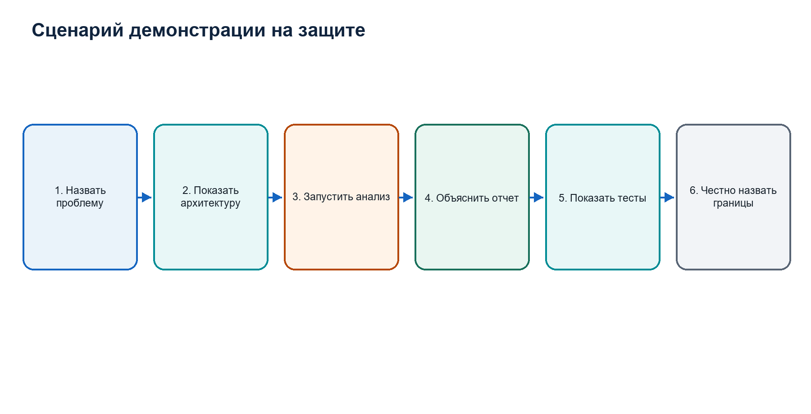
